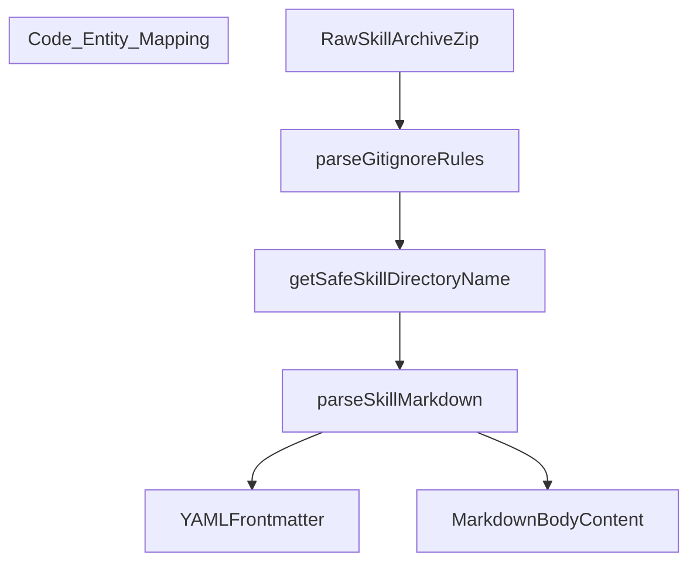
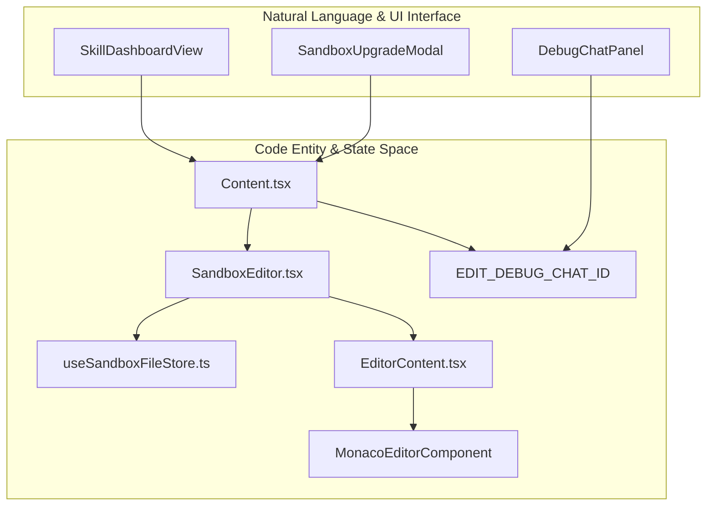

<!-- source: DeepWiki mcp.deepwiki.com · repo labring/FastGPT · page 13.1 Skill System · fetched 2026-10-29 -->

# Skill System

<details>
<summary>Relevant source files</summary>

The following files were used as context for generating this wiki page:

- [packages/global/common/error/code/skill.ts](packages/global/common/error/code/skill.ts)
- [packages/global/core/ai/skill/type.ts](packages/global/core/ai/skill/type.ts)
- [packages/global/core/app/version/type.ts](packages/global/core/app/version/type.ts)
- [packages/service/core/ai/skill/manage/folder.ts](packages/service/core/ai/skill/manage/folder.ts)
- [packages/service/core/ai/skill/manage/query.ts](packages/service/core/ai/skill/manage/query.ts)
- [packages/service/core/ai/skill/model/schema.ts](packages/service/core/ai/skill/model/schema.ts)
- [packages/service/core/ai/skill/utils.ts](packages/service/core/ai/skill/utils.ts)
- [packages/service/test/core/ai/skill/skillMdBuilder.test.ts](packages/service/test/core/ai/skill/skillMdBuilder.test.ts)
- [packages/web/components/common/MyPopover/PopoverConfirm.tsx](packages/web/components/common/MyPopover/PopoverConfirm.tsx)
- [packages/web/components/common/UserBox/index.tsx](packages/web/components/common/UserBox/index.tsx)
- [packages/web/components/common/VersionPublisherPopover/index.tsx](packages/web/components/common/VersionPublisherPopover/index.tsx)
- [packages/web/i18n/en/skill.json](packages/web/i18n/en/skill.json)
- [packages/web/i18n/zh-CN/skill.json](packages/web/i18n/zh-CN/skill.json)
- [packages/web/i18n/zh-Hant/skill.json](packages/web/i18n/zh-Hant/skill.json)
- [projects/app/src/components/common/folder/SelectOneResource.tsx](projects/app/src/components/common/folder/SelectOneResource.tsx)
- [projects/app/src/pageComponents/app/detail/PublishHistoriesSlider.tsx](projects/app/src/pageComponents/app/detail/PublishHistoriesSlider.tsx)
- [projects/app/src/pageComponents/dashboard/Container.tsx](projects/app/src/pageComponents/dashboard/Container.tsx)
- [projects/app/src/pageComponents/dashboard/ReferencedAppsPopover.tsx](projects/app/src/pageComponents/dashboard/ReferencedAppsPopover.tsx)
- [projects/app/src/pageComponents/dashboard/agent/List.tsx](projects/app/src/pageComponents/dashboard/agent/List.tsx)
- [projects/app/src/pageComponents/dashboard/agent/context.tsx](projects/app/src/pageComponents/dashboard/agent/context.tsx)
- [projects/app/src/pageComponents/dashboard/skill/CreateSkillModal.tsx](projects/app/src/pageComponents/dashboard/skill/CreateSkillModal.tsx)
- [projects/app/src/pageComponents/dashboard/skill/ImportSkillModal.tsx](projects/app/src/pageComponents/dashboard/skill/ImportSkillModal.tsx)
- [projects/app/src/pageComponents/dashboard/skill/List.tsx](projects/app/src/pageComponents/dashboard/skill/List.tsx)
- [projects/app/src/pageComponents/dataset/list/context.tsx](projects/app/src/pageComponents/dataset/list/context.tsx)
- [projects/app/src/pages/api/core/ai/skill/create.ts](projects/app/src/pages/api/core/ai/skill/create.ts)
- [projects/app/src/pages/api/core/ai/skill/detail.ts](projects/app/src/pages/api/core/ai/skill/detail.ts)
- [projects/app/src/pages/api/core/ai/skill/list.ts](projects/app/src/pages/api/core/ai/skill/list.ts)
- [projects/app/src/pages/api/core/ai/skill/update.ts](projects/app/src/pages/api/core/ai/skill/update.ts)
- [projects/app/src/pages/api/core/app/update.ts](projects/app/src/pages/api/core/app/update.ts)
- [projects/app/src/pages/api/core/dataset/update.ts](projects/app/src/pages/api/core/dataset/update.ts)
- [projects/app/test/api/core/ai/skill/list.test.ts](projects/app/test/api/core/ai/skill/list.test.ts)
- [projects/app/test/api/core/app/batch.test.ts](projects/app/test/api/core/app/batch.test.ts)

</details>


## 1. Purpose and Scope

The Skill System in FastGPT enables AI agents to dynamically create, manage, version, and execute modular capabilities known as "Skills". Each Skill encapsulates executable logic, metadata, and related files, centered around a canonical `SKILL.md` descriptor. Skills can be linked and invoked by Chat Agents, executed within isolated sandbox runtime environments.

This page covers the Skill data model structure, version management, packaging as zip archives for import-export, deployment within sandbox containers, the debugging chat interface, and related skill dashboards for administration.

Sources:  
- `packages/service/core/ai/skill/utils.ts:1-250`  
- `projects/app/src/pageComponents/dashboard/skill/detail/Content.tsx:1-141`  

---

## 2. Skill Data Model and Versioning

In FastGPT, Skills are persisted in MongoDB as documents in the `MongoAgentSkills` collection. Each Skill record contains:

- Basic metadata: unique `_id`, `name`, description (`intro`), `avatar`, a `parentId` for folder hierarchy.
- `type` indicating whether it is a `skill` or a `folder`.
- `source` denoting origin (e.g. personal or system).
- Versioning is realized by maintaining snapshot states of the skill's core files, especially `SKILL.md`.

The `SKILL.md` file is the primary skill descriptor using YAML frontmatter for structured metadata:

```yaml
---
name: "my-skill"
description: "Skill description text"
avatar: "/skill/avatar.png"
---
Skill markdown content here, including documentation, instructions and usage examples.
```

When creating a Skill (e.g., via the `CreateSkillModal.tsx` React component), an API call (`postCreateSkill`) initializes the database record, assigns a unique skill ID, and sets up initial sandbox sync data.

### Skills Database Schema Example

```
+-------------------------------------------------------+
|                   Skill Database Record               |
|  - _id: ObjectId                                      |
|  - parentId: ObjectId | null                          |
|  - name: string                                       |
|  - intro: string (description)                        |
|  - avatar: string                                     |
|  - type: "skill" | "folder"                          |
|  - source: enum                                       |
|  - createTime: Date                                  |
|  - updateTime: Date                                  |
|  - versions: [VersionSnapshots]                      |
+---------------------------+---------------------------+
                            |
                            v
+-------------------------------------------------------+
|                   SKILL.md Frontmatter                |
|  ---                                                  |
|  name: "my-skill"                                     |
|  description: "Skill description text"                 |
|  avatar: "/skill/avatar.png"                          |
|  ---                                                  |
+-------------------------------------------------------+
```

Sources:  
- `projects/app/src/pageComponents/dashboard/skill/CreateSkillModal.tsx:34-111`  
- `packages/service/core/ai/skill/utils.ts:16-48`  

---

## 3. SKILL.md Packaging, Zip Export and Import

Skills can be exported and imported as `.zip` archives containing the `SKILL.md` and related resource files. The packaging and unpacking process involves:

- Parsing the zip archive content.
- Extracting and validating the `SKILL.md` with frontmatter.
- Handling `.gitignore`-style ignore rules.
- Converting skill names to safe directory names for storage.

### Key Parsing and Builder Functions

| Function                      | Description                                                                                                       | Location                              |
|-------------------------------|-------------------------------------------------------------------------------------------------------------------|-------------------------------------|
| `parseSkillMarkdown(markdown)` | Extracts YAML frontmatter and markdown body from the `SKILL.md` file. Uses a lightweight YAML frontmatter parser. | `packages/service/core/ai/skill/utils.ts:16-96`       |
| `buildSkillMd(params)`          | Generates clean YAML frontmatter for skill metadata, escaping special characters and multi-line strings properly. | `packages/service/core/ai/skill/utils.ts:100-153`    |
| `getSafeSkillDirectoryName(name)` | Normalizes skill names into safe, container-friendly directory names (max 50 chars, allowed chars only).         | `packages/service/core/ai/skill/utils.ts:174-194`    |
| `parseGitignoreRules(contents)`    | Parses `.gitignore` syntax into explicit exclude lists and optimized `find` command prune rules for sandbox syncing. | `packages/service/core/ai/skill/utils.ts:205-235`    |

### Skill Import & Packaging Data Flow



This sequence ensures that imported skill archives are validated for proper metadata structure, safe naming, and filtered file inclusion/exclusion rules before deployment or editing.

Sources:  
- `packages/service/core/ai/skill/utils.ts:1-260`  
- `packages/service/test/core/ai/skill/skillMdBuilder.test.ts:1-191`  

---

## 4. Sandbox Deployment and Integration

Skills require sandboxed virtual machine environments to run securely isolated from the host system. FastGPT integrates cloud-based sandboxes for executing AI agent skills, dynamically syncing skill code and managing lifecycle.

### Sandbox State Management and Upgrade Flow

The dashboard UI and backend track the sandbox readiness state for skills:

- `sandboxState` can be `ready`, `upgrading`, `upgradeRequired`, `failed`.
- If an environment upgrade is detected (e.g. new runtime version for skills), users are prompted with modals to upgrade the sandbox.
- Auto-enablement of sandbox runtimes occurs when skills are assigned to agents.

The skill detail view (`Content.tsx`) actively monitors these sandbox states, fetching deployment status and rendering corresponding UI feedback.

### Auto Provisioning and Guarding

For teams or accounts without sandbox enabled, attempting to deploy or run skills triggers the system to activate sandbox features automatically or display upgrade/warning messages.

Sources:  
- `projects/app/src/pageComponents/dashboard/skill/detail/Content.tsx:1-141`  
- `packages/web/i18n/zh-CN/skill.json:44-76`  

---

## 5. Skill Dashboards and Debug Chat Architecture

The Skill Dashboard provides an integrated development environment (IDE) style interface combining:

- File tree navigation of skill files.
- Code editing with Monaco Editor.
- Markdown rendering with frontmatter metadata cards.
- Binary artifact previews (images/videos).
- A debug chat interface for live skill interaction and testing.

### Core Components Overview

| Component / File                             | Role                                                                                         | Location                                      |
|---------------------------------------------|----------------------------------------------------------------------------------------------|-----------------------------------------------|
| `Content.tsx`                               | Skill detail page, controls sandbox state UI, modals, error boundaries                       | `projects/app/src/pageComponents/dashboard/skill/detail/Content.tsx:1-141` |
| `SandboxEditor.tsx`                         | Main editor wrapper, handles container sizing and hooks into `useSandboxFileStore` which manages file state | `projects/app/src/pageComponents/chat/SandboxEditor/Editor.tsx:39-106` |
| `EditorContent.tsx`                         | Renders multiple editor types: Monaco code editor, markdown preview with metadata cards, binary viewers | `projects/app/src/pageComponents/chat/SandboxEditor/components/EditorContent.tsx:39-204` |
| `EDIT_DEBUG_CHAT_ID` (constant)             | Unique id representing the debug chat skill node used in workflow debugging                  | See usage references in detail content files   |

### Architecture Bridging UI and Code Entities



This diagram illustrates the relationship between user-facing skill dashboard elements (NaturalLanguageSpace) and the core React components and skill runtime state (CodeEntitySpace).

Sources:  
- `projects/app/src/pageComponents/dashboard/skill/detail/Content.tsx:1-141`  
- `projects/app/src/pageComponents/chat/SandboxEditor/Editor.tsx:39-106`  
- `projects/app/src/pageComponents/chat/SandboxEditor/components/EditorContent.tsx:39-204`  

---

# Summary

The Skill System in FastGPT is a comprehensive infrastructure for defining, versioning, packaging, deploying, and debugging AI agent skills within sandboxed runtimes. Skills revolve around a canonical `SKILL.md` descriptor file with YAML frontmatter metadata, can be exported/imported as safe zip archives, and are actively managed through dedicated dashboards and debug chat interfaces.

The system ensures safe, isolated execution of dynamic agent capabilities while providing rich user experiences for skill maintenance, development, and runtime inspection.

---

# References (Important Files)

- Skill data model & utils: `packages/service/core/ai/skill/utils.ts`  
- Skill dashboard detail view: `projects/app/src/pageComponents/dashboard/skill/detail/Content.tsx`  
- Sandbox editor & content:  
  - `projects/app/src/pageComponents/chat/SandboxEditor/Editor.tsx`  
  - `projects/app/src/pageComponents/chat/SandboxEditor/components/EditorContent.tsx`  
- Skill creation UI: `projects/app/src/pageComponents/dashboard/skill/CreateSkillModal.tsx`  
- Skill list UI: `projects/app/src/pageComponents/dashboard/skill/List.tsx`  

Sources:  
- `packages/service/core/ai/skill/utils.ts:1-260`  
- `projects/app/src/pageComponents/dashboard/skill/detail/Content.tsx:1-141`  
- `projects/app/src/pageComponents/chat/SandboxEditor/Editor.tsx:39-106`  
- `projects/app/src/pageComponents/chat/SandboxEditor/components/EditorContent.tsx:39-204`  
- `projects/app/src/pageComponents/dashboard/skill/CreateSkillModal.tsx:34-111`

---

