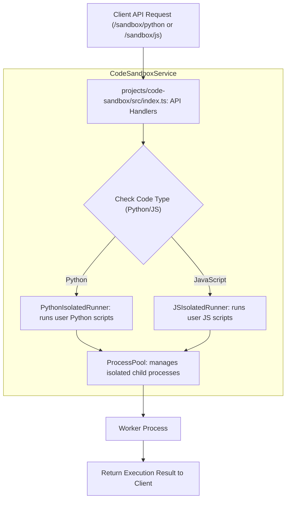
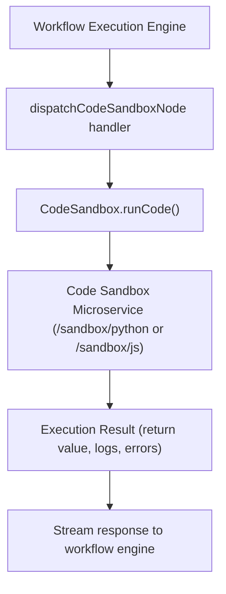
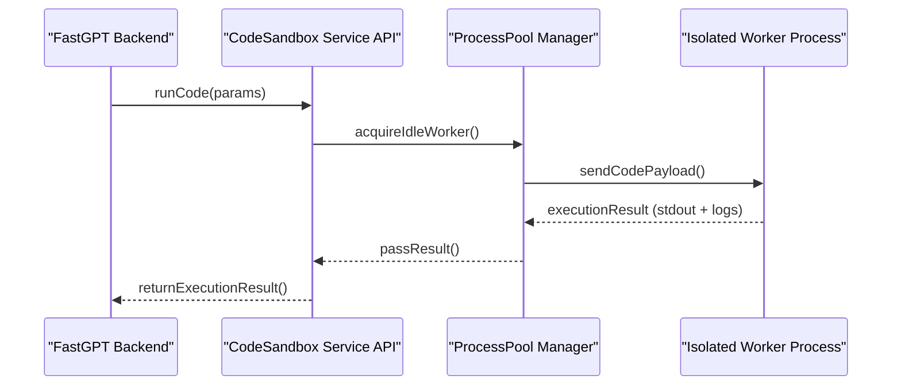

<!-- source: DeepWiki mcp.deepwiki.com · repo labring/FastGPT · page 13.2 Code Sandbox Service · fetched 2026-10-29 -->

# Code Sandbox Service

<details>
<summary>Relevant source files</summary>

The following files were used as context for generating this wiki page:

- [document/content/self-host/config/sandbox/opensandbox.en.mdx](document/content/self-host/config/sandbox/opensandbox.en.mdx)
- [document/content/self-host/config/sandbox/opensandbox.mdx](document/content/self-host/config/sandbox/opensandbox.mdx)
- [document/content/self-host/upgrading/4-14/4149.mdx](document/content/self-host/upgrading/4-14/4149.mdx)
- [document/content/self-host/upgrading/4-15/41501.mdx](document/content/self-host/upgrading/4-15/41501.mdx)
- [document/content/self-host/upgrading/4-15/41502.mdx](document/content/self-host/upgrading/4-15/41502.mdx)
- [document/content/self-host/upgrading/4-15/41505.en.mdx](document/content/self-host/upgrading/4-15/41505.en.mdx)
- [document/content/self-host/upgrading/4-15/41505.mdx](document/content/self-host/upgrading/4-15/41505.mdx)
- [document/content/self-host/upgrading/4-15/41506.mdx](document/content/self-host/upgrading/4-15/41506.mdx)
- [document/content/self-host/upgrading/4-15/meta.en.json](document/content/self-host/upgrading/4-15/meta.en.json)
- [document/content/self-host/upgrading/4-15/meta.json](document/content/self-host/upgrading/4-15/meta.json)
- [packages/global/openapi/support/user/team/api.ts](packages/global/openapi/support/user/team/api.ts)
- [packages/global/openapi/support/user/team/member/api.ts](packages/global/openapi/support/user/team/member/api.ts)
- [packages/global/support/user/account/cancellation/type.ts](packages/global/support/user/account/cancellation/type.ts)
- [packages/global/support/user/team/type.ts](packages/global/support/user/team/type.ts)
- [packages/global/support/user/type.ts](packages/global/support/user/type.ts)
- [packages/global/test/openapi/support/user/account/login/api.test.ts](packages/global/test/openapi/support/user/account/login/api.test.ts)
- [packages/global/test/openapi/support/user/api.test.ts](packages/global/test/openapi/support/user/api.test.ts)
- [packages/service/support/user/controller.ts](packages/service/support/user/controller.ts)
- [packages/web/components/common/MyTooltip/index.tsx](packages/web/components/common/MyTooltip/index.tsx)
- [projects/app/src/components/core/app/DatasetSelectModal.tsx](projects/app/src/components/core/app/DatasetSelectModal.tsx)
- [projects/app/src/components/core/dataset/RawSourceBox.tsx](projects/app/src/components/core/dataset/RawSourceBox.tsx)
- [projects/app/src/components/support/activity/ActivityAdModal.tsx](projects/app/src/components/support/activity/ActivityAdModal.tsx)
- [projects/app/src/pageComponents/account/TeamSelector.tsx](projects/app/src/pageComponents/account/TeamSelector.tsx)
- [projects/app/src/pages/account/team/index.tsx](projects/app/src/pages/account/team/index.tsx)
- [projects/app/src/pages/api/core/app/detail.ts](projects/app/src/pages/api/core/app/detail.ts)
- [projects/app/src/web/support/user/loginRedirect/index.ts](projects/app/src/web/support/user/loginRedirect/index.ts)
- [projects/app/test/api/core/app/detail.test.ts](projects/app/test/api/core/app/detail.test.ts)
- [projects/app/test/api/support/user/account/tokenLogin.test.ts](projects/app/test/api/support/user/account/tokenLogin.test.ts)
- [projects/app/test/web/support/user/loginRedirect.test.ts](projects/app/test/web/support/user/loginRedirect.test.ts)
- [projects/code-sandbox/package.json](projects/code-sandbox/package.json)
- [projects/code-sandbox/src/pool/base-process-pool.ts](projects/code-sandbox/src/pool/base-process-pool.ts)
- [projects/code-sandbox/test/unit/base-process-pool.test.ts](projects/code-sandbox/test/unit/base-process-pool.test.ts)

</details>


This page covers the architecture, implementation, API specifications, and workflow orchestration of FastGPT's Code Sandbox Service (`projects/code-sandbox`). The Code Sandbox Service provides isolated, secure runtime environments for executing user-defined Python and JavaScript code blocks within workflows, backed by a pre-warmed process pool and strict resource boundaries.

---

## 1. Service Architecture and Process Pool

The `projects/code-sandbox` application is an isolated microservice designed to accept code payloads, allocate dedicated worker processes or utilize pre-warmed pool instances, and execute Python or JavaScript scripts under constrained resource limits.

The sandbox runs distinct isolated runners for Python and JavaScript code, leveraging a process pool to manage worker lifecycle, improve responsiveness, and guarantee resource isolation.

### Core Execution Flow Diagram



- `CodeSandboxIndex` hosts HTTP API endpoints `/sandbox/python` and `/sandbox/js` implemented in `projects/code-sandbox/src/index.ts`.
- Requests specify `codeType` and code payload.
- The service uses a process pool (`BaseProcessPool` and specialized pools for Python/JS) to pre-spawn isolated worker processes for resource management.
- Worker processes communicate using stdin/stdout with a JSON line protocol.
- Execution results, including return values and logs, are sent back to the caller after execution completes or errors out.

Sources: [projects/code-sandbox/src/index.ts:15-33](), [projects/code-sandbox/src/pool/base-process-pool.ts:1-203]()

---

## 2. Environment Configuration and Security Limits

The sandbox service enforces strict boundaries on memory, execution time, network requests, and payload sizes. These parameters are configurable via environment variables.

| Environment Variable           | Default Value        | Description                                                  |
|-------------------------------|----------------------|--------------------------------------------------------------|
| `SANDBOX_API_MAX_BODY_MB`     | `8`                  | Max JSON request body size for `/sandbox` API (in MB).       |
| `SANDBOX_MAX_OUTPUT_MB`       | `10`                 | Max output JSON size (including return value + logs, MB).    |
| `CHECK_INTERNAL_IP`            | `true`               | Restricts sandbox network requests from internal/private IPs.|
| `SANDBOX_MAX_TIMEOUT`          | `60000` (ms)         | Execution timeout ceiling in milliseconds.                   |
| `SANDBOX_MAX_MEMORY_MB`        | `256` (MB)           | Memory usage limit per sandbox worker process (MB).          |
| `SANDBOX_POOL_SIZE`            | `20`                 | Number of pre-warmed worker processes per language.          |
| `SANDBOX_QUEUE_ID_CONCURRENCY` | `null`               | Optional concurrency limit grouping by `queueId`.            |

These environment variables are set in deployment configuration to tailor resource usage and security policies.

Sources: [document/content/self-host/upgrading/4-15/41503.mdx:19-34]()

---

## 3. FastGPT Service Client: `CodeSandbox`

The FastGPT backend service interacts with the sandbox service through the third-party provider client located at `packages/service/thirdProvider/codeSandbox/index.ts`. This client encapsulates API calls to the sandbox service and exposes methods used by workflow nodes.

### `CodeSandbox` Class Overview

```mermaid
classDiagram
  class CodeSandbox {
    -axiosInstance client
    +constructor()
    +getPackages() Promise~SandboxPackagesResponse~
    +runCode(params: RunCodeParams) Promise~RunCodeResponse~
  }

  class CodeSandboxModule {
    +codeSandbox: CodeSandbox
  }

  CodeSandboxModule --> CodeSandbox : "instantiates singleton"

  subgraph "Third Provider Client"
    CodeSandbox
  end
```

- The client initializes an Axios HTTP client with authorization headers.
- Method `getPackages()` calls the `/sandbox/modules` API to retrieve a white list of permitted Python modules and JavaScript runtime objects [packages/service/thirdProvider/codeSandbox/index.ts:52-55]().
- Method `runCode()` dispatches code execution requests to either `/sandbox/python` or `/sandbox/js` endpoints depending on `codeType`, passing code, input variables, timeout settings, etc. It returns execution results with return values, logs, errors, and runtime info [packages/service/thirdProvider/codeSandbox/index.ts:57-82]().

This client abstraction isolates the core backend from the sandbox runtime implementation details, allowing extension and runtime upgrades without impact on workflow logic.

Sources: [packages/service/thirdProvider/codeSandbox/index.ts:14-85]()

---

## 4. Workflow Integration and the `codeSandbox` Node

Within FastGPT workflows, user code execution is integrated as a node type called `codeSandbox`. This node leverages the third-party provider client described above to perform script execution.

### Workflow Node Dispatch Flow



- When a `codeSandbox` node is executed, `dispatchCodeSandboxNode` invokes the `CodeSandbox` client.
- The client sends the user code, input variables, and node context to the Code Sandbox microservice.
- The sandbox runs the code securely in an isolated process of the appropriate language.
- The execution results are returned to the workflow engine and integrated into the workflow runtime data for subsequent nodes.

This integration allows arbitrary user code snippets or complex scripts to be securely run inside FastGPT workflows with controlled resource limits and isolation.

Sources: [packages/service/thirdProvider/codeSandbox/index.ts:57-82](), [projects/code-sandbox/src/index.ts:15-33]()

---

## 5. Core Classes and Key Components

### 5.1 Base Process Pool (`BaseProcessPool`)

Located in `projects/code-sandbox/src/pool/base-process-pool.ts`, the `BaseProcessPool` class is the core abstraction managing a fixed-size pool of isolated child processes, responsible for:

- Pre-spawning worker processes based on configured pool size.
- Managing worker availability and task dispatching with a queue.
- Handling initialization messages and timeouts.
- Collecting stderr logs for diagnostics.
- Implementing periodic health checks.
- Optionally recycling processes based on task execution to maintain isolation.

Workers communicate with the pool manager using line-delimited JSON messages over stdin/stdout. Concrete language pools (e.g., JavaScript and Python pools) extend this class and provide language-specific spawn commands and initialization payloads.

Key aspects:
- Uses `child_process.spawn()` on Unix-like systems with detached process groups.
- Implements configurable spawn, initialization, and health check timeouts.
- Tracks worker busy state and idleness for load balancing.

Sources: [projects/code-sandbox/src/pool/base-process-pool.ts:1-203]()

---

## 6. Data Flow Summary



- The backend triggers a code execution via the `CodeSandbox` client abstraction.
- The sandbox service routes the request to the `ProcessPool` manager.
- The pool assigns an available worker process and sends the code to it.
- The worker executes code in isolated environment, returning outputs over stdout.
- The pool transmits the results back to the API handler.
- The service returns the results to the backend.

Sources: [projects/code-sandbox/src/index.ts:15-33](), [projects/code-sandbox/src/pool/base-process-pool.ts:1-203](), [packages/service/thirdProvider/codeSandbox/index.ts:14-85]()

---

# Summary

FastGPT's Code Sandbox Service provides a robust isolated execution environment for user-supplied Python and JavaScript code, grounded on a reusable pre-warmed process pool implementation. The service exposes HTTP APIs with strict security and resource constraints and integrates natively into FastGPT's workflow engine through a dedicated workflow node. This architecture delivers secure, scalable, and efficient code execution capabilities essential for the platform's AI agent composition and skill execution.

---

Sources:  
- projects/code-sandbox/src/index.ts:15-33  
- projects/code-sandbox/src/pool/base-process-pool.ts:1-203  
- packages/service/thirdProvider/codeSandbox/index.ts:14-85  
- document/content/self-host/upgrading/4-15/41503.mdx:19-34

---

