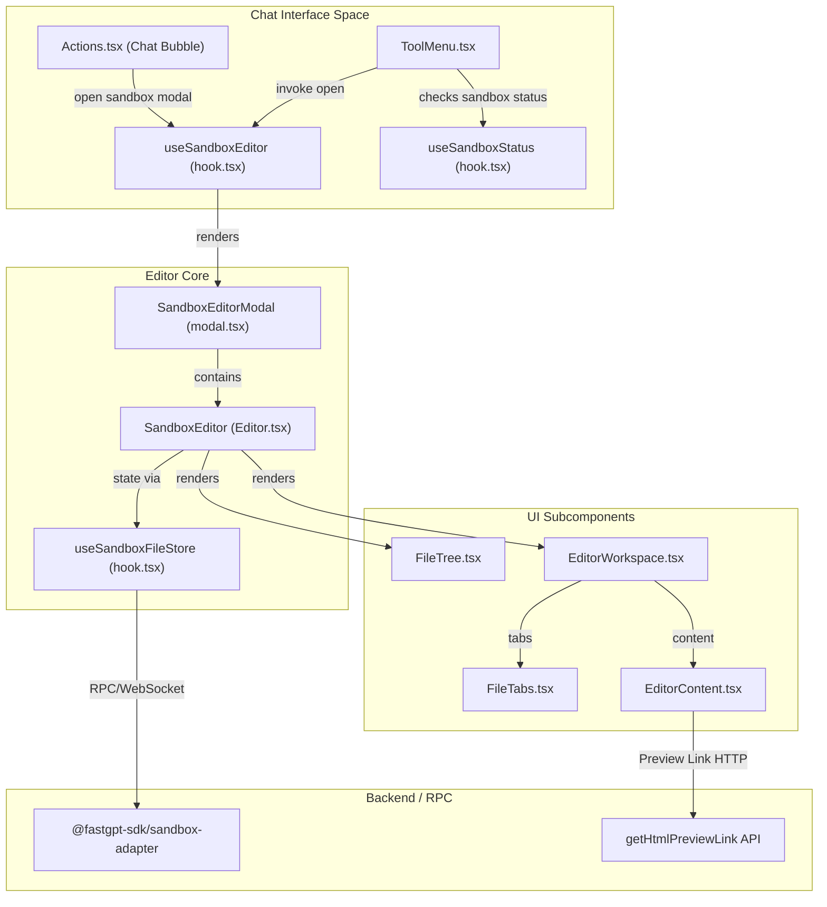
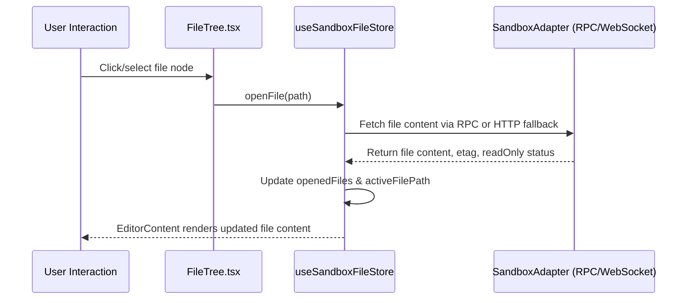
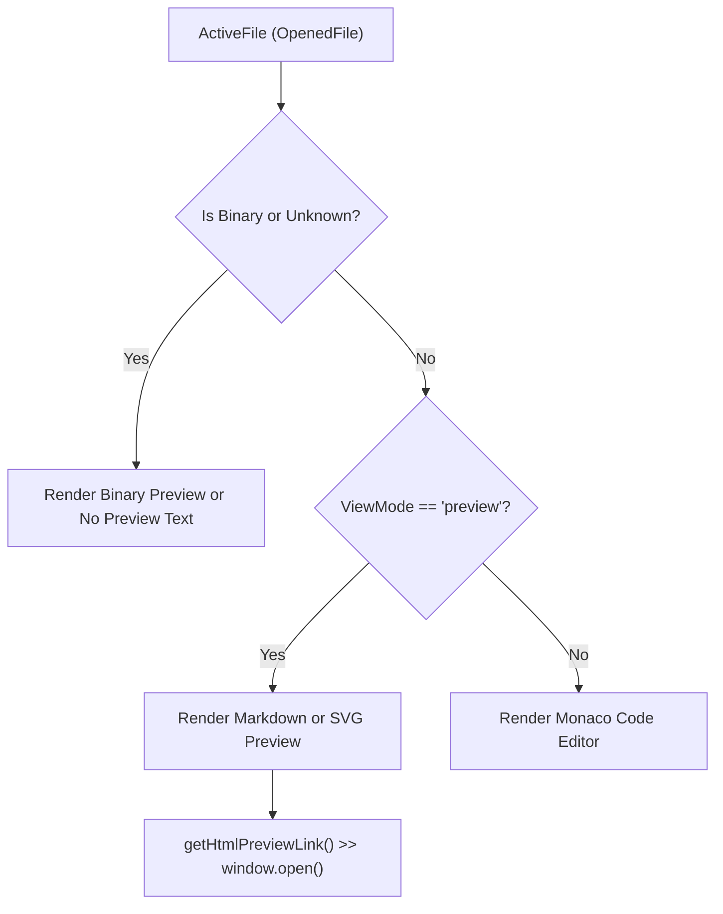

<!-- source: DeepWiki mcp.deepwiki.com · repo labring/FastGPT · page 13.4 In-Chat Sandbox Editor · fetched 2026-10-29 -->

# In-Chat Sandbox Editor

<details>
<summary>Relevant source files</summary>

The following files were used as context for generating this wiki page:

- [deploy/init.mjs](deploy/init.mjs)
- [packages/global/core/app/tool/constants.ts](packages/global/core/app/tool/constants.ts)
- [packages/global/core/app/tool/type.ts](packages/global/core/app/tool/type.ts)
- [packages/global/core/chat/type.ts](packages/global/core/chat/type.ts)
- [packages/global/core/plugin/tool/type.ts](packages/global/core/plugin/tool/type.ts)
- [packages/global/openapi/core/ai/skill/index.ts](packages/global/openapi/core/ai/skill/index.ts)
- [packages/global/openapi/core/chat/history/api.ts](packages/global/openapi/core/chat/history/api.ts)
- [packages/service/core/ai/sandbox/infrastructure/provider/config.ts](packages/service/core/ai/sandbox/infrastructure/provider/config.ts)
- [packages/service/core/ai/sandbox/infrastructure/provider/runtimeProfile/utils.ts](packages/service/core/ai/sandbox/infrastructure/provider/runtimeProfile/utils.ts)
- [projects/app/public/imgs/skill/runtimeUpgradeModalBg.jpg](projects/app/public/imgs/skill/runtimeUpgradeModalBg.jpg)
- [projects/app/src/components/common/PromptEditor/OptimizerPopover/index.tsx](projects/app/src/components/common/PromptEditor/OptimizerPopover/index.tsx)
- [projects/app/src/components/core/app/DatasetParamsModal.tsx](projects/app/src/components/core/app/DatasetParamsModal.tsx)
- [projects/app/src/pageComponents/app/detail/Edit/ChatAgent/ChatTest.tsx](projects/app/src/pageComponents/app/detail/Edit/ChatAgent/ChatTest.tsx)
- [projects/app/src/pageComponents/app/detail/Edit/SimpleApp/ChatTest.tsx](projects/app/src/pageComponents/app/detail/Edit/SimpleApp/ChatTest.tsx)
- [projects/app/src/pageComponents/app/detail/Logs/DetailLogsModal.tsx](projects/app/src/pageComponents/app/detail/Logs/DetailLogsModal.tsx)
- [projects/app/src/pageComponents/app/detail/WorkflowComponents/Flow/nodes/NodeCode/Copilot.tsx](projects/app/src/pageComponents/app/detail/WorkflowComponents/Flow/nodes/NodeCode/Copilot.tsx)
- [projects/app/src/pageComponents/app/detail/components/SandboxConfigButton.tsx](projects/app/src/pageComponents/app/detail/components/SandboxConfigButton.tsx)
- [projects/app/src/pageComponents/chat/SandboxEditor/Editor.tsx](projects/app/src/pageComponents/chat/SandboxEditor/Editor.tsx)
- [projects/app/src/pageComponents/chat/SandboxEditor/components/EditorContent.tsx](projects/app/src/pageComponents/chat/SandboxEditor/components/EditorContent.tsx)
- [projects/app/src/pageComponents/chat/SandboxEditor/components/FileTabs.tsx](projects/app/src/pageComponents/chat/SandboxEditor/components/FileTabs.tsx)
- [projects/app/src/pageComponents/chat/SandboxEditor/hook.tsx](projects/app/src/pageComponents/chat/SandboxEditor/hook.tsx)
- [projects/app/src/pageComponents/chat/SandboxEditor/modal.tsx](projects/app/src/pageComponents/chat/SandboxEditor/modal.tsx)
- [projects/app/src/pageComponents/chat/SandboxEditor/utils.tsx](projects/app/src/pageComponents/chat/SandboxEditor/utils.tsx)
- [projects/app/src/pageComponents/chat/ToolMenu.tsx](projects/app/src/pageComponents/chat/ToolMenu.tsx)
- [projects/app/src/pageComponents/dashboard/skill/detail/Content.tsx](projects/app/src/pageComponents/dashboard/skill/detail/Content.tsx)
- [projects/app/src/pageComponents/dashboard/skill/detail/context.tsx](projects/app/src/pageComponents/dashboard/skill/detail/context.tsx)
- [projects/app/src/pageComponents/dashboard/skill/detail/preview/SkillPreview.tsx](projects/app/src/pageComponents/dashboard/skill/detail/preview/SkillPreview.tsx)
- [projects/app/src/pageComponents/dashboard/skill/detail/useSkillDebugChatStore.ts](projects/app/src/pageComponents/dashboard/skill/detail/useSkillDebugChatStore.ts)
- [projects/app/src/pages/api/core/ai/sandbox/checkExist.ts](projects/app/src/pages/api/core/ai/sandbox/checkExist.ts)
- [projects/app/src/pages/api/core/ai/sandbox/download.ts](projects/app/src/pages/api/core/ai/sandbox/download.ts)
- [projects/app/src/pages/api/core/ai/sandbox/getHtmlPreviewLink.ts](projects/app/src/pages/api/core/ai/sandbox/getHtmlPreviewLink.ts)
- [projects/app/src/pages/skill/detail.tsx](projects/app/src/pages/skill/detail.tsx)
- [projects/app/src/web/core/skill/api.ts](projects/app/src/web/core/skill/api.ts)
- [projects/app/test/components/core/app/DatasetParamsModal.test.ts](projects/app/test/components/core/app/DatasetParamsModal.test.ts)
- [projects/app/test/web/core/skill/useSkillDebugChatStore.test.ts](projects/app/test/web/core/skill/useSkillDebugChatStore.test.ts)

</details>


The In-Chat Sandbox Editor provides a powerful, web-integrated development environment embedded within FastGPT’s chat interface and skill dashboards. It facilitates real-time inspection, editing, uploading, downloading, and previewing of files inside isolated sandbox runtimes dedicated to code or agent execution contexts. This enables developers and users alike to operate directly on code and assets without leaving the chat UI or skill management pages [projects/app/src/pageComponents/chat/SandboxEditor/Editor.tsx:39-56](), [projects/app/src/pageComponents/dashboard/skill/detail/Content.tsx:41-70]().

---

## 1. Component Hierarchy and Architectural Overview

The Sandbox Editor subsystem centers around two React hooks and a main container component, which collaborate to provide state management, UI rendering, and integration with backend sandbox runtimes and APIs:

- `useSandboxEditor`: A UI hook responsible for controlling the modal popup lifecycle displaying the sandbox editor interface.
- `useSandboxStatus`: A status synchronization hook that tracks sandbox existence and availability, querying backend status and managing UI icon visibility.
- `SandboxEditor` component: The main editor container composed of file tree, tab view, and file content panes.

### Architectural Diagram: Natural Language to Code Entity Mapping



Sources: `projects/app/src/pageComponents/chat/SandboxEditor/hook.tsx:124-185,196-228`, `projects/app/src/pageComponents/chat/SandboxEditor/Editor.tsx:39-106`, `projects/app/src/pageComponents/chat/ToolMenu.tsx:60-72`, `projects/app/src/components/core/chat/ChatContainer/ChatBox/components/AIChatBubble/Actions.tsx:63-74`.

---

## 2. File Tree, Tabs, and State Management (`useSandboxFileStore`)

The editor’s workspace and file system state are managed via the custom hook `useSandboxFileStore` (within `hook.tsx`). This hook abstracts API integration, WebSocket communication, and local state mutation for file trees, open tabs, and editing buffers.

### Key State Variables

- **fileTree**: A tree-structured array representing directories and files loaded from the sandbox. Each node includes metadata such as `name`, `is_dir`, and optionally `size` and timestamps.
- **openedFiles**: The list of currently open file tabs, each storing path, content, language info, etag for versioning, loading and read-only states.
- **activeFilePath**: String path of the currently focused/active file tab.
- **selectedPath**: Currently selected node path in the file tree (used for context commands).
- **expandedDirs**: Set of expanded folders in the file tree UI for navigation.

### Workspace Operation Flow



### File System Utilities

Utilities used inside the hook include path normalization, node addition/deletion, rename operations, and recursive tree updates (e.g., `addTreeNode`, `deleteTreeNode`, `moveTreeNodeInTree`, `renameTreeNodeInTree`, `findNodeByPath`, `sortTreeNodes`) to support file operations seamlessly within the tree [projects/app/src/pageComponents/chat/SandboxEditor/hook.tsx:28-45](). 

Sources: `projects/app/src/pageComponents/chat/SandboxEditor/hook.tsx:59-220`, `projects/app/src/pageComponents/chat/SandboxEditor/Editor.tsx:68-106`.

---

## 3. Editor Content and Preview Systems (`EditorContent.tsx`)

The `EditorContent` component dynamically determines how to render the currently active file based on file type, encoding, and user-selected view mode (source vs. preview).

### Render Modes and Logic

- **Binary support**: For image, audio, video blobs, specialized components like `MyPhotoView`, HTML5 `<audio>`, `<video>` tags are used. Unsupported binaries or unrecognized encodings show an informational message [EditorContent.tsx:103-141].
- **Markdown preview**: If the file is Markdown and preview mode is enabled, a frontmatter parser extracts metadata; `Markdown` components render the content with metadata cards [EditorContent.tsx:144-163].
- **SVG preview**: Raw SVG text content is URI-encoded and rendered as an image preview [EditorContent.tsx:164-172].
- **HTML preview links**: The `getHtmlPreviewLink` API generates a secure temporary URL for sandbox-hosted preview apps, opened in new tabs [EditorContent.tsx:65-86].
- **Source mode**: For code or text files, the `@monaco-editor/react` integration provides IDE-like editing with syntax highlighting, theming, read-only modes, and advanced editor options [EditorContent.tsx:175-204].

### Editor Content Routing Diagram



Sources: `projects/app/src/pageComponents/chat/SandboxEditor/components/EditorContent.tsx:39-204`.

---

## 4. Sandbox Status Synchronization and Integration APIs

The editor’s underlying sandbox availability and file command APIs rely on network calls to the backend using REST and optionally WebSocket/RPC. Several key utilities support this:

- `checkSandboxExist`: Validates if a sandbox container/session is active for a given `appId` and `chatTarget` to enable editor features [hook.tsx:7].
- `downloadSandbox`: API to export entire sandbox contents as archive files for local backup or offline inspection [hook.tsx:8].
- `uploadSandboxFile`: Uploads files or patches into the sandbox runtime to update or add new files [hook.tsx:11-12].
- `getSandboxTicket`, `getSandboxProxyWsUrl`: Fetch authentication tokens and WebSocket URLs to establish secure RPC connections or terminal sessions within the sandbox [hook.tsx:9-10].

These APIs underpin the seamless user experience of file manipulation and sandbox inspection embedded directly into FastGPT’s chat and skill management UI.

Sources: `projects/app/src/pageComponents/chat/SandboxEditor/hook.tsx:1-13`.

---

## 5. Preview Link Generation for Sandbox Files

The component `EditorContent` supports launching HTML preview windows of sandbox-hosted applications:

- `getHtmlPreviewLink` API dynamically generates a secure, time-limited URL proxying the sandbox resource.
- This supports review and testing of live UI applications running inside the sandbox container.
- The link opens a new browser tab/window to isolate preview runtime.

Sources: `projects/app/src/pageComponents/chat/SandboxEditor/components/EditorContent.tsx:65-86`.

---

## 6. Example Usage in Chat and Skill Interfaces

The sandbox editor is integrated in both chat UI and skill detail pages:

- Chat ToolMenu shows a sandbox status icon and open button, triggering the editor modal [projects/app/src/pageComponents/chat/ToolMenu.tsx:60-72].
- Skill detail page embeds `SandboxEditor` directly for code editing/debugging with readiness and upgrade UI handling [projects/app/src/pageComponents/dashboard/skill/detail/Content.tsx:41-70].

This consistent integration enables developers to iterate quickly on AI skills or agents without switching environments.

---

# Summary

The In-Chat Sandbox Editor in FastGPT delivers an inline integrated development environment specializing in sandbox runtimes for AI skills and chat agents. It combines a rich React-based UI with robust state management hooks, websocket and HTTP APIs, and preview capabilities. Through its modular architecture — including the modal wrapper, status synchronization, file tree and tabbed editor workspace, content preview system, and backend RPC integration — it empowers users to flexibly inspect and modify sandbox code and assets directly from FastGPT’s chat and skill management pages.

---

# Appendix: Relevant Key Code Entities and Files

| Role                         | File / Component                        | Description                                    |
|------------------------------|---------------------------------------|------------------------------------------------|
| UI Modal and Hook             | `hook.tsx` (useSandboxEditor)          | Controls Editor modal open/close state         |
| Sandbox Status Hook           | `hook.tsx` (useSandboxStatus)          | Sync sandbox existence status                   |
| Main Editor Container         | `Editor.tsx` (SandboxEditor)            | Composes file tree and editor workspace UI     |
| File Tree Listing             | `FileTree.tsx`                         | Displays file system tree and supports ops     |
| Workspace Tabs & Editor       | `EditorWorkspace.tsx`                   | Tabs + content through `FileTabs` and `EditorContent` |
| File Content Renderer         | `EditorContent.tsx`                    | Routes source, markdown, binary preview modes  |
| Backend RPC and API Utils     | `hook.tsx` (api import and usage)      | checkSandboxExist, downloadSandbox, uploadSandboxFile |

Sources: various above.

---

# Mermaid Diagram: Quick Reference Map from Features to Code Entities

```mermaid
graph LR
    "UI Hook"["useSandboxEditor (hook.tsx)"] --> "SandboxEditorModal (modal.tsx)" --> "SandboxEditor (Editor.tsx)"
    "SandboxEditor" --> "FileTree (FileTree.tsx)"
    "SandboxEditor" --> "EditorWorkspace (EditorWorkspace.tsx)" --> "FileTabs (FileTabs.tsx)"
    "EditorWorkspace" --> "EditorContent (EditorContent.tsx)"
    "Backend APIs" --> "checkSandboxExist, downloadSandbox, uploadSandboxFile (hook.tsx)"
    "EditorContent" --> "getHtmlPreviewLink (API)"
    "Chat UI" --> "ToolMenu.tsx" --> "useSandboxStatus & useSandboxEditor (hook.tsx)"
    "Skill Detail" --> "Content.tsx" --> "SandboxEditor (Editor.tsx)"

    classDef codeEntity fill:#fff,stroke:#333,stroke-width:1px;
    class "UI Hook","SandboxEditorModal","SandboxEditor","FileTree","EditorWorkspace","FileTabs","EditorContent","Backend APIs" codeEntity;
```

Sources: All above referenced source files.

# End of 13.4 In-Chat Sandbox Editor Page

---

