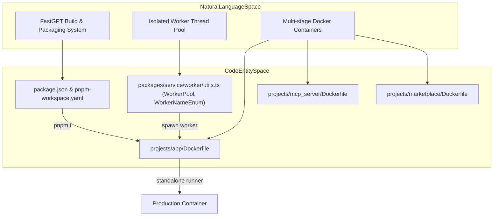
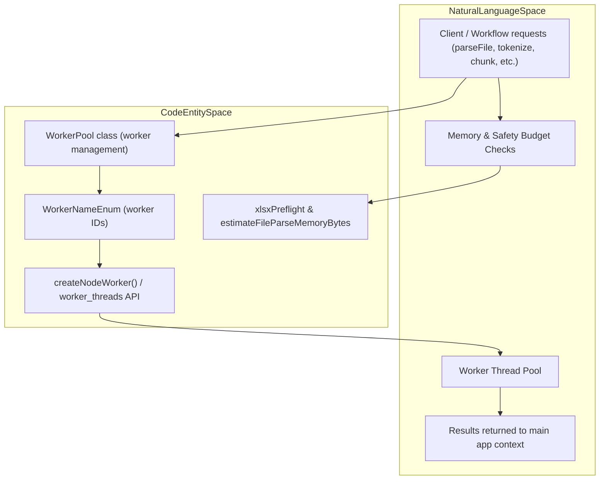
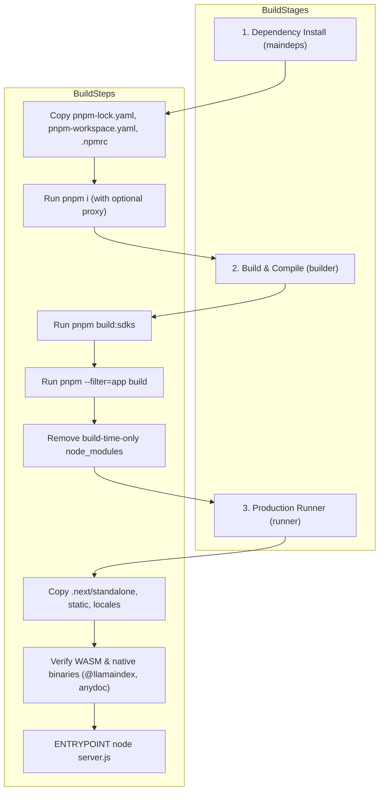
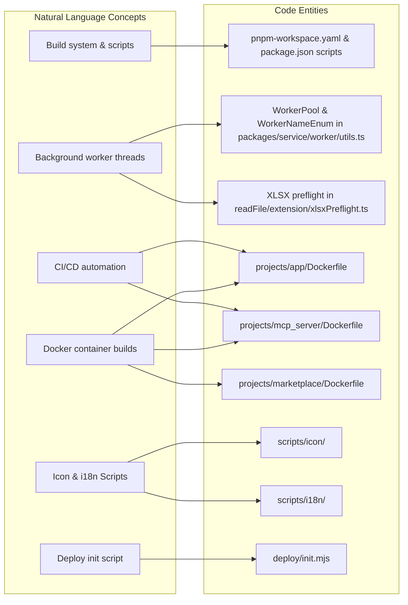

<!-- source: DeepWiki mcp.deepwiki.com · repo labring/FastGPT · page 14.1 Build System and Scripts · fetched 2026-10-29 -->

# Build System and Scripts

Relevant source files

The following files were used as context for generating this wiki page:

- [.dockerignore](.dockerignore)
- [document/package.json](document/package.json)
- [package.json](package.json)
- [packages/global/package.json](packages/global/package.json)
- [packages/service/common/metrics/runtime.ts](packages/service/common/metrics/runtime.ts)
- [packages/service/common/secret/aes256gcm.ts](packages/service/common/secret/aes256gcm.ts)
- [packages/service/common/system/resource.ts](packages/service/common/system/resource.ts)
- [packages/service/package.json](packages/service/package.json)
- [packages/service/test/common/secret/aes256gcm.test.ts](packages/service/test/common/secret/aes256gcm.test.ts)
- [packages/service/test/common/system/resource.test.ts](packages/service/test/common/system/resource.test.ts)
- [packages/web/package.json](packages/web/package.json)
- [pnpm-lock.yaml](pnpm-lock.yaml)
- [pnpm-workspace.yaml](pnpm-workspace.yaml)
- [projects/app/Dockerfile](projects/app/Dockerfile)
- [projects/app/package.json](projects/app/package.json)
- [projects/marketplace/Dockerfile](projects/marketplace/Dockerfile)
- [projects/marketplace/package.json](projects/marketplace/package.json)
- [projects/mcp_server/Dockerfile](projects/mcp_server/Dockerfile)
- [projects/mcp_server/package.json](projects/mcp_server/package.json)
- [scripts/icon/package.json](scripts/icon/package.json)

This page details the build system, package management, worker compilation pipelines, containerization scripts, and CI/CD automation used across the FastGPT monorepo. It governs how TypeScript packages, Next.js applications, micro-services, and isolated worker threads are built, verified, and packaged into production environments.

## Overview of Build Architecture

FastGPT uses a pnpm workspace-driven monorepo defined by `pnpm-workspace.yaml` combined with Turbo pipelines for task orchestration. The codebase is mostly TypeScript (`*.ts`, `*.tsx`) separated across foundational packages (`packages/*`), SDK utilities (`sdk/*`), and deployment projects (`projects/*`).

**Sources:** [pnpm-workspace.yaml:1-58](), [packages/service/worker/utils.ts:19-50](), [projects/app/Dockerfile:1-105](), [projects/mcp_server/Dockerfile:1-70]()

---

## Package Manager Configuration and Workspace Protocol

### pnpm Workspace and Turbo Pipeline

- The repository uses **pnpm** version `10.33.2` for high-performance node_modules management through symlinks and workspace protocols like `workspace:*`.
- The root and project Docker builds globally install `pnpm` at this locked version to ensure consistency.
- Turbo (`turbo@2.10.8`) coordinates scripts and caching to accelerate builds and test runs across packages [package.json:5-31](), [projects/app/Dockerfile:8](), [projects/mcp_server/Dockerfile:7](), [pnpm-lock.yaml:240-242](), [pnpm-workspace.yaml:1-60]().

### Structure of Workspace

| Directory        | Contents Description                                         | Typical Packages/Projects                           |
|------------------|--------------------------------------------------------------|---------------------------------------------------|
| `packages/*`     | Core libraries under the FastGPT ecosystem                    | `@fastgpt/global` (types, OpenAPI schemas), `@fastgpt/service` (backend logic and workers), `@fastgpt/web` (UI components) |
| `sdk/*`          | Specialized SDK utilities used by services and clients       | `@fastgpt-sdk/otel` (tracing), `@fastgpt-sdk/storage` (S3 abstraction), `@fastgpt-sdk/sandbox-adapter` (sandbox communication) |
| `projects/*`     | Standalone runnable applications and servers                  | `app` (Next.js frontend/backend), `marketplace`, `mcp_server` (MCP endpoint), `code-sandbox`, `volume-manager` |

This workspace setup allows cross-package development using workspace links, enabling rapid iteration and trustless builds.

**Sources:** [projects/app/Dockerfile:2-28](), [projects/mcp_server/Dockerfile:2-30](), [pnpm-workspace.yaml:1-60]()

---

## Build Scripts, Code Quality, and Maintenance Tools

### Root and Per-Package Scripts

- Root `package.json` defines high-level scripts to run Turbo pipelines for linting, testing, icon initialization, i18n resource generation, and SDK builds (e.g. `pnpm run lint` runs `turbo run lint`) [package.json:5-31]().

- `projects/app/package.json` scripts include:
  - `dev` and `build` that first build background workers then start Next.js dev/build: `pnpm run build:workers && next dev` or `next build`
  - Worker build handled by `tsx scripts/build-workers.ts`
  - Testing via Vitest with custom configs
  - Linting and type-checking commands [projects/app/package.json:12-26]()

### Dependency Locking and Catalog Mode

- The `pnpm-lock.yaml` uses `catalogMode: prefer` to select consistent versions across the monorepo.
- Central catalog definitions are mostly pinned to a stable version to ensure reproducible builds
- Development dependencies for linters, formatters, and test frameworks are centrally managed.

**Sources:** [package.json:5-31](), [projects/app/package.json:12-26](), [pnpm-lock.yaml:1-160]()

---

## Worker Compilation and Thread Pool Architecture

Heavy or CPU-intensive operations are delegated to Node.js `worker_threads` running background worker scripts. The module for this is in [`packages/service/worker/utils.ts`] which defines:

### Key Entities:

- **WorkerNameEnum**: Enum listing all worker types such as:
  - `readFile`
  - `htmlStr2Md`
  - `countGptMessagesTokens`
  - `systemPluginRun`
  - `text2Chunks`
  
- **WorkerPool class**: 
  - Maintains a pool of Node worker threads for task execution.
  - Queues tasks if all workers are busy.
  - Has a `maxTasksPerWorker` threshold to recycle workers periodically to mitigate memory bloat or leaks.
  - Supports a `taskTimeoutMs` to abort stubborn tasks.
  
- Preflight checks for security & memory usage are done before loading files, for example for XLSX spreadsheets with `xlsxPreflight.ts`.

### Worker Thread Data Flow

**Sources:** [packages/service/worker/utils.ts:19-216](), [packages/service/worker/readFile/extension/xlsxPreflight.ts:16-30](), [packages/service/worker/readFile/extension/xlsx.ts:23-44]()

---

## Docker Build Pipelines and Multi-Stage Containerization

FastGPT uses optimized multi-stage Dockerfiles for separated dependency installation, build compilation, and lean runtime environments.

### Main Application Dockerfile (`projects/app/Dockerfile`)

#### Stages:

1. **maindeps**
    - Base Node image: `node:24-bookworm-slim`
    - Copies lockfiles and workspace manifests
    - Runs `pnpm install` (with optional mirror proxy)
2. **builder**
    - Copies code and dependencies from `maindeps`
    - Installs global `pnpm`
    - Builds SDK sub-packages (`pnpm build:sdks`)
    - Builds the Next.js app (`pnpm --filter=app build`)
    - Cleans standalone build to remove build-time-only modules like TypeScript and rspack bindings
3. **runner**
    - Runs a slim Node base image, creates a non-root user (`nextjs`)
    - Copies built app files, public static assets, locales, and worker scripts
    - Verifies runtime native dependencies like `@llamaindex/liteparse-wasm` and `@fastgpt-sdk/anydoc`
    - Exposes port 3000 and runs the Next.js standalone server entry: `node ./projects/app/server.js`

#### Diagram:

### MCP Server Dockerfile (`projects/mcp_server/Dockerfile`)

- Similar multi-stage setup based on `node:24.16.0-alpine`
- Uses `bun` in build stage for faster builds
- Builds only the MCP server package and related SDKs
- Runtime stage installs runtime dependencies and sets `NODE_ENV=production`
- Entry point runs compiled MCP server (`dist/index.js`)

### Marketplace Dockerfile (`projects/marketplace/Dockerfile`)

- Uses multi-stage Node build on `node:24-bookworm-slim`
- Installs dependencies, builds the app with Next.js, and copies statics and locale files to the runner image
- Runs `next start` as entrypoint on port 4000

**Sources:** [projects/app/Dockerfile:1-105](), [projects/mcp_server/Dockerfile:1-70](), [projects/marketplace/Dockerfile:1-91]()

---

## Icon and Internationalization Scripts

- The root repo contains node scripts for icon management under the `scripts/icon/` directory.
  - `initIcon`: Generates icon constants and typings followed by prettier formatting [package.json:11-12]()
  - `previewIcon`: Runs icon preview generation

- Internationalization helper scripts generate translation loaders and validate i18n resource loaders [package.json:14-15, 28-29]().

---

## CI/CD Automation and Deploy Initialization

- GitHub Actions workflows automate build, test, and container image production.
- Preview environments are prepared by building images with source commit tags and published to container registries.
- Deploy initialization is scripted via `deploy/init.mjs` that is invoked by the root `gen:deploy` script [package.json:9-10]().
  
---

# Summary Table: Key Build and Script Concepts

| Concept                 | Location / Script                      | Purpose / Description                                                                                  |
|-------------------------|--------------------------------------|------------------------------------------------------------------------------------------------------|
| pnpm workspace          | `pnpm-workspace.yaml`                 | Monorepo package layout and dependency mapping                                                       |
| Turbo                   | `package.json` scripts, Turbofile    | CI script orchestration and caching for builds/test/lint                                             |
| WorkerPool & WorkerNameEnum | `packages/service/worker/utils.ts`    | Background worker thread management for CPU-intensive tasks (file parsing, chunking, token counting)  |
| XLSX Preflight Memory Checks | `packages/service/worker/readFile/extension/xlsxPreflight.ts` | Security and resource safety checks before parsing XLSX files                                         |
| Docker Multi-Stage Build | `projects/app/Dockerfile`, `projects/mcp_server/Dockerfile` | Dependency install, build, runtime separation to produce small final images                            |
| Icon/i18n scripts       | `scripts/icon/`, root package.json    | Icon definition generation, i18n resource loader generation and validation                             |
| CI/CD Automation        | `.github/workflows/`                  | Automated builds, tests, and preview environment deployments                                         |
| Deploy init script      | `deploy/init.mjs`                     | Script preparing deploy-time configurations, keys, and environment                                  |

---

# Detailed Diagram: Linking Natural Language Concepts to Entities

---

# Summary

The FastGPT build ecosystem integrates modern monorepo tooling with pnpm and Turbo to efficiently manage large scale dependencies and scripts. It delegates complex logic to worker threads managed by `WorkerPool`. Docker multi-stage builds generate reproducible, slim Linux containers for each application and service. Supporting scripts automate icon generation, i18n resource management, and deployment configuration.

This enables streamlined local development, robust production builds, and continuous deployment pipelines across the FastGPT AI Agent platform.

---

**Sources:**  
- [pnpm-workspace.yaml:1-58]()  
- [package.json:5-31]()  
- [projects/app/package.json:12-26]()  
- [packages/service/worker/utils.ts:19-216]()  
- [packages/service/worker/readFile/extension/xlsxPreflight.ts:16-30]()  
- [packages/service/worker/readFile/extension/xlsx.ts:23-44]()  
- [projects/app/Dockerfile:1-105]()  
- [projects/mcp_server/Dockerfile:1-70]()  
- [projects/marketplace/Dockerfile:1-91]()  
- [package.json:11-15, 28-29]()  
- [deploy/init.mjs]()

---

