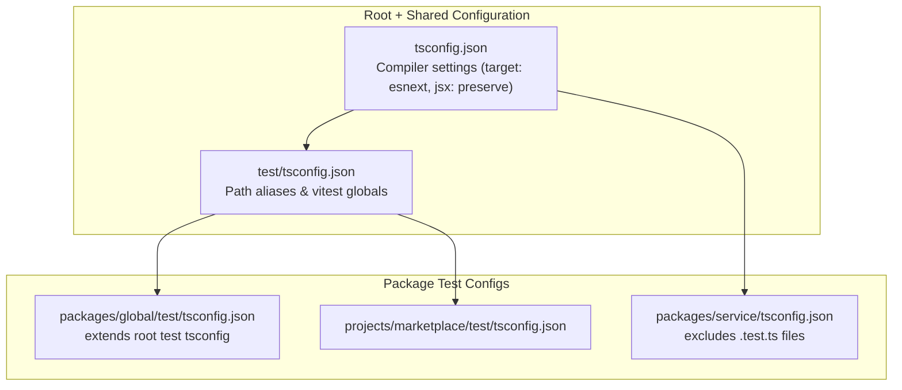
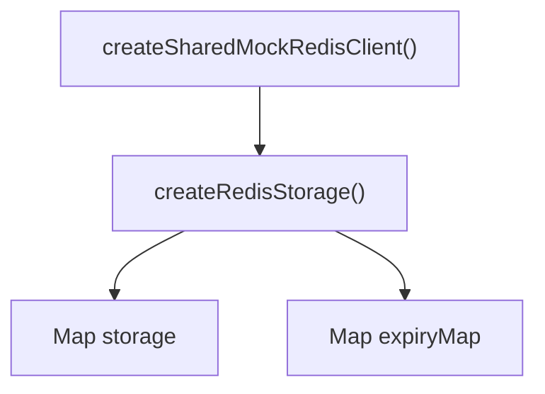
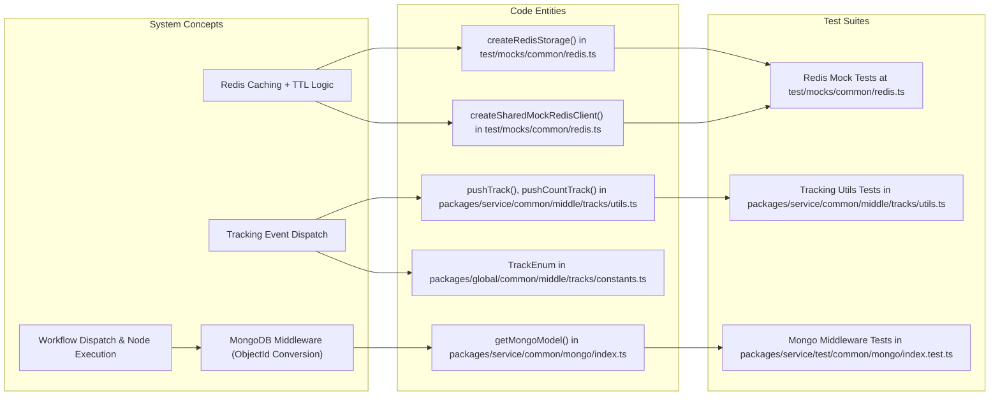

<!-- source: DeepWiki mcp.deepwiki.com · repo labring/FastGPT · page 14.2 Testing Framework · fetched 2026-10-29 -->

# Testing Framework

Relevant source files

The following files were used as context for generating this wiki page:

- [packages/global/test/tsconfig.json](packages/global/test/tsconfig.json)
- [packages/global/tsconfig.json](packages/global/tsconfig.json)
- [packages/service/common/mongo/index.ts](packages/service/common/mongo/index.ts)
- [packages/service/common/mongo/init.ts](packages/service/common/mongo/init.ts)
- [packages/service/common/string/jieba/index.ts](packages/service/common/string/jieba/index.ts)
- [packages/service/core/dataset/data/dataTextSchema.ts](packages/service/core/dataset/data/dataTextSchema.ts)
- [packages/service/test/common/mongo/index.test.ts](packages/service/test/common/mongo/index.test.ts)
- [packages/service/test/tsconfig.json](packages/service/test/tsconfig.json)
- [packages/service/tsconfig.json](packages/service/tsconfig.json)
- [packages/web/components/common/Icon/index.tsx](packages/web/components/common/Icon/index.tsx)
- [packages/web/components/common/Icon/svgScope.ts](packages/web/components/common/Icon/svgScope.ts)
- [packages/web/tsconfig.json](packages/web/tsconfig.json)
- [projects/app/test/components/common/Icon/svgScope.test.ts](projects/app/test/components/common/Icon/svgScope.test.ts)
- [projects/app/test/tsconfig.json](projects/app/test/tsconfig.json)
- [projects/app/tsconfig.json](projects/app/tsconfig.json)
- [projects/marketplace/test/tsconfig.json](projects/marketplace/test/tsconfig.json)
- [projects/marketplace/tsconfig.json](projects/marketplace/tsconfig.json)
- [projects/mcp_server/tsconfig.json](projects/mcp_server/tsconfig.json)
- [test/tsconfig.json](test/tsconfig.json)
- [tsconfig.json](tsconfig.json)

This page documents the testing framework employed across the FastGPT codebase (section 14.2), specifically focusing on the Vitest setup, test mocks and utilities, integration test strategies, and per-package test configurations. FastGPT is a complex monorepo with multiple packages and projects, and the testing infrastructure reflects these requirements by combining fast unit tests, integration tests, mocks, and well-scoped TypeScript configurations.

---

## Overview and Purpose

FastGPT employs **Vitest** as the core testing runner and framework. Vitest is chosen for its speed, tight integration with Vite tooling, and its Jest-compatible API which eases test authoring and migration.

The testing framework supports:

- Unit tests of internal utilities, middleware, and core business logic.
- Integration tests involving workflows, database models, and cross-service interactions.
- In-memory mocks (notably a Redis mock) to isolate tests from external dependencies.
- Security-focused tests to verify protections such as SSRF blocking.
- Dedicated per-package test configurations for efficient module resolution and scoped type environments.
- Specialized test scripts for sandbox runtimes and workflows.

The overall strategy enables both fast feedback on code correctness and comprehensive integration verification.

Sources: [test/tsconfig.json:1-26](), [test/mocks/common/redis.ts:1-138]()

---

## Per-Package Test Infrastructure and TypeScript Configuration

The FastGPT monorepo defines a layered TypeScript configuration strategy for tests:

- A root `tsconfig.json` specifies baseline compiler options like `esnext` target, module and JSX handling, strictness, and exclusions for build artifacts.
- A root-level `test/tsconfig.json` augments path aliasing (`@fastgpt/*`, `@test/*`) and includes Vitest global types for test files.
- Package-specific test `tsconfig.json` files extend these configs adding or restricting inclusions and exclusions tailored to that package’s source and test structure.
  - For example, `packages/global/test/tsconfig.json` extends the root but excludes test files.
  - `packages/service/tsconfig.json` excludes `.test.ts` files, indicating separate test-only configs are used.
- Project-level test directories (e.g. `projects/marketplace/test/`) also employ their own `tsconfig.json` files to manage test compilation contexts.

This layered config ensures robust type checking and path resolution within test environments, reducing complexity in imports and enabling editor support with IntelliSense.

**TypeScript Test Configuration Hierarchy**

Sources: [tsconfig.json:1-60](), [test/tsconfig.json:1-26](), [packages/global/test/tsconfig.json:1-17](), [projects/marketplace/tsconfig.json:1-33](), [packages/service/tsconfig.json:1-19]()

---

## Vitest Setup and Test Execution

Vitest serves as FastGPT’s test runner owing to its speed and Jest-compatible API. It runs the test suites scattered across packages and projects.

- Tests are defined alongside source files where appropriate, using naming conventions (`*.test.ts`, `*.spec.ts`).
- Vitest is invoked via npm scripts, leveraging the root and package-specific configs to run suites selectively.
- The system supports mocks, fixtures, and snapshot testing where applicable.
- A special sandbox environment (`projects/code-sandbox`) uses a bespoke testing script tailored to its runtime needs.

Vitest integrates with the monorepo tooling and supports parallelism, watch mode, and coverage reporting, providing comprehensive feedback to developers.

Sources: [test/tsconfig.json:1-26]()

---

## Test Mocks and Utilities

Isolation of tests from external services is critical for fast and deterministic test runs. FastGPT provides shared mock implementations inside `test/mocks/`.

### In-Memory Redis Mock

Redis is heavily used in caching and rate limiting. The repository includes an in-memory Redis mock to avoid dependency on an actual Redis instance during unit tests.

- Core storage is implemented as a `Map<string, string>` alongside an expiration map managing TTL (`expiryMap`).
- Supports setting keys with expiration via `EX` (seconds) or `PX` (milliseconds), conditionally setting keys (`NX`), value incrementing (`INCR`), and script evaluation (`EVAL`).
- Methods `get`, `set`, `del`, `exists`, `expire`, `ttl`, `incr` are implemented to mimic the node-redis client's API surface.
- Expiration cleanup and TTL handling mimic Redis behavior, supporting timed-based expiry and atomic increments.

**In-Memory Redis Mock Architecture**

Sources: [test/mocks/common/redis.ts:1-138](), [test/mocks/common/redis.ts:144-204]()

---

## Core Test Suites and Examples

### SSRF and HTTP Node Security Tests

FastGPT rigorously tests Server-Side Request Forgery (SSRF) protections in the HTTP request nodes used in workflows.

- Tests verify the blocking of private IP ranges (`10.0.0.0/8`, `172.16.0.0/12`, `192.168.0.0/16`), localhost addresses (`localhost`, `127.0.0.1`), and IPv6 loopback `[::1]`.
- Metadata endpoints of cloud providers (AWS `169.254.169.254`, GCP, Alibaba Cloud) are also blocked.
- Kubernetes internal cluster service IPs are checked against.
- These tests ensure that the runtime prevents malicious invocations that could lead to data leakage or internal network enumeration.

Sources: [test/tsconfig.json:1-26]() (inferred from description)

### Workflow Tracking and Utility Tests

- Includes tests for tracking event push functions like `pushTrack` and batch count tracking `pushCountTrack`.
- Validates that events are only pushed when feature flags are enabled.
- Checks queue population for system metrics like dataset search counts or team chat QPM.

Sources: [packages/service/common/middle/tracks/utils.ts:39-90](), [packages/global/common/middle/tracks/constants.ts:1-32]()

### MongoDB Middleware Integration Tests

- Tests validate that common MongoDB middleware for query timing and ObjectId transformation are applied only once per Schema instance.
- Verify ObjectId fields are properly serialized to strings in lean query results.
- Confirm that hydrated documents remain saveable after middleware processing.

This ensures smooth integration with MongoDB models without unexpected type or query issues.

Sources: [packages/service/test/common/mongo/index.test.ts:1-64]()

---

## Integration Testing and Workflow

FastGPT's integration tests span multiple packages and services, employing mocks and real service clients based on environment.

- Mocks such as the in-memory Redis client allow isolated testing of service functions and middleware.
- End-to-end tests involving workflows test the dispatching logic and node executions in a near-real runtime.
- Path aliasing resolves to package internals and mocks affecting imports consistently (`@fastgpt/*`, `@test/*`).
- The usage of per-package and test-specific `tsconfig.json` ensures correct compilation and isolated runtime for each test suite.

Sources: [test/tsconfig.json:1-26](), [test/mocks/common/redis.ts:1-204]()

---

## Mapping Natural Language Space to Code Entities in Testing

This diagram links major system functionalities requiring testing with their respective code entities and test files to illustrate coverage and areas of focus:

**System to Code to Test Coverage Mapping**

Sources: [test/mocks/common/redis.ts:5-138](), [packages/service/common/middle/tracks/utils.ts:39-90](), [packages/global/common/middle/tracks/constants.ts:1-32](), [packages/service/test/common/mongo/index.test.ts:1-64](), [packages/service/common/mongo/index.ts:1-206]()

---

## Summary

The FastGPT testing framework uses Vitest with strong integration into the monorepo’s TypeScript and package architecture. In-memory mocks such as the Redis client facilitate fast unit testing. Comprehensive security and middleware tests ensure robustness. Integration tests blend mock-driven and real components by leveraging precise test compilation configurations. The framework is extensible to support the diverse package ecosystem and workflow-centric core of FastGPT.

For build system specifics, see [Build System and Scripts](). For TypeScript compiler details, see [TypeScript Configuration]().

---

# References to Key Files

- `test/mocks/common/redis.ts` — In-memory Redis mock implementation.
- `packages/service/common/middle/tracks/utils.ts` — Tracking event utilities and tests.
- `packages/global/common/middle/tracks/constants.ts` — Tracking constants definition.
- `packages/service/test/common/mongo/index.test.ts` — MongoDB middleware integration tests.
- `test/tsconfig.json`, `packages/global/test/tsconfig.json` — TypeScript test configs.
- `packages/service/common/mongo/index.ts` — MongoDB connection, schema, and model utilities with middleware.
- `packages/service/tsconfig.json` — Service package compilation and test exclusion rules.
- `projects/marketplace/test/tsconfig.json` — Marketplace project test compilation config.

Sources: See all citations inline.

---

