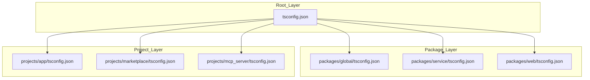
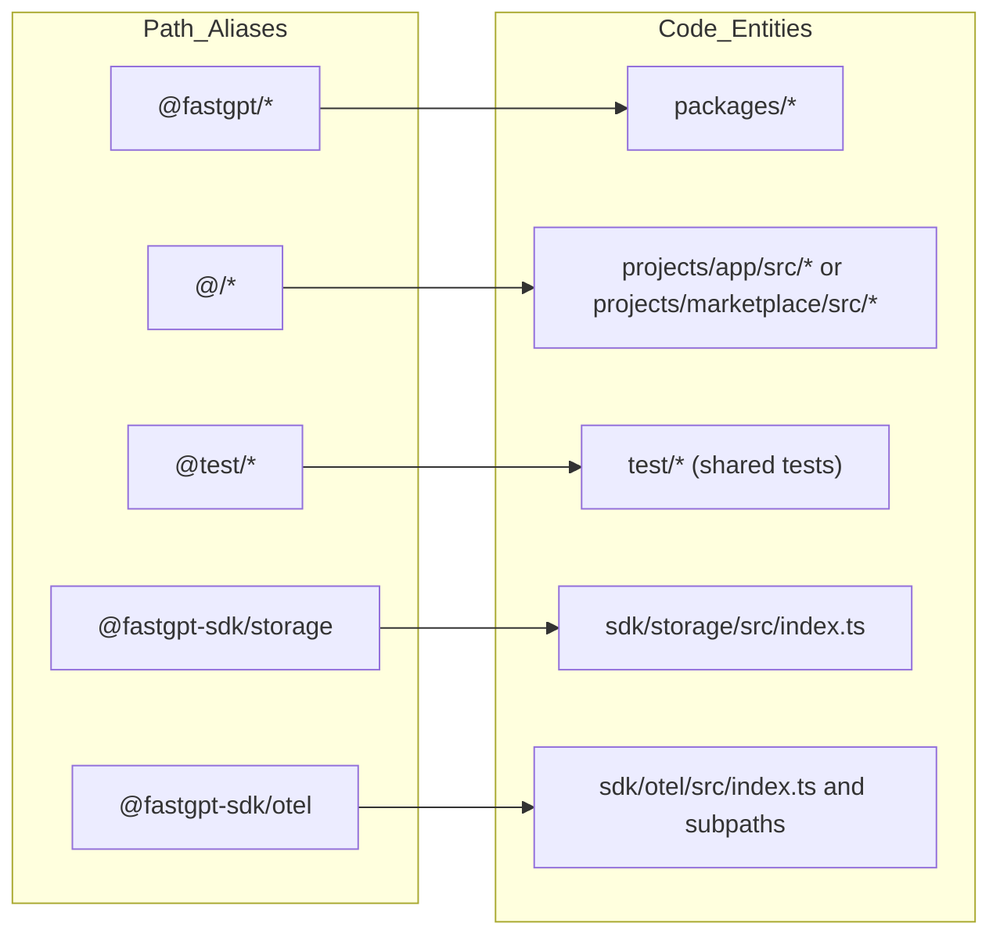
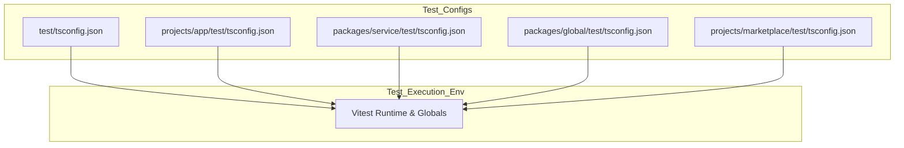
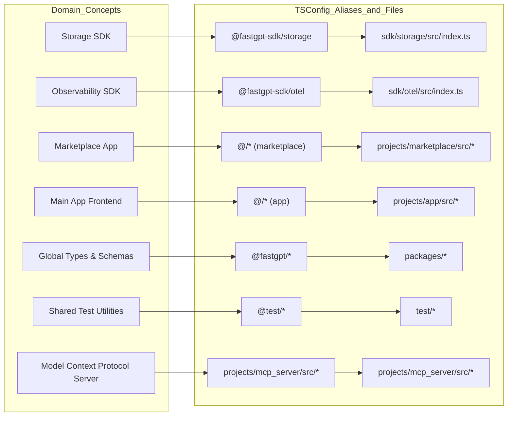
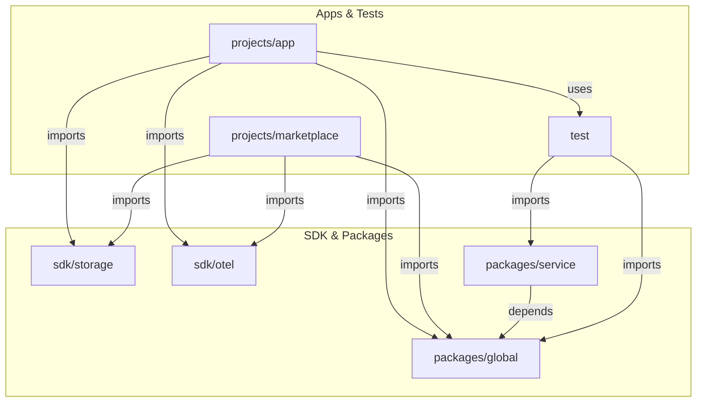

<!-- source: DeepWiki mcp.deepwiki.com · repo labring/FastGPT · page 14.3 TypeScript Configuration · fetched 2026-10-29 -->

# TypeScript Configuration

Relevant source files

The following files were used as context for generating this wiki page:

- [packages/global/test/tsconfig.json](packages/global/test/tsconfig.json)
- [packages/global/tsconfig.json](packages/global/tsconfig.json)
- [packages/service/test/tsconfig.json](packages/service/test/tsconfig.json)
- [packages/service/tsconfig.json](packages/service/tsconfig.json)
- [packages/web/tsconfig.json](packages/web/tsconfig.json)
- [projects/app/test/tsconfig.json](projects/app/test/tsconfig.json)
- [projects/app/tsconfig.json](projects/app/tsconfig.json)
- [projects/marketplace/test/tsconfig.json](projects/marketplace/test/tsconfig.json)
- [projects/marketplace/tsconfig.json](projects/marketplace/tsconfig.json)
- [projects/mcp_server/tsconfig.json](projects/mcp_server/tsconfig.json)
- [test/tsconfig.json](test/tsconfig.json)
- [tsconfig.json](tsconfig.json)

This page details the TypeScript configuration (`tsconfig.json`) setup across the FastGPT monorepo. It covers the root compilation settings, workspace inheritance, specific compiler rules, and comprehensive path alias mapping (such as `@fastgpt/*`, `@test/*`, and `@/*`) utilized across packages and projects.

For information about build scripts and toolchains, see [Build System and Scripts](#14.1). For details on the underlying monorepo structure, see [Monorepo Architecture and Dependencies](#2.1).

## Purpose and Scope

The TypeScript configuration across the FastGPT monorepo establishes unified compilation targets, module resolution strategies, strict type-safety enforcement, and path aliasing. It enables isolated packages (`packages/global`, `packages/service`, `packages/web`) and application projects (`projects/app`, `projects/marketplace`, `projects/mcp_server`) to reference each other seamlessly via workspace protocols while maintaining distinct compilation outputs.

**TypeScript Configuration Inheritance and Extension**

Sources: `tsconfig.json:1-60`(), `packages/global/tsconfig.json:1-5`(), `packages/service/tsconfig.json:1-19`(), `projects/marketplace/tsconfig.json:1-33`(), `projects/app/tsconfig.json:1-34`(), `projects/mcp_server/tsconfig.json:1-16`()

---

## Root Configuration and Compiler Options

The root `tsconfig.json` acts as the base configuration file for the monorepo and sets global compilation rules and environment assumptions. Key configuration details include:

| Compiler Option                | Value                 | Purpose                                                                                      |
|-------------------------------|-----------------------|----------------------------------------------------------------------------------------------|
| `target`                      | `esnext`              | Targets the latest ECMAScript features for modern runtime support.                           |
| `lib`                         | `["dom", "dom.iterable", "esnext"]` | Includes DOM typings and latest JS library definitions.                                      |
| `allowJs`                     | `true`                | Allows JavaScript files to be included in compilation.                                       |
| `skipLibCheck`                | `true`                | Skips type-checking declaration files for faster builds.                                    |
| `strict`                      | `true`                | Enables all strict type-checking options for improved type safety.                           |
| `forceConsistentCasingInFileNames` | `true`          | Ensures consistent casing in file imports to prevent issues in case-sensitive systems.       |
| `noEmit`                      | `true`                | Disables emitting output files; build handled separately by bundlers (e.g., Next.js).        |
| `esModuleInterop`             | `true`                | Enables interoperability between CommonJS and ES Modules.                                   |
| `module`                      | `esnext`              | Uses ES module system for output.                                                            |
| `moduleResolution`            | `bundler`             | Specialized resolution for bundler-compatible module lookup avoiding Node mechanisms.        |
| `resolveJsonModule`           | `true`                | Allows importing `.json` files as modules.                                                   |
| `isolatedModules`             | `true`                | Ensures that files can be transpiled independently (required for Babel/ts-loader).           |
| `jsx`                        | `preserve`            | Keeps JSX as-is in output for subsequent processing by React/Next.js.                        |
| `incremental`                 | `true`                | Enables incremental compilation for faster rebuilds.                                         |

The root config also excludes folders like `node_modules`, build outputs (`dist`, `.next`), coverage results, and various `node_modules` replicas globally to reduce irrelevant files in compilation.

Sources: `tsconfig.json:1-60`()

---

## Path Alias Resolution across Monorepo

To prevent deep relative import paths (e.g., `../../packages/...`), individual projects define path aliases in their respective TypeScript configurations. These aliases simplify imports by mapping logical namespaces to physical directories within the monorepo.

**Path Alias Mapping to Code Entities**

Sources: `projects/app/tsconfig.json:4-14`(), `test/tsconfig.json:4-14`(), `projects/marketplace/tsconfig.json:4-11`()

### Key Path Aliases Defined

- **`@fastgpt/*`**: Core shared packages under `packages/` such as `@fastgpt/global`, `@fastgpt/service`, and others are covered by this alias.
- **`@/*`**: Maps to the source directory of the current project, e.g., `projects/app/src/*` or `projects/marketplace/src/*` for importing local code modules.
- **`@test/*`**: Provides a shared namespace for test utilities and mock modules from the root `test/` folder available across projects.
- **`@fastgpt-sdk/*`**: SDK packages under `sdk/` are aliased, including `@fastgpt-sdk/storage` for S3-compatible storage integration, and `@fastgpt-sdk/otel` for observability (tracing, metrics, logging).

These aliases simplify import statements, enhance IDE code navigation, and improve code maintainability by avoiding fragile relative import paths.

---

## Package and Project-Specific Configurations

Each package or project extends the root `tsconfig.json`, tailoring compiler options and path aliases to their development and runtime needs.

### Core Packages (`packages/*`)

- **`packages/global/tsconfig.json`** extends root config to include all TypeScript files for shared global types, OpenAPI schemas, and contract definitions for frontend/backend interoperability.

- **`packages/service/tsconfig.json`** focuses on backend service logic. It extends the root and overrides the module resolution to `bundler`, explicitly excluding tests, benchmarks, and distribution artifacts.

- **`packages/web/tsconfig.json`** is streamlined for the React UI component library, pulling in Next.js typings and source files.

### Application Projects (`projects/*`)

- **`projects/app/tsconfig.json`** configures the main Next.js frontend app. It augments root settings with paths for local source (`@/*`), SDK integration (`@fastgpt-sdk/*`), and test utilities (`@test/*`). This setup aids in bundling and type-checking the UI code as well as seamless SDK use.

- **`projects/marketplace/tsconfig.json`** targets the Marketplace application using similar alias mappings for local source code, SDK packages, and workspace packages.

- **`projects/mcp_server/tsconfig.json`** configures the Model Context Protocol server backend project. It specifies a target of ES2022, a dedicated output folder `dist`, and includes strict type-checking and bundler resolution.

---

## Test Environment TypeScript Configurations

Testing setups in FastGPT leverage separate `tsconfig.json` files to provide Vitest typings, test-specific path mappings, and ensure the test runtime environment is properly configured.

**Test Configuration Architecture**

Notable details:

- `test/tsconfig.json` adds Aliases for SDK imports, core packages (`@fastgpt/*`) and local tests under `@test/*` for global shared test utilities.
- Project-level test configs like `projects/app/test/tsconfig.json` also add local path aliases like `#fastgpt/app/test/*` to map project-specific tests.
- Test configs enable TypeScript types for `vitest/globals` and Node.js for smooth integration with the Vitest testing framework.

This structured setup ensures consistent type safety in tests and development while maintaining isolated environments.

---

# Bridging Natural Language Space to Code Entity Space

To illustrate how these TypeScript configurations link natural concepts like "SDK Storage", "Marketplace", or "Tests" to their code-level entities, the diagrams below relate domain concepts and directories with TS config aliases and source files.

### Domain Concept to Code Path Alias Mapping

Sources: `projects/app/tsconfig.json:4-14`(), `projects/marketplace/tsconfig.json:4-11`(), `test/tsconfig.json:4-14`(), `projects/mcp_server/tsconfig.json:1-16`()

---

### Example of Package Dependency and Resolution via TypeScript Path Aliases

This diagram captures inter-package import dependencies facilitated by the flexible TypeScript path alias configuration.

Sources: `projects/app/tsconfig.json:4-14`(), `projects/marketplace/tsconfig.json:4-11`(), `test/tsconfig.json:4-14`(), `packages/service/tsconfig.json:1-19`()

---

# Summary

The FastGPT monorepo's TypeScript configuration is architected to:

- Centralize base compiler options targeting latest JavaScript standards with strict type safety.
- Use `moduleResolution: "bundler"` for compatibility with bundler and Next.js.
- Apply path aliases (`@fastgpt/*`, `@fastgpt-sdk/*`, `@test/*`, `@/*`) to enable seamless imports between packages, SDKs, projects, and shared test utilities.
- Support isolated package compilation while fostering inter-package references.
- Distinguish between production and test compilation contexts with dedicated `tsconfig.json` files adding testing framework types and paths.
- Provide clear mappings from natural language concepts (SDK, apps, tests) to codebase entities, improving developer experience and code maintainability.

By mastering these configurations and alias structures, developers can navigate the FastGPT codebase more effectively and develop/extend functionality with type-safe imports and compiled integration.

---

Sources:  
`tsconfig.json:1-60`(), `packages/global/tsconfig.json:1-5`(), `packages/service/tsconfig.json:1-19`(), `projects/marketplace/tsconfig.json:1-33`(),  
`projects/app/tsconfig.json:1-34`(), `projects/mcp_server/tsconfig.json:1-16`(), `test/tsconfig.json:1-26`(),  
`projects/app/test/tsconfig.json:1-33`(), `packages/service/test/tsconfig.json:1-18`(), `packages/global/test/tsconfig.json:1-17`(),  
`projects/marketplace/test/tsconfig.json:1-32`(), `packages/web/tsconfig.json:1-4`()

---

