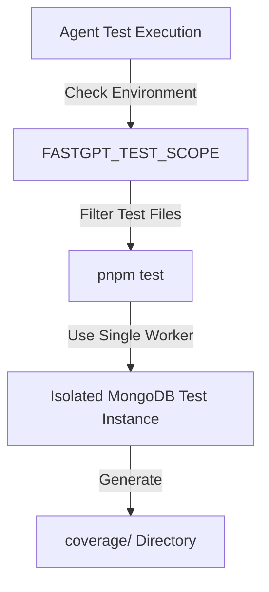
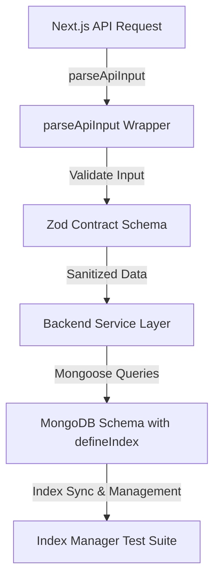

<!-- source: DeepWiki mcp.deepwiki.com · repo labring/FastGPT · page 14.4 Agent Workflows and Repository Conventions · fetched 2026-10-29 -->

# Agent Workflows and Repository Conventions

<details>
<summary>Relevant source files</summary>

The following files were used as context for generating this wiki page:

- [.agents/skills/system/pr-review/SKILL.md](.agents/skills/system/pr-review/SKILL.md)
- [.github/ISSUE_TEMPLATE/bugs.md](.github/ISSUE_TEMPLATE/bugs.md)
- [.github/ISSUE_TEMPLATE/config.yml](.github/ISSUE_TEMPLATE/config.yml)
- [.github/ISSUE_TEMPLATE/features.md](.github/ISSUE_TEMPLATE/features.md)
- [AGENTS.md](AGENTS.md)
- [document/content/self-host/upgrading/4-17/4171.en.mdx](document/content/self-host/upgrading/4-17/4171.en.mdx)
- [document/content/self-host/upgrading/4-17/4171.mdx](document/content/self-host/upgrading/4-17/4171.mdx)
- [packages/service/common/file/utils.ts](packages/service/common/file/utils.ts)
- [packages/service/common/system/constants.ts](packages/service/common/system/constants.ts)
- [packages/service/common/system/timerLock/constants.ts](packages/service/common/system/timerLock/constants.ts)
- [packages/web/components/common/MyPopover/index.tsx](packages/web/components/common/MyPopover/index.tsx)
- [packages/web/hooks/useLinkedScroll.tsx](packages/web/hooks/useLinkedScroll.tsx)
- [projects/app/src/instrumentation.ts](projects/app/src/instrumentation.ts)
- [projects/app/src/pageComponents/app/detail/Edit/FormComponent/AppCard.tsx](projects/app/src/pageComponents/app/detail/Edit/FormComponent/AppCard.tsx)
- [projects/app/src/pageComponents/app/detail/ExportConfigPopover.tsx](projects/app/src/pageComponents/app/detail/ExportConfigPopover.tsx)
- [projects/app/src/pageComponents/app/detail/WorkflowComponents/AppCard.tsx](projects/app/src/pageComponents/app/detail/WorkflowComponents/AppCard.tsx)
- [projects/app/src/pageComponents/app/detail/WorkflowComponents/Flow/ImportSettings.tsx](projects/app/src/pageComponents/app/detail/WorkflowComponents/Flow/ImportSettings.tsx)
- [projects/app/src/pageComponents/chat/ChatQuoteList/CollectionQuoteItem.tsx](projects/app/src/pageComponents/chat/ChatQuoteList/CollectionQuoteItem.tsx)
- [projects/app/src/pageComponents/chat/ChatQuoteList/CollectionQuoteReader.tsx](projects/app/src/pageComponents/chat/ChatQuoteList/CollectionQuoteReader.tsx)
- [projects/app/src/pageComponents/chat/ChatQuoteList/QuoteItem.tsx](projects/app/src/pageComponents/chat/ChatQuoteList/QuoteItem.tsx)
- [projects/app/src/pageComponents/chat/ChatQuoteList/QuoteReader.tsx](projects/app/src/pageComponents/chat/ChatQuoteList/QuoteReader.tsx)
- [projects/app/src/pageComponents/chat/ChatQuoteList/index.tsx](projects/app/src/pageComponents/chat/ChatQuoteList/index.tsx)
- [projects/app/src/pageComponents/dashboard/agent/JsonImportModal.tsx](projects/app/src/pageComponents/dashboard/agent/JsonImportModal.tsx)
- [projects/app/src/pageComponents/dashboard/agent/utils/appTemplateParse.ts](projects/app/src/pageComponents/dashboard/agent/utils/appTemplateParse.ts)
- [projects/app/src/service/common/system/cron.ts](projects/app/src/service/common/system/cron.ts)
- [projects/app/src/service/core/app/utils.ts](projects/app/src/service/core/app/utils.ts)
- [projects/app/test/pageComponents/dashboard/agent/utils/appTemplateParse.test.ts](projects/app/test/pageComponents/dashboard/agent/utils/appTemplateParse.test.ts)
- [projects/app/test/web/common/api/fetch.test.ts](projects/app/test/web/common/api/fetch.test.ts)

</details>


## Purpose and Scope
This page documents the conventions and workflows related to AI Agents within the FastGPT repository, focusing on the `.agents` directory (which contains design docs and skill definitions such as `pr-review` and `i18n-translate`), the `AGENTS.md` guidelines for structuring and operating agents, the standardized GitHub issue templates for bug and feature management, and the `.vscode` development environment configuration for contributing to these systems.

---

## 1. The `.agents` Directory and Agent Skill Ecosystem

The `.agents` directory is a reserved space within the repository that houses comprehensive design documentation, skill workflows, and problem analysis guiding how AI systems behave and assist developers in the FastGPT platform [AGENTS.md:11-14](). This includes skill definitions such as the `pr-review` skill which defines a detailed multi-phase Pull Request review process executed by an AI agent.

### Overview of `pr-review` Skill

- **Triggering**: Must be explicitly invoked by user commands naming `pr-review` or `$pr-review`. It avoids auto-triggering from generic PR links or review requests [`.agents/skills/system/pr-review/SKILL.md:2-13,10-11`].
- **Step 0: Code Fetching**: Uses GitHub CLI commands (`gh pr view`, `gh pr diff`) to obtain PR metadata, diffs, and commit history without needing to switch Git branches. Supports isolated workspace setup via `git worktree` to run tests safely alongside current code base [`.agents/skills/system/pr-review/SKILL.md:14-51`].
- **Phase 1: Requirements Understanding & Logical Validation**: The agent reads PR titles, descriptions, and diffs to summarize the PR intention, identify key modified modules and interfaces, and proposes and logically verifies 3–5 critical test cases across normal, boundary, and error paths [`.agents/skills/system/pr-review/SKILL.md:55-79`].
- **Phases 2–6: Concurrent Deep Quality Checks**:
  - *Backend Quality*: Security, error handling, performance.
  - *Frontend Quality*: React performance, TypeScript correctness.
  - *Code Style & API Conventions*: i18n key usage, API routing style.
  - *Test Coverage*: Existence of proper unit tests and coverage.
  - *Regression Risk*: API compatibility, schema evolution checks.
  
  These phases run independently and concurrently, enabling efficient review [`.agents/skills/system/pr-review/SKILL.md:82-135`].
- **Final Reporting**: Collates issues classified by severity (Critical, Suggestion, Optional) into a comprehensive report submitted via GitHub REST API calls using `gh api repos/$REPO/pulls/<number>/reviews` [`.agents/skills/system/pr-review/SKILL.md:138-171`].

```mermaid
graph TD
  UserRequest["User Request"] -->|"Explicit Trigger"| PrReviewSkill["pr-review SKILL.md"]
  PrReviewSkill -->|"Pull PR Data"| GitHubCLI["`gh pr view` / `gh pr diff`"]
  PrReviewSkill -->|"Isolate Test Env"| GitWorktree["`git worktree add`"]
  GitWorktree -->|"Run Tests"| TestRunner["`pnpm tsc` / `pnpm test`"]
  PrReviewSkill -->|"Multi-Phase Review" --> BackendCheck["Backend Quality Checks"]
  PrReviewSkill --> FrontendCheck["Frontend Quality Checks"]
  PrReviewSkill --> StyleCheck["Code Style Checks"]
  PrReviewSkill --> TestCoverage["Test Coverage Checks"]
  PrReviewSkill --> RegressionCheck["Regression Risk Checks"]
  BackendCheck -->|Aggregate Results| ReportCompiler["Aggregate & Summarize Issues"]
  FrontendCheck --> ReportCompiler
  StyleCheck --> ReportCompiler
  TestCoverage --> ReportCompiler
  RegressionCheck --> ReportCompiler
  ReportCompiler -->|"Submit via GitHub API"| GitHubReviewAPI["`gh api pulls/reviews`"]
```

*Sources: `.agents/skills/system/pr-review/SKILL.md:1-208`(), `AGENTS.md:1-147`()*


---

## 2. `AGENTS.md` Conventions and Repository Rules

The `AGENTS.md` file defines explicit conventions and instructions for AI agents engaged in tasks across the repository, including layout guidance, dependency rules, testing protocols, and API request parsing practices [AGENTS.md:1-147]().

### 2.1 Monorepo Layout and Package Organization

- **Packages Directory (`packages/`)**
  - `packages/global/`: Type definitions, constants, and openAPI schema contracts.
  - `packages/service/`: Backend service logic, MongoDB schemas/models, business controllers.
  - `packages/web/`: React components, hooks, UI utilities, and shared frontend logic.
  
- **Projects Directory (`projects/`)**
  - Contains deployable applications and services like `app/`, `code-sandbox/`, `mcp_server/`.

### 2.2 Testing: Guardrails for Agent-Driven Test Execution

Agents must execute tests with awareness of environment variables:

- `FASTGPT_TEST_MODE`: Integration modes (e.g., multi-worker vs single-worker).
- `FASTGPT_TEST_SCOPE`: Control specific file or module testing for focused runs.
  
Agents avoid running full test suites unconditionally to prevent resource contention. Instead, they run specific test files leveraging Vitest, with isolated MongoDB instances, generating coverage reports in a controlled manner to validate their changes in the safest way [AGENTS.md:39-54]().



---

## 3. MongoDB Schema Indexing and API Request Parsing Conventions

FastGPT enforces important consistency and safety patterns around database schema definitions and API route request validation.

### 3.1 API Request Validation (`parseApiInput`)

API endpoints under `projects/app/src/pages/api/` use `parseApiInput` wrapper for request data parsing and validation, instead of raw Zod schema calls. This layer normalizes error reporting and guards against untyped or malformed inputs [AGENTS.md:103-118]().

Example usage pattern:

```ts
import { parseApiInput } from '@fastgpt/service/common/zod/requestParseError';

const { body, query } = parseApiInput({
  req,
  bodySchema: CreateRequestBodySchema,
  querySchema: GetRequestQuerySchema,
});
```

### 3.2 MongoDB Index Declaration (`defineIndex`)

All MongoDB schema indexes, including unique constraints and deprecated indexes, must be declared using the helper `defineIndex(schema, {key, options, deprecated})` instead of index flags directly embedded in fields (e.g., no `{ index: true }` or `{ unique: true }` directly on schema paths). This improves index management, synchronization, and deprecation control [AGENTS.md:95-101]().



---

## 4. Issue Templates and Repository Auxiliary Configuration

Structured issue templates and configuration files in `.github/ISSUE_TEMPLATE` standardize issue reporting and smoothing community interactions.

### 4.1 Issue Template Configuration

- `.github/ISSUE_TEMPLATE/config.yml` disables blank issues and provides community support links such as a Feishu discussion group QR code image [`.github/ISSUE_TEMPLATE/config.yml:1-6`].

### 4.2 Bug Report Template

- `.github/ISSUE_TEMPLATE/bugs.md` guides issue reporters through checklists (like confirming no duplicates, key usage, and providing reproduction steps) with labels automatically assigned for prioritization [`.github/ISSUE_TEMPLATE/bugs.md:1-31`].

These templates ensure consistent, well-formed bug reports that are easier for agents and maintainers to triage.

---

# Summary

The repository conventions for agent workflows revolve around:

- The `.agents` directory as a centralized skill and design doc repository for AI agent workflows, exemplified by the rigorous `pr-review` skill.
- The `AGENTS.md` as core instruction documentation defining testing and development guardrails.
- Strict API parsing and MongoDB schema index declaration patterns to maintain backend consistency and security.
- Structured GitHub issue templates to facilitate smooth community and contributor interactions.

These rules and workflows reduce errors, enhance maintainability, and optimize AI-powered development assistance across the FastGPT ecosystem.

---

# Appendix: Mermaid Diagrams

```mermaid
title PR Review Skill Workflow

graph TD
  UserRequest["User Request with explicit 'pr-review' trigger"] --> PRSkill["PR Review Skill (.agents/skills/system/pr-review)"]
  PRSkill -->|Fetch PR Info| GHCLI["GitHub CLI (`gh pr view`, `gh pr diff`)"]
  PRSkill -->|Setup Test Env| GitWorktree["Git Worktree (`git worktree add`)"]
  GitWorktree -->|Run Tests| TestEngine["`pnpm tsc`, `pnpm test`"]
  PRSkill -->|Multi-Phase Reviews (2nd–6th)| BackendCheck["Backend Code Quality"]
  PRSkill --> FrontendCheck["Frontend Code Quality"]
  PRSkill --> StyleCheck["Code Style & i18n Keys"]
  PRSkill --> TestCoverage["Unit Test Coverage"]
  PRSkill --> RegressionCheck["API & DB Compatibility"]
  BackendCheck -->|Aggregate| ReportCompiler["Report Compiler"]
  FrontendCheck --> ReportCompiler
  StyleCheck --> ReportCompiler
  TestCoverage --> ReportCompiler
  RegressionCheck --> ReportCompiler
  ReportCompiler -->|Publish Comments and Summary| GitHubAPI["GitHub Reviews API (`gh api`)"]
```

```mermaid
title Agent Test Execution Flow (AGENTS.md)

graph TD
  AgentTask["Agent triggers tests"] --> CheckScope["Check FASTGPT_TEST_SCOPE environment"]
  CheckScope --> RunTestFile["Run `pnpm test <filepath>` selectively"]
  RunTestFile --> MongoDBInstance["Start isolated MongoDB per test"]
  MongoDBInstance --> Coverage["Generate coverage report in coverage/"]
```

```mermaid
title API Request and MongoDB Schema Handling Flow

graph TD
  NextAPI["Next.js API Request"] --> ParseInput["`parseApiInput` helper"]
  ParseInput --> ValidatedData["Validated input via Zod"]
  ValidatedData --> ServiceLogic["Service backend controller logic"]
  ServiceLogic --> MongoSchema["MongoSchema with `defineIndex` usage"]
  MongoSchema --> IndexManager["Index declaration and update test helpers"]
```

---

# Sources

- `.agents/skills/system/pr-review/SKILL.md:1-208`  
- `AGENTS.md:1-148`  
- `.github/ISSUE_TEMPLATE/config.yml:1-6`  
- `.github/ISSUE_TEMPLATE/bugs.md:1-31`

---

