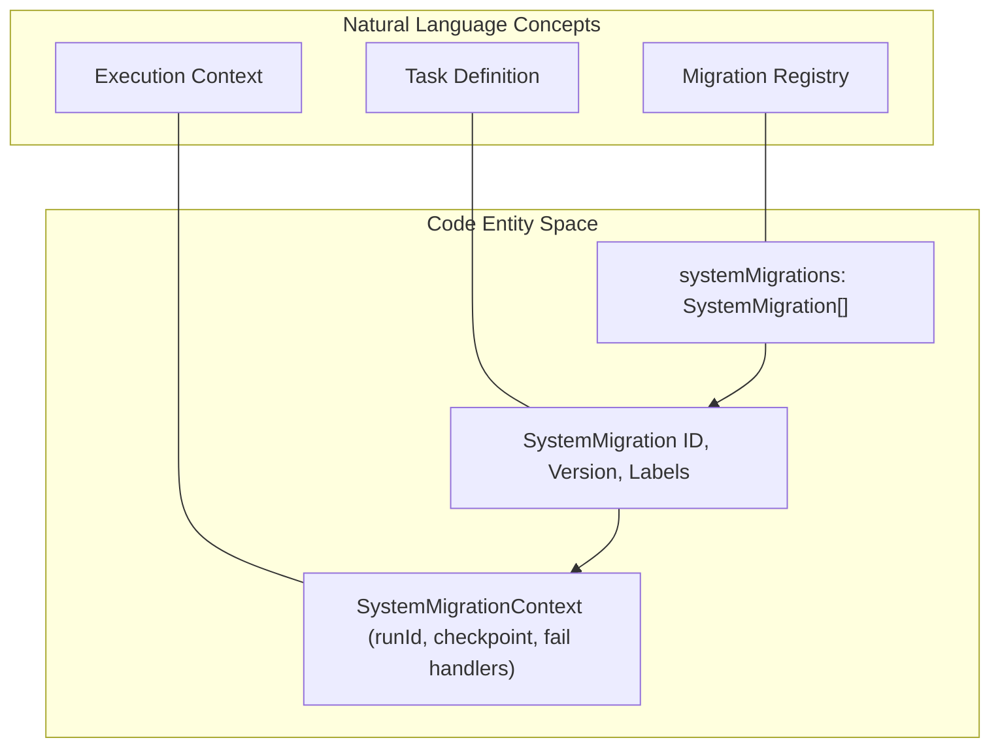
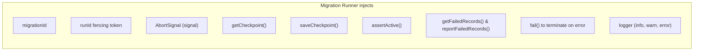
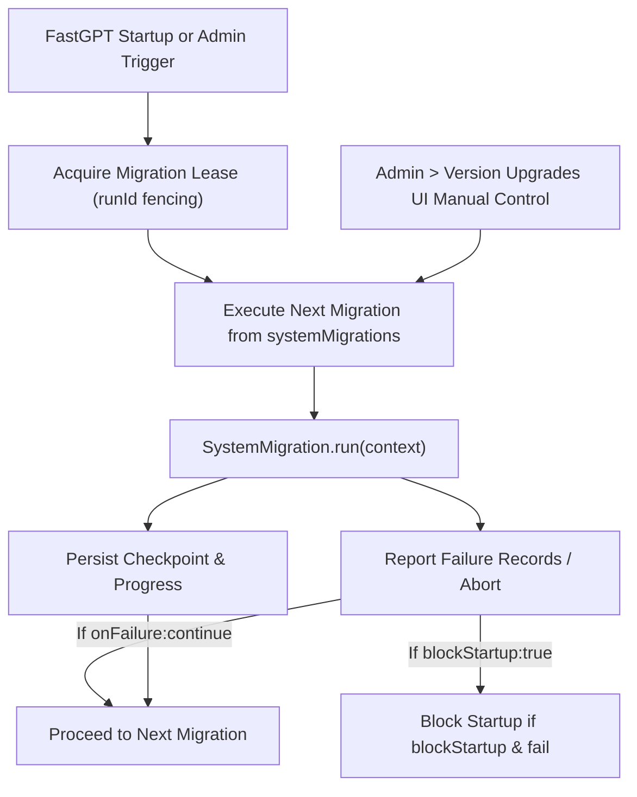
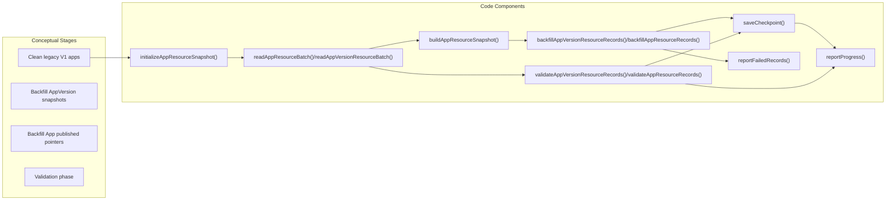
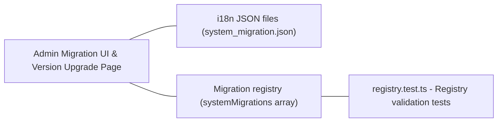

<!-- source: DeepWiki mcp.deepwiki.com · repo labring/FastGPT · page 14.5 Data Migration Framework · fetched 2026-10-29 -->

# Data Migration Framework

Relevant source files

The following files were used as context for generating this wiki page:

- [document/content/self-host/upgrading/4-17/4172.en.mdx](document/content/self-host/upgrading/4-17/4172.en.mdx)
- [document/content/self-host/upgrading/4-17/4172.mdx](document/content/self-host/upgrading/4-17/4172.mdx)
- [packages/global/migration/schema.ts](packages/global/migration/schema.ts)
- [packages/service/support/permission/app/resource.ts](packages/service/support/permission/app/resource.ts)
- [packages/web/i18n/en/system_migration.json](packages/web/i18n/en/system_migration.json)
- [packages/web/i18n/ko-KR/system_migration.json](packages/web/i18n/ko-KR/system_migration.json)
- [packages/web/i18n/zh-CN/system_migration.json](packages/web/i18n/zh-CN/system_migration.json)
- [packages/web/i18n/zh-Hant/system_migration.json](packages/web/i18n/zh-Hant/system_migration.json)
- [projects/app/src/migration/error.ts](projects/app/src/migration/error.ts)
- [projects/app/src/migration/registry.ts](projects/app/src/migration/registry.ts)
- [projects/app/src/migration/service.ts](projects/app/src/migration/service.ts)
- [projects/app/src/migration/tasks/4171/20260916_backfill_app_resource_snapshots/index.ts](projects/app/src/migration/tasks/4171/20260916_backfill_app_resource_snapshots/index.ts)
- [projects/app/src/migration/tasks/4171/20260916_backfill_app_resource_snapshots/service.ts](projects/app/src/migration/tasks/4171/20260916_backfill_app_resource_snapshots/service.ts)
- [projects/app/src/pageComponents/admin/config/Migration.tsx](projects/app/src/pageComponents/admin/config/Migration.tsx)
- [projects/app/test/migration/registry.test.ts](projects/app/test/migration/registry.test.ts)
- [projects/app/test/migration/tasks/4171/20260916_backfill_app_resource_snapshots/index.test.ts](projects/app/test/migration/tasks/4171/20260916_backfill_app_resource_snapshots/index.test.ts)
- [projects/app/test/migration/tasks/4171/20260916_backfill_app_resource_snapshots/service.test.ts](projects/app/test/migration/tasks/4171/20260916_backfill_app_resource_snapshots/service.test.ts)

## Purpose and Scope

The Data Migration Framework located in `projects/app/src/migration` implements a robust and extensible system to manage FastGPT's schema transformations, data backfills, and cleanup operations associated with version upgrades. It replaces legacy fragmented admin migration APIs with a centralized, ordered, and idempotent migration pipeline. This framework ensures safe execution in clustered setups through lease-based fencing, checkpoint persistence, and failure policies. It facilitates smooth data state transitions while preventing upgrade downtime or inconsistent states.

**Sources:**  
[projects/app/src/migration/registry.ts:1-97](), [document/content/self-host/upgrading/4-17/4172.en.mdx:16-45]()

---

## Registry and System Migration Metadata

The core of the framework is a statically defined sequential registry `systemMigrations` of migration tasks which are never reordered or mutated once released. Each migration task declares metadata describing its version, ID, localized labels, progress steps, startup block policy, failure behavior, and dependencies.

At runtime, every task receives a `SystemMigrationContext` providing fenced execution tokens (lease `runId`), progress checkpoint persistence, failure record reporting, and abort signaling.

**Diagram: Mapping migration domain concepts to registry code entities**

---

### `SystemMigration` Task Structure

Each migration entry declares static and runtime properties:

| Property        | Type                         | Description                                                                                      |
|-----------------|------------------------------|--------------------------------------------------------------------------------------------------|
| `id`            | `string`                     | Immutable semantic identifier, recommended `YYYYMMDD_short_name` (e.g. `20260907_cleanup_team_member_roles`) [registry.ts:72-72]() |
| `version`       | `string`                     | FastGPT version when this migration was introduced [registry.ts:74-74]()                          |
| `nameKey`       | `string`                     | i18n key for migration name [registry.ts:75-75]()                                                 |
| `descriptionKey`| `string`                     | i18n key for migration detailed description [registry.ts:76-76]()                                |
| `resultKey`     | `string`                     | i18n template for success result display [registry.ts:79-79]()                                   |
| `progressSteps` | `SystemMigrationProgressStep[]` | Ordered phases of the migration which are tracked and displayed in UI [registry.ts:80-81]()            |
| `blockStartup`  | `boolean`                    | If true, failure of this migration blocks entering "business ready" state [registry.ts:82-83]()  |
| `onFailure`     | enum (`stop` or `continue`)  | Failure policy: either pause following migrations or continue ignoring failure [registry.ts:84-85]()    |
| `delay`         | `boolean` (optional)        | When true, allows delayed execution after lease acquisition, configured by environment variable [registry.ts:89-90]()  |
| `manual`        | `boolean` (optional)        | If true, migration must be manually confirmed and triggered through UI, does not block startup [registry.ts:91-92]() |
| `dependsOn`     | `string[]` (optional)       | ID of prerequisite migration(s) that must succeed before this task can run [registry.ts:93-94]()  |
| `run`           | `(ctx: SystemMigrationContext) => Promise<SystemMigrationResultData | void>` | Core task execution function with injected context [registry.ts:95-96]() |

---

### `SystemMigrationContext` Interface

Key runtime APIs and fields injected by the migration runner:

- `migrationId`: Stable ID of the migration task instance [registry.ts:47-48]()
- `runId`: Unique fencing token for current lease, changing on lease acquisition [registry.ts:49-50]()
- `signal`: `AbortSignal` to detect lease loss or external cancellation [registry.ts:51-52]()
- `getCheckpoint<T>(schema: ZodType<T>)`: Retrieve persisted progress state with schema validation [registry.ts:53-54]()
- `saveCheckpoint(data)`: Atomically save progress state checkpoint after batch commit [registry.ts:59-60]()
- `assertActive()`: Confirm active lease ownership before writing batches [registry.ts:63-64]()
- `getFailedRecords()`: Fetch previously failed records for reprocessing [registry.ts:55-56]()
- `reportFailedRecords(records)`: Persist failure snapshots replacing previous records [registry.ts:57-58]()
- `fail(error)`: Report failure with optional failed records; terminates current run [registry.ts:65-66]()
- `logger`: Logging interface with `info`, `warn`, `error` methods [registry.ts:67-71]()

**Sources:** [projects/app/src/migration/registry.ts:28-68]()

---

## Runner Architecture and Execution Control

The migration runner is responsible for:

- Discovering pending migrations via the registry.
- Acquiring lease locks with fencing tokens (`runId`) to run each migration exclusively for idempotent safety.
- Calling the migration's `run` function with an injected `SystemMigrationContext`.
- Persisting progress checkpoints after business batch commits.
- Reporting failures, isolating their records, and handling retry or stopping subsequent migrations based on policy.
- Supporting both automatic and manual migration execution modes.
- Enforcing dependencies and ordered execution.

This ensures concurrent runner instances never cause conflicting writes, and any error behavior aligns with migration configuration.

**Sources:** [projects/app/src/migration/registry.ts:41-66](), [document/content/self-host/upgrading/4-17/4172.en.mdx:16-45]()

---

## Version-Specific Backfill Tasks

The framework includes numerous versioned migration tasks, mainly backfill operations updating legacy data to conform with new schema and business rules. These tasks are carefully ordered by their introduction date and dependencies.

### Notable Migration Tasks

| Migration ID                         | Version | Purpose                                                                                                                      | Manual? | Depends On                             |
|------------------------------------|---------|------------------------------------------------------------------------------------------------------------------------------|--------|--------------------------------------|
| `20260907_cleanup_team_member_roles` | 4.17.0  | Removes deprecated role fields from team members except owners, safeguarding permissions [registry.ts:103-125]()           | No     | None                                 |
| `20260903_migrate_legacy_system_models` | 4.17.0  | Migrates legacy system model configs and default model references to new data structure [registry.ts:126-157]()             | No     | None                                 |
| `20261008_migrate_chunk_training`  | 4.17.1  | *(Manual)* Converts legacy dataset chunk training tasks into new persisted-data-associated form to support stable training pipelines [registry.ts:88-94]()             | Yes    | None                                 |
| `20261009_migrate_dataset_rebuild_status` | 4.17.1  | *(Manual)* Migrates legacy rebuilding boolean flags on dataset chunks into new unified index status lifecycle [registry.ts:97-107]() | Yes    | `20261008_migrate_chunk_training`    |
| `20260916_backfill_app_resource_snapshots` | 4.17.1  | Populates resource snapshot fields with normalized workflow data and sets published version pointers on legacy apps [registry.ts:21-24]() | No     | Earlier migrations                   |
| `20261009_backfill_agent_sandbox_team_id` | 4.17.3  | Backfill team IDs for agent sandbox instances [registry.ts:110-116]()                                                        | No     | Earlier migrations                   |

These migrations typically operate in multiple finer-grained phases — scanning, processing, validation — with checkpoints enabling resumption and idempotent retry.

**Sources:** [projects/app/src/migration/registry.ts:103-116](), [document/content/self-host/upgrading/4-17/4172.en.mdx:16-40](), [projects/app/src/migration/tasks/4171/20260916_backfill_app_resource_snapshots/index.ts:1-200]()

---

## Example: App Resource Snapshot Backfill Task

One complex migration is the `20260916_backfill_app_resource_snapshots` which builds resource snapshots and published pointers for legacy apps and app versions.

It involves:

- Scanning MongoDB collections `MongoApp` and `MongoAppVersion` by immutable `_id` in batches with fixed upper bounds for safe scans.
- Normalizing legacy workflow modules, edges, and chat configurations into the current model shape ([`buildAppResourceSnapshot`](projects/app/src/migration/tasks/4171/20260916_backfill_app_resource_snapshots/service.ts:98-120)()).
- Writing back `resources` snapshot arrays and ensuring `publishedVersionId` points to a stable published version.
- Detecting and cleaning legacy V1 apps.
- Idempotent updates with optimistic concurrency control (transaction conflicts rollback the batch).
- Validation phase to confirm resource pointer integrity post-migration.

This task is tested extensively for idempotency, concurrency, failure recovery, and permission filtering [projects/app/test/migration/tasks/4171/20260916_backfill_app_resource_snapshots/index.test.ts:1-182](), [projects/app/test/migration/tasks/4171/20260916_backfill_app_resource_snapshots/service.test.ts:1-197]().

---

## Localization and Monitoring UI

The system migration framework integrates tightly with localized resources for presenting upgrade task statuses, progress steps, failure messages, and summaries in the Admin UI.

Localization keys follow the namespace `system_migration:migrations.<migrationId>.name`, `.description`, `.result`, and `.progress` supporting multiple languages:  
- Simplified Chinese (`zh-CN`)  
- Traditional Chinese (`zh-Hant`)  
- English (`en`)  
- Korean (`ko-KR`)

This setup provides realtime execution status, error exploration including failed record inspection, retrying failed migrations, and dependency guidance to operators.

---

# Summary

FastGPT's Data Migration Framework implements a formally ordered, lease-safe, and extensible migration system for structured data upgrades. It leverages:

- A static immutable registry for migration tasks with semantic versions and dependency declaration.
- An injected runtime context enabling checkpoint resiliency and failure isolation.
- Enforcement of startup blocking policies for critical migrations.
- Support for manual and automatic migrations with admin UI visibility.
- Version-specific migration implementations covering schema transformations and data backfills such as the app resource snapshot migration.
- Localized upgrade UI texts enabling global operation.

This framework ensures upgrade safety, operational observability, and long-term maintainability of evolving data structures across FastGPT platform versions.

---

**Sources:**  
[projects/app/src/migration/registry.ts:1-184](), [projects/app/test/migration/registry.test.ts:1-117](), [projects/app/src/migration/tasks/4171/20260916_backfill_app_resource_snapshots/index.ts:1-197](), [projects/app/src/migration/tasks/4171/20260916_backfill_app_resource_snapshots/service.ts:1-216](), [document/content/self-host/upgrading/4-17/4172.en.mdx:16-45](), [packages/web/i18n/zh-CN/system_migration.json:1-97]()

---

