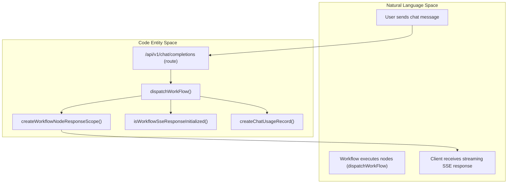
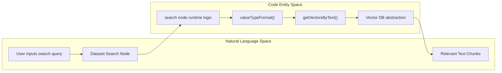

<!-- source: DeepWiki mcp.deepwiki.com · repo labring/FastGPT · page 15 Glossary · fetched 2026-10-29 -->

# Glossary

Relevant source files

The following files were used as context for generating this wiki page:

- [packages/global/common/string/tools.ts](packages/global/common/string/tools.ts)
- [packages/global/core/workflow/runtime/utils.ts](packages/global/core/workflow/runtime/utils.ts)
- [packages/global/openapi/core/app/folder/api.ts](packages/global/openapi/core/app/folder/api.ts)
- [packages/global/openapi/core/app/folder/index.ts](packages/global/openapi/core/app/folder/index.ts)
- [packages/global/test/common/string/tools.test.ts](packages/global/test/common/string/tools.test.ts)
- [packages/global/test/core/workflow/runtime/utils.test.ts](packages/global/test/core/workflow/runtime/utils.test.ts)
- [packages/service/core/ai/utils.ts](packages/service/core/ai/utils.ts)
- [packages/service/core/workflow/dispatch/abandoned/runApp.ts](packages/service/core/workflow/dispatch/abandoned/runApp.ts)
- [packages/service/core/workflow/dispatch/child/runApp.ts](packages/service/core/workflow/dispatch/child/runApp.ts)
- [packages/service/core/workflow/dispatch/index.ts](packages/service/core/workflow/dispatch/index.ts)
- [packages/service/core/workflow/dispatch/plugin/run.ts](packages/service/core/workflow/dispatch/plugin/run.ts)
- [packages/service/core/workflow/dispatch/tools/answer.ts](packages/service/core/workflow/dispatch/tools/answer.ts)
- [packages/service/core/workflow/dispatch/tools/http468.ts](packages/service/core/workflow/dispatch/tools/http468.ts)
- [packages/service/test/common/string/textSplitter.test.ts](packages/service/test/common/string/textSplitter.test.ts)
- [packages/service/test/core/ai/llm/toolCall.test.ts](packages/service/test/core/ai/llm/toolCall.test.ts)
- [packages/web/components/common/Icon/constants.ts](packages/web/components/common/Icon/constants.ts)
- [packages/web/components/common/MyModal/EditFolderModal.tsx](packages/web/components/common/MyModal/EditFolderModal.tsx)
- [packages/web/components/common/MySlider/InputSlider.tsx](packages/web/components/common/MySlider/InputSlider.tsx)
- [packages/web/i18n/en/app.json](packages/web/i18n/en/app.json)
- [packages/web/i18n/en/common.json](packages/web/i18n/en/common.json)
- [packages/web/i18n/ko-KR/common.json](packages/web/i18n/ko-KR/common.json)
- [packages/web/i18n/zh-CN/app.json](packages/web/i18n/zh-CN/app.json)
- [packages/web/i18n/zh-CN/common.json](packages/web/i18n/zh-CN/common.json)
- [packages/web/i18n/zh-Hant/app.json](packages/web/i18n/zh-Hant/app.json)
- [packages/web/i18n/zh-Hant/common.json](packages/web/i18n/zh-Hant/common.json)
- [projects/app/src/components/core/ai/AISettingModal/index.tsx](projects/app/src/components/core/ai/AISettingModal/index.tsx)
- [projects/app/src/pages/api/core/app/folder/create.ts](projects/app/src/pages/api/core/app/folder/create.ts)
- [projects/app/src/pages/dashboard/agent/index.tsx](projects/app/src/pages/dashboard/agent/index.tsx)
- [projects/app/src/pages/dashboard/tool/index.tsx](projects/app/src/pages/dashboard/tool/index.tsx)

This glossary defines the core concepts, technical jargon, domain-specific terms, and key code entities used throughout the FastGPT codebase. It aims to bridge natural language concepts to their precise implementations in the codebase with technical depth, including data flow and mermaid diagrams where applicable.

---

## 1. Core Domain Concepts & Architecture Terms

### RAG (Retrieval-Augmented Generation)
RAG refers to the technique where the language model's generation is augmented by retrieving relevant documents or chunks from an external knowledge base to improve accuracy and context. In FastGPT, this is implemented using:

- **Datasets and Vector Databases**: Text documents are segmented into chunks, embedded into vectors, and indexed in vector databases such as PGVector, Milvus, Zilliz, OceanBase, or OpenGauss [packages/service/common/vectorDB/opengauss/index.ts:1-10]().
- **Hybrid Search**: Combines semantic vector search and traditional keyword/full-text search to retrieve precise content relevant to the query, used in the dataset search node.

This enables dynamic, context-aware responses from the underlying LLMs by supplying additional domain knowledge lost during training.

### MCP (Model Context Protocol)
MCP is an open protocol that standardizes AI models’ access to external tools or data sources safely. FastGPT serves as an MCP server to expose its own tools (like workflows, agents) as MCP tools accessible to external AI clients.

- The **MCP Server** implementation relies on SSE (Server-Sent Events) for streaming tool call responses.
- MCP tools are registered by transforming FastGPT apps into MCP-compatible definitions and schemas [packages/web/i18n/en/app.json:14-20]().

### AI Points
AI Points are the internal metering unit representing usage cost of AI model invocations and tool calls.

- Each LLM call consumes AI Points roughly proportional to tokens processed, counted via providers’ official statistics or estimated using GPT-3.5 tokenization heuristics [packages/web/i18n/en/common.json:30-33]().
- Plans allocate AI Points monthly or yearly; unused points expire accordingly.
- This metering allows FastGPT to enforce usage limits and billing.

### QPM (Queries Per Minute)
QPM is a throttling metric defining the maximum number of Agent requests a team can invoke per minute, independent of individual workflow complexity or AI call volume. Other API endpoints have separate rate limits [packages/web/i18n/en/common.json:44-45]().

### outLink (External Share Links)
outLink are public share links or iframe embed URLs that expose a FastGPT app/chat without requiring authentication, facilitating quick external access and embedding on websites or other platforms [packages/web/i18n/zh-Hant/common.json:170-172]().

### Skill
Skills are modular, packaged units of functionality, including custom plugins, workflow tools, or external agents, that can be imported and versioned. Agents invoke skills internally to extend capabilities dynamically. Skills have their own configurations, versions, and dashboards [packages/web/i18n/en/common.json:86-87]().

### Sandbox
Sandboxes are isolated runtime environments for secure, controlled execution:

- **Code Sandbox**: Run user-submitted code snippets (Python, JS) safely in isolated processes [projects/code-sandbox].
- **Agent Sandbox / OpenSandbox**: Virtual machines or containerized runtimes hosting full Agent execution environments, supporting advanced tooling and persistent volumes.
- Sandboxes help implement secure execution of arbitrary user workflows or code within FastGPT [packages/web/i18n/zh-Hant/common.json:174-176]().

---

## 2. Workflow & Execution Engine Terms

### dispatchWorkFlow
Core backend function that executes a workflow instance given runtime nodes and edges, managing:

- Variable resolution across nodes.
- Node execution scheduling, including concurrency and conditional skipping.
- Agent loops and tool invocation.
- Streaming partial responses via SSE.
- Metrics, debugging, and usage tracking.

It accepts detailed runtime state, resources context, and user/session information, and outputs structured node responses and workflow runtime summary [packages/service/core/workflow/dispatch/index.ts:134-139]().

---

### Node Response
A node response is the output data from an executed workflow node recorded for persistence and subsequent reference. It contains:

- Node output values and any errors.
- Tokens consumed and usage statistics.
- Debug logs and execution metadata.
- Count of child node responses (for nested workflows).
- Stored persistently via node response sinks managing concurrency [packages/service/core/workflow/dispatch/index.ts:72-76]().

---

### bufferId
An internal unique identifier used to link and coordinate streaming chunks and buffered data between the workflow execution engine, streaming SSE responses, and database flush operations. This ensures partial incremental outputs can be updated and resumed without conflicts.

---

### HTTP468
A specialized workflow node type for executing HTTP requests externally with rich customization, including:

- URL, method, headers, and timeout parameters.
- Support for substituting variables in URL, headers, params, and bodies.
- Supports JSON, FormData, and x-www-form-urlencoded bodies.
- Special handling for HTTPS certificate verification based on system config.
- Secret values injection for authorization headers.
- Response and error parsing for integration into workflows [packages/service/core/workflow/dispatch/tools/http468.ts:68-91]().

---

## 3. Infrastructure & System Configuration

### feConfigs (Frontend Configurations)
Frontend configurations control the UI feature flags, global limits, branding, and policy toggles.

- Provided by backend via initialization data (`getInitData`) API, accessible globally as `FastGPTFeConfigsType`.
- Includes max folder depth, feature flags (e.g., `isPlus` for Premium features), and resource limits.
- Used client-side for conditional UI behavior and feature gating [projects/app/src/pages/dataset/list/index.tsx:70-71]().

### dal (Data Access Layer)
The `@fastgpt/dal` package abstracts all database and caching operations, providing:

- Access to MongoDB collections with ODM models for core entities (e.g., workflows, datasets).
- Redis interaction for caching, queue management, and concurrency controls.
- Internal APIs to persist node responses, chat records, and usage data.
- Simplifies access and consistency layers across the backend.

---

## 4. Data Flow & Code-to-Natural Language Mappings

### Diagram 1: Workflow Execution Data Flow  
Illustrates how a user message initiates a workflow dispatch, resulting in streamed AI chat messages and recording usage.

- `dispatchWorkFlow` coordinates the workflow nodes execution and state.
- SSE streaming responses require prior initialization (`isWorkflowSseResponseInitialized`).
- Usage is tracked per chat message.
- Node responses are buffered and persisted asynchronously.

Sources: [packages/service/core/workflow/dispatch/index.ts:134-157](), [packages/service/core/workflow/dispatch/index.ts:72-76]()

---

### Diagram 2: RAG Knowledge Retrieval Flow  
Shows how the search query enters the Dataset Search Node and is converted through embedding vectors for vector DB retrieval.

- The search node uses `valueTypeFormat` to parse inputs/outputs.
- Embedding queries are handled by embedding services which interact with vector databases.
- Retrieved chunks feed the LLM prompt for RAG-enhanced generation.

Sources: [packages/global/core/workflow/runtime/utils.ts:54-68](), [packages/service/common/vectorDB/opengauss/index.ts:1-10]()

---

## 5. Common Abbreviations & Jargon

| Abbreviation      | Full Term                    | Code / Location Reference                                                 | Description                                                                                                  |
|-------------------|-----------------------------|---------------------------------------------------------------------------|--------------------------------------------------------------------------------------------------------------|
| **SSE**           | Server-Sent Events           | [packages/service/core/workflow/dispatch/index.ts:152-157]()              | Streaming technology used for real-time updates in chat completions and workflow execution streaming.         |
| **Tmb**           | Team Member                 | [packages/service/core/workflow/dispatch/index.ts:162]()                  | Internal shorthand for a user's membership and permissions within a team.                                    |
| **VDB**           | Vector Database             | [packages/service/common/vectorDB/opengauss/index.ts:1-10]()              | Specialized database managing high-dimensional vector embeddings for similarity search.                      |
| **LLM**           | Large Language Model        | [packages/web/i18n/en/app.json:38]()                                      | Foundation AI models (e.g., GPT, OpenAI) used for text generation and understanding.                         |
| **QG**            | Question Guide              | [packages/web/i18n/en/app.json:90]()                                      | Feature for "guess what you want to ask" prompts to assist users in querying.                               |
| **IO**            | Input/Output                | [packages/global/core/workflow/runtime/utils.ts:54-68]()                  | Workflow node parameter schemas and value types used for node input and output validation and coercion.     |
| **MCP**           | Model Context Protocol      | [packages/web/i18n/en/app.json:14-20]()                                   | Open protocol for AI model interaction with external tools exposed by FastGPT.                              |
| **RAG**           | Retrieval-Augmented Generation | [packages/service/common/vectorDB/opengauss/index.ts:1-10]()            | Method integrating retrieval of documents to augment language generation results.                            |
| **Skill**         | Skill (Tool/Plugin)         | [packages/web/i18n/en/common.json:86-87]()                                | Modular app component providing functionality callable by Agents or workflows.                              |
| **Sandbox**       | Execution Sandbox           | [packages/web/i18n/zh-Hant/common.json:174-176]()                         | Isolated runtime environment for safe code and agent execution.                                             |
| **BufferId**      | Buffer Identifier           | [packages/service/core/workflow/dispatch/index.ts:72-76]()                | Unique ID to coordinate partial streaming chunk buffers and database writes in workflow execution.          |
| **feConfigs**     | Frontend Configurations     | [projects/app/src/pages/dataset/list/index.tsx:70-71]()                   | Central configuration object controlling feature flags, limits, and UI behavior.                            |
| **dal**           | Data Access Layer           | Backend package managing persistent storage/retrieval (MongoDB/Redis).   | Provides unified database models, repositories, and caching systems across services.                         |
| **dispatchHttp468Request** | HTTP Request Node Handler | [packages/service/core/workflow/dispatch/tools/http468.ts:68-91]()       | Function implementing HTTP request workflow node with support for headers, secrets, variable substitution, and body types. |

---

## 6. Additional Notes

- Variables carried throughout the workflow are managed in the `WorkflowVariableState` abstraction, enabling dynamic substitution and reference resolution [packages/service/core/workflow/dispatch/index.ts:134-139]().

- Workflow nodes are identified by unique IDs and typed via enums (`FlowNodeTypeEnum`), which influence execution logic and IO formats.

- Node response persistence uses scoped sinks (`createWorkflowNodeResponseScope`) to avoid race conditions and to emit incremental results to clients.

---

This glossary serves as a technical bridge between FastGPT's natural concepts and its complex backend implementation. For detailed exploration, readers should follow the code pointers and review source modules referenced in each section.

Sources:  
[packages/service/common/vectorDB/opengauss/index.ts:1-10](),  
[packages/web/i18n/en/app.json:14-20](),  
[packages/web/i18n/en/common.json:30-45](),  
[packages/web/i18n/zh-Hant/common.json:170-176](),  
[packages/service/core/workflow/dispatch/index.ts:72-76](),  
[packages/service/core/workflow/dispatch/index.ts:134-157](),  
[packages/global/core/workflow/runtime/utils.ts:54-68](),  
[packages/service/core/workflow/dispatch/tools/http468.ts:68-91](),  
[projects/app/src/pages/dataset/list/index.tsx:70-71]()