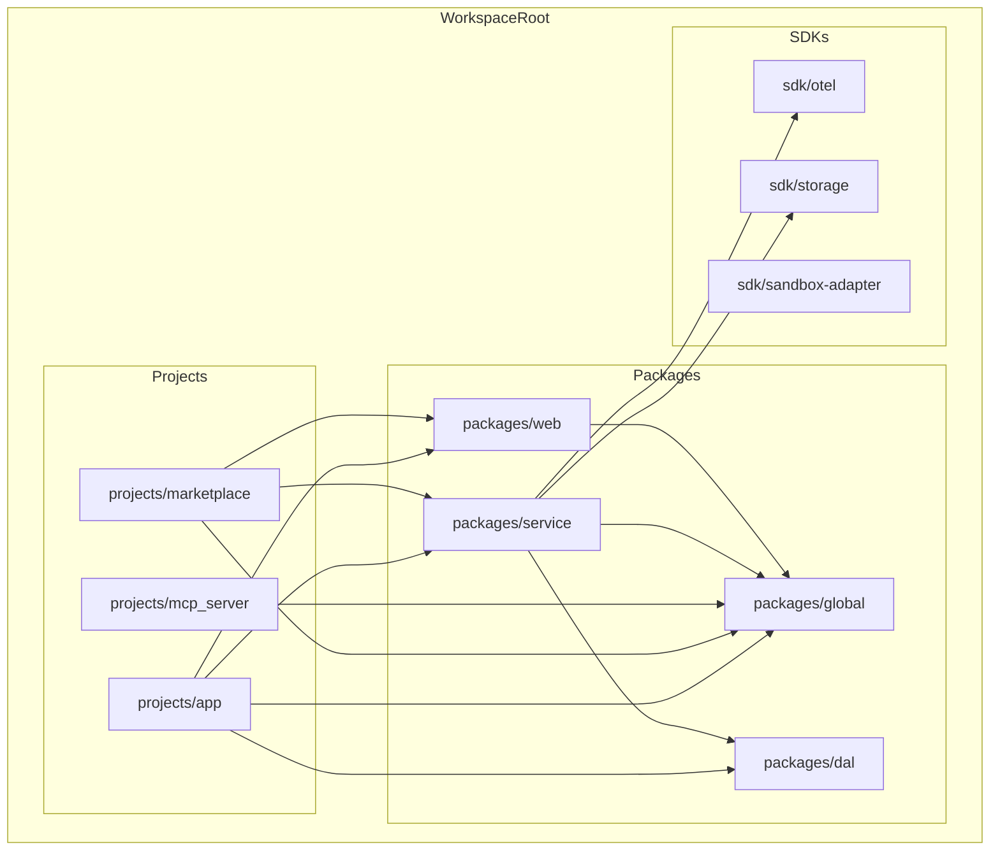
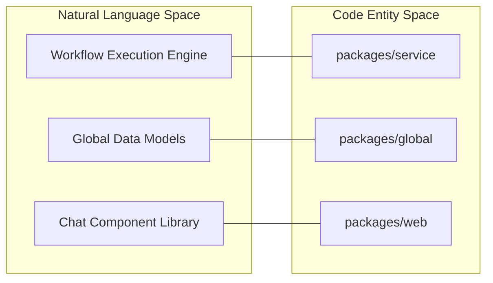
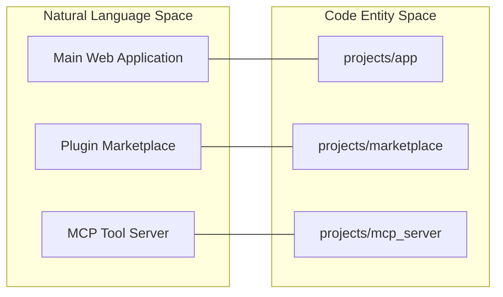
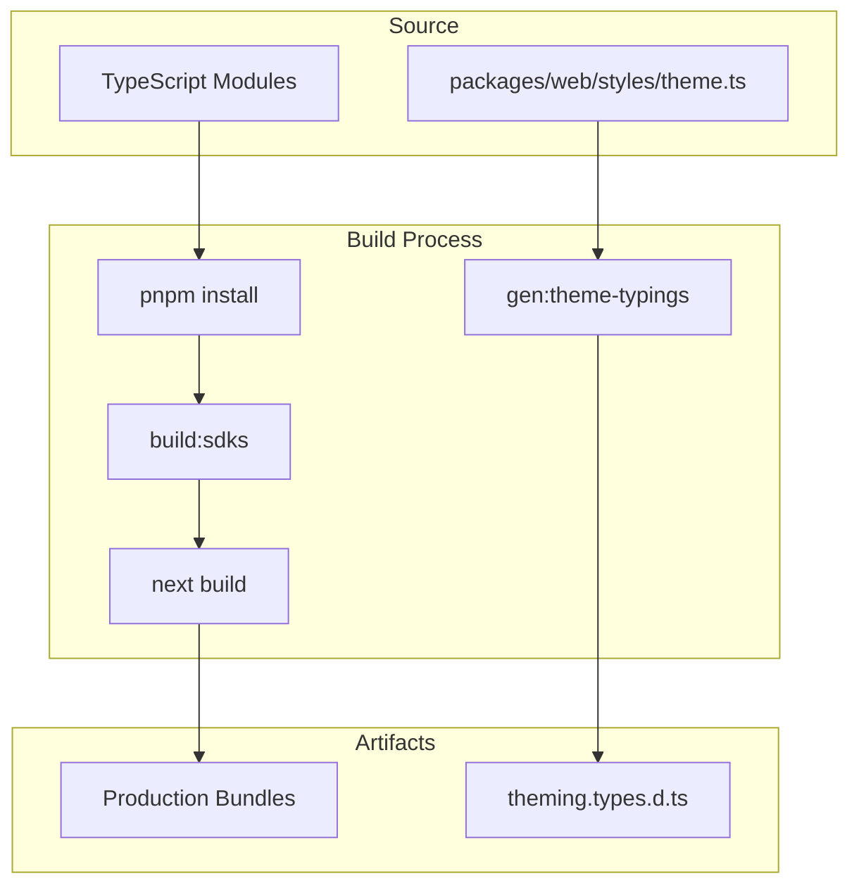

<!-- source: DeepWiki mcp.deepwiki.com · repo labring/FastGPT · page 2 Project Structure and Package Organization · fetched 2026-10-29 -->

# Project Structure and Package Organization

Relevant source files

The following files were used as context for generating this wiki page:

- [document/package.json](document/package.json)
- [package.json](package.json)
- [packages/global/package.json](packages/global/package.json)
- [packages/service/package.json](packages/service/package.json)
- [packages/web/package.json](packages/web/package.json)
- [pnpm-lock.yaml](pnpm-lock.yaml)
- [pnpm-workspace.yaml](pnpm-workspace.yaml)
- [projects/app/package.json](projects/app/package.json)
- [projects/marketplace/Dockerfile](projects/marketplace/Dockerfile)
- [projects/marketplace/package.json](projects/marketplace/package.json)
- [projects/mcp_server/Dockerfile](projects/mcp_server/Dockerfile)
- [projects/mcp_server/package.json](projects/mcp_server/package.json)
- [scripts/icon/package.json](scripts/icon/package.json)

This document explains the monorepo structure, package dependencies, and build system organization of FastGPT. It covers the pnpm workspace configuration, core service packages, and how different components interact within the codebase architecture.

For details on the monorepo setup, workspace protocols, and lockfile management, see [Monorepo Architecture and Dependencies](#2.1). For specific package functionality, see [Core Packages](#2.2) and [Application Projects](#2.3). Development environments are covered in [Development Environment and Build Pipeline](#2.4), and observability tools are detailed in [Observability SDK](#2.5).

## Monorepo Architecture Overview

FastGPT is organized as a pnpm workspace monorepo defined in `pnpm-workspace.yaml`. The architecture enforces a strict dependency flow from application projects down to shared packages and SDKs.

### Workspace Directory Structure

Sources: [pnpm-workspace.yaml:1-18](), [projects/app/package.json:45-53](), [packages/service/package.json:19-24]()

### Package Name Resolution and Catalogs

The monorepo uses `workspace:*` specifiers in `package.json` dependencies which pnpm resolves to local packages during development [projects/app/package.json:45-53](). External dependencies are managed via a centralized `catalog` in the workspace root to ensure version consistency across the repository [pnpm-workspace.yaml:19-105]().

For deep technical details on workspace protocol setup, catalogs, and Turbo pipeline caching, see [Monorepo Architecture and Dependencies](#2.1).

Sources: [pnpm-workspace.yaml:19-105](), [projects/app/package.json:45-53]()

## Core Package Responsibilities

The codebase divides shared responsibilities into distinct packages under `packages/`:

*   **`@fastgpt/global` (`packages/global`)**: Contains shared types, constants, Zod schemas, and universal utilities that run in both browser and Node.js environments [packages/global/package.json:1-40]().
*   **`@fastgpt/service` (`packages/service`)**: Implements backend business logic, database models, vector search adapters, and workflow execution dispatchers [packages/service/package.json:1-100]().
*   **`@fastgpt/web` (`packages/web`)**: Provides reusable React components, custom hooks, and state management logic built on Chakra UI and Zustand [packages/web/package.json:1-65]().
*   **`@fastgpt/dal` (`packages/dal`)**: Manages data access layer connections, caching layers, and queue abstractions (such as Redis interfaces).

### System Entity Mapping: Natural Language to Code

Sources: [packages/global/package.json:1-40](), [packages/service/package.json:1-100](), [packages/web/package.json:1-65]()

For detailed specifications on individual core packages, see [Core Packages](#2.2).

Sources: [packages/global/package.json:1-40](), [packages/service/package.json:1-100](), [packages/web/package.json:1-65]()

## Application Projects

Deployable services and applications reside in the `projects/` directory. Each project targets a specific runtime container or deployment target:

*   **`projects/app`**: The primary Next.js-based application hosting user dashboards, workflow editors, and core API endpoints [projects/app/package.json:1-149]().
*   **`projects/marketplace`**: A Next.js application handling the AI application and tool plugin marketplace [projects/marketplace/package.json:1-53]().
*   **`projects/mcp_server`**: An Express/Bun-based server implementing the Model Context Protocol (MCP) to expose FastGPT workflows as external tools [projects/mcp_server/package.json:1-34]().
*   **Sandbox & Infrastructure Projects**: Includes `projects/code-sandbox`, `projects/volume-manager`, and professional edition integrations [pnpm-workspace.yaml:4-13]().

### Application Entity Mapping

Sources: [projects/app/package.json:1-3](), [projects/marketplace/package.json:1-3](), [projects/mcp_server/package.json:1-3]()

For a comprehensive guide on all application projects, see [Application Projects](#2.3).

Sources: [projects/app/package.json:1-149](), [projects/marketplace/package.json:1-53](), [projects/mcp_server/package.json:1-34](), [pnpm-workspace.yaml:4-13]()

## Development Environment and Build Pipeline

The project uses a unified build pipeline orchestrated via the root `package.json` scripts and `turbo` [package.json:1-55](). Developers can initialize themes, build packages, and run local dev servers using pnpm tasks.

*   **Workspace Preparation**: `pnpm postinstall` triggers Chakra UI token generation (`gen:theme-typings`) and SDK builds (`build:sdks`) [package.json:8-10]().
*   **Worker Compilation**: The main app compiles specialized workers via `build:workers` scripts [projects/app/package.json:13]().

### Build Pipeline Flow

Sources: [package.json:8-30]()

For environment setup scripts, Docker Compose files, and local troubleshooting, see [Development Environment and Build Pipeline](#2.4).

Sources: [package.json:1-55](), [projects/app/package.json:13-26]()

## Observability SDK

Cross-cutting concerns such as telemetry, structured logging, and unified object storage are separated into the `sdk/` directory [pnpm-workspace.yaml:17](). These libraries are consumed by backend services and application workers.

*   **`@fastgpt-sdk/otel`**: OpenTelemetry tracing integration for performance monitoring [projects/app/package.json:45]().
*   **`@fastgpt-sdk/storage`**: Unified S3-compatible object storage SDK supporting multi-vendor drivers (AWS S3, Minio, Aliyun OSS) [sdk/storage/package.json:1-77]().
*   **`@fastgpt-sdk/sandbox-adapter`**: Execution runtime adapter for sandboxed environments [projects/app/package.json:47]().

For detailed documentation on tracing configurations and S3 storage abstractions, see [Observability SDK](#2.5).

Sources: [pnpm-workspace.yaml:17](), [projects/app/package.json:45-48](), [sdk/storage/package.json:1-77]()

---

