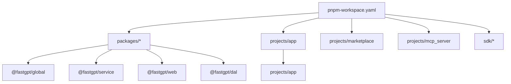
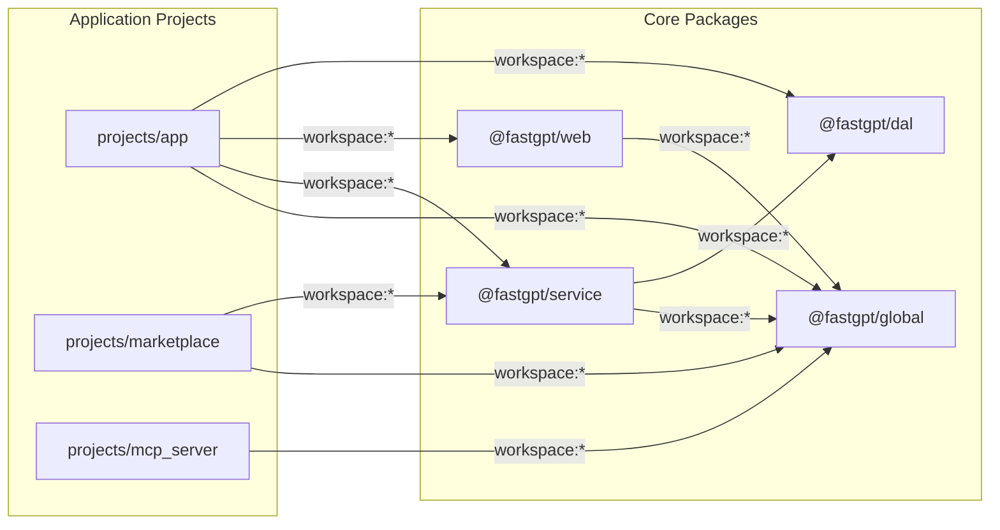
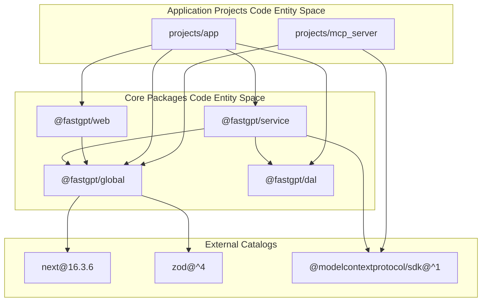

<!-- source: DeepWiki mcp.deepwiki.com · repo labring/FastGPT · page 2.1 Monorepo Architecture and Dependencies · fetched 2026-10-29 -->

# Monorepo Architecture and Dependencies

Relevant source files

The following files were used as context for generating this wiki page:

- [document/package.json](document/package.json)
- [package.json](package.json)
- [packages/global/package.json](packages/global/package.json)
- [packages/global/test/tsconfig.json](packages/global/test/tsconfig.json)
- [packages/global/tsconfig.json](packages/global/tsconfig.json)
- [packages/service/package.json](packages/service/package.json)
- [packages/service/test/tsconfig.json](packages/service/test/tsconfig.json)
- [packages/service/tsconfig.json](packages/service/tsconfig.json)
- [packages/web/package.json](packages/web/package.json)
- [packages/web/tsconfig.json](packages/web/tsconfig.json)
- [pnpm-lock.yaml](pnpm-lock.yaml)
- [pnpm-workspace.yaml](pnpm-workspace.yaml)
- [projects/app/package.json](projects/app/package.json)
- [projects/app/test/tsconfig.json](projects/app/test/tsconfig.json)
- [projects/app/tsconfig.json](projects/app/tsconfig.json)
- [projects/marketplace/Dockerfile](projects/marketplace/Dockerfile)
- [projects/marketplace/package.json](projects/marketplace/package.json)
- [projects/marketplace/test/tsconfig.json](projects/marketplace/test/tsconfig.json)
- [projects/marketplace/tsconfig.json](projects/marketplace/tsconfig.json)
- [projects/mcp_server/Dockerfile](projects/mcp_server/Dockerfile)
- [projects/mcp_server/package.json](projects/mcp_server/package.json)
- [projects/mcp_server/tsconfig.json](projects/mcp_server/tsconfig.json)
- [scripts/icon/package.json](scripts/icon/package.json)
- [test/tsconfig.json](test/tsconfig.json)
- [tsconfig.json](tsconfig.json)

## Purpose and Scope

This document details the pnpm workspace configuration, dependency management strategy, lockfile structure, and build pipelines that organize the FastGPT monorepo. It explains how the `workspace:*` protocol enables local package references, how `pnpm-lock.yaml` and pnpm catalogs maintain consistent dependencies across all packages, and the architectural decisions that enable efficient multi-package development and deployment.

FastGPT uses a monorepo structure to manage its core libraries, application projects, and SDKs in a single repository. This approach ensures type consistency across the stack, simplifies the management of shared logic between the backend (`@fastgpt/service`), frontend (`@fastgpt/web`), data access layer (`@fastgpt/dal`), and general utilities (`@fastgpt/global`).

## Workspace Configuration

The monorepo is configured using pnpm workspaces, which enables multiple packages to coexist in a single repository while maintaining isolated dependency trees and enabling efficient linking.

### Workspace Definition

The workspace structure is defined in `pnpm-workspace.yaml` [pnpm-workspace.yaml:1-18]():

The workspace includes four primary categories:
- **`packages/*`**: Core shared libraries (`@fastgpt/global`, `@fastgpt/service`, `@fastgpt/web`, `@fastgpt/dal`) [pnpm-workspace.yaml:2]().
- **`projects/*`**: Deployable applications including `@fastgpt/app` (`projects/app`), `@fastgpt/marketplace` (`projects/marketplace`), `@fastgpt/mcp_server` (`projects/mcp_server`), and `projects/code-sandbox` [pnpm-workspace.yaml:4-8]().
- **`sdk/*`**: Modular SDKs for observability (`@fastgpt-sdk/otel`), storage (`@fastgpt-sdk/storage`), and sandbox adapters (`@fastgpt-sdk/sandbox-adapter`) [pnpm-workspace.yaml:17]().
- **`scripts/icon`**: Development tooling for icon generation [pnpm-workspace.yaml:16]().

Sources: [pnpm-workspace.yaml:1-18]()

### Root Package Configuration

The root `package.json` serves as the workspace coordinator, defining shared development dependencies, engines, and monorepo script entrypoints [package.json:1-55]():

| Configuration | Value | Purpose |
|--------------|-------|---------|
| **name** | `fastgpt` | Workspace identifier [package.json:2]() |
| **version** | `4.0` | Workspace version [package.json:3]() |
| **private** | `true` | Prevents accidental publication [package.json:4]() |
| **engines.node** | `>=22.23.2` | Minimum Node.js version [package.json:52]() |
| **packageManager** | `pnpm@10.33.4` | Required pnpm version [package.json:54]() |

Key root script tasks include:
- `pnpm postinstall`: Triggers Chakra UI token generation (`gen:theme-typings`) and builds internal SDKs (`build:sdks`) [package.json:10]().
- `pnpm test:workspace`: Executes test suites across core application filters using Turbo [package.json:20]().
- `pnpm build:sdks`: Compiles storage, otel, and sandbox-adapter SDKs [package.json:30]().

Sources: [package.json:1-55]()

## Workspace Protocol and Package Dependencies

### Workspace Protocol Usage

The monorepo uses pnpm's `workspace:*` protocol to reference local packages. This protocol ensures that consumers always bind to the local source packages during development without requiring manual publishing.

**Dependency Examples:**

- **`projects/app`**: Depends on core packages via `workspace:*` protocol (`@fastgpt/global`, `@fastgpt/service`, `@fastgpt/web`, `@fastgpt/dal`, and SDKs) [projects/app/package.json:45-53]().
- **`packages/service`**: Depends on `@fastgpt/global` and `@fastgpt/dal` using `workspace:*` [packages/service/package.json:19-23]().
- **`projects/mcp_server`**: Depends on `@fastgpt/global` [projects/mcp_server/package.json:21]().

Sources: [projects/app/package.json:45-53](), [packages/service/package.json:19-23](), [projects/mcp_server/package.json:21]()

### Package Dependency Graph

The following dependency graph maps system packages to their underlying code entities and external catalogs:

Sources: [pnpm-workspace.yaml:19-106](), [packages/global/package.json:13-34](), [packages/service/package.json:17-82](), [projects/app/package.json:31-124]()

## Central Lockfile and Catalogs

### Pnpm Catalogs

FastGPT utilizes pnpm's **Catalog** feature (`catalog:`) in `pnpm-workspace.yaml` to centralize third-party package versioning across the entire repository [pnpm-workspace.yaml:19-106]().

| Package | Catalog Specifier | Resolved Version |
|---------|-------------------|------------------|
| `next` | `16.3.6` | `16.3.6` [pnpm-workspace.yaml:82]() |
| `react` | `^18` | `18.x` (via overrides) [pnpm-workspace.yaml:88,142]() |
| `zod` | `^4` | `4.1.12` [pnpm-lock.yaml:254]() |
| `axios` | `^1.18.0` | `1.18.1` [pnpm-lock.yaml:119]() |
| `@modelcontextprotocol/sdk` | `^1` | `1.32.1` [pnpm-lock.yaml:56]() |

This guarantees that sub-packages and applications do not suffer from version drift or duplicate dependency instantiations.

Sources: [pnpm-workspace.yaml:19-106](), [pnpm-lock.yaml:1-254]()

### Lockfile Management

The `pnpm-lock.yaml` file (lockfile version 9.0) maintains the exact dependency tree and integrity hashes for the monorepo [pnpm-lock.yaml:1-5]().

- **Settings**: `autoInstallPeers: true` is configured to automatically resolve peer dependencies [pnpm-lock.yaml:3-5]().
- **Overrides & Package Extensions**: Forced overrides for React versions (`@types/react`, `react`, `react-dom`) and extension handlers (`@alicloud/credentials`) ensure compatibility across Next.js 16 and third-party tooling [pnpm-workspace.yaml:136-148]().

Sources: [pnpm-lock.yaml:1-5](), [pnpm-workspace.yaml:136-148]()

## Build and Development Pipeline

### Workspace Scripts and Turbo Integration

Tasks across packages are coordinated via Turbo and workspace scripts defined in `package.json` [package.json:5-31]().

- `pnpm dev:pro`: Filters execution to `@fastgpt/app` via Turbo to run the core application development server [package.json:6]().
- `pnpm build:sdks`: Sequentially compiles the modular storage, OpenTelemetry, and sandbox adapter SDKs (`packages/sdk/*`) [package.json:30]().
- `pnpm lint`: Runs multi-package linting jobs defined in Turbo configuration [package.json:13]().

### Application Worker Builds

Applications like `projects/app` require preliminary script generation prior to running the Next.js compiler [projects/app/package.json:12-25]():
- `build:workers`: Invokes `tsx scripts/build-workers.ts` to package background workers and runner scripts [projects/app/package.json:22]().
- `dev`: Executes `build:workers` followed by `next dev` [projects/app/package.json:13]().

Sources: [package.json:5-31](), [projects/app/package.json:12-25]()

---

