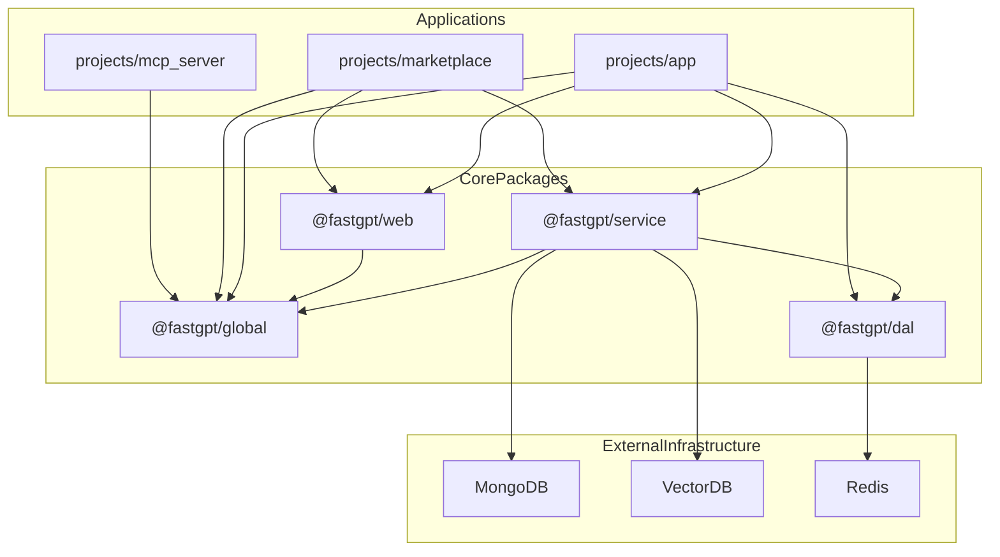
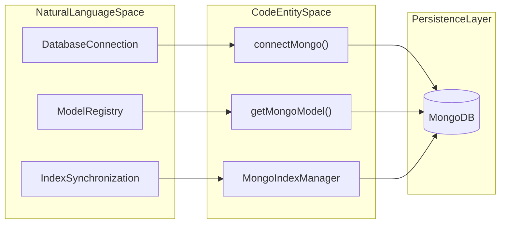
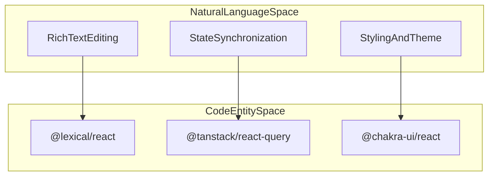

<!-- source: DeepWiki mcp.deepwiki.com · repo labring/FastGPT · page 2.2 Core Packages · fetched 2026-10-29 -->

# Core Packages

Relevant source files

The following files were used as context for generating this wiki page:

- [document/package.json](document/package.json)
- [package.json](package.json)
- [packages/global/package.json](packages/global/package.json)
- [packages/service/common/mongo/index.ts](packages/service/common/mongo/index.ts)
- [packages/service/common/mongo/init.ts](packages/service/common/mongo/init.ts)
- [packages/service/common/string/jieba/index.ts](packages/service/common/string/jieba/index.ts)
- [packages/service/core/dataset/data/dataTextSchema.ts](packages/service/core/dataset/data/dataTextSchema.ts)
- [packages/service/package.json](packages/service/package.json)
- [packages/service/test/common/mongo/index.test.ts](packages/service/test/common/mongo/index.test.ts)
- [packages/web/components/common/Icon/index.tsx](packages/web/components/common/Icon/index.tsx)
- [packages/web/components/common/Icon/svgScope.ts](packages/web/components/common/Icon/svgScope.ts)
- [packages/web/package.json](packages/web/package.json)
- [pnpm-lock.yaml](pnpm-lock.yaml)
- [pnpm-workspace.yaml](pnpm-workspace.yaml)
- [projects/app/package.json](projects/app/package.json)
- [projects/app/test/components/common/Icon/svgScope.test.ts](projects/app/test/components/common/Icon/svgScope.test.ts)
- [projects/marketplace/Dockerfile](projects/marketplace/Dockerfile)
- [projects/marketplace/package.json](projects/marketplace/package.json)
- [projects/mcp_server/Dockerfile](projects/mcp_server/Dockerfile)
- [projects/mcp_server/package.json](projects/mcp_server/package.json)
- [scripts/icon/package.json](scripts/icon/package.json)

This page documents the core packages within the FastGPT monorepo: `@fastgpt/global`, `@fastgpt/service`, `@fastgpt/web`, and `@fastgpt/dal`. These packages form the architectural backbone of the system, separating shared types/OpenAPI schemas, backend database and workflow logic, frontend UI components, and data-access/caching layers.

## Package Architecture Overview

FastGPT utilizes a pnpm monorepo structure where application projects depend on core workspace packages. This separation ensures that business logic, schemas, and UI components can be shared reliably across applications like the main app, marketplace, and MCP server.

### Core Package Relationships

Sources: [projects/app/package.json:30-54](), [projects/mcp_server/package.json:1-30](), [projects/marketplace/package.json:1-40]()

---

## 1. @fastgpt/global (Foundation Layer)

The `@fastgpt/global` package is a pure TypeScript package containing shared constants, type definitions, validation schemas, and utility functions. It has no direct dependencies on the database or UI framework, making it safe to import in any environment (browser, Node.js, or Edge Runtime).

### Key Responsibilities
*   **Type Definitions**: Defines TypeScript types and schemas for workflows, chat completion payloads, agent states, and dataset management.
*   **OpenAPI Contracts**: Leverages `zod-openapi` to construct type-safe OpenAPI specs and request validation contracts [packages/global/package.json:1-34]().
*   **Constants and Enums**: Houses system-wide enums (e.g., node types, error codes, capability flags).
*   **Utilities**: Common logic for string manipulation, time zone handling via `cron-parser`, and shared helper functions [packages/global/package.json:1-34]().

### Core Dependencies
| Dependency | Role |
| :--- | :--- |
| `zod` | Schema validation for API requests and configurations [packages/global/package.json:32-32](). |
| `openai` | Shared types for AI model interactions [packages/global/package.json:29-29](). |
| `axios` | Base HTTP client configuration [packages/global/package.json:19-19](). |
| `zod-openapi` | OpenAPI schema generation from Zod validators [packages/global/package.json:33-33](). |

Sources: [packages/global/package.json:1-34]()

---

## 2. @fastgpt/service (Backend Logic)

The `@fastgpt/service` package contains the backend business logic. It manages database connections via Mongoose, executes visual workflows, handles file parsing, and orchestrates AI operations.

### Database Initialization & Query Pipeline

Sources: [packages/service/common/mongo/init.ts:1-73](), [packages/service/common/mongo/index.ts:1-180]()

### Key Subsystems
*   **Database Management**: Implements connection pools, slow query monitoring (>500ms and >2s warnings), and automatic index synchronization via `connectMongo` and `getMongoModel` [packages/service/common/mongo/init.ts:1-73](), [packages/service/common/mongo/index.ts:1-180]().
*   **Workflow Engine**: Executes Directed Acyclic Graphs (DAGs) representing multi-step agent and prompt workflows.
*   **Dataset and RAG Pipeline**: Manages embedding generation, text chunking, and vector searches using SDKs like `@zilliz/milvus2-sdk-node` [packages/service/package.json:35-35]().
*   **File Processing**: Extracts content from structured and unstructured documents utilizing libraries like `pdfjs-dist` [packages/service/package.json:68-68]() and `mammoth` [packages/service/package.json:58-58]().

Sources: [packages/service/package.json:1-82](), [packages/service/common/mongo/init.ts:1-73](), [packages/service/common/mongo/index.ts:1-180]()

---

## 3. @fastgpt/web (UI Components)

The `@fastgpt/web` package provides a React-based component library tailored for the FastGPT frontend ecosystem, powering the interactive workflow canvas, settings screens, and chat interfaces.

### UI State and Component Architecture

Sources: [packages/web/package.json:1-56]()

### Key Responsibilities
*   **Shared UI Elements**: Reusable components built on top of `@chakra-ui/react` [packages/web/package.json:12-19]().
*   **Rich Text & Prompt Editing**: Integrates `@lexical/react` and associated plugins for advanced prompt editing and Markdown formatting [packages/web/package.json:22-29]().
*   **State Management & Data Fetching**: Utilizes `zustand` for client state and `@tanstack/react-query` for asynchronous server state synchronization [packages/web/package.json:31-55]().
*   **Internationalization**: Bundles multi-language dictionaries and context providers for global accessibility [packages/web/package.json:36-48]().

Sources: [packages/web/package.json:1-56]()

---

## 4. @fastgpt/dal (Redis Data Access Layer)

The `@fastgpt/dal` package acts as the dedicated Data Access Layer for Redis operations within FastGPT. It provides optimized abstractions for caching, rate limiting, token bucket queues, and distributed locking mechanisms used across backend services.

### Key Responsibilities
*   **Caching Layer**: Speeds up frequent lookups for user sessions, configuration settings, and token metrics.
*   **Distributed Locking**: Ensures concurrency control for sensitive operations such as user quota updates and training queue workers.
*   **Queue Management**: Supports high-throughput message and background job coordination.

Sources: [projects/app/package.json:49-49](), [packages/service/package.json:23-23]()

---

## Core Configuration and Build Environment

The core workspace packages are orchestrated via monorepo scripts located in the root `package.json` [package.json:1-31](). These scripts handle theme compilation, icon generation, and workspace build tasks.

| Script | Target Package | Description |
| :--- | :--- | :--- |
| `gen:theme-typings` | `@fastgpt/web` | Generates Chakra UI tokens for the shared theme [package.json:8-8](). |
| `initIcon` | `@fastgpt/web` | Processes SVG files into centralized icon constants [package.json:11-11](). |
| `build:sdks` | `sdk/*` | Compiles independent SDK packages prior to service bundling [package.json:30-30](). |

Sources: [package.json:1-31](), [projects/app/package.json:30-54]()

---

