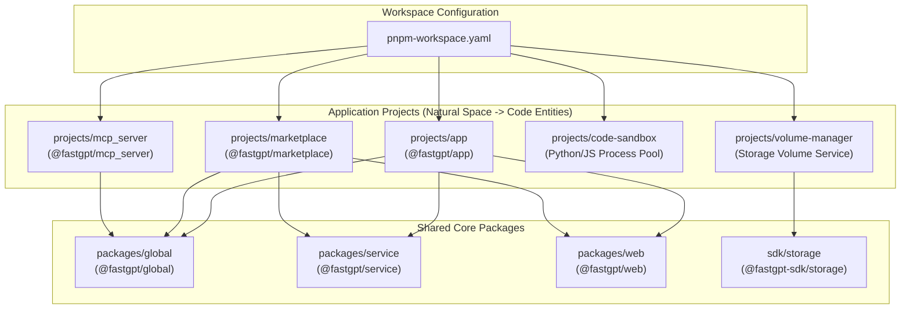
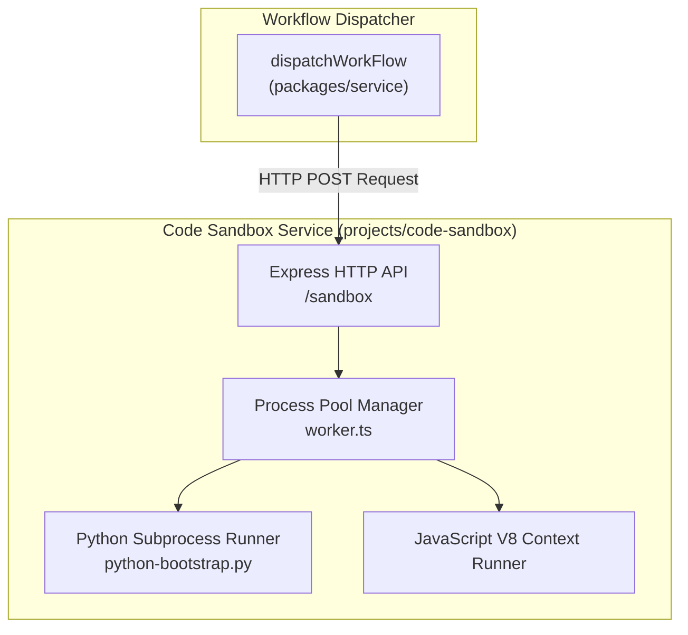
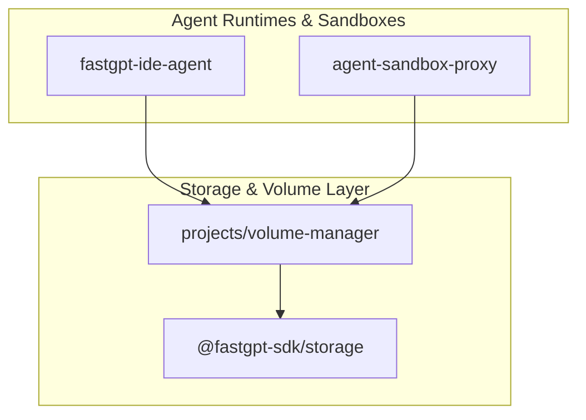

<!-- source: DeepWiki mcp.deepwiki.com · repo labring/FastGPT · page 2.3 Application Projects · fetched 2026-10-29 -->

# Application Projects

Relevant source files

The following files were used as context for generating this wiki page:

- [document/package.json](document/package.json)
- [package.json](package.json)
- [packages/global/package.json](packages/global/package.json)
- [packages/service/package.json](packages/service/package.json)
- [packages/web/package.json](packages/web/package.json)
- [pnpm-lock.yaml](pnpm-lock.yaml)
- [pnpm-workspace.yaml](pnpm-workspace.yaml)
- [projects/app/package.json](projects/app/package.json)
- [projects/app/src/pages/_app.tsx](projects/app/src/pages/_app.tsx)
- [projects/app/src/web/common/system/api.ts](projects/app/src/web/common/system/api.ts)
- [projects/marketplace/Dockerfile](projects/marketplace/Dockerfile)
- [projects/marketplace/package.json](projects/marketplace/package.json)
- [projects/mcp_server/Dockerfile](projects/mcp_server/Dockerfile)
- [projects/mcp_server/package.json](projects/mcp_server/package.json)
- [scripts/icon/package.json](scripts/icon/package.json)

This page details the application projects located in the `projects/` directory of the FastGPT monorepo. These projects represent standalone deployable runtimes, servers, and web applications that consume shared core packages such as `@fastgpt/global`, `@fastgpt/service`, and `@fastgpt/web`.

## 1. Projects Directory Overview and Workspace Structure

The `projects/` directory houses independent micro-applications and execution runtimes managed via pnpm workspaces (`pnpm-workspace.yaml`). Each project is filtered during build and deployment pipelines using Turbo and pnpm filters.

**Sources:** [pnpm-workspace.yaml:1-18](), [projects/app/package.json:1-53](), [projects/mcp_server/package.json:1-30]()

---

## 2. Main Application (`projects/app`)

The primary FastGPT user interface and API backend wrapper is hosted under `projects/app`. Built on Next.js, it consolidates administrative dashboards, visual workflow editors, knowledge base management, and chat interfaces.

### Key Characteristics & Configuration
- **Framework**: Next.js (version `16.3.6`) with server-side rendering and client-side dynamic routing [projects/app/package.json:1-150]().
- **Entrypoint**: Configured via `src/pages/_app.tsx`, wrapping the application with `appWithTranslation` and `AppShell` contexts [projects/app/src/pages/_app.tsx:1-53]().
- **Dependencies**: Integrates directly with `@fastgpt/global`, `@fastgpt/service`, `@fastgpt/web`, `@fastgpt/dal`, and `@fastgpt-sdk/otel` [projects/app/package.json:45-53]().

**Sources:** [projects/app/package.json:1-150](), [projects/app/src/pages/_app.tsx:1-53]()

---

## 3. Template Marketplace (`projects/marketplace`)

`projects/marketplace` is a dedicated Next.js application designed for community workflow template discovery, plugin installation, and ecosystem sharing.

### Architecture
- **Package Name**: `@fastgpt/marketplace` [projects/marketplace/package.json:1-3]().
- **Responsibilities**: Acts as a micro-frontend/service proxying template data from shared database entities, allowing users to browse and import workflow templates directly into their instances.
- **Dependencies**: Consumes `@fastgpt/global`, `@fastgpt/service`, and `@fastgpt/web` to maintain uniform UI patterns and database models [projects/marketplace/package.json:18-41]().

**Sources:** [projects/marketplace/package.json:1-41]()

---

## 4. Model Context Protocol Server (`projects/mcp_server`)

The `projects/mcp_server` project implements a Model Context Protocol (MCP) server that exposes FastGPT applications, tools, and datasets as standardized MCP endpoints for external AI clients (e.g., Claude Desktop).

### Implementation and Runtime
- **Server Framework**: Express combined with `@modelcontextprotocol/sdk` [projects/mcp_server/package.json:20-30]().
- **Build & Bundle**: Compiled using Bun (`bun build src/index.ts --outdir=dist --target=node`) inside a multi-stage Docker container [projects/mcp_server/package.json:11](), [projects/mcp_server/Dockerfile:1-70]().

**Sources:** [projects/mcp_server/package.json:1-34](), [projects/mcp_server/Dockerfile:1-70]()

---

## 5. Code Sandbox (`projects/code-sandbox`)

`projects/code-sandbox` provides an isolated execution environment for running Python and JavaScript snippets triggered by workflow code nodes.

### Security and Isolation
- Employs process pooling (`SANDBOX_POOL_SIZE`) to maintain pre-warmed execution contexts.
- Enforces strict resource constraints like `SANDBOX_MAX_OUTPUT_MB` and `SANDBOX_MAX_TIMEOUT` to prevent Denial of Service and SSRF vulnerabilities.

**Sources:** [pnpm-workspace.yaml:1-8]()

---

## 6. Volume Manager and Agent Sandboxes (`volume-manager`, `agent-sandbox`, `fastgpt-ide-agent`)

This group of projects handles file persistence, remote agent runtimes, and specialized skill debugging environments:
- **`projects/volume-manager`**: Manages shared persistent storage volumes, local mount points, and synchronization with S3-compatible object storage via `@fastgpt-sdk/storage`.
- **`agent-sandbox(-proxy)`**: Provides secure sidecar proxying and lifecycle management for remote containerized agent sandboxes (e.g., Sealos Devbox / OpenSandbox).
- **`fastgpt-ide-agent`**: Supplies an integrated development environment runner for authoring and testing custom AI agents and skills.

**Sources:** [pnpm-workspace.yaml:1-18]()

---

