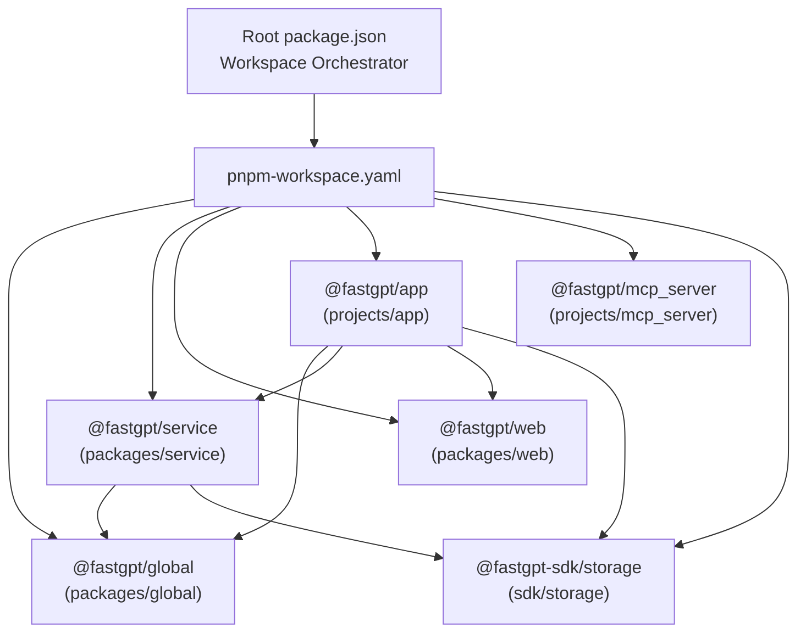
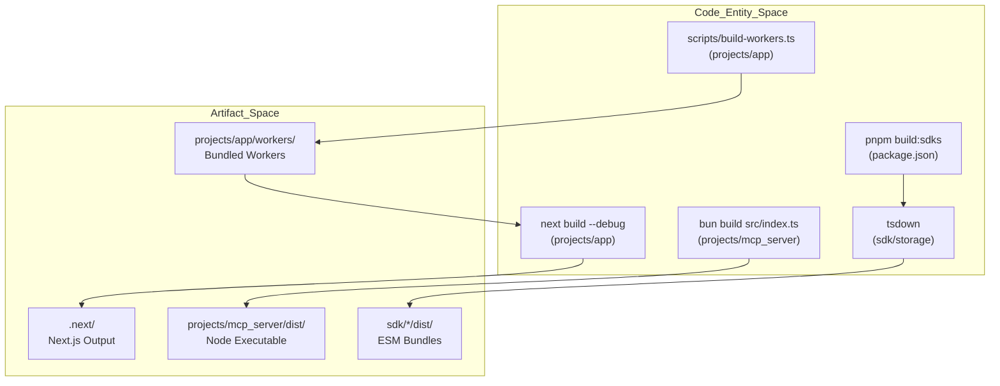
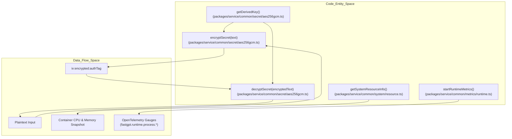

<!-- source: DeepWiki mcp.deepwiki.com · repo labring/FastGPT · page 2.4 Development Environment and Build Pipeline · fetched 2026-10-29 -->

# Development Environment and Build Pipeline

Relevant source files

The following files were used as context for generating this wiki page:

- [.dockerignore](.dockerignore)
- [deploy/dev/docker-compose.cn.yml](deploy/dev/docker-compose.cn.yml)
- [deploy/dev/docker-compose.yml](deploy/dev/docker-compose.yml)
- [packages/service/common/metrics/runtime.ts](packages/service/common/metrics/runtime.ts)
- [packages/service/common/secret/aes256gcm.ts](packages/service/common/secret/aes256gcm.ts)
- [packages/service/common/system/resource.ts](packages/service/common/system/resource.ts)
- [packages/service/test/common/secret/aes256gcm.test.ts](packages/service/test/common/secret/aes256gcm.test.ts)
- [packages/service/test/common/system/resource.test.ts](packages/service/test/common/system/resource.test.ts)
- [projects/app/Dockerfile](projects/app/Dockerfile)

## Purpose and Scope

This page documents the development environment, build orchestration, workspace configuration, and local deployment pipelines within the FastGPT monorepo. It details the `pnpm` workspace setup, monorepo package relationships, build processes for Next.js applications and bundled workers via `esbuild`, test harnesses, runtime metrics instrumentation, security utilities, and development infrastructure via `docker-compose`.

Sources: [package.json:1-31](), [pnpm-workspace.yaml:1-106](), [deploy/dev/docker-compose.yml:1-18]()

---

## Workspace Architecture and Package Organization

FastGPT is structured as a pnpm monorepo. The workspace topology is declared in `pnpm-workspace.yaml`, grouping shared packages, deployable applications, SDKs, and developer utilities [pnpm-workspace.yaml:1-18]().

### Monorepo Layout and Dependencies
- **Packages (`packages/*`)**: Core shared libraries including `@fastgpt/global` (types and schemas), `@fastgpt/service` (backend services), `@fastgpt/web` (UI primitives), and `@fastgpt/dal` [pnpm-workspace.yaml:2](), [projects/app/package.json:48-53]().
- **Projects (`projects/*`)**: Deployable services such as `projects/app`, `projects/marketplace`, `projects/mcp_server`, and `projects/code-sandbox` [pnpm-workspace.yaml:4-8]().
- **SDKs (`sdk/*`)**: Modular toolkits including `@fastgpt-sdk/storage` and `@fastgpt-sdk/otel` [pnpm-workspace.yaml:17]().

Internal inter-dependencies use the `workspace:*` protocol to link packages directly within the local workspace graph [projects/app/package.json:45-53](). External dependency versions are centrally governed through `catalog` definitions in `pnpm-workspace.yaml` and `pnpm-lock.yaml` [pnpm-lock.yaml:7-132](), [pnpm-workspace.yaml:19-105]().

Sources: [pnpm-workspace.yaml:1-18](), [projects/app/package.json:45-53](), [packages/service/package.json:17-24]()

---

## Build Systems and Pipelines

FastGPT uses heterogeneous build tools tailored to each application target within the monorepo, orchestrating multi-stage Docker builds as seen in `projects/app/Dockerfile` [projects/app/Dockerfile:1-105]().

### Build Tooling Map
- **Next.js Compilation**: Used for `projects/app` and `projects/marketplace`, compiling server-side rendering and client React components [projects/app/package.json:15](), [projects/marketplace/package.json:7]().
- **Worker Bundling**: Prior to running Next.js builds, background scripts are bundled using `esbuild` via `scripts/build-workers.ts` [projects/app/package.json:22]().
- **Bun Bundler**: Used by `projects/mcp_server` to compile standalone Node.js targets [projects/mcp_server/package.json:11]().
- **tsdown**: Used by SDK packages like `@fastgpt-sdk/storage` to output ESM distribution artifacts [sdk/storage/package.json:49]().

Sources: [package.json:30](), [projects/app/package.json:15-22](), [projects/mcp_server/package.json:11](), [sdk/storage/package.json:49]()

---

## Local Development and Infrastructure

Local development relies on Docker Compose environments defined in `deploy/dev/` (`docker-compose.yml` and `docker-compose.cn.yml`) to instantiate backing services without requiring local native installations [deploy/dev/docker-compose.yml:1-18](), [deploy/dev/docker-compose.cn.yml:1-18]().

### Local Docker Services
The development compose file defines essential backing infrastructure:
- **`fastgpt-pg`**: PostgreSQL with the `pgvector` extension running on port `5432` [deploy/dev/docker-compose.yml:60-79]().
- **`fastgpt-mongo`**: MongoDB replica set running on port `27017` [deploy/dev/docker-compose.yml:82-143]().
- **`fastgpt-redis`**: Redis instance running on port `6379` [deploy/dev/docker-compose.yml:144-161]().
- **`fastgpt-minio`**: MinIO object storage emulating S3-compatible storage on ports `9000` and `9001` [deploy/dev/docker-compose.yml:162-181]().
- **`fastgpt-code-sandbox`**: Isolated execution sandbox running on port `3002` [deploy/dev/docker-compose.yml:182-187]().

Sources: [deploy/dev/docker-compose.yml:1-187](), [deploy/dev/docker-compose.cn.yml:1-197]()

---

## Runtime Instrumentation, Security, and System Utilities

The `@fastgpt/service` package includes robust foundational modules for performance monitoring, system resource inspection, and cryptographic secret management.

### Runtime Metrics and OpenTelemetry (`packages/service/common/metrics/runtime.ts`)
The `startRuntimeMetrics()` function hooks into OpenTelemetry meters (`@fastgpt-sdk/otel/metrics`) to collect process-level performance gauges [packages/service/common/metrics/runtime.ts:35-132](). It exposes metrics covering Resident Set Size (RSS), V8 heap memory usage, external memory, array buffers, cumulative CPU user/system times, process CPU utilization percentages across cores, and process uptime [packages/service/common/metrics/runtime.ts:40-75]().

### Container-Aware System Resource Inspection (`packages/service/common/system/resource.ts`)
To operate efficiently inside containerized environments, `getSystemCpuInfo()` uses Node.js `availableParallelism()` wrapped with `lodash-es` memoization to respect `cgroups` CPU limits [packages/service/common/system/resource.ts:37-51](). Similarly, `getSystemMemoryInfo()` reads container memory boundaries via `process.constrainedMemory()` and `process.availableMemory()` to report reliable memory ceilings [packages/service/common/system/resource.ts:59-80]().

### Cryptographic AES-256-GCM Secret Management (`packages/service/common/secret/aes256gcm.ts`)
FastGPT implements authenticated encryption for sensitive configuration properties using AES-256-GCM [packages/service/common/secret/aes256gcm.ts:1-56](). 
- `getDerivedKey()` uses `crypto.scryptSync()` to derive 32-byte keys from `serviceEnv.AES256_SECRET_KEY`, memoizing results to prevent expensive KDF recomputations [packages/service/common/secret/aes256gcm.ts:11-16]().
- `encryptSecret()` generates a random 16-byte initialization vector (`iv`), encrypts the plaintext payload, computes an authentication tag, and returns a formatted string (`iv:encrypted:authTag`) [packages/service/common/secret/aes256gcm.ts:23-30]().
- `decryptSecret()` splits the composite ciphertext string, verifies the authentication tag via `crypto.createDecipheriv()`, and recovers the original plaintext [packages/service/common/secret/aes256gcm.ts:37-56]().

Sources: [packages/service/common/metrics/runtime.ts:35-132](), [packages/service/common/system/resource.ts:37-86](), [packages/service/common/secret/aes256gcm.ts:11-56]()

---

## Testing Framework and Quality Assurance

Testing and validation are structured across packages using **Vitest** and static analysis tools [package.json:17-30](), [projects/app/package.json:20-24]().

### Test Suites and Execution
- **Workspace Tests**: Executed via `pnpm test:workspace`, running turbo filters across core packages [package.json:20]().
- **Integration Tests**: Specialized suites such as `test:integration` and `test:integration:sandbox` validate service integration layers [packages/service/package.json:9-10]().
- **Unit and Cryptographic Tests**: Validated via unit specs such as `aes256gcm.test.ts` and `resource.test.ts`, ensuring encryption round-trips and container resource constraints behave correctly [packages/service/test/common/secret/aes256gcm.test.ts:1-143](), [packages/service/test/common/system/resource.test.ts:1-89]().
- **Linting & Code Style**: Enforced using ESLint (`@typescript-eslint/eslint-plugin`) and Prettier via `turbo run lint` [package.json:13](), [pnpm-workspace.yaml:112-120]().

Sources: [package.json:13-30](), [projects/app/package.json:20-24](), [packages/service/package.json:6-12](), [packages/service/test/common/secret/aes256gcm.test.ts:1-143](), [packages/service/test/common/system/resource.test.ts:1-89]()

---

