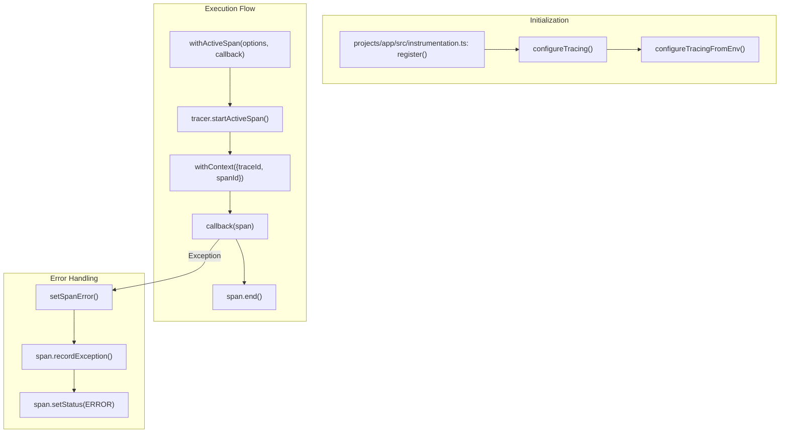
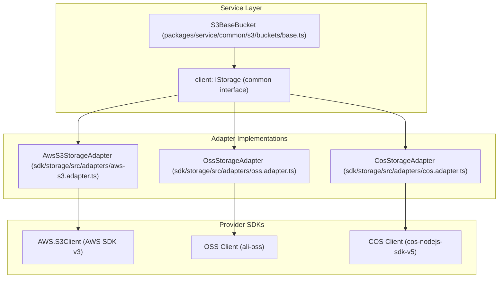
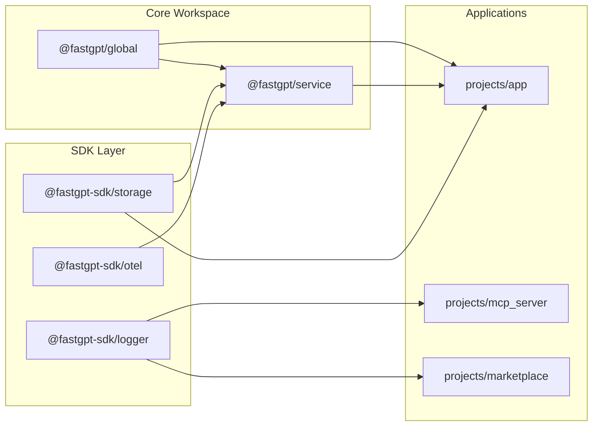

<!-- source: DeepWiki mcp.deepwiki.com · repo labring/FastGPT · page 2.5 Observability SDK · fetched 2026-10-29 -->

# Observability SDK

Relevant source files

The following files were used as context for generating this wiki page:

- [packages/global/common/error/code/s3.ts](packages/global/common/error/code/s3.ts)
- [packages/global/common/error/s3.ts](packages/global/common/error/s3.ts)
- [packages/global/common/file/utils.ts](packages/global/common/file/utils.ts)
- [packages/global/test/common/error/s3.test.ts](packages/global/test/common/error/s3.test.ts)
- [packages/global/test/common/file/utils.test.ts](packages/global/test/common/file/utils.test.ts)
- [packages/service/common/s3/buckets/base.ts](packages/service/common/s3/buckets/base.ts)
- [packages/service/common/s3/contracts/type.ts](packages/service/common/s3/contracts/type.ts)
- [packages/service/common/s3/queue/delete.ts](packages/service/common/s3/queue/delete.ts)
- [packages/service/common/s3/uploadPolicy/service.ts](packages/service/common/s3/uploadPolicy/service.ts)
- [packages/service/common/s3/validation/upload.ts](packages/service/common/s3/validation/upload.ts)
- [packages/service/test/common/s3/deleteQueue.test.ts](packages/service/test/common/s3/deleteQueue.test.ts)
- [packages/service/test/common/s3/uploadPolicy.test.ts](packages/service/test/common/s3/uploadPolicy.test.ts)
- [packages/service/test/common/s3/uploadValidation.test.ts](packages/service/test/common/s3/uploadValidation.test.ts)
- [packages/web/common/file/uploader/utils.ts](packages/web/common/file/uploader/utils.ts)
- [projects/app/test/service/common/file/utils.test.ts](projects/app/test/service/common/file/utils.test.ts)
- [sdk/storage/README.md](sdk/storage/README.md)
- [sdk/storage/package.json](sdk/storage/package.json)
- [sdk/storage/src/adapters/aws-s3.adapter.ts](sdk/storage/src/adapters/aws-s3.adapter.ts)
- [sdk/storage/src/adapters/cos.adapter.ts](sdk/storage/src/adapters/cos.adapter.ts)
- [sdk/storage/src/adapters/minio.adapter.ts](sdk/storage/src/adapters/minio.adapter.ts)
- [sdk/storage/src/adapters/oss.adapter.ts](sdk/storage/src/adapters/oss.adapter.ts)
- [sdk/storage/src/assert.ts](sdk/storage/src/assert.ts)
- [sdk/storage/src/helper/mock.ts](sdk/storage/src/helper/mock.ts)
- [sdk/storage/src/index.ts](sdk/storage/src/index.ts)
- [sdk/storage/src/interface.ts](sdk/storage/src/interface.ts)
- [sdk/storage/src/types.ts](sdk/storage/src/types.ts)
- [sdk/storage/src/utils.ts](sdk/storage/src/utils.ts)
- [sdk/storage/test/unit/adapters/aws-s3.adapter.test.ts](sdk/storage/test/unit/adapters/aws-s3.adapter.test.ts)
- [sdk/storage/test/unit/adapters/cos.adapter.test.ts](sdk/storage/test/unit/adapters/cos.adapter.test.ts)
- [sdk/storage/test/unit/adapters/oss.adapter.test.ts](sdk/storage/test/unit/adapters/oss.adapter.test.ts)
- [sdk/storage/test/unit/assert.test.ts](sdk/storage/test/unit/assert.test.ts)

The FastGPT Observability SDK provides a comprehensive suite of tools supporting instrumentation, distributed tracing, structured logging, and unified S3-compatible object storage across the monorepo. It comprises specialized packages located under `sdk/`:

- `@fastgpt-sdk/otel`: OpenTelemetry-based tracing instrumentation,
- `@fastgpt-sdk/logger`: Structured logging with trace context,
- `@fastgpt-sdk/storage`: Unified object storage interface and adapters for multiple S3-compatible providers,
- `sandbox-adapter` (not detailed here): Integrations with sandbox runtimes.

These packages enable consistent observability and resource management and are consumed by core service packages (`@fastgpt/service`) as well as application projects (`projects/app`, `projects/mcp_server`, etc.).

---

## OpenTelemetry and Distributed Tracing (@fastgpt-sdk/otel)

FastGPT leverages OpenTelemetry (OTel) to deliver distributed tracing and performance monitoring capabilities, allowing the tracing of request lifecycles across services and workflows.

### Initialization and Configuration

Observability instrumentation is initialized during application registration in `projects/app/src/instrumentation.ts`:

- `configureMetrics()`: Sets up OTel metrics collection.
- `configureTracing()`: Initializes the OTel tracer provider with environment-aware sampling.
- `configureTracingFromEnv()`: Core function reading environment variables to configure OTel providers [packages/service/common/tracing/client.ts:62-69]().
  
### Trace Context and Span Management

The SDK exports utility `withActiveSpan` to easily create scoped OpenTelemetry tracing spans. The function:

- Starts an active span,
- Executes user callback passing in the span,
- Automatically catches exceptions, recording them on the span,
- Ends the span on completion,
- Propagates trace context (`traceId`, `spanId`) into logging context for correlation [packages/service/common/tracing/client.ts:93-125]().

---

### Trace Initialization and Execution Flow

Sources: [projects/app/src/instrumentation.ts:6](), [packages/service/common/tracing/client.ts:62-69](), [packages/service/common/tracing/client.ts:93-125]()

---

## Structured Logging (@fastgpt-sdk/logger)

The logging package offers structured and categorized logging, tightly integrated with the tracing system for context propagation.

### Implementation Highlights

- `configureLogger()`: Initializes logging transports, optionally integrating with OpenTelemetry.
- `getLogger(category)`: Retrieves a logger bound to a specific domain/category (e.g., `SYSTEM`, `HTTP`).
- Log entries include trace context (`traceId`, `spanId`) for correlation with traces.
- Used extensively for infrastructure-level logs such as system startup, errors, and operational metrics [projects/app/src/instrumentation.ts:6]().

### Log Categories and Usage

| Package                | Purpose                               | Consumers                      |
|------------------------|-------------------------------------|--------------------------------|
| `@fastgpt-sdk/logger`  | Structured logging with trace context | `projects/mcp_server`, `projects/marketplace` |
| `LogCategories`        | Enumeration of log domains (e.g. SYSTEM) | `projects/app`, core packages  |

Sources: [projects/app/src/instrumentation.ts:6](), [projects/mcp_server/package.json:21-22](), [projects/marketplace/package.json:22-24]()

---

## Unified S3-Compatible Storage Interface (@fastgpt-sdk/storage)

The storage package exposes a vendor-agnostic interface for object storage operations supporting multiple backends. It serves to unify file uploads, downloads, metadata operations, and Multipart uploads across providers with a consistent SDK.

### Core Interface: IStorage

The `IStorage` interface defines methods such as:

- `uploadObject()`,
- `downloadObject()`,
- `checkObjectExists()`,
- `createMultipartUpload()`,
- `uploadMultipartPart()`,
- `completeMultipartUpload()`,
- `abortMultipartUpload()`,

with uniform parameter and result types for keys, metadata, content types, body streams, and abort signals [sdk/storage/src/interface.ts:228-300]().

### Key Adapters for Major Storage Providers

- **AWS S3, MinIO, Cloudflare R2**: `AwsS3StorageAdapter` wraps AWS SDK v3 client with multipart and presigned URL support [sdk/storage/src/adapters/aws-s3.adapter.ts:39-224]().

- **Alibaba Cloud OSS**: `OssStorageAdapter` uses ali-oss SDK with compatible multipart and metadata handling [sdk/storage/src/adapters/oss.adapter.ts:26-217]().

- **Tencent Cloud COS**: `CosStorageAdapter` interfaces with cos-nodejs-sdk-v5 with multipart and metadata adaptation [sdk/storage/src/adapters/cos.adapter.ts:26-227]().

### Storage Bucket Management: S3BaseBucket

Higher-level bucket management resides in `S3BaseBucket` [packages/service/common/s3/buckets/base.ts:116-200]():

- Wraps an `IStorage` client and optionally an external client,
- Provides health check via creating+reading a test object and cleaning up,
- Implements safe operations like object copy, move, and deletion with fallback key resolution to handle encoding variants,
- Manages transient TTL for temporary uploaded files using MongoDB TTL records.

---

### Storage Adapter Routing Flow

This structure enables seamless switching or multi-provider deployment by encapsulating vendor-specific logic behind the unified `IStorage` interface.

Sources: [packages/service/common/s3/buckets/base.ts:116-200](), [sdk/storage/src/interface.ts:228-300](), [sdk/storage/src/adapters/aws-s3.adapter.ts:39-224](), [sdk/storage/src/adapters/oss.adapter.ts:26-217](), [sdk/storage/src/adapters/cos.adapter.ts:26-227]()

---

## SDK Dependency and Usage Mapping

The following diagram highlights how the SDK packages propagate observability capabilities into FastGPT’s core service and applications.

- `@fastgpt-sdk/otel` and `@fastgpt-sdk/storage` are primarily consumed by backend service code (`@fastgpt/service`).
- `@fastgpt-sdk/logger` supports logging in microservices such as MCP server and marketplace.
- Applications like `projects/app` also utilize storage SDK for media and file management.

Sources: [packages/service/package.json:11-13](), [projects/app/package.json:29-31](), [projects/mcp_server/package.json:21-22](), [projects/marketplace/package.json:22-24]()

---

## System Health and Sampling Control

Observability components participate in system health checks, e.g., ensuring MongoDB, Redis, and vector databases are reachable during startup [projects/app/src/instrumentation.ts:6](). 

Tracing is configured with environment-based sampling:

- Production environment uses 1% sampling (`0.01`),
- Other environments use full 100% sampling (`1`) to facilitate debugging [packages/service/common/tracing/client.ts:32-43]().

This balances performance overhead with diagnostic visibility.

---

# Summary

The Observability SDK in FastGPT encompasses:

- **Distributed Tracing with OpenTelemetry** (`@fastgpt-sdk/otel`): enabling detailed trace context propagation and span management for HTTP requests, LLM calls, and workflow nodes.

- **Structured Logging** (`@fastgpt-sdk/logger`): supporting domain-specific logs enriched with trace identifiers for seamless trace-log correlation.

- **Unified Object Storage Interface** (`@fastgpt-sdk/storage`): abstracting complex multipart upload and metadata management across multiple S3-compatible vendors via a consistent API.

These components form the foundational observability and storage capabilities that underpin the FastGPT platform’s reliability, extensibility, and developer experience.

---

# References

- `projects/app/src/instrumentation.ts:6-51`
- `packages/service/common/tracing/client.ts:30-130`
- `packages/service/common/s3/buckets/base.ts:1-200`
- `sdk/storage/src/interface.ts:228-300`
- `sdk/storage/src/adapters/aws-s3.adapter.ts:1-224`
- `sdk/storage/src/adapters/oss.adapter.ts:1-217`
- `sdk/storage/src/adapters/cos.adapter.ts:1-227`

---

