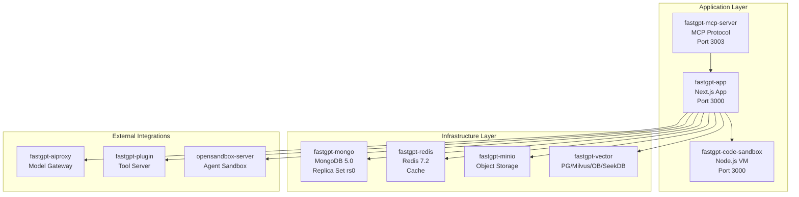
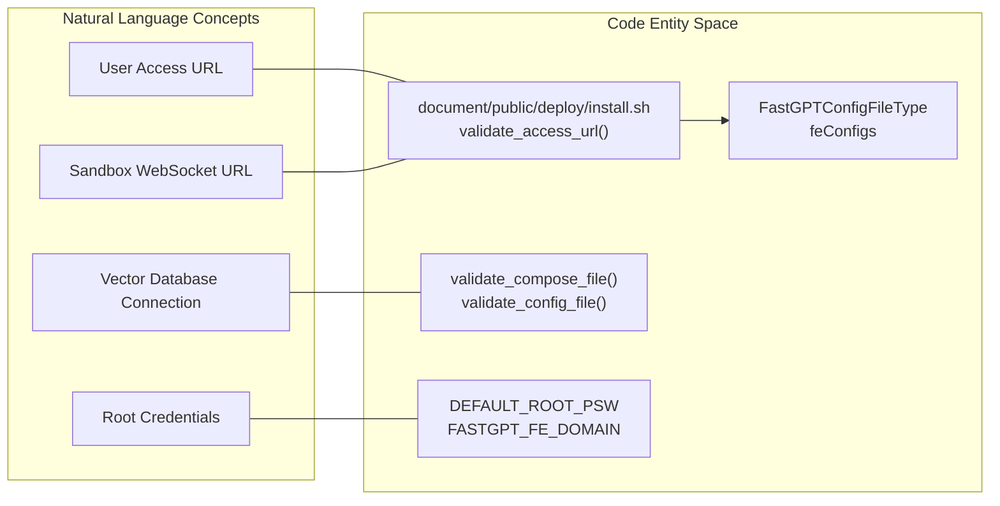

<!-- source: DeepWiki mcp.deepwiki.com · repo labring/FastGPT · page 3 Deployment and Infrastructure · fetched 2026-10-29 -->

# Deployment and Infrastructure

Relevant source files

The following files were used as context for generating this wiki page:

- [document/content/self-host/deploy/docker.en.mdx](document/content/self-host/deploy/docker.en.mdx)
- [document/content/self-host/deploy/docker.mdx](document/content/self-host/deploy/docker.mdx)
- [document/public/deploy/SKILL.md](document/public/deploy/SKILL.md)
- [document/public/deploy/install.sh](document/public/deploy/install.sh)

This document covers the deployment architecture and infrastructure components of FastGPT, including deployment options, service orchestration, database integration patterns, and environment configuration. FastGPT supports a containerized microservices architecture with flexible options ranging from interactive shell scripts and Docker Compose variants to enterprise Kubernetes and Sealos deployments.

**Related Sections:**
- [Docker Deployment Options](#3.1) — Detail the various Docker Compose configurations for different vector database backends (PG Vector, Milvus, Zilliz, OceanBase, SeekDB) across `cn/` and `global/` variants [document/content/self-host/deploy/docker.mdx:167-186]()
- [System Configuration and Environment Variables](#3.2) — Document `FastGPTConfigFileType`, `SystemEnvType`, `FastGPTFeConfigsType`, and environment validation via shell installation scripts [document/public/deploy/install.sh:138-154]()
- [Vector Database Integration](#3.3) — Explain the abstraction layer for vector databases and how to configure PG Vector, Milvus, OceanBase, or Zilliz [document/content/self-host/deploy/docker.mdx:28-56]()
- [Multi-Database Architecture](#3.4) — Document the use of MongoDB for structured data, vector databases for embeddings, Redis for caching/queues, and S3 for file storage [document/content/self-host/deploy/docker.mdx:18-24]()
- [Kubernetes and Helm Deployment](#3.5) — Document the Helm charts and manifests in `deploy/` for deploying FastGPT and opensandbox on Kubernetes
- [Version Updates and Migration Procedures](#3.6) — Guide users through upgrade procedures, migration scripts, and version-specific changes documented in self-host guides
- [CI/CD Pipelines](#3.7) — Document GitHub Actions and Forgejo workflows for building and previewing multi-arch service images

Sources: [document/content/self-host/deploy/docker.mdx:167-186](), [document/public/deploy/install.sh:138-154]()

## Deployment Options Overview

FastGPT provides multiple deployment pathways designed for different scale and operational environments, ranging from zero-config cloud platforms to custom self-hosted container clusters.

### Sealos Cloud Platform and Scripted Deployment
Sealos provides a managed Kubernetes environment optimized for FastGPT, offering one-click deployment with automatic scaling. For self-hosted environments, FastGPT provides interactive and non-interactive shell deployment scripts (`install.sh`) that automatically handle credential generation, network interface detection, and Docker socket binding [document/public/deploy/install.sh:146-154](). For details, see [Docker Deployment Options](#3.1).

### Docker Compose Variants and Regions
Docker Compose serves as the primary self-hosting mechanism. Configurations are segmented into regional mirrors (`cn/` using Aliyun container registries and `global/` using GitHub Container Registry or Docker Hub) and vector database types [document/content/self-host/deploy/docker.mdx:170-185](). For details, see [Docker Deployment Options](#3.1).

### Kubernetes and Helm
For enterprise orchestration, FastGPT provides comprehensive Helm charts and Kubernetes manifests in `deploy/` [document/content/self-host/deploy/docker.mdx:15-17](). For details, see [Kubernetes and Helm Deployment](#3.5).

Sources: [document/content/self-host/deploy/docker.mdx:15-24](), [document/public/deploy/install.sh:146-154]()

## Container Service Architecture

The FastGPT runtime ecosystem relies on a set of cooperating microservices coordinated via Docker Compose or Kubernetes orchestrators.

Title: "FastGPT Container Service Relationships"

Sources: [document/content/self-host/deploy/docker.mdx:18-24](), [document/public/deploy/SKILL.md:92-100]()

## Infrastructure Components and Multi-Database Storage

FastGPT adopts a multi-database architecture to partition responsibilities across structured application state, high-dimensional vector representations, caching layers, and object stores.

### Storage and Caching Backends
- **MongoDB**: Manages structured relational entities, users, application flows, team permissions, and chat logs [document/content/self-host/deploy/docker.mdx:20](). Requires replica set mode (`rs0`) for transaction support.
- **Vector Databases**: Pluggable storage engines for vector embeddings (PGVector, Milvus, OceanBase, SeekDB, Zilliz) [document/content/self-host/deploy/docker.mdx:21](). For details, see [Vector Database Integration](#3.3) and [Multi-Database Architecture](#3.4).
- **Redis**: Handles rate limiting, transient queues, and session caching [document/content/self-host/deploy/docker.mdx:18-24]().
- **MinIO / S3**: Provides S3-compatible object storage for file uploads and document ingestion. For details, see [Multi-Database Architecture](#3.4).

Sources: [document/content/self-host/deploy/docker.mdx:18-24](), [document/public/deploy/install.sh:146-154]()

## System Configuration and Deployment Management

Configuration parameters, such as domain bindings, security secrets, and environment profiles, are injected via environment files (`.env` or Docker Compose environment blocks) and initialization scripts.

Title: "Deployment Configuration to Code Mapping"

Sources: [document/public/deploy/install.sh:120-154](), [document/public/deploy/SKILL.md:65-73]()

## Summary of Child Topics

- **Docker Deployment Options**: Detailed in [Docker Deployment Options](#3.1). Covers `cn/` and `global/` compose templates for PG Vector, Milvus, OceanBase, SeekDB, and Zilliz.
- **System Configuration**: Detailed in [System Configuration and Environment Variables](#3.2). Covers `install.sh` validation logic, `.env.template`, and `feConfigs`.
- **Vector Database Integration**: Detailed in [Vector Database Integration](#3.3). Covers abstraction layers and connector configurations.
- **Multi-Database Architecture**: Detailed in [Multi-Database Architecture](#3.4). Covers Mongo, Vector DB, Redis, and S3 interactions.
- **Kubernetes and Helm**: Detailed in [Kubernetes and Helm Deployment](#3.5). Covers Helm charts and manifests in `deploy/`.
- **Version Updates and Migration**: Detailed in [Version Updates and Migration Procedures](#3.6). Covers upgrading guidelines and migration scripts.
- **CI/CD Pipelines**: Detailed in [CI/CD Pipelines](#3.7). Covers GitHub Actions workflows for multi-arch image publishing.

Sources: [document/content/self-host/deploy/docker.mdx:1-210](), [document/public/deploy/install.sh:1-150]()

---

