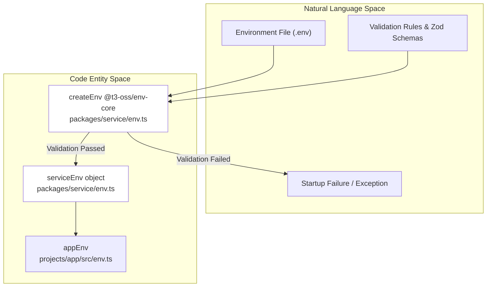
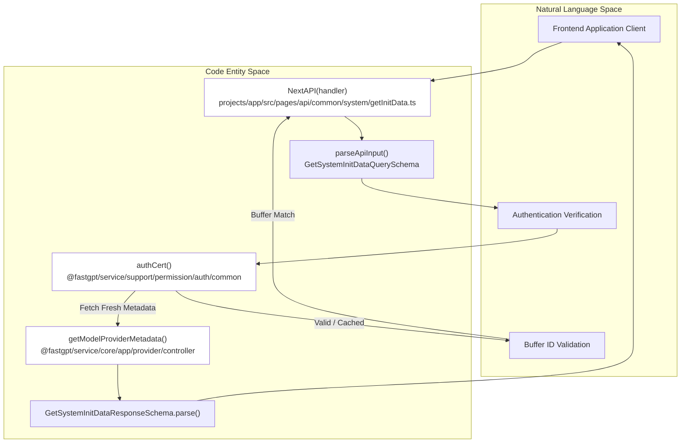
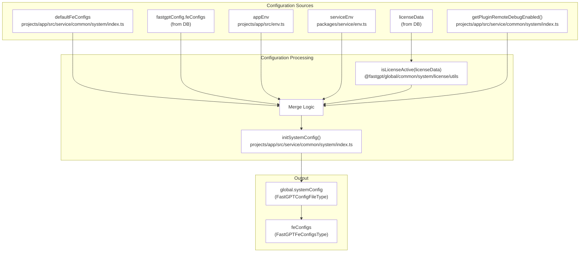

<!-- source: DeepWiki mcp.deepwiki.com · repo labring/FastGPT · page 3.2 System Configuration and Environment Variables · fetched 2026-10-29 -->

# System Configuration and Environment Variables

Relevant source files

The following files were used as context for generating this wiki page:

- [document/content/self-host/config/env.en.mdx](document/content/self-host/config/env.en.mdx)
- [document/content/self-host/config/env.mdx](document/content/self-host/config/env.mdx)
- [packages/global/common/system/types/index.ts](packages/global/common/system/types/index.ts)
- [packages/global/openapi/common/system/api.ts](packages/global/openapi/common/system/api.ts)
- [packages/service/env.ts](packages/service/env.ts)
- [packages/service/support/permission/memberGroup/teamDefaultGroup.ts](packages/service/support/permission/memberGroup/teamDefaultGroup.ts)
- [packages/service/test/env.test.ts](packages/service/test/env.test.ts)
- [packages/service/test/support/permission/memberGroup/teamDefaultGroup.test.ts](packages/service/test/support/permission/memberGroup/teamDefaultGroup.test.ts)
- [packages/service/test/support/user/team/controller.test.ts](packages/service/test/support/user/team/controller.test.ts)
- [projects/app/.env.template](projects/app/.env.template)
- [projects/app/src/env.ts](projects/app/src/env.ts)
- [projects/app/src/pageComponents/admin/config/ImportPluginModal.tsx](projects/app/src/pageComponents/admin/config/ImportPluginModal.tsx)
- [projects/app/src/pageComponents/admin/config/ToolProvider.tsx](projects/app/src/pageComponents/admin/config/ToolProvider.tsx)
- [projects/app/src/pages/config/tool/marketplace.tsx](projects/app/src/pages/config/tool/marketplace.tsx)
- [projects/app/src/pages/dashboard/systemTool/index.tsx](projects/app/src/pages/dashboard/systemTool/index.tsx)
- [projects/app/src/service/common/system/index.ts](projects/app/src/service/common/system/index.ts)

This page details FastGPT's configuration system architecture, covering runtime environment validation via `serviceEnv`, environment templates (`.env.template`), frontend configuration (`feConfigs`), and the initialization data delivery mechanism (`getInitData`).

For deployment options, see [Docker Deployment Options](#3.1). For AI model configurations, see [AI Model Configuration and Selection](#9.1).

---

## Service Environment Validation (`serviceEnv`)

FastGPT validates backend environment variables at startup using `@t3-oss/env-core` combined with `zod` validation schemas defined in `packages/service/env.ts` [packages/service/env.ts:1-29]().

During production builds (`isPhaseProductionBuild`), validation is automatically bypassed to allow image compilation without full external service dependencies [packages/service/env.ts:3-3](). At runtime, missing or invalid required variables (such as `FILE_TOKEN_KEY`, `AES256_SECRET_KEY`, `INVOKE_TOKEN_SECRET`, or required AI Proxy configuration) immediately fail startup [packages/service/env.ts:42-46](), [document/content/self-host/config/env.mdx:15-15]().

*Diagram 1: Environment Validation Architecture bridging configuration files to runtime code entities (`serviceEnv`)*

Sources: [packages/service/env.ts:1-30](), [document/content/self-host/config/env.mdx:13-16]()

---

## Environment Template and Variables (`.env.template`)

The reference environment template at `projects/app/.env.template` organizes variables into functional sections [projects/app/.env.template:1-206]():

| Category | Key Variables | Description |
|----------|---------------|-------------|
| **Basics & Secrets** | `DEFAULT_ROOT_PSW`, `DB_MAX_LINK`, `SYNC_INDEX`, `ROOT_KEY`, `FILE_TOKEN_KEY`, `AES256_SECRET_KEY`, `INVOKE_TOKEN_SECRET` | System root password, connection pool sizes (`DB_MAX_LINK`), index synchronization flags, and mandatory cryptographic tokens [projects/app/.env.template:1-18](). |
| **Service URLs & Integrations** | `PLUGIN_BASE_URL`, `CODE_SANDBOX_URL`, `AIPROXY_API_ENDPOINT`, `AIPROXY_API_TOKEN`, `MARKETPLACE_URL` | Endpoints and tokens for external microservices, AI Proxy gateway, and tool marketplaces [projects/app/.env.template:30-50](). |
| **Agent Sandbox** | `AGENT_SANDBOX_PROVIDER`, `AGENT_SANDBOX_SEALOS_*`, `AGENT_SANDBOX_OPENSANDBOX_*`, `AGENT_SANDBOX_PROXY_SECRET` | Configuration for isolated container execution runtimes (`sealosdevbox` or `opensandbox`), resource limits, and WebSocket proxies [projects/app/.env.template:53-92](). |
| **Object Storage** | `STORAGE_VENDOR`, `STORAGE_S3_ENDPOINT`, `STORAGE_PUBLIC_BUCKET`, `STORAGE_PRIVATE_BUCKET` | S3-compatible storage integration settings for MinIO, AWS S3, Tencent COS, or Alibaba OSS [projects/app/.env.template:101-117](). |
| **Databases & Caching** | `MONGODB_URI`, `REDIS_URL`, `PG_URL`, `VECTOR_VQ_LEVEL` | Connection strings for MongoDB (structured data), Redis (caching and stream queues), and Vector stores (PostgreSQL, Milvus, OceanBase, openGauss) [projects/app/.env.template:122-152](). |
| **Security & Limits** | `USE_IP_LIMIT`, `CHECK_INTERNAL_IP`, `CSRF_ENABLED`, `TRUSTED_PROXY_ENABLE` | IP throttling, internal network inspection, CSRF validation, and trusted reverse proxy configurations [projects/app/.env.template:188-206](). |

Sources: [projects/app/.env.template:1-206](), [packages/service/env.ts:31-169]()

---

## System Initialization Data Delivery (`getInitData`)

Client applications bootstrap their runtime environment and feature flags by querying the system initialization API endpoint located at `projects/app/src/pages/api/common/system/getInitData.ts` [projects/app/src/pages/api/common/system/getInitData.ts:1-73]().

*Diagram 2: System Initialization Data Delivery Flow linking HTTP requests to controller and schema validation entities*

### Initialization Handler Logic

The handler function processes incoming requests with an optional `bufferId` query parameter to optimize bandwidth through client-side caching [projects/app/src/pages/api/common/system/getInitData.ts:14-21]().

1.  **Query Parsing:** Validates query parameters against `GetSystemInitDataQuerySchema` [projects/app/src/pages/api/common/system/getInitData.ts:18-21]().
2.  **Authentication Check:** Executes `authCert({ req, authToken: true })` to verify user permissions [projects/app/src/pages/api/common/system/getInitData.ts:26]().
3.  **Buffer Optimization:** If the provided `bufferId` matches `global.systemInitBufferId`, it returns a lightweight payload containing only `bufferId`, `feConfigs`, and `systemVersion` [projects/app/src/pages/api/common/system/getInitData.ts:28-35]().
4.  **Full Payload Delivery:** Otherwise, it delivers complete runtime data including `feConfigs`, runtime subscription plans (`subPlans`), system version, and AI Proxy channel metadata (`getModelProviderMetadata().aiproxyChannels`) [projects/app/src/pages/api/common/system/getInitData.ts:37-43]().

Sources: [projects/app/src/pages/api/common/system/getInitData.ts:1-73](), [packages/global/openapi/common/system/api.ts:1-50]()

---

## FastGPTConfigFileType and Frontend Configurations (`feConfigs`)

The `FastGPTConfigFileType` [packages/global/common/system/types/index.ts:141-170]() defines the structure for system-wide configurations, including `feConfigs` which are specifically tailored for the frontend application. These configurations control various UI behaviors, feature visibility, and external service integrations.

The `feConfigs` object is initialized in `projects/app/src/service/common/system/index.ts` [projects/app/src/service/common/system/index.ts:142-168]() by merging `defaultFeConfigs` [projects/app/src/service/common/system/index.ts:94-117]() with database-stored configurations (`fastgptConfig.feConfigs`) and environment variables (`appEnv`, `serviceEnv`).

Key `feConfigs` properties include:

*   `show_git`: Controls the visibility of GitHub repository links [projects/app/src/service/common/system/index.ts:95]().
*   `docUrl`, `openAPIDocUrl`: Links to documentation [projects/app/src/service/common/system/index.ts:96-97]().
*   `isPlus`: Indicates if a commercial license is active [projects/app/src/service/common/system/index.ts:151]().
*   `isProService`: Indicates if the commercial (pro) service is deployed and configured via `PRO_URL` [projects/app/src/service/common/system/index.ts:153]().
*   `hideChatCopyrightSetting`: Hides chat copyright customization options [projects/app/src/service/common/system/index.ts:154]().
*   `marketplaceUrl`: The URL for the plugin marketplace [projects/app/src/service/common/system/index.ts:162]().
*   `pluginRemoteDebug`: Enables or disables remote debugging for custom plugins, determined by probing the plugin service [projects/app/src/service/common/system/index.ts:160](), [projects/app/src/service/common/system/index.ts:119-129]().
*   `limit`: Defines various system limits such as file upload size, file amount, and workflow concurrency [projects/app/src/service/common/system/index.ts:105-113]().

*Diagram 3: `feConfigs` Generation Flow*

Sources:
*   [packages/global/common/system/types/index.ts:59-201]()
*   [projects/app/src/service/common/system/index.ts:94-117]()
*   [projects/app/src/service/common/system/index.ts:119-129]()
*   [projects/app/src/service/common/system/index.ts:142-168]()
*   [projects/app/src/env.ts:5-27]()
*   [packages/service/env.ts:31-169]()

---

