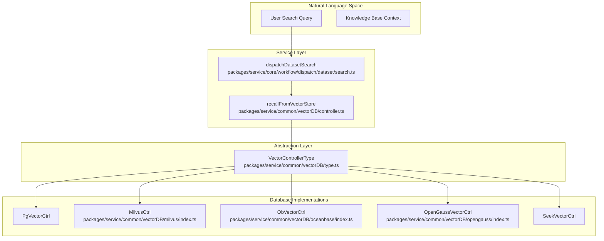
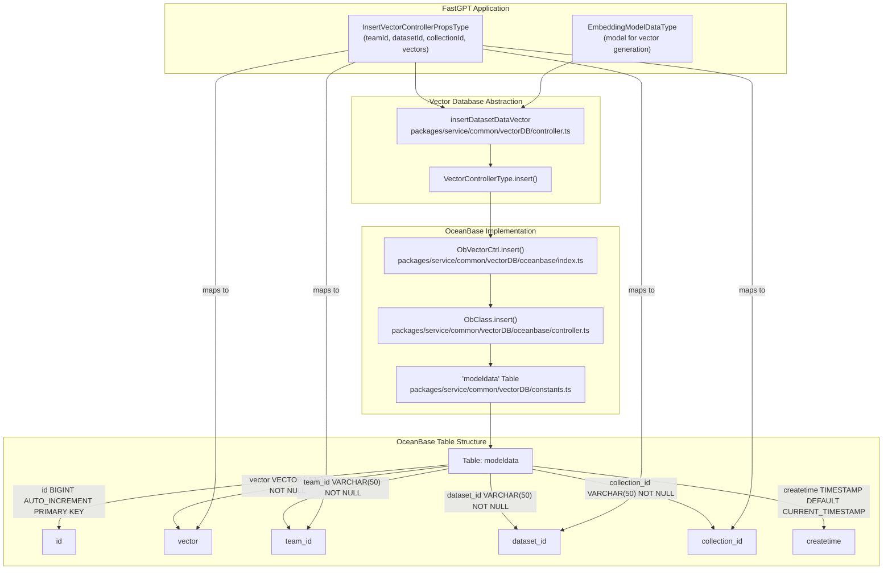

<!-- source: DeepWiki mcp.deepwiki.com · repo labring/FastGPT · page 3.3 Vector Database Integration · fetched 2026-10-29 -->

# Vector Database Integration

Relevant source files

The following files were used as context for generating this wiki page:

- [deploy/templates/vector/opengauss.txt](deploy/templates/vector/opengauss.txt)
- [packages/global/common/system/utils.ts](packages/global/common/system/utils.ts)
- [packages/global/test/common/system/utils.test.ts](packages/global/test/common/system/utils.test.ts)
- [packages/service/common/vectorDB/constants.ts](packages/service/common/vectorDB/constants.ts)
- [packages/service/common/vectorDB/controller.ts](packages/service/common/vectorDB/controller.ts)
- [packages/service/common/vectorDB/milvus/index.ts](packages/service/common/vectorDB/milvus/index.ts)
- [packages/service/common/vectorDB/oceanbase/controller.ts](packages/service/common/vectorDB/oceanbase/controller.ts)
- [packages/service/common/vectorDB/oceanbase/index.ts](packages/service/common/vectorDB/oceanbase/index.ts)
- [packages/service/common/vectorDB/opengauss/controller.ts](packages/service/common/vectorDB/opengauss/controller.ts)
- [packages/service/common/vectorDB/opengauss/index.ts](packages/service/common/vectorDB/opengauss/index.ts)
- [packages/service/common/vectorDB/pg/controller.ts](packages/service/common/vectorDB/pg/controller.ts)
- [packages/service/common/vectorDB/type.ts](packages/service/common/vectorDB/type.ts)
- [packages/service/core/dataset/search/defaultRecall/fullTextRecall.ts](packages/service/core/dataset/search/defaultRecall/fullTextRecall.ts)
- [packages/service/test/common/vectorDB/controller.test.ts](packages/service/test/common/vectorDB/controller.test.ts)

## Purpose and Scope

This document describes FastGPT's vector database integration layer, which provides an abstraction for storing and retrieving high-dimensional embeddings used in RAG (Retrieval-Augmented Generation) operations. The system supports multiple vector database backends including PostgreSQL with PG Vector, Milvus, OceanBase Vector, Zilliz Cloud, and OpenGauss.

The integration is initialized during the system startup sequence in the `register()` function of the instrumentation layer, which calls `initVectorStore()` to prepare the configured backend [projects/app/src/instrumentation.ts:6]().

---

## Vector Database Abstraction Layer

FastGPT implements a unified controller interface that abstracts vector database operations. This allows the system to support multiple backends without changing application code. The abstraction layer is central to the RAG pipeline, specifically during dataset search operations where vector retrieval functions are invoked to retrieve relevant context [packages/service/core/workflow/dispatch/dataset/search.ts:6-169]().

The core abstraction is defined by the `VectorControllerType` interface [packages/service/common/vectorDB/type.ts:94-127](), which specifies methods for initialization, insertion, deletion, recall, and counting of vectors.

### Controller Interface Pattern

The following diagram bridges the "Natural Language Space" (Search Queries) to the "Code Entity Space" (Database Controllers).

**Vector Retrieval Flow Architecture**

The `getVectorObj()` function in `packages/service/common/vectorDB/controller.ts` is responsible for instantiating the correct vector controller based on the configured `VectorType` [packages/service/common/vectorDB/controller.ts:16-30]().

**Sources:**
- [packages/service/core/workflow/dispatch/dataset/search.ts:6-169]()
- [projects/app/src/instrumentation.ts:6]()
- [packages/service/common/vectorDB/type.ts:94-127]()
- [packages/service/common/vectorDB/controller.ts:16-30]()
- [packages/service/common/vectorDB/milvus/index.ts]()
- [packages/service/common/vectorDB/oceanbase/index.ts]()
- [packages/service/common/vectorDB/opengauss/index.ts]()

---

## Supported Vector Database Backends

FastGPT supports several primary vector database backends. The active backend is determined by the presence of specific environment variables during the initialization process.

### Configuration and Environment Variables

The system identifies the backend using specific URL or address environment variables. The `getVectorType()` function [packages/service/common/vectorDB/constants.ts:95-102]() checks these environment variables in a specific order to determine the active vector database.

| Backend | Environment Variable | Default Port | Controller Class | Deployment Template |
| :--- | :--- | :--- | :--- | :--- |
| **PG Vector** | `PG_URL` | 5432 | `PgVectorCtrl` | [deploy/templates/vector/pg.txt]() |
| **Milvus** | `MILVUS_ADDRESS` & `MILVUS_TOKEN` | 19530 | `MilvusCtrl` | [document/public/deploy/docker/main/cn/docker-compose.milvus.yml:91-94]() |
| **OceanBase** | `OCEANBASE_URL` | 2881 | `ObVectorCtrl` | [document/public/deploy/docker/main/cn/docker-compose.oceanbase.yml:91-93]() |
| **Zilliz Cloud** | `MILVUS_ADDRESS` & `MILVUS_TOKEN` | Cloud URL | `MilvusCtrl` | [document/public/deploy/docker/main/cn/docker-compose.zilliz.yml:91-94]() |
| **OpenGauss** | `OPENGAUSS_URL` | 5432 | `OpenGaussVectorCtrl` | [deploy/templates/vector/opengauss.txt]() |
| **SeekDB** | `SEEKDB_ADDRESS` | 2881 | `SeekVectorCtrl` | (Similar to OceanBase) |

**Sources:**
- [packages/service/common/vectorDB/constants.ts:95-102]()
- [document/public/deploy/docker/main/cn/docker-compose.oceanbase.yml:91-93]()
- [document/public/deploy/docker/main/cn/docker-compose.pg.yml:91-93]()
- [document/public/deploy/docker/main/cn/docker-compose.milvus.yml:91-94]()
- [document/public/deploy/docker/main/cn/docker-compose.zilliz.yml:91-94]()
- [deploy/templates/vector/opengauss.txt]()
- [deploy/templates/vector/pg.txt]()

---

## Vector Storage Architecture

### OceanBase Vector Implementation

The OceanBase implementation provides a robust example of how FastGPT structures vector data and metadata using a relational-vector hybrid approach. The `ObVectorCtrl` class [packages/service/common/vectorDB/oceanbase/index.ts:11-17]() handles the specific interactions with OceanBase.

**Data Entity Mapping: Vector Table Schema**

**Sources:**
- [packages/service/common/vectorDB/oceanbase/index.ts:11-17]()
- [packages/service/common/vectorDB/oceanbase/index.ts:20-39]()
- [packages/service/common/vectorDB/oceanbase/index.ts:51-58]()
- [packages/service/common/vectorDB/oceanbase/controller.ts:183-216]()
- [packages/service/common/vectorDB/constants.ts:4-5]()
- [packages/service/common/vectorDB/controller.ts:50-82]()
- [packages/service/common/vectorDB/type.ts:12-17]()

### Table Initialization
The initialization routines in database drivers ensure that vector tables and associated indexes (such as HNSW or IVFFLAT) exist with optimized distance metrics (e.g., inner product or cosine distance). For OceanBase, this is handled by `ObVectorCtrl.init()` [packages/service/common/vectorDB/oceanbase/index.ts:18-49](). Similarly, `OpenGaussVectorCtrl.init()` [packages/service/common/vectorDB/opengauss/index.ts:12-39]() performs this for OpenGauss.

**Sources:**
- [packages/service/common/vectorDB/oceanbase/index.ts:18-49]()
- [packages/service/common/vectorDB/opengauss/index.ts:12-39]()

---

## Embedding Generation and Search

### Search Logic
When a search is initiated via `dispatchDatasetSearch`, the system first extracts parameters, loads vector models through model handles, and delegates vector retrieval to the database controllers [packages/service/core/workflow/dispatch/dataset/search.ts:70-170](). The `recallFromVectorStore` function [packages/service/common/vectorDB/controller.ts:38-39]() serves as the entry point for vector recall, which internally uses the selected `VectorControllerType` implementation. This function is wrapped with `retryFn` [packages/service/common/vectorDB/controller.ts:39]() to handle transient errors.

**Search Flow Parameters:**
- **Search Mode**: Determined by `DatasetSearchModeEnum` (e.g., embedding, fullTextRecall) [packages/service/core/workflow/dispatch/dataset/search.ts:41-43]().
- **Recall Limit**: Configured per search request or defaults [packages/service/core/workflow/dispatch/dataset/search.ts:78-83]().
- **Filtering**: Filters are applied based on `teamId`, `datasetIds`, and collection filter matches [packages/service/core/workflow/dispatch/dataset/search.ts:72-115]().

**Sources:**
- [packages/service/core/workflow/dispatch/dataset/search.ts:69-170]()
- [packages/service/common/vectorDB/controller.ts:38-39]()
- [packages/service/common/vectorDB/controller.ts:39]()

---

## Vector Insertion Operations

### Batch Insert Strategy
Vector insertion operations utilize batch strategies to handle large data ingestion efficiently while maintaining relational consistency across multi-tenant environments. The `insertDatasetDataVector` function [packages/service/common/vectorDB/controller.ts:50-90]() is the primary entry point for inserting dataset vectors. It first generates embeddings using `getVectors` [packages/service/common/vectorDB/controller.ts:74-77]() and then calls the `Vector.insert` method of the active controller, also wrapped in `retryFn` [packages/service/common/vectorDB/controller.ts:78-82]().

The `batchRun` and `batchRunSettled` utilities [packages/global/common/system/utils.ts:43-89]() are used for executing tasks with fixed concurrency, ensuring efficient processing of multiple items.

**Sources:**
- [packages/service/common/vectorDB/controller.ts:50-90]()
- [packages/service/common/vectorDB/controller.ts:74-77]()
- [packages/service/common/vectorDB/controller.ts:78-82]()
- [packages/global/common/system/utils.ts:43-89]()

---

## Vector Deletion Operations

The deletion API in the abstraction layer supports multiple granularities to maintain knowledge base hygiene:
- **By ID**: Deleting a specific vector entry.
- **By Dataset**: Deleting all vectors associated with one or more `datasetIds`.
- **By Collection**: Deleting vectors within specific collections.

All deletion operations are strictly scoped by `teamId` to ensure multi-tenant data isolation. The `deleteDatasetDataVector` function [packages/service/common/vectorDB/controller.ts:93-96]() calls the `Vector.delete` method of the active controller, also wrapped in `retryFn`.

**Sources:**
- [packages/service/common/vectorDB/controller.ts:93-96]()
- [packages/service/common/vectorDB/type.ts:30-46]()

---

## Connection Management

### Database Connection Pools
The system maintains global connection pools to manage database links efficiently across different containerized backends. Pool parameters such as maximum links, keep-alive, and idle timeouts are configurable via environment variables. For PostgreSQL, the `connectPg` function [packages/service/common/vectorDB/pg/controller.ts:10-59]() manages the connection pool. Similarly, `connectOg` [packages/service/common/vectorDB/opengauss/controller.ts:10-53]() handles OpenGauss connections, and `MilvusCtrl.getClient()` [packages/service/common/vectorDB/milvus/index.ts:41-56]() manages the Milvus client.

**Sources:**
- [packages/service/common/vectorDB/pg/controller.ts:10-59]()
- [packages/service/common/vectorDB/opengauss/controller.ts:10-53]()
- [packages/service/common/vectorDB/milvus/index.ts:41-56]()
- [document/public/deploy/docker/main/cn/docker-compose.pg.yml:100-113]()
- [document/public/deploy/docker/main/cn/docker-compose.milvus.yml:135-152]()

---

## Performance and Monitoring

### Slow Query Logging and Concurrency
Controllers monitor execution times for database queries to log slow operations for performance tuning. For example, `PgClass.query` [packages/service/common/vectorDB/pg/controller.ts:124-147]() and `OgClass.query` [packages/service/common/vectorDB/opengauss/controller.ts:119-143]() include logic to log queries exceeding certain time thresholds. The `retryFn` utility [packages/global/common/system/utils.ts:8-20]() is used across various vector operations to automatically retry failed database calls, improving resilience.

**Sources:**
- [packages/service/common/vectorDB/pg/controller.ts:124-147]()
- [packages/service/common/vectorDB/opengauss/controller.ts:119-143]()
- [packages/global/common/system/utils.ts:8-20]()

---

