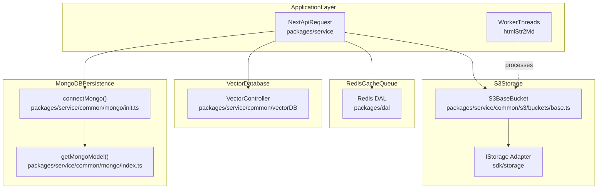
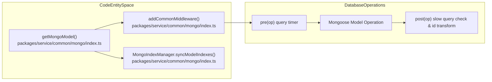
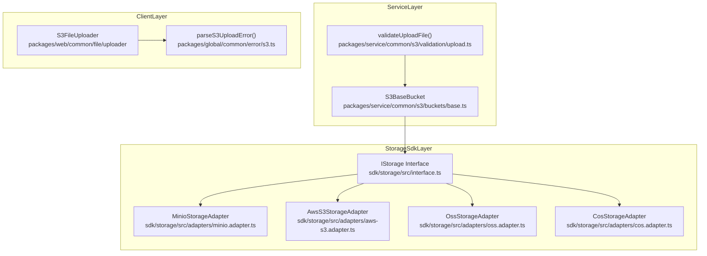

<!-- source: DeepWiki mcp.deepwiki.com · repo labring/FastGPT · page 3.4 Multi-Database Architecture · fetched 2026-10-29 -->

# Multi-Database Architecture

<details>
<summary>Relevant source files</summary>

The following files were used as context for generating this wiki page:

- [packages/global/common/error/code/s3.ts](packages/global/common/error/code/s3.ts)
- [packages/global/common/error/s3.ts](packages/global/common/error/s3.ts)
- [packages/global/common/file/utils.ts](packages/global/common/file/utils.ts)
- [packages/global/test/common/error/s3.test.ts](packages/global/test/common/error/s3.test.ts)
- [packages/global/test/common/file/utils.test.ts](packages/global/test/common/file/utils.test.ts)
- [packages/service/common/mongo/index.ts](packages/service/common/mongo/index.ts)
- [packages/service/common/mongo/init.ts](packages/service/common/mongo/init.ts)
- [packages/service/common/s3/buckets/base.ts](packages/service/common/s3/buckets/base.ts)
- [packages/service/common/s3/uploadPolicy/service.ts](packages/service/common/s3/uploadPolicy/service.ts)
- [packages/service/common/s3/validation/upload.ts](packages/service/common/s3/validation/upload.ts)
- [packages/service/common/string/jieba/index.ts](packages/service/common/string/jieba/index.ts)
- [packages/service/core/dataset/data/dataTextSchema.ts](packages/service/core/dataset/data/dataTextSchema.ts)
- [packages/service/test/common/mongo/index.test.ts](packages/service/test/common/mongo/index.test.ts)
- [packages/service/test/common/s3/uploadPolicy.test.ts](packages/service/test/common/s3/uploadPolicy.test.ts)
- [packages/service/test/common/s3/uploadValidation.test.ts](packages/service/test/common/s3/uploadValidation.test.ts)
- [packages/web/common/file/uploader/utils.ts](packages/web/common/file/uploader/utils.ts)
- [packages/web/components/common/Icon/index.tsx](packages/web/components/common/Icon/index.tsx)
- [packages/web/components/common/Icon/svgScope.ts](packages/web/components/common/Icon/svgScope.ts)
- [projects/app/test/components/common/Icon/svgScope.test.ts](projects/app/test/components/common/Icon/svgScope.test.ts)
- [projects/app/test/service/common/file/utils.test.ts](projects/app/test/service/common/file/utils.test.ts)

</details>


## Purpose and Scope

This document describes FastGPT's polyglot persistence strategy, which distributes data across specialized database systems: MongoDB, Vector Databases (PGVector/Milvus/OceanBase/Zilliz/SeekDB/OpenGauss), Redis (via `@fastgpt/dal`), and S3-compatible object storage (via `@fastgpt-sdk/storage` and `packages/service/common/s3`). Each system is optimized for specific workload patterns, enabling efficient handling of structured metadata, high-dimensional vector embeddings, caching, queues, and binary file storage.

---

## System Overview

FastGPT employs a multi-database architecture where each persistence layer serves a distinct purpose. Application logic in `packages/service` coordinates these data stores through unified abstraction layers and client managers.

**System Architecture and Data Flow**



**Sources:**
- [packages/service/common/mongo/init.ts:11-73]()
- [packages/service/common/mongo/index.ts:29-41]()
- [packages/service/common/s3/buckets/base.ts:116-120]()

---

## MongoDB - Structured Data Layer

MongoDB serves as the primary data store for structured application state, logs, and user metadata. FastGPT utilizes two independent Mongoose connection instances: `connectionMongo` for core operational data and `connectionLogMongo` for high-volume logs [packages/service/common/mongo/index.ts:29-41]().

### Connection Management and Pooling

The `connectMongo` function initializes connections with robust fault tolerance, automatic reconnection, and connection pool bounds [packages/service/common/mongo/init.ts:11-73]().

```typescript
// Connection configuration highlights from packages/service/common/mongo/init.ts
await db.connect(url, {
  maxConnecting: serviceEnv.DB_MAX_LINK,
  maxPoolSize: serviceEnv.DB_MAX_LINK,
  minPoolSize: 1,
  connectTimeoutMS: 60000,
  socketTimeoutMS: 60000,
  retryWrites: true,
  retryReads: true
});
```

### Middleware and Slow Query Monitoring

The `addCommonMiddleware` function registers pre- and post-hooks for query operations (`find`, `save`, `create`, `update`, `delete`, `aggregate`) [packages/service/common/mongo/index.ts:67-82](). It calculates operation duration and automatically logs warnings for queries exceeding 500ms or 2000ms [packages/service/common/mongo/index.ts:119-123](). It also automatically normalizes BSON `ObjectId` and `_id` fields into standard string representations across document queries [packages/service/common/mongo/index.ts:53-64](). This middleware is installed only once per schema to prevent duplicates [packages/service/test/common/mongo/index.test.ts:14-26]().

### Full-Text and Specialized Schemas

Specialized schemas, such as `MongoDatasetDataText`, maintain indexes for hybrid and full-text retrieval workflows alongside team scoping [packages/service/core/dataset/data/dataTextSchema.ts:11-45](). The `syncMongoIndex` function ensures that indexes are created and maintained for models [packages/service/common/mongo/index.ts:166-184]().

**Code Entity Mapping: MongoDB Execution Flow**



**Sources:**
- [packages/service/common/mongo/init.ts:11-73]()
- [packages/service/common/mongo/index.ts:29-41]()
- [packages/service/common/mongo/index.ts:53-64]()
- [packages/service/common/mongo/index.ts:67-82]()
- [packages/service/common/mongo/index.ts:119-123]()
- [packages/service/common/mongo/index.ts:166-184]()
- [packages/service/core/dataset/data/dataTextSchema.ts:11-50]()
- [packages/service/test/common/mongo/index.test.ts:14-26]()

---

## Vector Database Layer

FastGPT decouples vector embedding persistence through a modular controller architecture supporting multiple underlying vector engines (PGVector, Milvus, OceanBase, Zilliz, SeekDB, OpenGauss).

### Vector Operations and Synchronization

The vector layer interfaces with dataset storage nodes, managing vector dimensions, HNSW index parameters, and similarity search metrics (Cosine, L2, Inner Product). High-dimensional vectors are queried during semantic search stages and paired with lexical retrieval tokens stored in MongoDB collections.

**Sources:**
- [packages/service/common/vectorDB/controller.ts:28-36]()

---

## Redis - Caching and Queues

Redis, managed via `packages/dal`, handles low-latency operations such as team vector count caching, distributed locks, rate limiting, and background task queues. Cache invalidation strategies incorporate throttling to mitigate cache stampedes during bulk delete operations.

**Sources:**
- [packages/service/common/vectorDB/controller.ts:38-67]()

---

## S3 Storage - File Layer and Object Adapters

Binary files, attachments, avatars, and dataset documents are stored in S3-compatible object storage. The storage abstraction is unified via `@fastgpt-sdk/storage` and wrapped in `packages/service/common/s3/buckets/base.ts` through the `S3BaseBucket` class.

### Storage Adapters

The `@fastgpt-sdk/storage` package defines the `IStorage` interface [sdk/storage/src/interface.ts:244-300]() and provides concrete adapters for multiple cloud vendors and self-hosted instances:
- `AwsS3StorageAdapter`: AWS S3 and generic S3-compatible endpoints [sdk/storage/src/adapters/aws-s3.adapter.ts:39-65]()
- `MinioStorageAdapter`: Specialized adapter for MinIO addressing checksum compatibility issues and handling batch deletions via `removeObjects` [sdk/storage/src/adapters/minio.adapter.ts:95-127]()
- `OssStorageAdapter`: Alibaba Cloud OSS integration [sdk/storage/src/adapters/oss.adapter.ts:26-47]()
- `CosStorageAdapter`: Tencent Cloud COS integration [sdk/storage/src/adapters/cos.adapter.ts:26-46]()

### S3BaseBucket Implementation

The `S3BaseBucket` class provides high-level bucket operations, health checks, multi-part upload orchestration, and storage key normalization:

```typescript
export class S3BaseBucket {
  constructor(
    private readonly _client: IStorage,
    private readonly _externalClient: IStorage | undefined
  ) {}
  // ...
}
```[packages/service/common/s3/buckets/base.ts:116-120]()

It handles health checks by uploading and verifying temporary test objects [packages/service/common/s3/buckets/base.ts:134-170](), object copying with temporary TTL tracking [packages/service/common/s3/buckets/base.ts:177-200](), and robust object deletion with key fallback validation [packages/service/common/s3/buckets/base.ts:202-211]().

File uploads are validated using `validateUploadFile` which checks buffer length, filename, and applies upload constraints and policies [packages/service/common/s3/validation/upload.ts:35-68](). This includes detecting Office lock files (`~$filename.ext`) and rejecting them [packages/global/common/file/utils.ts:12-15](), [packages/service/test/common/s3/uploadPolicy.test.ts:58-64](). The `getUploadInspectBytes` function determines the necessary inspection window for file type detection, especially for Office documents [packages/service/common/s3/validation/upload.ts:29-30](), [packages/service/test/common/s3/uploadPolicy.test.ts:68-99]().

Client-side S3 file uploads are handled by `S3FileUploader` in `@fastgpt/web/common/file/uploader` [projects/app/test/service/common/file/utils.test.ts:3-4](). This component supports both single PUT and multipart uploads, with multipart uploads handling part ordering, retries, and progress normalization [projects/app/test/service/common/file/utils.test.ts:78-124](). Errors during S3 uploads are parsed by `parseS3UploadError` to provide user-friendly messages, covering cases like file size limits, invalid file types, authentication failures, and network issues [packages/global/common/error/s3.ts:10-113](), [packages/global/test/common/error/s3.test.ts:10-238]().

**Code Entity Mapping: S3 Storage Architecture**



**Sources:**
- [packages/service/common/s3/buckets/base.ts:116-211]()
- [packages/service/common/s3/validation/upload.ts:29-30]()
- [packages/service/common/s3/validation/upload.ts:35-68]()
- [packages/global/common/file/utils.ts:12-15]()
- [packages/global/common/error/s3.ts:10-113]()
- [sdk/storage/src/interface.ts:244-300]()
- [sdk/storage/src/adapters/minio.adapter.ts:95-127]()
- [sdk/storage/src/adapters/aws-s3.adapter.ts:39-65]()
- [sdk/storage/src/adapters/oss.adapter.ts:26-47]()
- [sdk/storage/src/adapters/cos.adapter.ts:26-46]()
- [projects/app/test/service/common/file/utils.test.ts:3-4]()
- [projects/app/test/service/common/file/utils.test.ts:78-124]()
- [packages/global/test/common/error/s3.test.ts:10-238]()
- [packages/service/test/common/s3/uploadPolicy.test.ts:58-64]()
- [packages/service/test/common/s3/uploadPolicy.test.ts:68-99]()

---

## Worker Thread Architecture

CPU-intensive text and HTML parsing tasks are offloaded to worker threads. The HTML-to-Markdown parser strips unwanted elements, extracts metadata, and replaces base64 images with unique S3 references before persistence.

**Sources:**
- [packages/service/common/string/cheerio.ts:74-126]()
- [packages/service/worker/htmlStr2Md/utils.ts:12-31]()

---

