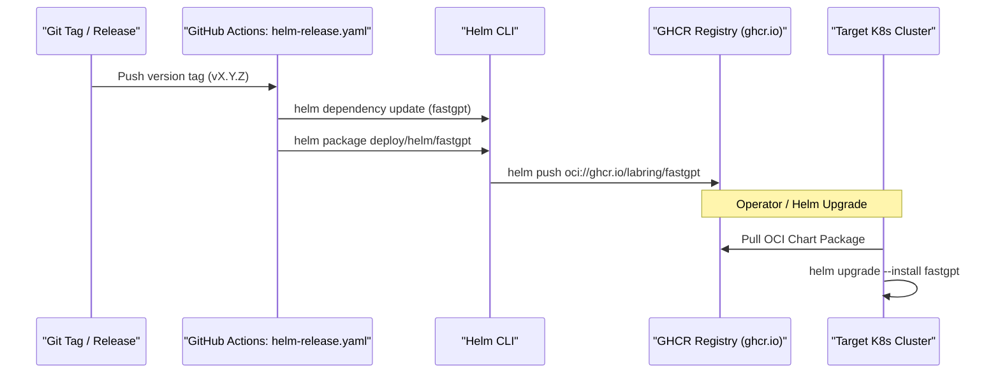

<!-- source: DeepWiki mcp.deepwiki.com · repo labring/FastGPT · page 3.5 Kubernetes and Helm Deployment · fetched 2026-10-29 -->

# Kubernetes and Helm Deployment

<details>
<summary>Relevant source files</summary>

The following files were used as context for generating this wiki page:

- [deploy/dev/docker-compose.cn.yml](deploy/dev/docker-compose.cn.yml)
- [deploy/dev/docker-compose.yml](deploy/dev/docker-compose.yml)

</details>


FastGPT provides a production-ready deployment strategy using Kubernetes and Helm charts, complemented by container definitions and compose configurations in the `deploy/` and `projects/` directories. This approach supports automated scaling, high availability, and simplified lifecycle management for the entire FastGPT ecosystem, including core application pods, sandbox runtimes, and stateful databases.

## Helm Chart and Deployment Architecture

The core deployment assets are orchestrated through Helm charts and configuration manifests located under `deploy/`. The main application is split across modular services such as `fastgpt-app`, `fastgpt-code-sandbox`, `fastgpt-plugin`, and sandbox/proxy controllers.

### Component Breakdown

| Component | Description | Code / Configuration Source |
| :--- | :--- | :--- |
| **FastGPT App** | The primary Next.js web application and backend service worker. | `projects/app/Dockerfile` [projects/app/Dockerfile:1-105]() |
| **Code Sandbox** | Isolated runtime environment for secure script execution inside workflows. | `deploy/dev/docker-compose.cn.yml:182-197`() |
| **MCP Server** | Model Context Protocol service exposing FastGPT tools over SSE. | `projects/mcp_server/Dockerfile` [projects/mcp_server/Dockerfile:1-70]() |
| **Stateful Services** | Supporting storage backends including MongoDB, Redis, MinIO, and vector stores. | `deploy/dev/docker-compose.cn.yml:60-181`() |

### System Dependency and Kubernetes Entity Flow

The following diagram bridges natural language deployment roles to actual container services and configuration names defined in the deployment and compose definitions.

**FastGPT Kubernetes Entity and Service Relationship**
```mermaid
graph TD
    subgraph "External Traffic"
        "User" --> "Ingress"[""Ingress Controller""]
    end

    subgraph "Kubernetes Cluster"
        "Ingress" --> "FastGPTService"[""Service: fastgpt-app""]
        
        "FastGPTService" --> "FastGPTPod"[""Deployment: fastgpt""]
        
        "FastGPTPod" -- "MetadataStore" --> "MongoService"[""Service: fastgpt-mongo""]
        "FastGPTPod" -- "CacheAndQueues" --> "RedisService"[""Service: fastgpt-redis""]
        "FastGPTPod" -- "VectorSearch" --> "VectorService"[""Service: fastgpt-pg / milvus""]
        "FastGPTPod" -- "ObjectStorage" --> "MinioService"[""Service: fastgpt-minio""]
        "FastGPTPod" -- "CodeExecution" --> "SandboxService"[""Service: fastgpt-code-sandbox""]
        "FastGPTPod" -- "PluginExecution" --> "PluginService"[""Service: fastgpt-plugin""]
        
        subgraph "Data Storage Layer"
            "MongoService" --> "MongoSS"[""StatefulSet: fastgpt-mongo""]
            "RedisService" --> "RedisContainer"[""Container: redis:7.2-alpine""]
            "VectorService" --> "VectorSS"[""StatefulSet: pgvector / milvus""]
            "MinioService" --> "MinioContainer"[""Container: minio""]
        end
    end
```
Sources: `deploy/dev/docker-compose.cn.yml:58-197`(), `deploy/dev/docker-compose.yml:58-201`()

## Container Builds and Dockerfiles

FastGPT containerizes each project using multi-stage Dockerfiles optimized for production deployment under `projects/`. For instance, the main application Dockerfile uses pnpm workspaces and Next.js standalone output to produce a lightweight runner image [projects/app/Dockerfile:1-105]().

### Build Pipeline Stages (`projects/app/Dockerfile`)
1. **`maindeps` stage**: Sets up `node:24.16.0-alpine`, installs pnpm, and caches workspace dependencies using `pnpm-lock.yaml` [projects/app/Dockerfile:2-23]().
2. **`builder` stage**: Builds SDK packages and runs Next.js production builds (`pnpm --filter=app build`), pruning non-essential platform bindings from the standalone folder [projects/app/Dockerfile:26-58]().
3. **`runner` stage**: Copies standalone server artifacts, locale files, worker runtimes (`worker/readFile.js`), and starts the production entrypoint (`node ./projects/app/server.js`) [projects/app/Dockerfile:61-105]().

Sources: `projects/app/Dockerfile:1-111](), `projects/mcp_server/Dockerfile:1-71`()

## Configuration and Environment Variables

Kubernetes deployments rely on ConfigMaps and Secrets mapped to environment variables declared in container definitions. Key configuration domains include:

### Database and Storage Binding
- **MongoDB**: Configured via `MONGODB_URI` with authentication and replica set options [deploy/dev/docker-compose.cn.yml:31]()
- **Redis**: Configured via `REDIS_URL` with password protection [deploy/dev/docker-compose.cn.yml:33]()
- **Object Storage (S3 / MinIO)**: Controlled via `STORAGE_VENDOR`, `STORAGE_S3_ENDPOINT`, access keys, and bucket names [deploy/dev/docker-compose.cn.yml:35-43]()
- **Proxy Bypass**: Network routing bypasses internal compose endpoints via `NO_PROXY` [deploy/dev/docker-compose.cn.yml:54-56]()

Sources: `deploy/dev/docker-compose.cn.yml:19-57`(), `deploy/dev/docker-compose.yml:19-57`()

## Release Automation and Helm Packaging

Releases are managed via CI/CD workflows that package Helm charts and publish OCI artifacts to the GitHub Container Registry (`ghcr.io`).

**Helm Chart Release and Deployment Sequence**

Sources: `.github/workflows/helm-release.yaml:1-35`(), `deploy/dev/docker-compose.cn.yml:1-10`()

## Deployment Commands

To deploy FastGPT using Helm and Kubernetes manifests:

1. **Pull the OCI Helm Chart**:
   ```bash
   helm pull oci://ghcr.io/labring/fastgpt --version <version>-helm
   ```

2. **Install or Upgrade with Custom Values**:
   ```bash
   helm upgrade --install fastgpt ./fastgpt -f values.yaml --namespace fastgpt --create-namespace
   ```

3. **Verify Service Health and Dependencies**:
   Ensure stateful dependencies (`fastgpt-mongo`, vector storage, `fastgpt-redis`) report healthy status probes before traffic hits the main `fastgpt` application deployment [deploy/dev/docker-compose.cn.yml:75-159]().

Sources: `deploy/dev/docker-compose.cn.yml:75-159`(), `.github/workflows/helm-release.yaml:1-35`()

---

