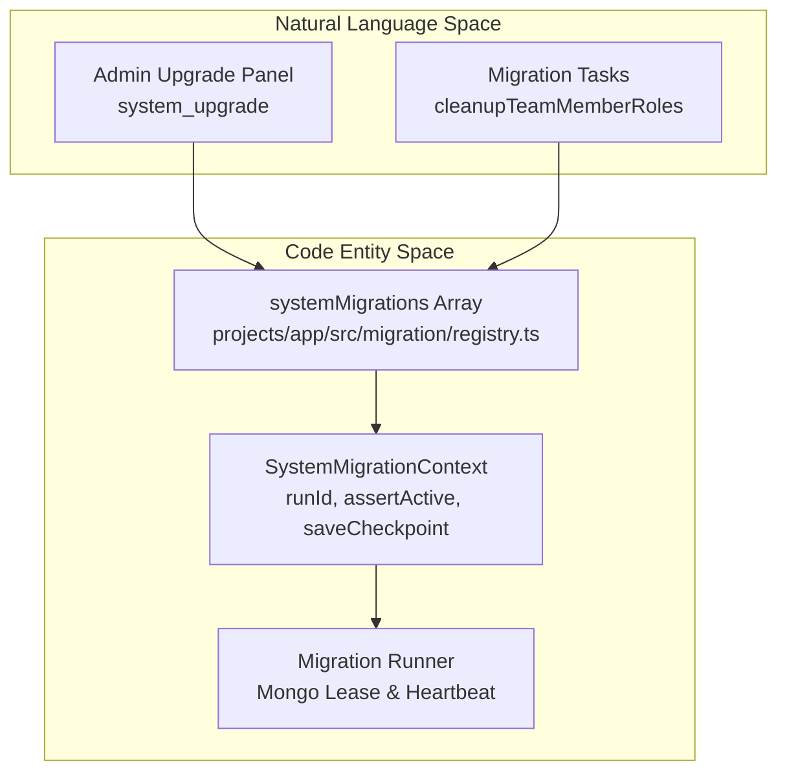
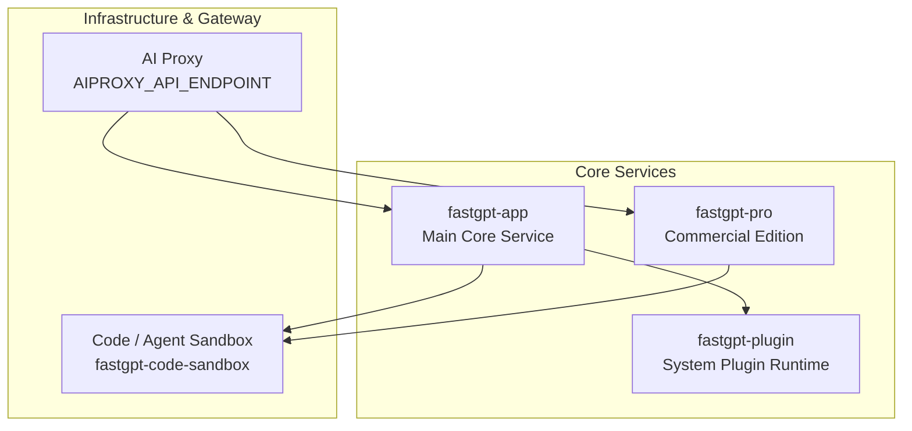

<!-- source: DeepWiki mcp.deepwiki.com · repo labring/FastGPT · page 3.6 Version Updates and Migration Procedures · fetched 2026-10-29 -->

# Version Updates and Migration Procedures

<details>
<summary>Relevant source files</summary>

The following files were used as context for generating this wiki page:

- [document/content/self-host/upgrading/4-15/4158.en.mdx](document/content/self-host/upgrading/4-15/4158.en.mdx)
- [document/content/self-host/upgrading/4-15/4158.mdx](document/content/self-host/upgrading/4-15/4158.mdx)
- [document/content/self-host/upgrading/4-16/41602.en.mdx](document/content/self-host/upgrading/4-16/41602.en.mdx)
- [document/content/self-host/upgrading/4-16/41602.mdx](document/content/self-host/upgrading/4-16/41602.mdx)
- [document/content/self-host/upgrading/4-16/meta.en.json](document/content/self-host/upgrading/4-16/meta.en.json)
- [document/content/self-host/upgrading/4-16/meta.json](document/content/self-host/upgrading/4-16/meta.json)
- [document/content/self-host/upgrading/4-17/4172.en.mdx](document/content/self-host/upgrading/4-17/4172.en.mdx)
- [document/content/self-host/upgrading/4-17/4172.mdx](document/content/self-host/upgrading/4-17/4172.mdx)
- [packages/global/migration/schema.ts](packages/global/migration/schema.ts)
- [packages/global/test/openapi/common/system.test.ts](packages/global/test/openapi/common/system.test.ts)
- [packages/web/i18n/en/system_migration.json](packages/web/i18n/en/system_migration.json)
- [packages/web/i18n/ko-KR/system_migration.json](packages/web/i18n/ko-KR/system_migration.json)
- [packages/web/i18n/zh-CN/system_migration.json](packages/web/i18n/zh-CN/system_migration.json)
- [packages/web/i18n/zh-Hant/system_migration.json](packages/web/i18n/zh-Hant/system_migration.json)
- [projects/app/src/migration/error.ts](projects/app/src/migration/error.ts)
- [projects/app/src/migration/registry.ts](projects/app/src/migration/registry.ts)
- [projects/app/src/migration/service.ts](projects/app/src/migration/service.ts)
- [projects/app/src/pageComponents/admin/config/Migration.tsx](projects/app/src/pageComponents/admin/config/Migration.tsx)
- [projects/app/test/migration/registry.test.ts](projects/app/test/migration/registry.test.ts)

</details>


This document covers the version upgrade system in FastGPT, including the automated system migration framework (`projects/app/src/migration/registry.ts`), version-specific changes for V4.16, V4.17, and V4.17.2 (`document/content/self-host/upgrading/`), Docker image update matrices, and critical environment variable migrations.

## Version Naming and Release Strategy

FastGPT follows a structured versioning strategy to manage stable and iterative releases:
*   **Stable Versions**: Maintained across consecutive series (e.g., `4.16.x`, `4.17.x`).
*   **Iterative Versions**: Suffix-tagged releases (e.g., `4.17.0-beta.1`, `v4.17.2`) deployed for rapid feature iterations.
*   **Aggregation and Automated Tasks**: Starting with V4.17.0, automated migration tasks are registered in the codebase and managed via lease-based node coordination rather than manual HTTP admin calls for every sub-task, while manual tasks like chunk training and index rebuild migrations are executed via the **Admin > Version Upgrades** console.

**Sources:** [document/content/self-host/upgrading/4-17/4170.mdx:9-16](), [document/content/self-host/upgrading/4-17/4172.mdx:16-20]()

---

## Automated System Migration Framework

Starting with V4.17.0, FastGPT features an automated system upgrade manager that executes registered migration tasks sequentially with lease fencing, heartbeat checks, and batch checkpointing.

### Migration Registry and Context Architecture

The registry (`projects/app/src/migration/registry.ts`) defines the static metadata (`SystemMigration`) and runtime context (`SystemMigrationContext`) for each migration task.



**Sources:** [projects/app/src/migration/registry.ts:1-88](), [projects/web/i18n/en/system_migration.json:1-12]()

### Migration Execution and Lease Flow

Tasks use MongoDB leases and run-id fencing to prevent concurrent execution across clustered FastGPT backend nodes.

```mermaid
sequenceDiagram
    participant Node1 as "FastGPT Node A"
    participant Mongo as "MongoDB Collection"
    participant Task as "cleanupTeamMemberRoles()"

    Node1->>Mongo: Acquire Migration Lease (runId)
    Mongo--|>>Node1: Lease Granted
    Node1->>Task: Invoke run(SystemMigrationContext)
    loop Every Batch
        Task->>Context: assertActive()
        Context->>Mongo: Verify lease & heartbeat
        Mongo--|>>Context: Active
        Task->>Mongo: Process Batch & saveCheckpoint()
    end
    Task-->>Node1: Succeeded
    Node1->>Mongo: Mark Status = succeeded
```

**Sources:** [projects/app/src/migration/registry.ts:36-63](), [projects/app/src/migration/tasks/4170/20260907_cleanup_team_member_roles/index.ts:32-87]()

**Sources:** [projects/app/src/migration/registry.ts:1-440](), [projects/app/src/migration/tasks/4170/20260907_cleanup_team_member_roles/index.ts:1-87]()

---

## Version-Specific Upgrades (V4.16, V4.17 & V4.17.2)

### V4.17.2 Critical Upgrades and Manual Migration Scripts

FastGPT V4.17.2 introduces two manual system migration scripts under **Admin > Version Upgrades** that support batched transactional commits and checkpoint resumption without blocking FastGPT startup.

> **⚠️ Execution Order and Page Display Notice**:
> These two manual migration scripts have a strict prerequisite dependency. **You must run step 1 ("Migrate legacy dataset training tasks") first. Only after it succeeds can you run step 2 ("Migrate index rebuild statuses").**
> On the **Admin > Version Upgrades** page, tasks are listed in reverse chronological order by default, meaning **"Migrate index rebuild statuses" appears above "Migrate legacy dataset training tasks"**. Please execute them from bottom to top.

1. **Migrate legacy dataset training tasks (`20261008_migrate_chunk_training`)**:
   - Converts legacy chunk training tasks into the new pattern associated with persisted data rows (`dataId`), ensuring historical training tasks can correctly write back vector indexes after dataset pre-persistence refactoring.
   - **Prerequisite**: Ensure all older FastGPT App and Pro instances are stopped and worker leases have expired before executing.
2. **Migrate index rebuild statuses (`20261009_migrate_dataset_rebuild_status`)**:
   - Converts legacy `rebuilding` boolean flags and transitional states on dataset data chunks into the unified `indexStatus` rebuild lifecycle.
   - **Timeout Handling**: For large datasets (millions to tens of millions of chunks), scanning `dataset_datas` without an index can take time. A MongoDB partial index can be created to accelerate scanning:
     ```javascript
     db.dataset_datas.createIndex(
       { rebuilding: 1, _id: 1 },
       { partialFilterExpression: { rebuilding: { $exists: true } }, background: true }
     );
     ```

**Sources:** [document/content/self-host/upgrading/4-17/4172.en.mdx:7-44]()

### V4.17.0 Critical Changes

1.  **AI Proxy Requirement**: `OPENAI_BASE_URL` and `CHAT_API_KEY` are deprecated and removed. FastGPT must connect to an AI Proxy service using `AIPROXY_API_ENDPOINT` and `AIPROXY_API_TOKEN` [document/content/self-host/upgrading/4-17/4170.mdx:17-27]().
2.  **CSRF Protection**: Enabled via `CSRF_ENABLED=true` to prevent external HTML tags from passing cookies [document/content/self-host/upgrading/4-17/4170.mdx:28-34]().
3.  **Code Sandbox Seccomp**: Can be toggled with `SANDBOX_DISABLE_SECCOMP=true` if host kernels lack application-level seccomp support [document/content/self-host/upgrading/4-17/4170.mdx:36-45]().

### V4.16.1 Critical Changes

1.  **Agent Sandbox Images**: Requires updating image references such as `AGENT_SANDBOX_OPENSANDBOX_IMAGE=ghcr.io/labring/fastgpt-agent-sandbox:v0.3.1` [document/content/self-host/upgrading/4-16/4161.en.mdx:12-26]().
2.  **Tool JSON Schema Storage**: MCP and HTTP tool schemas migrated to string storage. Requires executing migration endpoints such as `/api/admin/4161/initToolJsonSchemaStorage` with dry-run support [document/content/self-host/upgrading/4-16/4161.en.mdx:36-62]().

**Sources:** [document/content/self-host/upgrading/4-16/4161.en.mdx:1-87](), [document/content/self-host/upgrading/4-17/4170.mdx:1-119](), [document/content/self-host/upgrading/4-17/4172.en.mdx:1-44]()

---

## Component Upgrade Architecture and Matrix

Upgrades require simultaneous image tag alignment across the FastGPT microservice ecosystem.



**Sources:** [document/content/self-host/upgrading/4-17/4170.mdx:50-56](), [document/content/self-host/upgrading/4-16/4161.en.mdx:30-35]()

### Component Image Matrix

| Component | Service Name | Example Tag (V4.17.2) |
| :--- | :--- | :--- |
| **Main App** | `fastgpt-app` | `v4.17.2` |
| **Pro Version** | `fastgpt-pro` | `v4.17.2` |
| **Code Sandbox** | `fastgpt-code-sandbox` | `v4.17.2` |
| **Plugins** | `fastgpt-plugin` | `v1.1.3` |

**Sources:** [document/content/self-host/upgrading/4-17/4170.mdx:50-56](), [document/content/self-host/upgrading/4-17/4172.en.mdx:7-13]()

---

