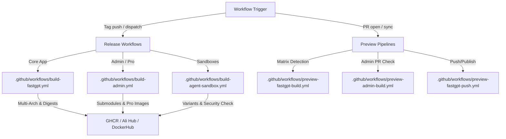
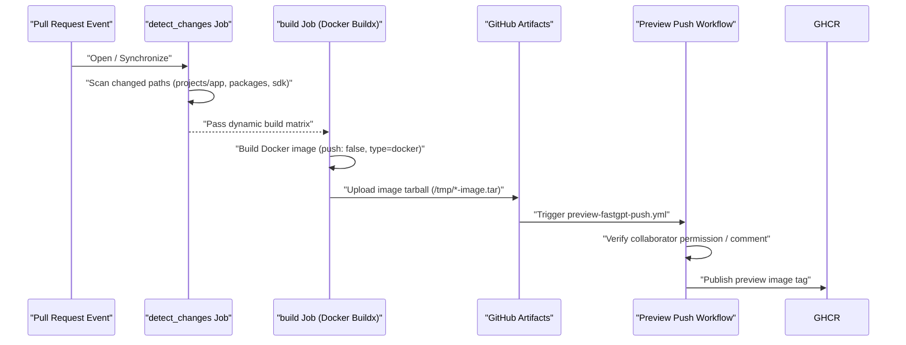

<!-- source: DeepWiki mcp.deepwiki.com · repo labring/FastGPT · page 3.7 CI/CD Pipelines · fetched 2026-10-29 -->

# CI/CD Pipelines

Relevant source files

The following files were used as context for generating this wiki page:

- [.forgejo/workflows/build-agent-sandbox.yml](.forgejo/workflows/build-agent-sandbox.yml)
- [.forgejo/workflows/build-code-sandbox.yml](.forgejo/workflows/build-code-sandbox.yml)
- [.forgejo/workflows/build-fastgpt-ide-agent.yml](.forgejo/workflows/build-fastgpt-ide-agent.yml)
- [.forgejo/workflows/build-fastgpt.yml](.forgejo/workflows/build-fastgpt.yml)
- [.forgejo/workflows/build-marketplace.yml](.forgejo/workflows/build-marketplace.yml)
- [.forgejo/workflows/build-mcp-server.yml](.forgejo/workflows/build-mcp-server.yml)
- [.github/workflows/build-admin.yml](.github/workflows/build-admin.yml)
- [.github/workflows/build-agent-sandbox.yml](.github/workflows/build-agent-sandbox.yml)
- [.github/workflows/build-browser-sandbox.yml](.github/workflows/build-browser-sandbox.yml)
- [.github/workflows/build-code-sandbox.yml](.github/workflows/build-code-sandbox.yml)
- [.github/workflows/build-docs.yml](.github/workflows/build-docs.yml)
- [.github/workflows/build-fastgpt.yml](.github/workflows/build-fastgpt.yml)
- [.github/workflows/build-marketplace.yml](.github/workflows/build-marketplace.yml)
- [.github/workflows/build-mcp-server.yml](.github/workflows/build-mcp-server.yml)
- [.github/workflows/build-sso-service-image.yml](.github/workflows/build-sso-service-image.yml)
- [.github/workflows/preview-admin-build.yml](.github/workflows/preview-admin-build.yml)
- [.github/workflows/preview-admin-push.yml](.github/workflows/preview-admin-push.yml)
- [.github/workflows/preview-docs-build.yml](.github/workflows/preview-docs-build.yml)
- [.github/workflows/preview-docs-push.yml](.github/workflows/preview-docs-push.yml)
- [.github/workflows/preview-fastgpt-build.yml](.github/workflows/preview-fastgpt-build.yml)
- [.github/workflows/preview-fastgpt-push.yml](.github/workflows/preview-fastgpt-push.yml)
- [.github/workflows/test-fastgpt-pro.yaml](.github/workflows/test-fastgpt-pro.yaml)
- [.github/workflows/test-fastgpt.yaml](.github/workflows/test-fastgpt.yaml)
- [projects/app/src/components/core/chat/ChatContainer/ChatBox/Provider.tsx](projects/app/src/components/core/chat/ChatContainer/ChatBox/Provider.tsx)
- [projects/app/src/pages/api/core/chat/file/presignChatFilePostUrl.ts](projects/app/src/pages/api/core/chat/file/presignChatFilePostUrl.ts)
- [projects/app/test/pages/api/core/chat/file/presignChatFilePostUrl.test.ts](projects/app/test/pages/api/core/chat/file/presignChatFilePostUrl.test.ts)
- [turbo.json](turbo.json)

## 1. Introduction and Scope
The FastGPT CI/CD infrastructure utilizes GitHub Actions and Forgejo workflows to automate testing, multi-architecture container image compilation (`linux/amd64` and `linux/arm64`), documentation deployment, and pull request preview generation. The pipeline spans core FastGPT applications, pro/admin extensions, code and agent sandboxes, MCP servers, and marketplace services, publishing artifacts to GitHub Container Registry (GHCR), Alibaba Cloud Container Registry (Ali Hub), and Docker Hub.

Sources:
- [.github/workflows/build-fastgpt.yml:1-189]()
- [.github/workflows/build-admin.yml:1-182]()
- [.github/workflows/preview-fastgpt-build.yml:1-135]()

---

## 2. Workflow Architecture Overview
Workflows are categorized into release workflows (triggered by version tags or manual dispatches) and pull request preview workflows (triggered by code changes and PR lifecycles).

*Figure 1: High-level workflow routing mapping natural language intents to specific workflow configuration files.*

Sources:
- [.github/workflows/build-fastgpt.yml:1-189]()
- [.github/workflows/build-admin.yml:1-182]()
- [.github/workflows/preview-fastgpt-build.yml:1-135]()
- [.github/workflows/preview-fastgpt-push.yml:1-170]()

---

## 3. Core Release and Production Workflows
Release workflows enforce strict semantic versioning checks and handle multi-architecture compilation with Docker Buildx.

### FastGPT Core and Admin Image Builds
- **FastGPT Core (`build-fastgpt.yml`)**: Triggered by tag pushes matching `v*` or manual workflow dispatches [.github/workflows/build-fastgpt.yml:3-16](). It validates version strings starting with `v` [.github/workflows/build-fastgpt.yml:41-45](), builds multi-architecture images for `repo: fastgpt` and sub-routes (`repo: fastgpt-sub-route`, base URL `/fastai`) [.github/workflows/build-fastgpt.yml:55-65](), exports image digests as workflow artifacts, and aggregates them into multi-arch manifest lists.
- **FastGPT Pro / Admin (`build-admin.yml`)**: Manages proprietary or extended admin modules via git submodules. It requires `PRO_SUBMODULE_TOKEN` to initialize encrypted submodules [.github/workflows/build-admin.yml:72-84](), builds under `pro/admin/Dockerfile` [.github/workflows/build-admin.yml:120](), and supports sub-route targets like `/fastaipro` [.github/workflows/build-admin.yml:52-58]().

### Sandbox and Utility Runtimes
- **Agent Sandbox (`build-agent-sandbox.yml`)**: Builds specialized container runtimes for `amd64` and `arm64` targets.
- **Browser Sandbox (`build-browser-sandbox.yml`)**: Validates SemVer version tags on default branches [.github/workflows/build-browser-sandbox.yml:24-44](), installs pnpm workspace dependencies for `@fastgpt/browser-sandbox` [.github/workflows/build-browser-sandbox.yml:82-84](), executes automated end-to-end smoke tests and security scripts against newly built images, and uploads test reports [.github/workflows/build-browser-sandbox.yml:179-195]().
- **Documentation (`build-docs.yml`)**: Automatically synchronizes asset directories with `labring/fastgpt-img` via `DOCS_IMGS_SYNC_TOKEN` [.github/workflows/build-docs.yml:27-34](), builds localized images for `.io` and `.cn` domains with injected build arguments (`FASTGPT_HOME_DOMAIN`), and updates Kubernetes deployments via `kubectl set image` [.github/workflows/build-docs.yml:134-203]().

Sources:
- [.github/workflows/build-fastgpt.yml:1-189]()
- [.github/workflows/build-admin.yml:1-182]()
- [.github/workflows/build-browser-sandbox.yml:1-195]()
- [.github/workflows/build-docs.yml:1-204]()

---

## 4. Pull Request Preview Pipelines
Pull request pipelines enable isolated container image builds and verification prior to merging.

*Figure 2: Data flow and interaction sequence for pull request preview generation and publishing.*

### Preview Build Configuration
- **Matrix Detection (`preview-fastgpt-build.yml`)**: Scans modified files via `github.rest.pulls.listFiles` [.github/workflows/preview-fastgpt-build.yml:33-38]() to selectively build images for `fastgpt`, `code-sandbox`, or `mcp_server` only if relevant monorepo paths are affected [.github/workflows/preview-fastgpt-build.yml:47-82](). Images are compiled locally without pushing (`push: false`), exported as tar archives (`type=docker,dest=/tmp/...`), and uploaded with 1-day retention [.github/workflows/preview-fastgpt-build.yml:113-135]().
- **Admin Preview (`preview-admin-build.yml`)**: Restricted to repository collaborators and owners (`COLLABORATOR`, `OWNER`) [.github/workflows/preview-admin-build.yml:28](). It checks out private submodules using `PRO_SUBMODULE_TOKEN` [.github/workflows/preview-admin-build.yml:41-54]() and builds `pro/admin/Dockerfile` [.github/workflows/preview-admin-build.yml:63]().

### Preview Publishing Flow (`preview-fastgpt-push.yml` & `preview-docs-push.yml`)
- Automatically triggers upon completion of build workflows or when authorized maintainers post a command comment (e.g., `/preview push`) [.github/workflows/preview-fastgpt-push.yml:4-8]().
- Implements concurrency groups keyed by PR numbers to cancel stale preview deployments and prevent race conditions [.github/workflows/preview-fastgpt-push.yml:11-13]().
- Verifies GitHub collaborator permissions before publishing external preview tags [.github/workflows/preview-fastgpt-push.yml:52-65]().

Sources:
- [.github/workflows/preview-fastgpt-push.yml:1-170]()
- [.github/workflows/preview-fastgpt-build.yml:1-135]()
- [.github/workflows/preview-admin-build.yml:1-90]()
- [.github/workflows/preview-docs-build.yml:1-60]()

---

## 5. Multi-Arch Caching and Registry Strategies
To optimize pipeline execution time across arm64 and amd64 runner pools:
- **Docker Layer Caching**: Leverages `actions/cache@v4` with runner OS, architecture, and commit SHA keys to cache Docker Buildx layers under `/tmp/.buildx-cache` [.github/workflows/build-browser-sandbox.yml:141-148]().
- **Digest Export and Multi-Registry Promotion**: Build jobs push individual architecture digests (`push-by-digest=true`) to GHCR and Ali Hub [.github/workflows/build-admin.yml:127-146](), upload digest files as artifacts, and subsequently combine them into multi-architecture manifest lists during the release phase.

Sources:
- [.github/workflows/build-admin.yml:91-175]()
- [.github/workflows/build-browser-sandbox.yml:141-195]()

---

