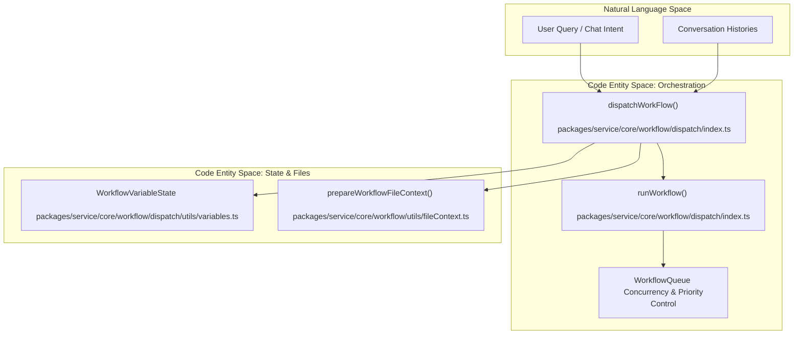
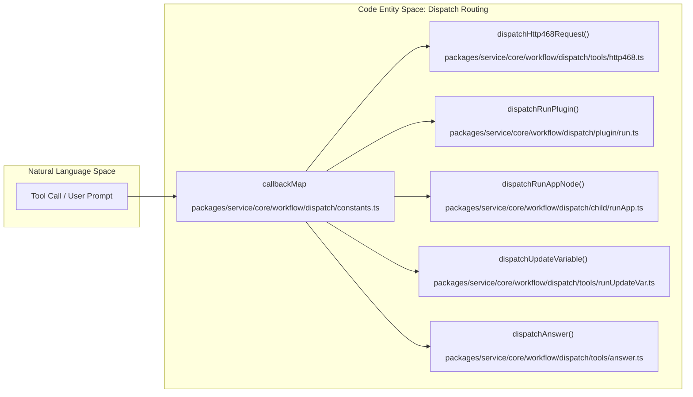

<!-- source: DeepWiki mcp.deepwiki.com · repo labring/FastGPT · page 4 Workflow System Architecture · fetched 2026-10-29 -->

# Workflow System Architecture

Relevant source files

The following files were used as context for generating this wiki page:

- [packages/global/common/string/tools.ts](packages/global/common/string/tools.ts)
- [packages/global/core/workflow/runtime/utils.ts](packages/global/core/workflow/runtime/utils.ts)
- [packages/global/test/common/string/tools.test.ts](packages/global/test/common/string/tools.test.ts)
- [packages/global/test/core/workflow/runtime/utils.test.ts](packages/global/test/core/workflow/runtime/utils.test.ts)
- [packages/service/core/ai/utils.ts](packages/service/core/ai/utils.ts)
- [packages/service/core/workflow/dispatch/abandoned/runApp.ts](packages/service/core/workflow/dispatch/abandoned/runApp.ts)
- [packages/service/core/workflow/dispatch/child/runApp.ts](packages/service/core/workflow/dispatch/child/runApp.ts)
- [packages/service/core/workflow/dispatch/index.ts](packages/service/core/workflow/dispatch/index.ts)
- [packages/service/core/workflow/dispatch/plugin/run.ts](packages/service/core/workflow/dispatch/plugin/run.ts)
- [packages/service/core/workflow/dispatch/tools/answer.ts](packages/service/core/workflow/dispatch/tools/answer.ts)
- [packages/service/core/workflow/dispatch/tools/http468.ts](packages/service/core/workflow/dispatch/tools/http468.ts)
- [packages/service/test/common/string/textSplitter.test.ts](packages/service/test/common/string/textSplitter.test.ts)
- [packages/service/test/core/ai/llm/toolCall.test.ts](packages/service/test/core/ai/llm/toolCall.test.ts)

## Purpose and Scope

This document provides a high-level overview of FastGPT's visual workflow orchestration system. It covers the core execution model, node dispatch mechanics, variable resolution, and integrations, serving as a parent guide to detailed child pages.

For comprehensive technical deep dives, refer to the following child pages:
- [Workflow Node Templates and Types](#4.1) — `FlowNodeTemplateType`, `FlowNodeTypeEnum`, node categories and input/output types.
- [Workflow Execution Engine](#4.2) — Deep dive into `dispatchWorkFlow`, `WorkflowQueue`, concurrency, edge status and skip logic.
- [Variable Resolution and Data Flow](#4.3) — How variables flow between nodes, reference resolution, global variables, and `VARIABLE_NODE_ID`.
- [Interactive Workflows and Pause-Resume](#4.4) — `WorkflowInteractiveResponseType`, user select, form input, `agentAsk`, and resume semantics.
- [Child Workflows and Plugin Execution](#4.5) — Nested workflow execution: plugins, child apps via `dispatchRunAppNode`, tool runners and loop nodes.
- [Workflow Utilities and Versioning](#4.6) — `storeNode2FlowNode`, validation via `checkWorkflowNodeIssues`, resource extraction, model policies and snapshot comparison.
- [HTTP Request Node and External Integration](#4.7) — `dispatchHttp468Request`, request configuration, header auth secrets, and SSRF protections.
- [AI Response Parsing and Streaming](#4.8) — How streaming AI responses are parsed: reasoning content, tool calls, citations and node responses.
- [Agent Loop and Tool Calling](#4.9) — Document `dispatch/ai/agent`, `agentLoopCore`, toolcall providers, sub-dataset/tool runners and skill invocation inside agents.

---

## Workflow Orchestration Overview

The workflow system processes directed acyclic graphs (DAGs) representing conversational or task-oriented AI pipelines. The execution engine bridges natural language inputs and contextual states to concrete runtime node evaluations.

Title: Bridging Natural Language Space to Code Entity Space for Workflow Execution

Sources: `[packages/service/core/workflow/dispatch/index.ts:134-189]()`, `[packages/service/core/workflow/dispatch/index.ts:211-256]()`

---

## Node Dispatch and Tool Execution Architecture

Once the orchestration engine queues runtime nodes (`RuntimeNodeItemType`), individual node handlers are invoked via a callback registry to execute specific tasks such as LLM inference, HTTP requests, variable updates, or sub-plugin execution.

Title: Bridging Natural Language Tool Selection to Node Dispatch Code Entities

Sources: `[packages/service/core/workflow/dispatch/plugin/run.ts:65-100]()`, `[packages/service/core/workflow/dispatch/tools/http468.ts:95-125]()`, `[packages/service/core/workflow/dispatch/tools/answer.ts]()`, `[packages/service/core/workflow/dispatch/child/runApp.ts:36-55]()`

---

## Core Sub-Topics Summary

### Workflow Node Templates and Types
Workflows are constructed from defined node templates categorized by type (`FlowNodeTypeEnum`), supporting inputs, outputs, and rich data typing (`WorkflowIOValueTypeEnum`).
For details, see [Workflow Node Templates and Types](#4.1).

### Workflow Execution Engine
The execution core relies on `dispatchWorkFlow`, queue management (`WorkflowQueue`), and edge status evaluations to traverse runtime node items with strict concurrency limits. The `dispatchWorkFlow` function orchestrates the entire workflow execution, handling initialization, variable state management, and node dispatch.
For details, see [Workflow Execution Engine](#4.2).
Sources: `[packages/service/core/workflow/dispatch/index.ts:139-157]()`

### Variable Resolution and Data Flow
Variables are managed through `WorkflowVariableState`, resolving editor interpolation strings and reference arrays via `VARIABLE_NODE_ID` and `getReferenceVariableValue`. The `valueTypeFormat` utility ensures data types are correctly converted between nodes.
For details, see [Variable Resolution and Data Flow](#4.3).
Sources: `[packages/global/core/workflow/runtime/utils.ts:54-157]()`, `[packages/global/core/workflow/constants.ts:8-10]()`

### Interactive Workflows and Pause-Resume
Workflows support pause-resume mechanics using `WorkflowInteractiveResponseType` to handle user-interactive prompts such as form inputs and `agentAsk`. The `extractDeepestInteractive` utility helps in navigating nested interactive responses.
For details, see [Interactive Workflows and Pause-Resume](#4.4).
Sources: `[packages/global/core/workflow/runtime/utils.ts:22-35]()`, `[packages/global/core/workflow/template/system/interactive/type.ts:2-3]()`

### Child Workflows and Plugin Execution
Workflows can invoke nested plugins or child applications via `dispatchRunPlugin` and `dispatchRunAppNode`, propagating resource contexts and tracking aggregated usage. This allows for modularity and reuse of complex logic.
For details, see [Child Workflows and Plugin Execution](#4.5).
Sources: `[packages/service/core/workflow/dispatch/plugin/run.ts:66-72]()`, `[packages/service/core/workflow/dispatch/child/runApp.ts:36-46]()`

### Workflow Utilities and Versioning
Transformation utilities like `storeNode2FlowNode` and validation routines such as `checkWorkflowNodeIssues` ensure graph validity across versions. String manipulation functions like `getNanoid` and `sliceJsonStr` are also used for various workflow operations.
For details, see [Workflow Utilities and Versioning](#4.6).
Sources: `[packages/global/common/string/tools.ts:46-57]()`, `[packages/global/common/string/tools.ts:79-142]()`, `[packages/global/test/common/string/tools.test.ts:62-76]()`, `[packages/global/test/common/string/tools.test.ts:84-129]()`

### HTTP Request Node and External Integration
The HTTP integration node (`dispatchHttp468Request`) manages custom methods, headers, body formats, header secrets, and SSRF guardrails. It uses `axios` for requests and `getSecretValue` for sensitive data.
For details, see [HTTP Request Node and External Integration](#4.7).
Sources: `[packages/service/core/workflow/dispatch/tools/http468.ts:95-117]()`, `[packages/service/core/workflow/dispatch/tools/http468.ts:21-22]()`, `[packages/service/core/workflow/dispatch/tools/http468.ts:27-28]()`

### AI Response Parsing and Streaming
Streaming AI responses are parsed for reasoning content, tool calls, and citations using dedicated utilities and event sinks (`workflowSseEvent`). The `parseReasoningContent` and `parseLLMStreamResponse` functions handle the extraction of structured information from raw LLM output.
For details, see [AI Response Parsing and Streaming](#4.8).
Sources: `[packages/service/core/ai/utils.ts:53-69]()`, `[packages/service/core/ai/utils.ts:72-111]()`, `[packages/service/test/core/ai/llm/toolCall.test.ts:11-88]()`

### Agent Loop and Tool Calling
Agent workflows leverage `agentLoopCore` and dispatch handlers under `dispatch/ai/agent` to iterate over tool calls, sub-datasets, and custom skills. The `parsePromptToolCall` function is crucial for interpreting tool calls from LLM responses.
For details, see [Agent Loop and Tool Calling](#4.9).
Sources: `[packages/service/test/core/ai/llm/toolCall.test.ts:11-88]()`

---

