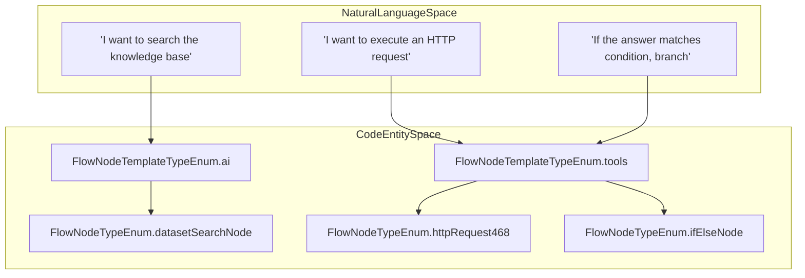
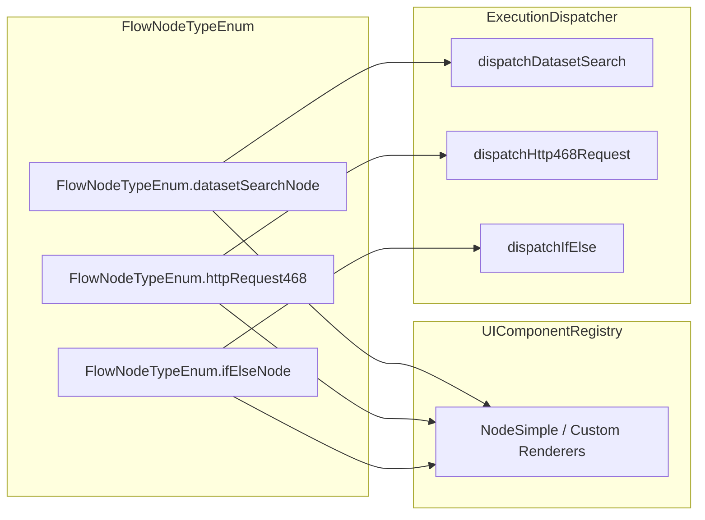
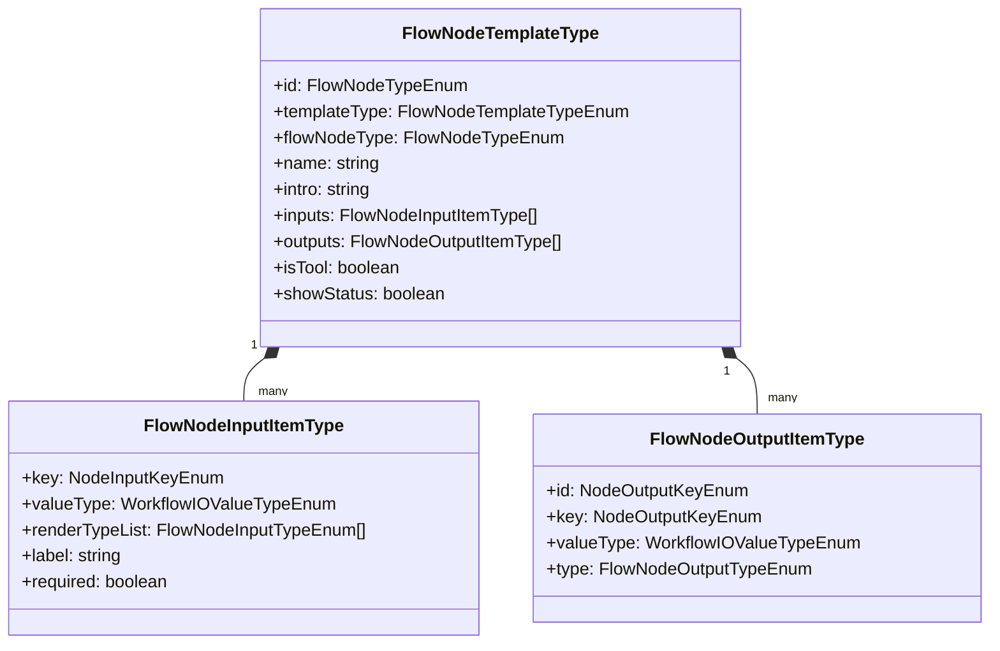

<!-- source: DeepWiki mcp.deepwiki.com · repo labring/FastGPT · page 4.1 Workflow Node Templates and Types · fetched 2026-10-29 -->

# Workflow Node Templates and Tests

Relevant source files

The following files were used as context for generating this wiki page:

- [packages/global/core/workflow/constants.ts](packages/global/core/workflow/constants.ts)
- [packages/global/core/workflow/node/constant.ts](packages/global/core/workflow/node/constant.ts)
- [packages/global/core/workflow/template/system/assignedAnswer.ts](packages/global/core/workflow/template/system/assignedAnswer.ts)
- [packages/global/core/workflow/template/system/classifyQuestion/index.ts](packages/global/core/workflow/template/system/classifyQuestion/index.ts)
- [packages/global/core/workflow/template/system/contextExtract/index.ts](packages/global/core/workflow/template/system/contextExtract/index.ts)
- [packages/global/core/workflow/template/system/customFeedback.ts](packages/global/core/workflow/template/system/customFeedback.ts)
- [packages/global/core/workflow/template/system/datasetConcat.ts](packages/global/core/workflow/template/system/datasetConcat.ts)
- [packages/global/core/workflow/template/system/datasetSearch.ts](packages/global/core/workflow/template/system/datasetSearch.ts)
- [packages/global/core/workflow/template/system/http468.ts](packages/global/core/workflow/template/system/http468.ts)
- [packages/global/core/workflow/template/system/ifElse/index.ts](packages/global/core/workflow/template/system/ifElse/index.ts)
- [packages/global/core/workflow/template/system/sandbox/index.ts](packages/global/core/workflow/template/system/sandbox/index.ts)
- [packages/global/core/workflow/template/system/textEditor.ts](packages/global/core/workflow/template/system/textEditor.ts)
- [packages/global/core/workflow/template/system/variableUpdate/index.tsx](packages/global/core/workflow/template/system/variableUpdate/index.tsx)
- [packages/service/core/app/version/controller.ts](packages/service/core/app/version/controller.ts)
- [packages/web/components/common/MySelect/index.tsx](packages/web/components/common/MySelect/index.tsx)
- [packages/web/components/core/workflow/NodeInputSelect.tsx](packages/web/components/core/workflow/NodeInputSelect.tsx)
- [packages/web/i18n/en/workflow.json](packages/web/i18n/en/workflow.json)
- [packages/web/i18n/zh-CN/workflow.json](packages/web/i18n/zh-CN/workflow.json)
- [packages/web/i18n/zh-Hant/workflow.json](packages/web/i18n/zh-Hant/workflow.json)
- [projects/app/src/components/common/secret/HeaderAuthConfig.tsx](projects/app/src/components/common/secret/HeaderAuthConfig.tsx)
- [projects/app/src/pageComponents/app/create/AppTypeCard.tsx](projects/app/src/pageComponents/app/create/AppTypeCard.tsx)
- [projects/app/src/pageComponents/app/detail/Workflow/components/SearchButton.tsx](projects/app/src/pageComponents/app/detail/Workflow/components/SearchButton.tsx)
- [projects/app/src/pageComponents/app/detail/WorkflowComponents/Flow/components/Container.tsx](projects/app/src/pageComponents/app/detail/WorkflowComponents/Flow/components/Container.tsx)
- [projects/app/src/pageComponents/app/detail/WorkflowComponents/Flow/components/FlowController.tsx](projects/app/src/pageComponents/app/detail/WorkflowComponents/Flow/components/FlowController.tsx)
- [projects/app/src/pageComponents/app/detail/WorkflowComponents/Flow/index.tsx](projects/app/src/pageComponents/app/detail/WorkflowComponents/Flow/index.tsx)
- [projects/app/src/pageComponents/app/detail/WorkflowComponents/Flow/nodes/render/InlineEdit.tsx](projects/app/src/pageComponents/app/detail/WorkflowComponents/Flow/nodes/render/InlineEdit.tsx)
- [projects/app/src/pageComponents/app/detail/WorkflowComponents/Flow/nodes/render/NodeCard.tsx](projects/app/src/pageComponents/app/detail/WorkflowComponents/Flow/nodes/render/NodeCard.tsx)
- [projects/app/src/web/common/utils/errorLogger.ts](projects/app/src/web/common/utils/errorLogger.ts)

This document describes the workflow node template system in FastGPT, which defines the building blocks for constructing visual workflows. It covers `FlowNodeTemplateType`, `FlowNodeTypeEnum`, input/output type systems, and the structural definition of node templates.

## Overview and Purpose

The workflow system in FastGPT uses a template-based approach where each node type is defined by a `FlowNodeTemplateType` object. These templates serve as the blueprint for nodes, specifying their visual metadata, input/output configurations, and runtime behavior.

Templates are primarily defined in the `@fastgpt/global` package and are categorized to facilitate discovery in the workflow editor. The central registry for these templates maps directly to the execution dispatcher and UI renderers.

Sources: [packages/global/core/workflow/node/constant.ts:143-187](), [packages/global/core/workflow/constants.ts:4-13]()

## Node Template Categories

### FlowNodeTemplateTypeEnum

Node templates are organized into primary categories using `FlowNodeTemplateTypeEnum`. These categories dictate where nodes appear in the "Add Node" panel and their general role in the graph.

| Category | Key | Description | Example Nodes |
|----------|-----|-------------|---------------|
| System Input | `systemInput` | Entry points for data flow | `workflowStart`, `pluginInput` |
| AI | `ai` | Core LLM processing nodes | `chatNode`, `datasetSearchNode`, `classifyQuestion` |
| Interactive | `interactive` | Requires user feedback | `userSelect`, `formInput` |
| Tools | `tools` | External integrations and utilities | `httpRequest468`, `variableUpdate`, `ifElseNode` |
| Other | `other` | Miscellaneous components | Custom components |
| Team App | `teamApp` | Team-shared application calls | `runApp` |

**Diagram: Workflow Node Category and Implementation Mapping**

Sources: [packages/global/core/workflow/constants.ts:4-13](), [packages/global/core/workflow/template/system/http468.ts:18-21](), [packages/global/core/workflow/template/system/variableUpdate/index.tsx:10-13]()

Sources: [packages/global/core/workflow/constants.ts:4-13](), [packages/global/core/workflow/template/system/http468.ts:18-21](), [packages/global/core/workflow/template/system/variableUpdate/index.tsx:10-13]()

## Node Type System

### FlowNodeTypeEnum

Each concrete node implementation is identified by a `FlowNodeTypeEnum`. This enum is the unique identifier used by the execution engine and UI component mappings.

**Key Node Types:**
- `workflowStart`: Entry point of the workflow graph [packages/global/core/workflow/node/constant.ts:148-148]().
- `chatNode`: The standard AI conversation node [packages/global/core/workflow/node/constant.ts:149-149]().
- `datasetSearchNode`: Performs vector or full-text search on knowledge bases [packages/global/core/workflow/node/constant.ts:151-151]().
- `httpRequest468`: Executes external HTTP calls [packages/global/core/workflow/node/constant.ts:157-157]().
- `ifElseNode`: Branching logic based on conditions [packages/global/core/workflow/node/constant.ts:165-165]().
- `variableUpdate`: Updates global or node-specific variables [packages/global/core/workflow/node/constant.ts:166-166]().
- `code`: Executes custom scripts inside a sandbox [packages/global/core/workflow/node/constant.ts:167-167]().
- `loopRun`: Iterative workflow execution engine node [packages/global/core/workflow/node/constant.ts:176-176]().

**Diagram: Execution Routing and UI Component Mapping**

Sources: [packages/global/core/workflow/node/constant.ts:143-187](), [projects/app/src/pageComponents/app/detail/WorkflowComponents/Flow/index.tsx:33-72]()

Sources: [packages/global/core/workflow/node/constant.ts:143-187](), [projects/app/src/pageComponents/app/detail/WorkflowComponents/Flow/index.tsx:33-72]()

## Input and Output Type System

FastGPT employs a strongly-typed data contract system for values flowing between nodes via `WorkflowIOValueTypeEnum`, rendered via `FlowNodeInputTypeEnum`.

### Value Types (WorkflowIOValueTypeEnum)

- Primitive types: `string`, `number`, `boolean`, `object` [packages/global/core/workflow/constants.ts:16-19]()
- Array types: `arrayString`, `arrayNumber`, `arrayBoolean`, `arrayObject`, `arrayAny`, `any` [packages/global/core/workflow/constants.ts:21-26]()
- Specialized types: `chatHistory`, `datasetQuote`, `dynamic`, `selectDataset` [packages/global/core/workflow/constants.ts:28-34]()

Sources: [packages/global/core/workflow/constants.ts:15-38]()

### Input Render Types (FlowNodeInputTypeEnum)

The `renderTypeList` in a template determines how the input UI is rendered in the React Flow editor:
- `reference`: Allows picking a variable from a previous node's output [packages/global/core/workflow/node/constant.ts:5-5]()
- `input` / `textarea`: Text input fields [packages/global/core/workflow/node/constant.ts:6-7]()
- `numberInput`: Numeric stepper/input [packages/global/core/workflow/node/constant.ts:8-8]()
- `switch`: Boolean toggle [packages/global/core/workflow/node/constant.ts:9-9]()
- `select` / `multipleSelect`: Option dropdowns [packages/global/core/workflow/node/constant.ts:10-11]()
- `JSONEditor`: Structured JSON configuration [packages/global/core/workflow/node/constant.ts:14-14]()
- `hidden`: Internal configuration values not directly edited as standalone fields [packages/global/core/workflow/node/constant.ts:29-29]()

Sources: [packages/global/core/workflow/node/constant.ts:3-45]()

## Template Structure Implementation

A standard node template follows a strict structure to ensure compatibility with the `Workflow` editor and backend dispatch validation.

**Diagram: Node Template Data Structure**

Sources: [packages/global/core/workflow/template/system/http468.ts:18-157](), [packages/global/core/workflow/template/system/variableUpdate/index.tsx:10-41]()

Sources: [packages/global/core/workflow/template/system/http468.ts:18-157](), [packages/global/core/workflow/template/system/variableUpdate/index.tsx:10-41]()

### Concrete Template Examples

- **HTTP Request Node (`HttpNode468`)**: Utilizes custom method selections, timeout configurations, headers, body types, and outputs raw responses alongside detailed error objects [packages/global/core/workflow/template/system/http468.ts:18-157]().
- **Dataset Search Node (`DatasetSearchModule`)**: Configures similarity thresholds, search modes (embedding vs keyword), reranking options, and query inputs returning `datasetQuote` output items [packages/global/core/workflow/template/system/datasetSearch.ts:22-156]().
- **Question Classification Node (`ClassifyQuestionModule`)**: Uses AI model selections, system background prompts, chat history, and category branch configurations.
- **Condition Checker (`IfElseNode`)**: Evaluates conditional expressions (`ifElseList`) across different execution paths.
- **Variable Update Node (`VariableUpdateNode`)**: Updates specified node outputs or global variables using `updateList` inputs [packages/global/core/workflow/template/system/variableUpdate/index.tsx:10-41]().

Sources: [packages/global/core/workflow/template/system/http468.ts:18-157](), [packages/global/core/workflow/template/system/datasetSearch.ts:22-156](), [packages/global/core/workflow/template/system/variableUpdate/index.tsx:10-41]()

## Summary of Data Flow

1. **Input Resolution**: Nodes evaluate input items. If `renderTypeList` contains `reference`, values are dynamically parsed from predecessor node outputs.
2. **Dispatch Execution**: The execution engine reads the node's `flowNodeType` and routes execution to the registered handler function.
3. **Output Emission**: Structured results are written to defined `outputs` for downstream consumers.

Sources: [packages/global/core/workflow/node/constant.ts:143-187](), [projects/app/src/pageComponents/app/detail/WorkflowComponents/Flow/index.tsx:33-72]()

---

