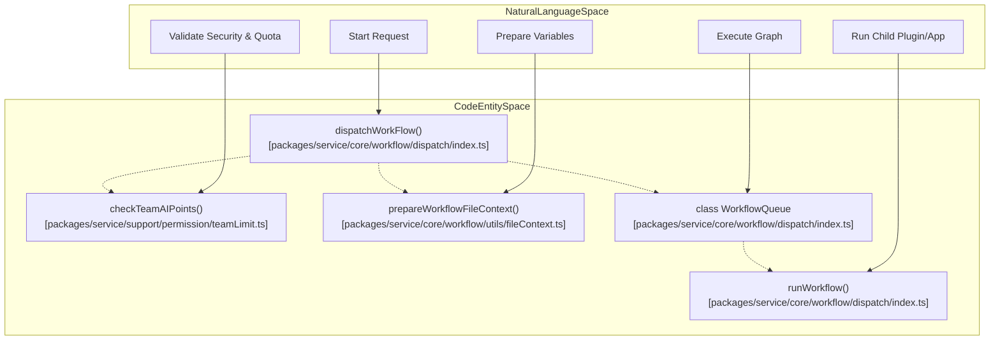
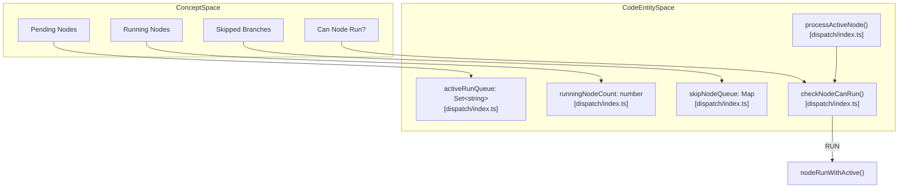

<!-- source: DeepWiki mcp.deepwiki.com · repo labring/FastGPT · page 4.2 Workflow Execution Engine · fetched 2026-10-29 -->

# Workflow Execution Engine

Relevant source files

The following files were used as context for generating this wiki page:

- [packages/global/common/string/tools.ts](packages/global/common/string/tools.ts)
- [packages/global/core/workflow/runtime/utils.ts](packages/global/core/workflow/runtime/utils.ts)
- [packages/global/core/workflow/template/system/ifElse/type.ts](packages/global/core/workflow/template/system/ifElse/type.ts)
- [packages/global/test/common/string/tools.test.ts](packages/global/test/common/string/tools.test.ts)
- [packages/global/test/core/workflow/runtime/utils.test.ts](packages/global/test/core/workflow/runtime/utils.test.ts)
- [packages/service/core/ai/utils.ts](packages/service/core/ai/utils.ts)
- [packages/service/core/workflow/dispatch/abandoned/runApp.ts](packages/service/core/workflow/dispatch/abandoned/runApp.ts)
- [packages/service/core/workflow/dispatch/child/runApp.ts](packages/service/core/workflow/dispatch/child/runApp.ts)
- [packages/service/core/workflow/dispatch/index.ts](packages/service/core/workflow/dispatch/index.ts)
- [packages/service/core/workflow/dispatch/plugin/run.ts](packages/service/core/workflow/dispatch/plugin/run.ts)
- [packages/service/core/workflow/dispatch/tools/answer.ts](packages/service/core/workflow/dispatch/tools/answer.ts)
- [packages/service/core/workflow/dispatch/tools/http468.ts](packages/service/core/workflow/dispatch/tools/http468.ts)
- [packages/service/core/workflow/dispatch/tools/runIfElse.ts](packages/service/core/workflow/dispatch/tools/runIfElse.ts)
- [packages/service/test/common/string/textSplitter.test.ts](packages/service/test/common/string/textSplitter.test.ts)
- [packages/service/test/core/ai/llm/toolCall.test.ts](packages/service/test/core/ai/llm/toolCall.test.ts)
- [packages/service/test/core/workflow/dispatch/tools/runIfElse.test.ts](packages/service/test/core/workflow/dispatch/tools/runIfElse.test.ts)
- [packages/web/components/common/Icon/icons/core/modules/fitView.svg](packages/web/components/common/Icon/icons/core/modules/fitView.svg)
- [projects/app/src/components/common/NextHead/index.tsx](projects/app/src/components/common/NextHead/index.tsx)
- [projects/app/src/pageComponents/app/detail/WorkflowComponents/Flow/components/ContextMenu.tsx](projects/app/src/pageComponents/app/detail/WorkflowComponents/Flow/components/ContextMenu.tsx)
- [projects/app/src/pageComponents/app/detail/WorkflowComponents/Flow/hooks/useWorkflow.tsx](projects/app/src/pageComponents/app/detail/WorkflowComponents/Flow/hooks/useWorkflow.tsx)
- [projects/app/src/pageComponents/app/detail/WorkflowComponents/Flow/nodes/NodeIfElse/ListItem.tsx](projects/app/src/pageComponents/app/detail/WorkflowComponents/Flow/nodes/NodeIfElse/ListItem.tsx)
- [projects/app/src/pageComponents/app/detail/WorkflowComponents/Flow/nodes/render/Handle/ConnectionHandle.tsx](projects/app/src/pageComponents/app/detail/WorkflowComponents/Flow/nodes/render/Handle/ConnectionHandle.tsx)
- [projects/app/src/pageComponents/app/detail/WorkflowComponents/Flow/utils/edge.ts](projects/app/src/pageComponents/app/detail/WorkflowComponents/Flow/utils/edge.ts)
- [projects/app/test/components/common/NextHead.test.ts](projects/app/test/components/common/NextHead.test.ts)

## Purpose and Scope

The Workflow Execution Engine is the core runtime system that orchestrates the execution of workflow nodes in FastGPT applications. It handles node scheduling, dependency resolution, concurrent execution, variable propagation, and interactive workflows that can pause and resume based on user input. This document covers the internal mechanics of workflow execution, including the queue-based execution model, node lifecycle, state management, and specialized dispatch functions.

For information about workflow node templates and types, see [Workflow Node Templates and Types](4.1). For variable resolution between nodes, see [Variable Resolution and Data Flow](4.3). For interactive workflow capabilities, see [Interactive Workflows and Pause-Resume](4.4).

## Architecture Overview

The workflow execution engine operates as a priority-based queue system that manages concurrent node execution while respecting dependencies defined by edges. The engine transforms stored workflow definitions into runtime representations, then executes nodes based on their edge status and dependencies.

### Natural Language to Code Entity Mapping (Execution Flow)

This diagram bridges the conceptual execution steps to the actual code entities in the `dispatch` module.

**Sources:** [packages/service/core/workflow/dispatch/index.ts:134-180]()

## Main Entry Points

### dispatchWorkFlow

The `dispatchWorkFlow` function is the primary entry point for workflow execution, typically called by chat completion and API routes.

**Key responsibilities:**
- **SSE Validation**: Ensures that HTTP Server-Sent Events (SSE) response wrappers are initialized before execution [packages/service/core/workflow/dispatch/index.ts:152-157]().
- **Quota Control**: Checks team AI points balance via `checkTeamAIPoints` [packages/service/core/workflow/dispatch/index.ts:162-162]().
- **File Context Preparation**: Sets up file context and registrars through `prepareWorkflowFileContext` [packages/service/core/workflow/dispatch/index.ts:164-180]().
- **Client Abort Tracking**: Instantiates a client abort tracker via `createClientAbortTracker` to handle dropped connections or cancellations gracefully [packages/service/test/core/workflow/dispatch/index.test.ts:118-128]().

**Sources:** [packages/service/core/workflow/dispatch/index.ts:134-180](), [packages/service/test/core/workflow/dispatch/index.test.ts:118-128]()

### runWorkflow

The `runWorkflow` function is the recursive core executor used for both root workflows and nested executions (plugins, tools, and child apps).

**Key features:**
- **Depth Limiting**: Tracks recursion limits to prevent stack overflow on deep nesting.
- **Runtime Rewriting**: Adapts nodes and edges for the current runtime context.
- **Queue Initialization**: Instantiates the `WorkflowQueue` to manage the lifecycle and scheduling of nodes.

**Sources:** [packages/service/core/workflow/dispatch/index.ts:1-1500]()

## WorkflowQueue: The Execution Controller

The `WorkflowQueue` class implements a priority-based system that manages concurrent node execution while respecting graph dependencies.

### Natural Language to Code Entity Mapping (Queue Logic)

This diagram maps conceptual queue management to internal class methods and state variables.

**Sources:** [packages/service/core/workflow/dispatch/index.ts:1-1500]()

### Execution Logic

1. **Concurrency Control**: Limits simultaneous node execution per workflow instance or team based on configuration.
2. **Dependency Resolution**: Evaluates incoming edges using topological analysis to determine if predecessor nodes have completed.
3. **Node Status**:
    - **RUN**: Executed when required incoming edges are active.
    - **SKIP**: Skipped when incoming branches are deactivated via conditional logic (e.g., `If/Else`).
    - **WAIT**: Deferred while predecessor nodes are still active or pending.

**Sources:** [packages/service/core/workflow/dispatch/index.ts:1-1500]()

## Node Execution Lifecycle

### 1. Parameter Injection and Variable Substitution
Before a node executes, its inputs are resolved:
- **Variable Substitution**: Replaces editor variables in strings via `replaceEditorVariable` [packages/service/core/workflow/dispatch/tools/http468.ts:141-147]().
- **Reference Resolution**: Resolves values from previous node outputs using `getReferenceVariableValue` [packages/global/core/workflow/runtime/utils.ts:121-125]().
- **Type Coercion**: Enforces target types via `valueTypeFormat`, handling numbers, booleans, arrays, and JSON objects [packages/global/core/workflow/runtime/utils.ts:54-154]().

**Sources:** [packages/service/core/workflow/dispatch/tools/http468.ts:135-148](), [packages/global/core/workflow/runtime/utils.ts:54-154]()

### 2. Specialized Node Dispatchers
Nodes are dispatched to specific handlers depending on their type:
- **HTTP Requests**: `dispatchHttp468Request` handles external requests, supporting JSON/Form-data/Urlencoded bodies, header secrets, and timeout configuration [packages/service/core/workflow/dispatch/tools/http468.ts:95-205]().
- **If/Else Logic**: `dispatchIfElse` evaluates conditions and determines which branch to follow. It supports various comparison operators (`equalTo`, `greaterThan`, `include`, `reg`, etc.) and logical combinations (`AND`, `OR`) [packages/service/core/workflow/dispatch/tools/runIfElse.ts:162-177](). The `checkCondition` function performs the actual comparison, handling type conversions for robust evaluation [packages/service/core/workflow/dispatch/tools/runIfElse.ts:74-128]().
- **Plugins and Sub-workflows**: `dispatchRunPlugin` loads personal or commercial plugin workflows, filters tool inputs, and invokes `runWorkflow` under isolated contexts [packages/service/core/workflow/dispatch/plugin/run.ts:65-189]().
- **Child App Execution**: `dispatchRunAppNode` executes a child application as a sub-workflow, managing its own history, query, and variable state [packages/service/core/workflow/dispatch/child/runApp.ts:36-177]().

**Sources:** [packages/service/core/workflow/dispatch/tools/http468.ts:95-205](), [packages/service/core/workflow/dispatch/tools/runIfElse.ts:162-177](), [packages/service/core/workflow/dispatch/tools/runIfElse.ts:74-128](), [packages/service/core/workflow/dispatch/plugin/run.ts:65-189](), [packages/service/core/workflow/dispatch/child/runApp.ts:36-177]()

## Interactive Workflows and Pause-Resume

Workflows can pause execution to prompt users for input (`userSelect`, `userInput`, or `agentAsk`).

1. **Detection**: The engine identifies interactive requests from node outputs [packages/global/core/workflow/runtime/utils.ts:162-206]().
2. **State Capture**: Unresolved execution contexts and interactive parameters are bundled into the response.
3. **Resumption**: `getLastInteractiveValue` and `extractDeepestInteractive` parse previous AI chat histories to extract user answers and resume workflow execution from the paused node [packages/global/core/workflow/runtime/utils.ts:22-35](), [packages/global/core/workflow/runtime/utils.ts:162-206]().

**Sources:** [packages/global/core/workflow/runtime/utils.ts:22-35](), [packages/global/core/workflow/runtime/utils.ts:162-206]()

## Summary of Key Components

| Component | File Path | Role |
| :--- | :--- | :--- |
| `dispatchWorkFlow` | `packages/service/core/workflow/dispatch/index.ts` | Main entry point, authorization, file context, and SSE checks |
| `runWorkflow` | `packages/service/core/workflow/dispatch/index.ts` | Recursive sub-workflow and plugin executor |
| `WorkflowQueue` | `packages/service/core/workflow/dispatch/index.ts` | Priority queue, concurrency control, and scheduling |
| `dispatchHttp468Request` | `packages/service/core/workflow/dispatch/tools/http468.ts` | External HTTP API request handler |
| `dispatchIfElse` | `packages/service/core/workflow/dispatch/tools/runIfElse.ts` | Conditional logic evaluation and branch selection |
| `dispatchRunPlugin` | `packages/service/core/workflow/dispatch/plugin/run.ts` | Plugin and workflow tool runner |
| `dispatchRunAppNode` | `packages/service/core/workflow/dispatch/child/runApp.ts` | Child application execution handler |
| `valueTypeFormat` | `packages/global/core/workflow/runtime/utils.ts` | Data type coercion and format validation |

**Sources:** [packages/service/core/workflow/dispatch/index.ts:134-180](), [packages/service/core/workflow/dispatch/tools/http468.ts:95-205](), [packages/service/core/workflow/dispatch/tools/runIfElse.ts:162-177](), [packages/service/core/workflow/dispatch/plugin/run.ts:65-189](), [packages/service/core/workflow/dispatch/child/runApp.ts:36-177](), [packages/global/core/workflow/runtime/utils.ts:54-154]()

---

