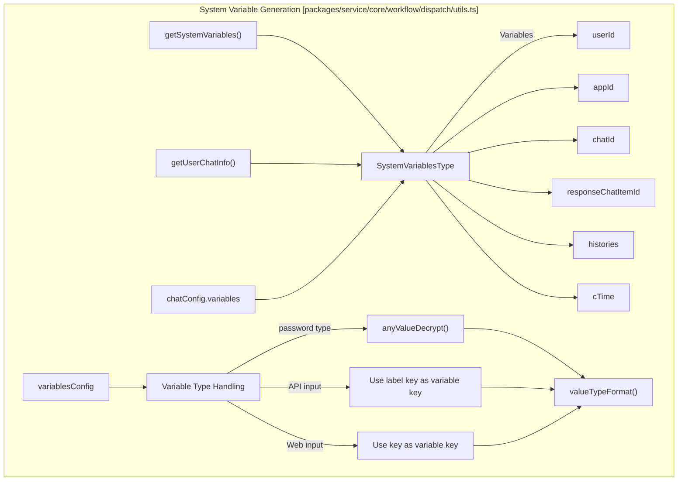
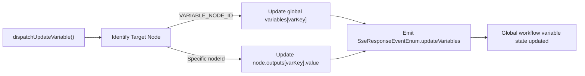
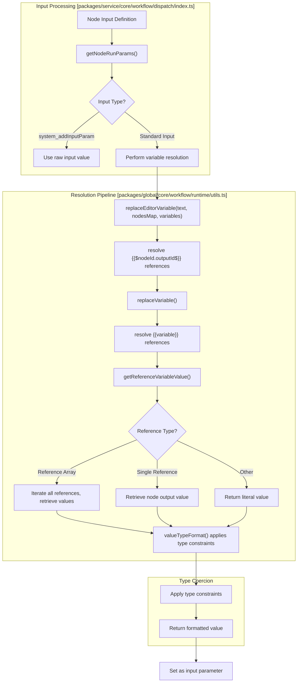
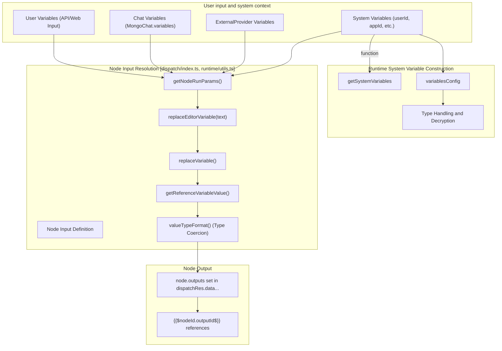
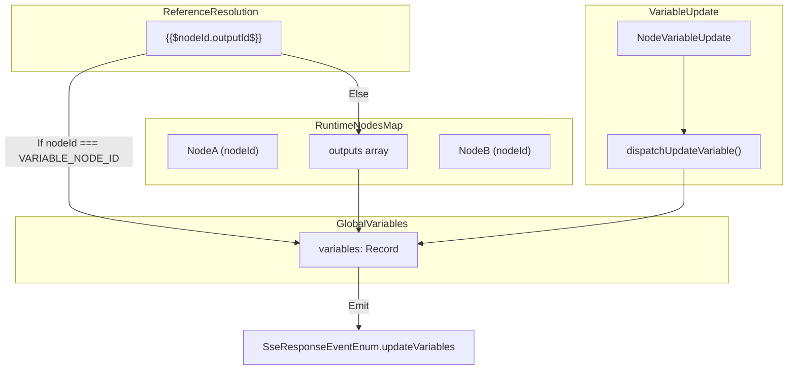

<!-- source: DeepWiki mcp.deepwiki.com · repo labring/FastGPT · page 4.3 Variable Resolution and Data Flow · fetched 2026-10-29 -->

# Variable Resolution and Data Flow

<details>
<summary>Relevant source files</summary>

The following files were used as context for generating this wiki page:

- [packages/global/core/app/constants.ts](packages/global/core/app/constants.ts)
- [packages/global/core/app/tool/toolSet/type.ts](packages/global/core/app/tool/toolSet/type.ts)
- [packages/global/core/app/type.ts](packages/global/core/app/type.ts)
- [packages/global/core/workflow/migration/index.ts](packages/global/core/workflow/migration/index.ts)
- [packages/global/core/workflow/migration/legacy/structure.ts](packages/global/core/workflow/migration/legacy/structure.ts)
- [packages/global/core/workflow/migration/legacy/systemConfig.ts](packages/global/core/workflow/migration/legacy/systemConfig.ts)
- [packages/global/core/workflow/migration/legacy/workflow.ts](packages/global/core/workflow/migration/legacy/workflow.ts)
- [packages/global/core/workflow/migration/migrate.ts](packages/global/core/workflow/migration/migrate.ts)
- [packages/global/core/workflow/type/io.ts](packages/global/core/workflow/type/io.ts)
- [packages/global/test/core/app/type.test.ts](packages/global/test/core/app/type.test.ts)
- [packages/global/test/core/workflow/migration/schema.test.ts](packages/global/test/core/workflow/migration/schema.test.ts)
- [packages/service/core/workflow/dispatch/ai/agentLoopCore/application/runtime/workflowToolRunner.ts](packages/service/core/workflow/dispatch/ai/agentLoopCore/application/runtime/workflowToolRunner.ts)
- [packages/service/core/workflow/dispatch/utils/containerRunState.ts](packages/service/core/workflow/dispatch/utils/containerRunState.ts)
- [packages/service/core/workflow/dispatch/utils/variables.ts](packages/service/core/workflow/dispatch/utils/variables.ts)
- [packages/service/test/core/app/schema.test.ts](packages/service/test/core/app/schema.test.ts)
- [packages/service/test/core/workflow/dispatch/ai/agentLoopCore/runtime/workflowToolRunner.test.ts](packages/service/test/core/workflow/dispatch/ai/agentLoopCore/runtime/workflowToolRunner.test.ts)
- [packages/service/test/core/workflow/dispatch/variables.test.ts](packages/service/test/core/workflow/dispatch/variables.test.ts)
- [packages/service/test/support/permission/app/resource.test.ts](packages/service/test/support/permission/app/resource.test.ts)
- [packages/web/components/common/DndDrag/DragIcon.tsx](packages/web/components/common/DndDrag/DragIcon.tsx)
- [packages/web/components/common/DndDrag/index.tsx](packages/web/components/common/DndDrag/index.tsx)
- [projects/app/src/components/core/app/VariableEdit.tsx](projects/app/src/components/core/app/VariableEdit.tsx)
- [projects/app/src/pageComponents/app/detail/WorkflowComponents/Flow/nodes/NodeFormInput/index.tsx](projects/app/src/pageComponents/app/detail/WorkflowComponents/Flow/nodes/NodeFormInput/index.tsx)
- [projects/app/src/pageComponents/app/detail/WorkflowComponents/Flow/nodes/NodeIfElse/index.tsx](projects/app/src/pageComponents/app/detail/WorkflowComponents/Flow/nodes/NodeIfElse/index.tsx)
- [projects/app/src/pageComponents/app/detail/WorkflowComponents/Flow/nodes/NodeToolParams/index.tsx](projects/app/src/pageComponents/app/detail/WorkflowComponents/Flow/nodes/NodeToolParams/index.tsx)
- [projects/app/src/pageComponents/app/detail/WorkflowComponents/Flow/nodes/NodeUserSelect.tsx](projects/app/src/pageComponents/app/detail/WorkflowComponents/Flow/nodes/NodeUserSelect.tsx)
- [projects/app/src/pageComponents/app/detail/WorkflowComponents/Flow/nodes/components/ToolParamsEditModal/constants.ts](projects/app/src/pageComponents/app/detail/WorkflowComponents/Flow/nodes/components/ToolParamsEditModal/constants.ts)
- [projects/app/src/web/common/system/utils.ts](projects/app/src/web/common/system/utils.ts)
- [projects/app/test/pageComponents/app/detail/WorkflowComponents/Flow/nodes/components/ToolParamsEditModal/constants.test.ts](projects/app/test/pageComponents/app/detail/WorkflowComponents/Flow/nodes/components/ToolParamsEditModal/constants.test.ts)

</details>


This document provides a detailed technical explanation of variable resolution and data flow in FastGPT workflows. It covers how variables propagate between nodes, the mechanism of reference resolution, the management of global variables, and the special role of the constant `VARIABLE_NODE_ID`. Implementation details, key functions, data structures, and process diagrams are included for a comprehensive understanding.

---

## Variable Types and Scopes

FastGPT workflows maintain multiple variable scopes during execution. Understanding these scopes clarifies how data flows and variables are resolved.

### Global Variables

Global variables persist across the entire workflow execution lifecycle and can be updated or queried by any node.

- **Sources of Global Variables:**
  - User-provided input parameters (API/Web input).
  - Stored chat-specific variables from prior interactions (MongoDB storage).
  - External providers injecting variables externally.
  - Automatically generated system variables providing runtime context.

Global variables are centralized and accessed during node execution to fulfill input requirements or influence node logic.

Sources: [packages/service/core/workflow/dispatch/index.ts:162-210](), [packages/service/core/workflow/dispatch/utils.ts:51-118]()

### System Variables

Generated at workflow start, system variables embed runtime context such as:

- User ID
- App ID
- Chat session ID
- Response item ID
- Chat history
- Current time

These variables are automatically injected and available globally, facilitating node runtime context awareness and variable state initialization.

Below is a diagram illustrating natural language system context mapping into code variables:



Sources: [packages/service/core/workflow/dispatch/utils.ts:51-118](), [projects/app/src/web/core/app/utils.ts:21-59]()

### Node Output Variables

Every workflow node defines outputs that downstream nodes can reference. Each output has:

- An `id` (string identifier)
- A `key` used for data mapping
- A `label` shown in UI or editor
- Optionally, a `valueType` limiting data type
- A `value` after runtime resolution

These outputs are commonly referenced in inputs of other nodes via the pattern `{{$nodeId.outputId$}}`.

```typescript
interface RuntimeNodeItemType {
  outputs: FlowNodeOutputItemType[];
}

interface FlowNodeOutputItemType {
  id: string;              // Output identifier
  key: string;             // Output key for data storage
  label: string;           // Display label
  valueType?: WorkflowIOValueTypeEnum;  // Data type constraint
  value?: any;             // Runtime resolved value
}
```

Sources: [packages/global/core/workflow/runtime/type.ts:106-127](), [packages/service/core/workflow/dispatch/index.ts:11-12]()

---

## Variable Update and Propagation Mechanism

FastGPT allows workflow nodes to update variables during execution:

- The special `NodeVariableUpdate` node type modifies global variables or node outputs explicitly.
- Updates are done by setting keys either globally or locally in nodes.
- Updated variables are broadcast via event streams (`SseResponseEventEnum.updateVariables`).

The update flow:



Sources: [packages/service/core/workflow/dispatch/tools/runUpdateVar.ts:68-178](), [packages/global/core/workflow/runtime/constants.ts:5-6]()

---

## Reference Formats and Syntax

FastGPT uses distinctive variable reference syntaxes within workflow node inputs.

### Simple Variable Reference: `{{variable}}`

- Syntax: `{{key}}`
- Resolves to a global variable with the matching key.
- Every match is replaced with its stringified value.
- To prevent infinite loops, replacement depth and self-references are guarded.

**Resolution Algorithm:**

1. Regex match: `/{{([^}]+)}}/g`
2. Lookup `key` in global variables map.
3. Convert value with `valToStr()` for string output.
4. Replace reference in text.

Sources: [packages/global/common/string/tools.ts:64-136]()

### Node Output Reference: `{{$nodeId.outputId$}}`

- Syntax: `{{$nodeId.outputId$}}`
- Used for referencing a particular output from a node by its `nodeId` and `outputId`.
- Special node ID constant: `VARIABLE_NODE_ID` (string, e.g., `"variables"`) refers to global variables as node outputs.
- Allows precise value retrieval from another node's outputs during input resolution.

**Resolution Algorithm:**

1. Regex match: `/\{\{\$([^.]+)\.([^$]+)\$\}\}/g`
2. Extract `nodeId` and `outputId`.
3. If `nodeId === VARIABLE_NODE_ID`, lookup in global variables.
4. Else find node in runtime map and output matching `outputId`.
5. Format value with `valueTypeFormat()` by the output's `valueType`.
6. Replace reference in text.

Sources: [packages/global/core/workflow/runtime/utils.ts:409-432](), [packages/global/core/workflow/constants.ts:12]()

### Reference Value Format (Array)

In node configurations, a connection reference is an array or array of arrays:

- Single reference: `[nodeId, outputId]`
- Multiple references: `[[nodeId, outputId], ...]`

This format lets nodes dynamically bind inputs to outputs of upstream nodes.

```typescript
type ReferenceValueType = [string, string];
// Example: ["node123", "outputKey"]
```

Sources: [packages/global/core/workflow/runtime/utils.ts:409-432](), [packages/service/core/workflow/dispatch/tools/runUpdateVar.ts:84-95]()

---

## Variable Resolution Process

Variables are resolved at several stages to enable workflow node input binding and value passing.

### Resolution Flow Diagram (Code Entity Space)



Sources: [packages/service/core/workflow/dispatch/index.ts:398-453](), [packages/global/core/workflow/runtime/utils.ts:409-432]()

### Text Variable Replacement Function

The key function `replaceEditorVariable()` processes strings with embedded variable references, resolving and substituting them recursively with safeguards.

Function signature snippet:

```typescript
function replaceEditorVariable({
  text,
  nodesMap,
  variables,
  depth = 0
}: {
  text: any;
  nodesMap: Map<string, RuntimeNodeItemType>;
  variables: Record<string, any>;
  depth?: number;
}): string
```

Features:

- Supports recursive substitution of `{{variable}}` and `{{$nodeId.outputId$}}` patterns.
- Uses depth limit to prevent infinite recursion (default max depth = 10).
- Calls `replaceVariable()` internally.

Sources: [packages/global/core/workflow/runtime/utils.ts:432](), [packages/global/common/string/tools.ts:64-136]()

### HTTP Node JSON Body Variable Resolution

The HTTP Request node (`http468`) integrates a special resolution path with `replaceJsonBodyString` to replace variables within JSON strings for safe parsing and replacement, preserving JSON structure.

This is done in:

- `dispatchHttp468Request()` at the workflow dispatch layer.
- It processes HTTP JSON body with variable replacement prior to request emission.

Sources: [packages/service/core/workflow/dispatch/tools/http468.ts:178-184]()

---

## Type Coercion System

FastGPT enforces data type consistency across workflow boundaries.

### Value Type Enum

```typescript
export enum WorkflowIOValueTypeEnum {
  string = 'string',
  number = 'number',
  boolean = 'boolean',
  object = 'object',
  arrayString = 'arrayString',
  arrayNumber = 'arrayNumber',
  arrayBoolean = 'arrayBoolean',
  arrayObject = 'arrayObject',
  arrayAny = 'arrayAny',
  any = 'any',
  chatHistory = 'chatHistory',
  datasetQuote = 'datasetQuote',
  dynamic = 'dynamic',
  selectDataset = 'selectDataset',
  selectApp = 'selectApp'
}
```

Sources: [packages/global/core/workflow/constants.ts:15-38]()

### Variable Value Formatting (`valueTypeFormat()`)

This function coerces values into expected types for inputs/outputs:

| Target Type     | Conversion Logic                                                                                                  | Example                      |
|-----------------|------------------------------------------------------------------------------------------------------------------|------------------------------|
| `string`        | If object, convert via `JSON.stringify()`. Else `String(value)`.                                                 | `{a:1}` → `'{"a":1}'`        |
| `number`        | Convert with `Number()`. Convert empty string to `null` to avoid NaN.                                           | `"42"` → `42`, `""` → `null` |
| `boolean`       | Convert string `"true"`/`"false"` (case-insensitive) to boolean. Use `Boolean()` for others.                     | `"true"` → `true`            |
| `object`        | Parse JSON5 string, fallback to `{}` if error.                                                                   | `'{"a":1}'` → `{a:1}`        |
| `array*`        | Parse JSON5 string to array, fallback to `[value]` if malformed.                                                 | `'[1,2]'` → `[1,2]`          |

Additional details:

- Secret/password typed values skip coercion at this stage.
- Type coercion ensures valid data is passed to node operations.

Sources: [packages/global/core/workflow/runtime/utils.ts:55-155]()

---

## Data Flow Between Nodes

### Input Parameters

When a node executes, its inputs are resolved by:

- Resolving embedded variables by `replaceEditorVariable()`.
- Retrieving references to outputs of upstream nodes or global variables.
- Coercing types via `valueTypeFormat()`.

Sources: [packages/service/core/workflow/dispatch/index.ts:398-453]()

### Output Variable Storage

After a node finishes, output values are saved into the internal runtime node object’s outputs array.

```mermaid
graph LR
  A["Node Execution completed"]
  A --> B["dispatchRes.data (node output key: value mapping)"]
  B --> C{"For each output in node.outputs"}
  C -->|if data[output.key] exists| D["Assign output.value = data[output.key]"]
  C -->|else| E["Use output.defaultValue or undefined"]
  D --> F["Outputs available for downstream references"]
  E --> F
```

Sources: [packages/service/core/workflow/dispatch/index.ts:579-746]()

### Variable State Updates and Persistency

Nodes can update global variables via the `newVariables` key in their response.

- Variables marked as system-level are filtered out before persisting to database.
- Filtering logic retains user or app-defined variables for saving.

Key function snippet:

```typescript
export const runtimeSystemVar2StoreType = ({
  variables,
  removeObj,
  userVariablesConfigs
}: {
  variables: Record<string, any>;
  removeObj?: Record<string, any>;
  userVariablesConfigs?: VariableItemType[];
}): Record<string, any> => {
  // Exclude system variables but keep user config variables
};
```

Sources: [packages/service/core/workflow/dispatch/utils.ts:120-151]()

---

## Special Cases and Edge Handling

### Circular Reference Prevention

To prevent infinite substitution loops during variable replacement:

- Both `replaceEditorVariable()` and `replaceVariable()` track processed variable keys in a Set.
- Detect if the substitution value contains the same variable reference pattern.
- Enforce a recursion depth limit (default 10).
  
This guards against faulty workflows with recursive variable definitions.

Sources: [packages/global/common/string/tools.ts:74-136](), [packages/global/core/workflow/runtime/utils.ts:432]()

### Password and Secret Variables

Secret or password-type variables are treated cautiously:

- Their encrypted store value is not decrypted during normal variable substitution.
- Decryption happens only when a node explicitly requests the plaintext:
  - For example, HTTP nodes or Plugin nodes handling sensitive data.
- This avoids accidental leakage of secrets during intermediate passes.

Coercion skip snippet:

```typescript
if (valueType === WorkflowIOValueTypeEnum.string && isSecretValue(value)) {
  return value;  // no coercion for encrypted password tokens
}
```

Sources: [packages/global/core/workflow/runtime/utils.ts:72](), [packages/global/common/secret/utils.ts:1-3]()

### If-Else Node Branching

In the `If-Else` control flow node:

- Inputs like `leftVal` and `rightVal` are first resolved by `getReferenceVariableValue()`.
- Conditional comparisons are applied based on resolved runtime values.
- This enables conditional branching based on variable data from upstream nodes.

Sources: [packages/service/core/workflow/dispatch/tools/runIfElse.ts:104-133]()

---

# Diagrams Bridging Natural Language Space to Code Entities

## Workflow Variable Resolution: Natural Language to Code Function Flow



---

## Variable and Node Relationship: Reference Resolution and Update Flow



---

# Summary

- Variables flow primarily between global context and node outputs.
- Variable references use distinct syntaxes: simple global variable `{{var}}` and node output `{{$nodeId.outputId$}}`.
- Resolution happens by recursively substituting variable references with safeguards against cycles.
- A rigorous type coercion system ensures data integrity.
- Special handling for secrets and system-generated variables protects sensitive data.
- Node execution injects input from resolved variables and exports outputs to global state for downstream nodes.
- The constant `VARIABLE_NODE_ID` denotes the global variable node, enabling uniform referencing.
- The variable update node and dispatch handle runtime changes and notify via event streams.

This detailed explanation provides both conceptual and code-level clarity into FastGPT's variable resolution and data flow system.

---

## Sources

- projects/app/src/components/core/app/VariableEdit.tsx:1-209
- packages/global/core/app/constants.ts:1-189
- packages/global/core/app/type.ts:1-203
- packages/global/core/workflow/constants.ts:1-55
- packages/global/core/workflow/runtime/constants.ts:1-30
- packages/global/core/workflow/runtime/type.ts:85-110
- packages/global/core/workflow/runtime/utils.ts:20-185,400-450
- packages/global/common/string/tools.ts:37-136
- packages/service/core/workflow/dispatch/index.ts:162-210,398-453,579-746
- packages/service/core/workflow/dispatch/tools/runUpdateVar.ts:68-178
- packages/service/core/workflow/dispatch/tools/runIfElse.ts:104-133
- packages/service/core/workflow/dispatch/tools/http468.ts:178-184
- packages/global/common/secret/utils.ts:1-3

---

