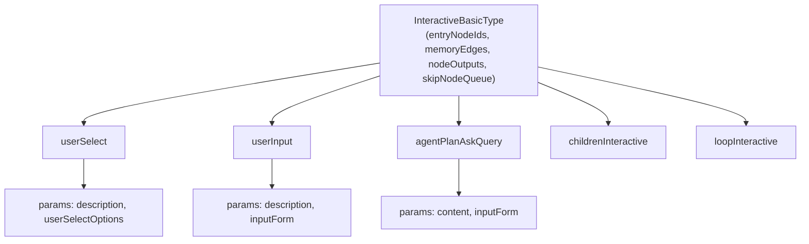
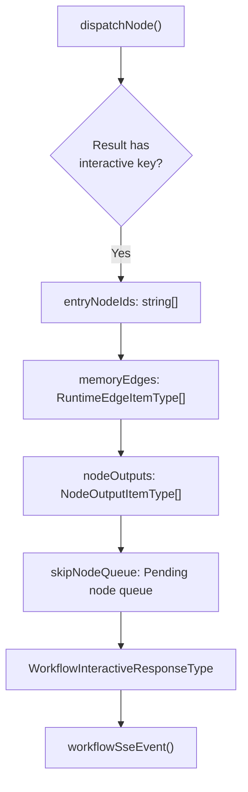
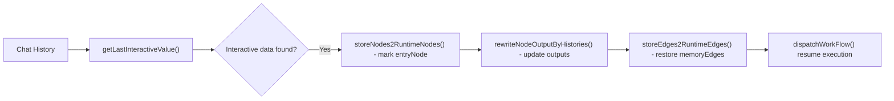
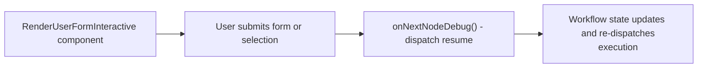
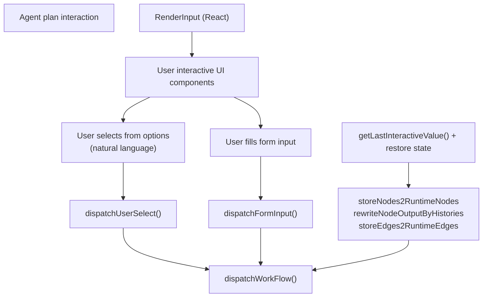
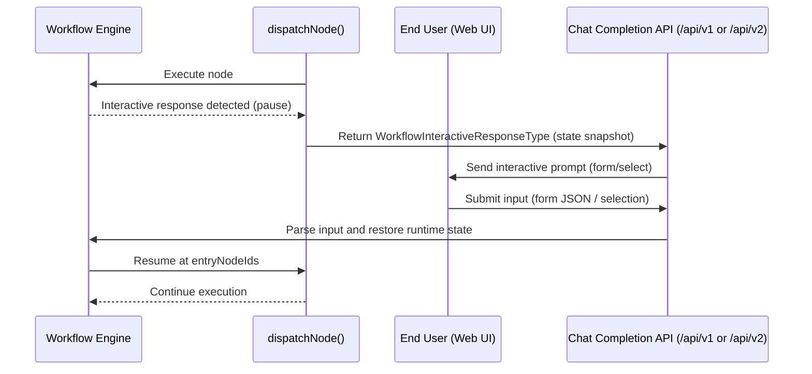

<!-- source: DeepWiki mcp.deepwiki.com · repo labring/FastGPT · page 4.4 Interactive Workflows and Pause-Resume · fetched 2026-10-29 -->

# Interactive Workflows and Pause-Resume

Relevant source files

The following files were used as context for generating this wiki page:

- [packages/service/common/s3/sources/chat/type.ts](packages/service/common/s3/sources/chat/type.ts)
- [packages/service/core/workflow/dispatch/interactive/formInput.ts](packages/service/core/workflow/dispatch/interactive/formInput.ts)
- [packages/service/core/workflow/dispatch/interactive/userSelect.ts](packages/service/core/workflow/dispatch/interactive/userSelect.ts)
- [packages/service/core/workflow/dispatch/plugin/runInput.ts](packages/service/core/workflow/dispatch/plugin/runInput.ts)
- [packages/service/test/core/chat/utils.test.ts](packages/service/test/core/chat/utils.test.ts)
- [packages/service/test/core/workflow/dispatch/interactive/formInput.test.ts](packages/service/test/core/workflow/dispatch/interactive/formInput.test.ts)
- [packages/service/test/core/workflow/dispatch/plugin/runInput.test.ts](packages/service/test/core/workflow/dispatch/plugin/runInput.test.ts)
- [projects/app/src/components/core/chat/ChatContainer/PluginRunBox/components/RenderInput.tsx](projects/app/src/components/core/chat/ChatContainer/PluginRunBox/components/RenderInput.tsx)
- [projects/app/src/components/core/chat/ChatContainer/PluginRunBox/context.tsx](projects/app/src/components/core/chat/ChatContainer/PluginRunBox/context.tsx)
- [projects/app/src/pageComponents/app/detail/WorkflowComponents/Flow/nodes/NodeFormInput/InputFormEditModal.tsx](projects/app/src/pageComponents/app/detail/WorkflowComponents/Flow/nodes/NodeFormInput/InputFormEditModal.tsx)
- [projects/app/src/pageComponents/app/detail/WorkflowComponents/Flow/nodes/NodePluginIO/InputEditModal.tsx](projects/app/src/pageComponents/app/detail/WorkflowComponents/Flow/nodes/NodePluginIO/InputEditModal.tsx)
- [projects/app/src/pageComponents/app/detail/WorkflowComponents/Flow/nodes/render/RenderDebug/NodeDebugResponse.tsx](projects/app/src/pageComponents/app/detail/WorkflowComponents/Flow/nodes/render/RenderDebug/NodeDebugResponse.tsx)
- [projects/app/src/pageComponents/app/detail/WorkflowComponents/context/index.tsx](projects/app/src/pageComponents/app/detail/WorkflowComponents/context/index.tsx)
- [projects/app/src/pages/api/core/chat/chatTest.ts](projects/app/src/pages/api/core/chat/chatTest.ts)
- [projects/app/src/pages/api/core/workflow/debug.ts](projects/app/src/pages/api/core/workflow/debug.ts)
- [projects/app/src/pages/api/v1/chat/completions.ts](projects/app/src/pages/api/v1/chat/completions.ts)
- [projects/app/src/pages/api/v2/chat/completions.ts](projects/app/src/pages/api/v2/chat/completions.ts)
- [projects/app/src/web/common/api/fetch.ts](projects/app/src/web/common/api/fetch.ts)

## Purpose and Scope

This document details the implementation of FastGPT’s interactive workflows with pause-resume capabilities. It covers the design and handling of `WorkflowInteractiveResponseType` for pausing workflow execution, the types of user interactions enabled (selection, form input, agent planning), and how the system resumes workflows seamlessly from the paused state by reconstructing runtime context. Key server-side dispatch functions, runtime data flows, and frontend rendering mechanisms are described with concrete references to relevant code entities.

This page focuses on the interactive workflow layer (node types and dispatch logic) and pause-resume semantics, complementing broader workflow execution details in section [4.2]() and nested workflow/plugin execution in [4.5]().

---

## Interactive Response Types

FastGPT implements a rich hierarchy of interactive response types used to pause workflow execution and solicit user interaction.

### Interactive Type Hierarchy and Core Interface

All interactive responses extend from the base `InteractiveBasicType` interface, which ensures key workflow state fields are preserved for pause and resume.

- `InteractiveBasicType` carries essential runtime state snapshots enabling the workflow to resume where it left off.
- Interactive variants allow different user interactions:
  - **userSelect**: choose one option from a predefined list
  - **userInput**: fill out a form with multiple fields, supporting file inputs and encrypted entries
  - **agentPlanAskQuery**: agent-driven planning interactions with query forms
  - Additional types handle nested children or loop-based interaction contexts

Sources: [packages/global/core/workflow/template/system/interactive/type.ts:10-185]()

### User Selection Interactive (`userSelect`)

This interaction pauses the workflow to present a Markdown description and a list of options for the user to pick from.

| Field | Type | Description |
|-------|------|-------------|
| `description` | `string` | Markdown instructional content shown to the user |
| `userSelectOptions` | `UserSelectOptionItemType[]` | Array of option items with keys & display values |

**Key Implementation Details:**

- The dispatch logic in `dispatchUserSelect` checks if the node is an entry resume point.
- If not a resume, the function returns an interactive response instructing the frontend to render options.
- Once resumed, it uses the user’s selection from the query to update node outputs, ignores skipped handles, and trims history accordingly.

Sources: [packages/service/core/workflow/dispatch/interactive/userSelect.ts:16-65]()

### Form Input Interactive (`userInput`)

Used for requesting structured multi-field form input from users, including sensitive types like passwords or file uploads.

| Field | Type | Description |
|-------|------|-------------|
| `description` | `string` | Form instructions or help text |
| `inputForm` | `UserInputFormItemType[]` | Array defining form fields (type, label, defaults, constraints) |

**Key Implementation Details:**

- Implemented in `dispatchFormInput`.
- On initial pause, returns an interactive form descriptor to the frontend.
- On resume, parses a JSON string from the query `text` containing user-submitted values.
- Handles decryption of password fields, registers file uploads for preview URLs, and ensures limits on file counts.
- Injects parsed form values into node outputs and updates the workflow state to continue execution.

Sources: [packages/service/core/workflow/dispatch/interactive/formInput.ts:83-161]()

---

## Workflow Pause Mechanism and Code Entity Mapping

### Pause Trigger and State Preservation Flow

When a workflow node returns a `WorkflowInteractiveResponseType`, the workflow engine pauses and preserves complete runtime state, including the entry nodes, edges status, node outputs, and queue of pending nodes.

- The fields saved are critical to later resuming execution exactly where it stopped.
- `entryNodeIds` specifies which node(s) caused the pause and will be entry points upon resume.
- `memoryEdges` snapshot all edges’ current active/waiting state to maintain accurate graph traversal.
- `nodeOutputs` contain all node values computed up to this point (needed for variable references).
- `skipNodeQueue` holds nodes waiting in the queue that haven't been processed yet.

Sources:  
[packages/global/core/workflow/template/system/interactive/type.ts:10-18](),  
[projects/app/src/pages/api/v2/chat/completions.ts:335-360]()

---

## Resume Mechanism

After the user interacts (e.g., selects an option or submits form), the backend resumes the workflow using the saved interactive state.

### Resume Detection Logic

On chat completion API calls (`/api/v1/chat/completions` or `/api/v2/chat/completions`), the last AI response in chat history is inspected for an unresolved interactive block using `getLastInteractiveValue`.

- If found, the saved interactive data is extracted to reconstruct runtime.
- The interactive node(s) are marked as entry nodes with `isEntry = true`.
- Previous nodes and edges state are restored.

Key utility functions involved:

- `storeNodes2RuntimeNodes`: Converts stored DB nodes to runtime nodes and sets the interactive node's `isEntry` flag [projects/app/src/pages/api/v1/chat/completions.ts:260-265]()
- `rewriteNodeOutputByHistories`: Rewrites node output values from interactive data into runtime nodes so variables resolve correctly [projects/app/src/pages/api/v1/chat/completions.ts:275-280](), [packages/global/core/workflow/runtime/utils.ts:57-80]()
- `storeEdges2RuntimeEdges`: Restores edge states in runtime to keep track of visited/traversed branches [projects/app/src/pages/api/v1/chat/completions.ts:260]()

Sources:  
[projects/app/src/pages/api/v1/chat/completions.ts:230-280](),  
[projects/app/src/pages/api/v2/chat/completions.ts:235-246](),  
[packages/global/core/workflow/runtime/utils.ts:55-80]()

---

## Frontend Interactive Rendering and Submit Flow

The frontend chat UI renders interactive nodes using specialized React components based on interaction type:

- For form inputs: `RenderInput` component shows the form fields and captures user input, resetting with historic data for resume [projects/app/src/components/core/chat/ChatContainer/PluginRunBox/components/RenderInput.tsx:20-130]()
- For user selections: similar form or button components render options.

When the user submits, the frontend fires a "Next Step" or "Submit" action:

1. Collected input data or selection is serialized (often as JSON string).
2. The new query containing user response is sent as part of the next chat message `query`.
3. The API backend detects the previous interactive state and resumes execution using the new input.
4. The workflow continues seamlessly from the paused node(s).

Interactive debug mode in the workflow editor also uses a similar pattern but handles resume locally via `onNextNodeDebug` state update:

Sources:  
[projects/app/src/components/core/chat/ChatContainer/PluginRunBox/components/RenderInput.tsx:20-130](),  
[projects/app/src/pageComponents/app/detail/WorkflowComponents/Flow/nodes/render/RenderDebug/NodeDebugResponse.tsx:100-140]()

---

## Key Code Entities Reference

| Code Entity                              | File & Lines                                                  | Description                                           |
|----------------------------------------|--------------------------------------------------------------|-------------------------------------------------------|
| `WorkflowInteractiveResponseType`      | packages/global/core/workflow/template/system/interactive/type.ts:180-184 | Type defining entire interactive pause state object. |
| `InteractiveBasicType`                  | packages/global/core/workflow/template/system/interactive/type.ts:10-19   | Base interface with essential runtime state for resume. |
| `UserInputInteractive`                  | packages/global/core/workflow/template/system/interactive/type.ts:142-150 | Parameters for form-based user inputs.                |
| `dispatchUserSelect`                    | packages/service/core/workflow/dispatch/interactive/userSelect.ts:16-65    | Server logic for user select node dispatch & resume.  |
| `dispatchFormInput`                     | packages/service/core/workflow/dispatch/interactive/formInput.ts:83-161    | Server logic for form input node dispatch & resume.   |
| `getLastInteractiveValue`               | packages/global/core/workflow/runtime/utils.ts:15                         | Utility to find last unresolved interactive block in chat history. |
| `storeNodes2RuntimeNodes`               | projects/app/src/pages/api/v1/chat/completions.ts:260-265                 | Converts stored node DB data to runtime nodes and marks entry. |
| `rewriteNodeOutputByHistories`          | projects/app/src/pages/api/v1/chat/completions.ts:275-280                 | Injects stored nodeOutputs back into runtime nodes.    |
| `storeEdges2RuntimeEdges`               | projects/app/src/pages/api/v1/chat/completions.ts:260                      | Restores runtime edges states for paused workflow.              |
| `RenderInput` (React component)         | projects/app/src/components/core/chat/ChatContainer/PluginRunBox/components/RenderInput.tsx:20-130 | React UI rendering for form inputs during interactive pause. |

Sources:  
[packages/global/core/workflow/template/system/interactive/type.ts](),  
[packages/service/core/workflow/dispatch/interactive/userSelect.ts](),  
[packages/service/core/workflow/dispatch/interactive/formInput.ts](),  
[projects/app/src/pages/api/v1/chat/completions.ts](),  
[projects/app/src/pages/api/v2/chat/completions.ts](),  
[packages/global/core/workflow/runtime/utils.ts](),  
[projects/app/src/components/core/chat/ChatContainer/PluginRunBox/components/RenderInput.tsx]()

---

# Summary Diagram: Natural Language Interaction to Code Implementation

---

# Summary Diagram: Pause-Resume Interaction Inside Workflow Engine

---

This page captures technical details for implementing and understanding FastGPT’s interactive workflows with pause-resume semantics, including data flow from user interaction down to dispatch logic and runtime state restoration.

Sources: See inline section citations above.

---

