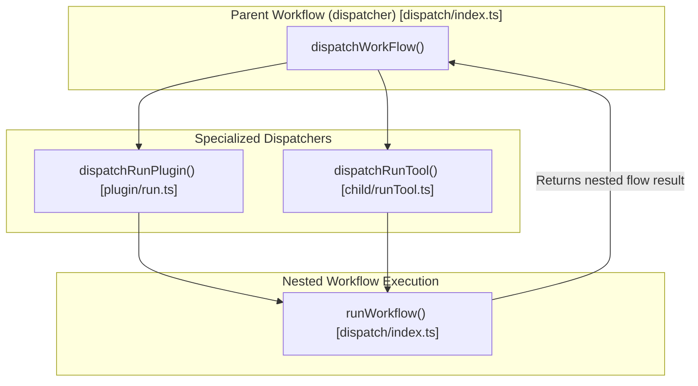
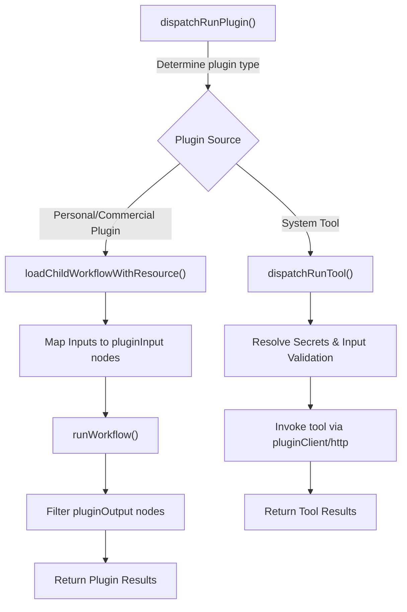
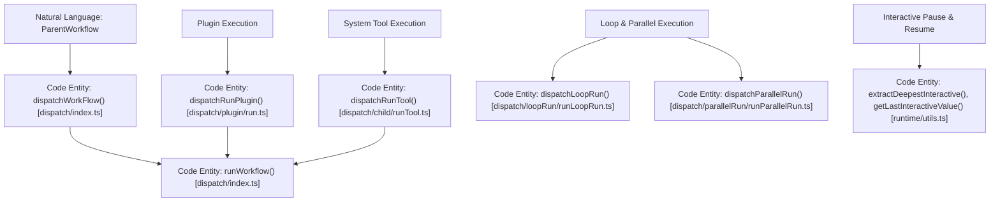

<!-- source: DeepWiki mcp.deepwiki.com · repo labring/FastGPT · page 4.5 Child Workflows and Plugin Execution · fetched 2026-10-29 -->

# Child Workflows and Plugin Execution

<details>
<summary>Relevant source files</summary>

The following files were used as context for generating this wiki page:

- [.agents/design/core/ai/model-permission-auth.md](.agents/design/core/ai/model-permission-auth.md)
- [packages/global/common/error/utils.ts](packages/global/common/error/utils.ts)
- [packages/global/common/string/tools.ts](packages/global/common/string/tools.ts)
- [packages/global/core/workflow/runtime/utils.ts](packages/global/core/workflow/runtime/utils.ts)
- [packages/global/test/common/string/tools.test.ts](packages/global/test/common/string/tools.test.ts)
- [packages/global/test/core/workflow/runtime/utils.test.ts](packages/global/test/core/workflow/runtime/utils.test.ts)
- [packages/service/common/file/image/controller.ts](packages/service/common/file/image/controller.ts)
- [packages/service/common/response/index.ts](packages/service/common/response/index.ts)
- [packages/service/core/ai/utils.ts](packages/service/core/ai/utils.ts)
- [packages/service/core/app/mcp.ts](packages/service/core/app/mcp.ts)
- [packages/service/core/dataset/image/controller.ts](packages/service/core/dataset/image/controller.ts)
- [packages/service/core/workflow/dispatch/abandoned/runApp.ts](packages/service/core/workflow/dispatch/abandoned/runApp.ts)
- [packages/service/core/workflow/dispatch/ai/agent/sub/tool/index.ts](packages/service/core/workflow/dispatch/ai/agent/sub/tool/index.ts)
- [packages/service/core/workflow/dispatch/ai/toolcall/toolCall.ts](packages/service/core/workflow/dispatch/ai/toolcall/toolCall.ts)
- [packages/service/core/workflow/dispatch/child/runApp.ts](packages/service/core/workflow/dispatch/child/runApp.ts)
- [packages/service/core/workflow/dispatch/child/runTool.ts](packages/service/core/workflow/dispatch/child/runTool.ts)
- [packages/service/core/workflow/dispatch/index.ts](packages/service/core/workflow/dispatch/index.ts)
- [packages/service/core/workflow/dispatch/plugin/run.ts](packages/service/core/workflow/dispatch/plugin/run.ts)
- [packages/service/core/workflow/dispatch/tools/answer.ts](packages/service/core/workflow/dispatch/tools/answer.ts)
- [packages/service/core/workflow/dispatch/tools/http468.ts](packages/service/core/workflow/dispatch/tools/http468.ts)
- [packages/service/test/common/string/textSplitter.test.ts](packages/service/test/common/string/textSplitter.test.ts)
- [packages/service/test/core/ai/llm/toolCall.test.ts](packages/service/test/core/ai/llm/toolCall.test.ts)
- [packages/service/test/core/app/http.test.ts](packages/service/test/core/app/http.test.ts)
- [packages/service/test/core/app/mcp.test.ts](packages/service/test/core/app/mcp.test.ts)
- [packages/service/test/core/workflow/dispatch/ai/agent/sub/tool/index.test.ts](packages/service/test/core/workflow/dispatch/ai/agent/sub/tool/index.test.ts)
- [packages/service/test/core/workflow/dispatch/ai/toolcall/toolProvider/createToolCallToolProvider.test.ts](packages/service/test/core/workflow/dispatch/ai/toolcall/toolProvider/createToolCallToolProvider.test.ts)
- [packages/service/test/core/workflow/dispatch/tools/runTool.test.ts](packages/service/test/core/workflow/dispatch/tools/runTool.test.ts)
- [projects/app/src/pageComponents/app/detail/Edit/HTTPTools/Edit.tsx](projects/app/src/pageComponents/app/detail/Edit/HTTPTools/Edit.tsx)
- [projects/app/test/api/core/app/tool/debugCompatibility.test.ts](projects/app/test/api/core/app/tool/debugCompatibility.test.ts)

</details>


This page provides a comprehensive technical overview of how FastGPT orchestrates nested workflow execution. It covers the recursive invocation of workflows for plugins, child applications, system tool runners, and loop nodes, detailing data flow, state management for interactive pauses/resumes, and concurrency handling.

---

## 1. Child Workflow Execution Architecture

FastGPT manages nested workflows by recursively dispatching execution contexts via `dispatchWorkFlow`. This main dispatcher invokes specialized runners based on the node type (plugins, tools, loops), ensuring isolated runtime state and variable scoping to prevent interference between nested instances.

### Recursive Dispatch Model

- The root entry for workflow execution is `dispatchWorkFlow` ([packages/service/core/workflow/dispatch/index.ts:134-157]()).
- Nodes representing child workflows or tools call specialized dispatchers such as `dispatchRunPlugin` or `dispatchRunTool`.
- These specialized dispatchers load the child workflow's runtime nodes and edges, prepare the execution context, and invoke the generic `runWorkflow` to perform the nested execution.
- Execution results, including any interactive prompts or node outputs, are returned back up to the parent caller.
- Depth and context isolation ensure parallel/recursive runs do not clobber shared variable state.



Sources: [packages/service/core/workflow/dispatch/index.ts:134-157](), [packages/service/core/workflow/dispatch/plugin/run.ts:30-185](), [packages/service/core/workflow/dispatch/child/runTool.ts:64-190]()

---

## 2. Plugin and Tool Execution

### 2.1 Plugin Execution (`dispatchRunPlugin`)

- Plugins are workflow-based tools that can be either **personal** (team apps) or **commercial** (system-level).
- The `dispatchRunPlugin` function:
  - Determines plugin source from `pluginId` (personal, commercial, or system tool).
  - For system tools, forwards execution to `dispatchRunTool`.
  - For personal/commercial plugins:
    - Loads the child workflow's nodes/edges and resource context (`loadChildWorkflowWithResource`).
    - Filters plugin input variables and maps parent parameters into child `pluginInput` nodes.
    - Injects decrypted sensitive values and processes file selection inputs.
    - Calls `runWorkflow` with prepared runtime nodes and edges, passing filtered variables.
    - Extracts and filters outputs from child `pluginOutput` nodes according to the output filter map.
    - Wraps and returns results, including interactive scenarios if present ([packages/service/core/workflow/dispatch/plugin/run.ts:47-185]()).

### 2.2 System Tool Execution (`dispatchRunTool`)

- Handles execution of system tools, which may include HTTP tools or MCP tools.
- Key steps:
  - Resolves the tool's runtime source and retrieves tool runtime config and secrets.
  - Validates input parameters against the tool's JSON schema.
  - Generates invocation tokens for usage tracking.
  - Uses the `pluginClient` or HTTP client to invoke the tool's endpoint.
  - Supports streaming or batch responses based on workflow configuration.
  - Handles permissions, secret injection, and error responses consistently.
  - Returns tool execution results encapsulated in dispatch node result format ([packages/service/core/workflow/dispatch/child/runTool.ts:64-190]()).



Sources: [packages/service/core/workflow/dispatch/plugin/run.ts:65-185](), [packages/service/core/workflow/dispatch/child/runTool.ts:64-190]()

---

## 3. Loop and Parallel Execution of Child Nodes

FastGPT supports nodes that run multiple child workflows iteratively (loops) or concurrently (parallel runs). These are special cases of child workflow dispatch.

### 3.1 Loop Execution (`dispatchLoopRun`)

- Iterates over arrays or loop conditions.
- For each iteration:
  - Clones runtime nodes and edges to isolate iterations.
  - Sets current loop item and iteration index in the loop's start node variables.
  - Runs the child workflow execution normally via `runWorkflow`.
  - Supports early break if a break condition is triggered inside the loop.
- Aggregates results by iteration.

### 3.2 Parallel Execution (`dispatchParallelRun`)

- Runs multiple branches of execution concurrently.
- Manages concurrency limits.
- Incorporates retry policies to auto-retry failed executions.
- Collects and merges results after all parallel branches complete.

Both loop and parallel runs maintain isolated runtime contexts for each iteration/branch to avoid race conditions or shared mutable state.

Sources:  
- loop run: [packages/service/core/workflow/dispatch/loopRun/runLoopRun.ts:43-215]()  
- parallel run: [packages/service/core/workflow/dispatch/parallelRun/runParallelRun.ts:37-134]()

---

## 4. Interactive Responses and Pausing in Child Workflows

When nested workflows reach user interaction points like `userSelect` or `agentAsk`, execution must pause and bubble interactive state upwards.

### Interactive State Wrapping and Bubble-Up

- Child workflow dispatchers detect interactive responses and wrap them in special container types to preserve context:
  - Plugins, Tools, and child apps wrap interactions as `childrenInteractive` containing the child's `childrenResponse`.
  - Loop runs wrap interactive responses as `loopRunInteractive` including iteration index and history.
- These wrappers allow the parent workflow to recognize nested pause points and keep track of which child workflow and iteration requires user input.

### Resumption Handling

- When resuming after user input, the parent supplies `lastInteractive` data to child dispatchers.
- The dispatcher queries the IDs of entry nodes reached in the last interaction.
- It restores output data for those nodes using node response history logs, ensuring all downstream data references are consistent.
- It reconstructs runtime edges via `storeEdges2RuntimeEdges` for correct data flow in resumed execution ([packages/global/core/workflow/runtime/utils.ts:160-207](), [packages/service/core/workflow/dispatch/index.ts:140-150]()).

---

## 5. Stream and Response Control in Child Workflows

FastGPT allows child workflows to override or inherit streaming behavior:

- The plugin dispatcher accepts a `system_forbid_stream` flag.
- When `system_forbid_stream` is true, it forcibly disables streaming (`stream: false`) for the nested child workflow.
- To avoid duplicated messages in the parent chat UI, it filters out the `assistantResponses` field from the child's streamed response.
- This control ensures nested workflows can either stream their output fully, or return only a final batch result depending on context ([packages/service/core/workflow/dispatch/plugin/run.ts:65-75](), [packages/service/core/workflow/dispatch/index.ts:150-160]()).

```mermaid
graph LR
    A[dispatchRunPlugin()] -->|Check system_forbid_stream| B{Forbid streaming?}
    B -- Yes --> C[runWorkflow(stream: false)]
    B -- No --> D[runWorkflow(stream: true)]
    C --> E[Filter assistantResponses from child result]
    E --> F[Return filtered result]
    D --> F
```

---

## 6. Data Flow in Nested Workflows

- Parent workflow variables are merged and filtered into child inputs following the plugin tool input schema.
- Child workflows operate on runtime nodes and edges arrays, which are generated by `storeNodes2RuntimeNodes` and `storeEdges2RuntimeEdges`.
- Outputs from child executions pass through output filters defined by `pluginOutput` input metadata.
- Node responses are recorded and can be read back for resume and cascading references.
- Sensitive data (e.g., passwords, secrets) is decrypted just before injection into child workflows, preserving security boundaries.

---

# Summary Diagram: Natural Language to Code Entities Mapping



---

# Summary Table: Key Dispatch Functions

| Function/Module              | Purpose                                        | Location (lines)                     |
|-----------------------------|------------------------------------------------|------------------------------------|
| `dispatchWorkFlow`           | Main workflow dispatcher for all runs          | dispatch/index.ts (134-157)         |
| `dispatchRunPlugin`          | Runs plugin-based child workflow                 | dispatch/plugin/run.ts (47-185)     |
| `dispatchRunTool`            | Runs system tool child workflows                  | dispatch/child/runTool.ts (64-190)  |
| `dispatchLoopRun`            | Serial loop execution of child workflows           | dispatch/loopRun/runLoopRun.ts      |
| `dispatchParallelRun`        | Parallel concurrent child workflow execution     | dispatch/parallelRun/runParallelRun.ts |
| `extractDeepestInteractive` | Extracts deepest nested interactive data from history | global/core/workflow/runtime/utils.ts (22-35) |
| `getLastInteractiveValue`   | Retrieves last interactive prompt from chat history | global/core/workflow/runtime/utils.ts (165-207) |

---

# References & Sources

- `dispatchWorkFlow`: [packages/service/core/workflow/dispatch/index.ts:134-157]()
- `dispatchRunPlugin`: [packages/service/core/workflow/dispatch/plugin/run.ts:47-185]()
- `dispatchRunTool`: [packages/service/core/workflow/dispatch/child/runTool.ts:64-190]()
- Loop execution: [packages/service/core/workflow/dispatch/loopRun/runLoopRun.ts:43-215]()
- Parallel execution: [packages/service/core/workflow/dispatch/parallelRun/runParallelRun.ts:37-134]()
- Interactive utils: [packages/global/core/workflow/runtime/utils.ts:22-35,165-207]()
- Stream control part: [packages/service/core/workflow/dispatch/plugin/run.ts:65-75](), [packages/service/core/workflow/dispatch/index.ts:150-160]()

This detailed description clarifies how FastGPT implements nested workflows with plugins, child apps, tools, and iteration constructs, ensuring flexible, composable AI agent orchestration.

---

