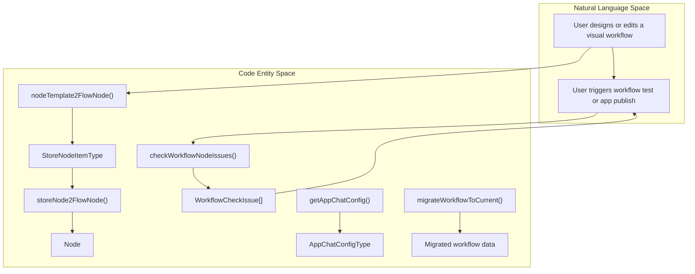
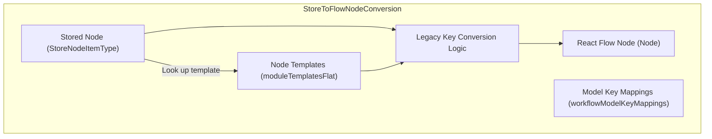
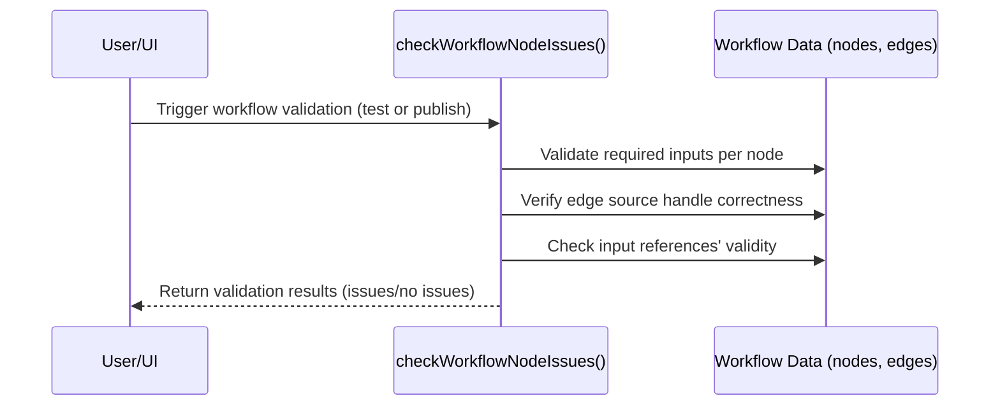
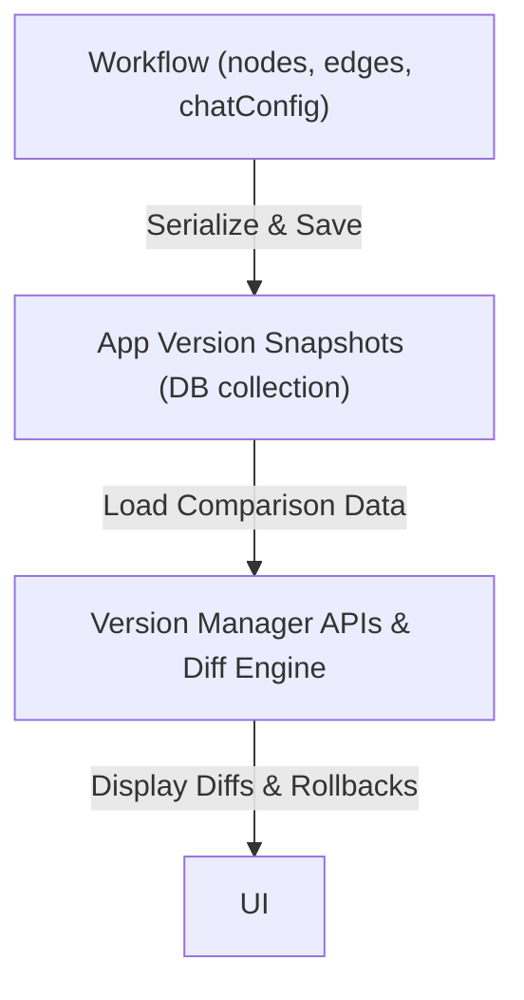

<!-- source: DeepWiki mcp.deepwiki.com · repo labring/FastGPT · page 4.6 Workflow Utilities and Versioning · fetched 2026-10-29 -->

# Workflow Utilities and Versioning

<details>
<summary>Relevant source files</summary>

The following files were used as context for generating this wiki page:

- [packages/global/core/app/constants.ts](packages/global/core/app/constants.ts)
- [packages/global/core/app/tool/toolSet/type.ts](packages/global/core/app/tool/toolSet/type.ts)
- [packages/global/core/app/type.ts](packages/global/core/app/type.ts)
- [packages/global/core/workflow/migration/index.ts](packages/global/core/workflow/migration/index.ts)
- [packages/global/core/workflow/migration/legacy/structure.ts](packages/global/core/workflow/migration/legacy/structure.ts)
- [packages/global/core/workflow/migration/legacy/systemConfig.ts](packages/global/core/workflow/migration/legacy/systemConfig.ts)
- [packages/global/core/workflow/migration/legacy/workflow.ts](packages/global/core/workflow/migration/legacy/workflow.ts)
- [packages/global/core/workflow/migration/migrate.ts](packages/global/core/workflow/migration/migrate.ts)
- [packages/global/core/workflow/type/io.ts](packages/global/core/workflow/type/io.ts)
- [packages/global/test/core/app/type.test.ts](packages/global/test/core/app/type.test.ts)
- [packages/global/test/core/workflow/migration/schema.test.ts](packages/global/test/core/workflow/migration/schema.test.ts)
- [packages/global/test/core/workflow/modelPublishPolicy.test.ts](packages/global/test/core/workflow/modelPublishPolicy.test.ts)
- [packages/service/core/workflow/dispatch/utils/variables.ts](packages/service/core/workflow/dispatch/utils/variables.ts)
- [packages/service/test/core/app/schema.test.ts](packages/service/test/core/app/schema.test.ts)
- [packages/service/test/core/workflow/dispatch/variables.test.ts](packages/service/test/core/workflow/dispatch/variables.test.ts)
- [packages/service/test/support/permission/app/resource.test.ts](packages/service/test/support/permission/app/resource.test.ts)
- [packages/web/components/common/Textarea/JsonEditor/index.tsx](packages/web/components/common/Textarea/JsonEditor/index.tsx)
- [packages/web/hooks/useSafeTranslation.ts](packages/web/hooks/useSafeTranslation.ts)
- [projects/app/src/components/core/chat/ChatContainer/ChatBox/components/AIChatBubble/index.tsx](projects/app/src/components/core/chat/ChatContainer/ChatBox/components/AIChatBubble/index.tsx)
- [projects/app/src/components/core/chat/ChatContainer/ChatBox/components/AppChatMain.tsx](projects/app/src/components/core/chat/ChatContainer/ChatBox/components/AppChatMain.tsx)
- [projects/app/src/components/core/chat/ChatContainer/ChatBox/components/ChatItem.tsx](projects/app/src/components/core/chat/ChatContainer/ChatBox/components/ChatItem.tsx)
- [projects/app/src/components/core/chat/ChatContainer/ChatBox/components/ChatVariableForm.tsx](projects/app/src/components/core/chat/ChatContainer/ChatBox/components/ChatVariableForm.tsx)
- [projects/app/src/components/core/chat/ChatContainer/ChatBox/constants.ts](projects/app/src/components/core/chat/ChatContainer/ChatBox/constants.ts)
- [projects/app/src/pageComponents/app/detail/Edit/FormComponent/checkAppForm.ts](projects/app/src/pageComponents/app/detail/Edit/FormComponent/checkAppForm.ts)
- [projects/app/src/pageComponents/app/detail/WorkflowComponents/Flow/ChatTest.tsx](projects/app/src/pageComponents/app/detail/WorkflowComponents/Flow/ChatTest.tsx)
- [projects/app/src/pageComponents/app/detail/WorkflowComponents/Flow/components/NodeTemplates/list.tsx](projects/app/src/pageComponents/app/detail/WorkflowComponents/Flow/components/NodeTemplates/list.tsx)
- [projects/app/src/pageComponents/app/detail/WorkflowComponents/Flow/nodes/components/ToolParamsEditModal/constants.ts](projects/app/src/pageComponents/app/detail/WorkflowComponents/Flow/nodes/components/ToolParamsEditModal/constants.ts)
- [projects/app/src/pageComponents/app/detail/WorkflowComponents/Flow/nodes/render/RenderInput/templates/Reference.tsx](projects/app/src/pageComponents/app/detail/WorkflowComponents/Flow/nodes/render/RenderInput/templates/Reference.tsx)
- [projects/app/src/pageComponents/app/detail/useChatTest.tsx](projects/app/src/pageComponents/app/detail/useChatTest.tsx)
- [projects/app/src/web/core/app/api/tool.ts](projects/app/src/web/core/app/api/tool.ts)
- [projects/app/src/web/core/chat/context/chatItemContext.tsx](projects/app/src/web/core/chat/context/chatItemContext.tsx)
- [projects/app/src/web/core/workflow/utils.ts](projects/app/src/web/core/workflow/utils.ts)
- [projects/app/test/pageComponents/app/detail/Edit/FormComponent/checkAppForm.test.ts](projects/app/test/pageComponents/app/detail/Edit/FormComponent/checkAppForm.test.ts)
- [projects/app/test/pageComponents/app/detail/WorkflowComponents/Flow/components/NodeTemplates/useNodeTemplates.test.ts](projects/app/test/pageComponents/app/detail/WorkflowComponents/Flow/components/NodeTemplates/useNodeTemplates.test.ts)
- [projects/app/test/pageComponents/app/detail/WorkflowComponents/Flow/nodes/components/ToolParamsEditModal/constants.test.ts](projects/app/test/pageComponents/app/detail/WorkflowComponents/Flow/nodes/components/ToolParamsEditModal/constants.test.ts)
- [projects/app/test/web/core/app/tool/templates.test.ts](projects/app/test/web/core/app/tool/templates.test.ts)
- [projects/app/test/web/core/app/workflow/utils.test.ts](projects/app/test/web/core/app/workflow/utils.test.ts)

</details>


This document details the core utility functions, validation mechanisms, resource extraction tools, model policies, and snapshot comparison strategies that support the workflow system in FastGPT. These components are essential for handling workflow node transformations, validating workflows before runtime or publishing, managing application chat configurations and variables, enforcing model usage policies, and managing workflow version snapshots.

---

## Workflow Utility System Architecture

FastGPT's workflow utilities form a critical backbone to the visual workflow system, translating between data representations, validating workflows, and ensuring consistent execution.



*The architecture bridges user workflow actions like creation and testing to internal data transformations and validations, ensuring smooth UI-to-code transitions.*

**Sources:** [projects/app/src/web/core/workflow/utils.ts:55-190](), [projects/app/src/web/core/workflow/workflowCheck.ts:1-135](), [packages/global/core/workflow/utils.ts:117-151]()

---

## Node and Edge Transformation Pipeline (`storeNode2FlowNode`)

FastGPT supports multiple node representations. Key functions convert between template nodes, stored database nodes, and React Flow nodes used for rendering and editing.

### Key Functions

| Function                 | Description                                                   | Input Type                | Output Type                |
|--------------------------|---------------------------------------------------------------|---------------------------|----------------------------|
| `nodeTemplate2FlowNode`  | Convert a flow node template into an interactive React Flow node with localization | `FlowNodeTemplateType`, `XYPosition` | `Node<FlowNodeItemType>` |
| `storeNode2FlowNode`     | Convert a stored/persisted workflow node to a React Flow node, merging legacy data and templates | `StoreNodeItemType`          | `Node<FlowNodeItemType>`   |
| `filterSensitiveNodesData` | Filter out sensitive node data from stored workflows (e.g. datasets) for safer exporting | `StoreNodeItemType[]`          | `StoreNodeItemType[]`          |

### `storeNode2FlowNode` Implementation Details

- Fetches the node template by matching the stored node's type from `moduleTemplatesFlat`.
- Merges inputs and outputs, preserving deprecated inputs if present.
- Performs legacy model key reconciliation:
  - Uses `workflowModelKeyMappings` to detect canonical and legacy model input keys.
  - Removes duplicate legacy keys if canonical keys are present.
  - Converts legacy input keys to canonical keys when only legacy keys exist, preserving data integrity.
- Supports dynamic model input detection to handle references or array-type model inputs.
- Localizes node names and intros upon conversion using the passed translation function `t`.



This pipeline is crucial for loading saved workflows into the editor accurately, making sure the user sees the latest metadata while preserving backward compatibility.

**Sources:** [projects/app/src/web/core/workflow/utils.ts:137-190](), [projects/app/src/web/core/workflow/workflowCheck.ts:1-55]()

---

## Workflow Validation System (`checkWorkflowNodeIssues`)

Before executing or publishing workflows, FastGPT validates the workflow graph to ensure correctness, connectivity, and runtime readiness.

### Validation Checks Overview

The `checkWorkflowNodeIssues` function performs these checks:

1. **Required Input Presence**: Ensures all required inputs on each node have non-empty values or proper references ([`isEmptyWorkflowInputValue`]).
2. **Edge Source Validity**: Validates that multi-branch source handles (edges) correspond to valid outputs or available options like agents ([`isWorkflowEdgeSourceHandleValid`]).
3. **Reference Input Validation**: Confirms inputs that reference outputs are linked to valid and reachable nodes to prevent broken dependencies.
4. **Branch Consistency**: Checks multi-branch nodes for consistency in source handles.
5. **Legacy and Structural Migrated Data**: Utilizes migration and validation helpers to handle older stored workflows gracefully.

If validation fails, it returns detailed issues with messages and identifiers to aid in UI feedback.



This system is essential for avoiding runtime failures and ensuring a smooth user experience.

**Sources:** [projects/app/src/web/core/workflow/workflowCheck.ts:1-135](), [projects/app/src/pageComponents/app/detail/useChatTest.tsx:56-66]()

---

## Variable Management and Input Normalization

FastGPT separates concerns between workflow node data and application-level chat and runtime configurations, normalizing inputs and variables.

### Application Chat Configuration: `getAppChatConfig`

- Combines different configuration aspects:
  - `chatConfig` from app data
  - `storeVariables` which override or extend variables
  - `storeWelcomeText` default welcome messages
- Normalizes variable list to ensure all variables have proper default values, labels, and types.
- Resolves scheduled triggers by parsing cron and timezone details, handling input prompt injections.
- Supports public fetch mode with limited exposure of sensitive config fields.

```typescript
export const getAppChatConfig = ({
  chatConfig,
  storeVariables,
  storeWelcomeText,
  isPublicFetch
}: {
  chatConfig?: AppChatConfigType;
  storeVariables?: VariableItemType[];
  storeWelcomeText?: string;
  isPublicFetch: boolean;
}): AppChatConfigType => { ... }
```

This utility centralizes chat-related runtime configurations used in workflows and chat components.

### Input Type Normalization

- Uses `normalizeFlowNodeInputType` to determine an input's runtime rendering type, balancing manual input, selectable model inputs, and reference-style inputs.
- Ensures form editing UI and runtime input compatibility.
- Resolves legacy input render types and normalizes deprecated types.

**Sources:** [packages/global/core/workflow/utils.ts:117-151](), [packages/global/core/app/formEdit/utils.ts:139-187]()

---

## Workflow Snapshot Comparison and Versioning

FastGPT's versioning system enables workflow state snapshotting, editing history tracking, and rollback capabilities to maintain workflow app stability.

### Version and Snapshot Model

- Application versions store serialized snapshots of the entire workflow state: nodes, edges, variables, and chat configurations.
- Snapshots are saved in the database with associated `appId` and version metadata.
- Snapshot comparison utilities use state diffing to highlight changes between versions.



This system supports auditability, safe publishing, and automated testable deployments for workflows.

**Sources:** [packages/service/core/app/version/schema.ts:9-50]()

---

# Summary

FastGPT's workflow utilities and versioning components provide a robust infrastructure essential for the visual workflow experience:

- **Node transformations** ensure seamless transitions between templates, stored data, and UI-rendered flow nodes.
- **Validation systems** enforce correctness before runtime, catching input and connection issues early.
- **Variable normalization** and chat configurations unify runtime parameters for workflows with rich AI capabilities.
- **Version snapshots** facilitate workflow lifecycle management, enabling history, rollback, and stable deployments.

Together, they form a critical foundation enabling FastGPT to provide a flexible, maintainable AI agent workflow platform.

---

**Sources:**

- [projects/app/src/web/core/workflow/utils.ts:55-190]()
- [projects/app/src/web/core/workflow/workflowCheck.ts:1-135]()
- [projects/app/src/pageComponents/app/detail/useChatTest.tsx:56-66]()
- [packages/global/core/workflow/utils.ts:117-151]()
- [packages/global/core/app/formEdit/utils.ts:139-187]()
- [packages/service/core/app/version/schema.ts:9-50]()

---

