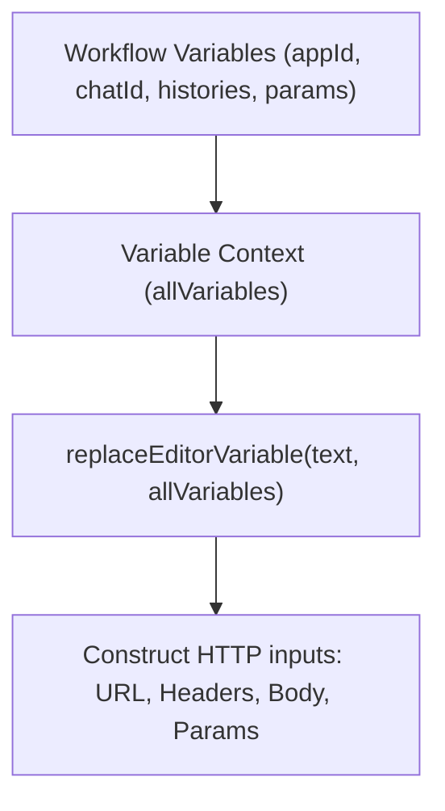
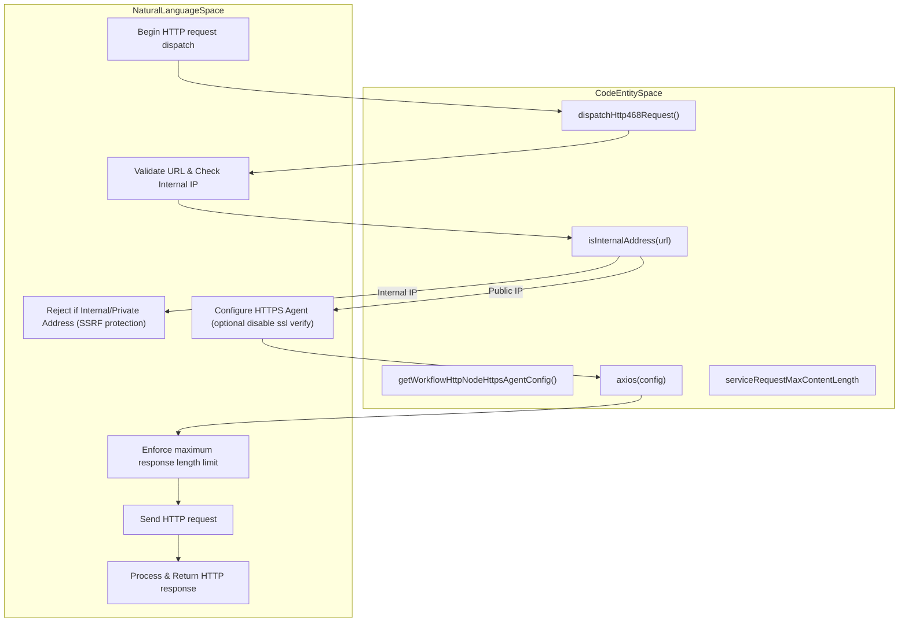
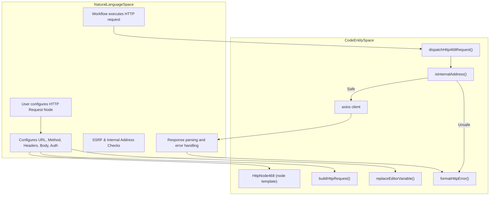

<!-- source: DeepWiki mcp.deepwiki.com · repo labring/FastGPT · page 4.7 HTTP Request Node and External Integration · fetched 2026-10-29 -->

# HTTP Request Node and External Integration

<details>
<summary>Relevant source files</summary>

The following files were used as context for generating this wiki page:

- [packages/global/core/workflow/template/system/assignedAnswer.ts](packages/global/core/workflow/template/system/assignedAnswer.ts)
- [packages/global/core/workflow/template/system/classifyQuestion/index.ts](packages/global/core/workflow/template/system/classifyQuestion/index.ts)
- [packages/global/core/workflow/template/system/contextExtract/index.ts](packages/global/core/workflow/template/system/contextExtract/index.ts)
- [packages/global/core/workflow/template/system/customFeedback.ts](packages/global/core/workflow/template/system/customFeedback.ts)
- [packages/global/core/workflow/template/system/datasetConcat.ts](packages/global/core/workflow/template/system/datasetConcat.ts)
- [packages/global/core/workflow/template/system/datasetSearch.ts](packages/global/core/workflow/template/system/datasetSearch.ts)
- [packages/global/core/workflow/template/system/http468.ts](packages/global/core/workflow/template/system/http468.ts)
- [packages/global/core/workflow/template/system/ifElse/index.ts](packages/global/core/workflow/template/system/ifElse/index.ts)
- [packages/global/core/workflow/template/system/sandbox/index.ts](packages/global/core/workflow/template/system/sandbox/index.ts)
- [packages/global/core/workflow/template/system/textEditor.ts](packages/global/core/workflow/template/system/textEditor.ts)
- [packages/global/core/workflow/template/system/variableUpdate/index.tsx](packages/global/core/workflow/template/system/variableUpdate/index.tsx)
- [packages/service/common/string/cheerio.ts](packages/service/common/string/cheerio.ts)
- [packages/service/common/system/utils.ts](packages/service/common/system/utils.ts)
- [packages/service/core/app/http.ts](packages/service/core/app/http.ts)
- [packages/service/test/common/string/cheerio.test.ts](packages/service/test/common/string/cheerio.test.ts)
- [packages/service/test/worker/htmlStr2Md.test.ts](packages/service/test/worker/htmlStr2Md.test.ts)
- [packages/service/worker/htmlStr2Md/utils.ts](packages/service/worker/htmlStr2Md/utils.ts)

</details>


This document presents a comprehensive technical overview of the HTTP Request Node (node type `httpRequest468`) within FastGPT's workflow system. It details the node template, request configuration mechanisms including header authentication secrets, SSRF protections, the variable substitution system, request execution lifecycle, response parsing, and error handling. This node enables workflows to securely and dynamically perform HTTP(S) requests to interact with external APIs and services.

For related external integration capabilities beyond HTTP calls, see the Tool Integration System [6.2]. For the runtime behavior of workflow execution, refer to the Workflow Execution Engine [4.2]. For plugin-based external service calls, consult Child Workflows and Plugin Execution [4.5].

---

## Node Template and Configuration

The HTTP Request Node is implemented as a concrete workflow node template named `HttpNode468` identified by `FlowNodeTypeEnum.httpRequest468`. It belongs to the tools category (`FlowNodeTemplateTypeEnum.tools`) and exposes a rich set of configurable inputs and outputs to cover typical HTTP client needs.

### Inputs

- **httpMethod**: HTTP verb such as GET, POST, PUT, DELETE, PATCH.
- **httpReqUrl**: URL string for the target HTTP endpoint.
- **httpTimeout**: Request timeout (default 30 seconds, max 600).
- **httpHeaders**: Array of key-value pairs for HTTP headers, enabling dynamic header input.
- **headerSecret**: Secure storage reference for secret headers like API keys, applied at runtime.
- **httpParams**: Query parameters as a key-value array.
- **httpJsonBody**: Body content as a JSON string.
- **httpFormBody**: Set of form fields for multipart/form-data or urlencoded body.
- **httpContentType**: HTTP Content-Type header value, selections include `application/json`, `multipart/form-data`, `application/x-www-form-urlencoded`, raw, xml, or none.

### Outputs

- **httpRawResponse**: Raw data returned by the HTTP request.
- **httpExtractOutput**: Structured output extracted from the response using JSONPath selectors or similar.
- **httpRawError**, **error**: Error outputs capturing request failures or HTTP errors.

The inputs allow fine-grained control for constructing HTTP requests, including static and dynamic fields, with support for secure secrets injection and detailed response extraction.

```mermaid
graph TB
    subgraph "CodeEntitySpace"
        HttpNode["HttpNode468 (FlowNodeTypeEnum.httpRequest468)"]
        InputKeys["NodeInputKeyEnum"]
        OutputKeys["NodeOutputKeyEnum"]
    end

    subgraph "NaturalLanguageSpace"
        Method["httpMethod: HTTP VERB (GET, POST, etc)"]
        URL["httpReqUrl: Target URL (string)"]
        Timeout["httpTimeout: Timeout (default 30s)"]
        Headers["httpHeaders[]: Header key-value pairs"]
        HeaderSecret["headerSecret: Auth secrets (encrypted)"]
        Params["httpParams[]: Query parameters"]
        JsonBody["httpJsonBody: JSON body string"]
        FormBody["httpFormBody[]: Form data fields"]
        ContentType["httpContentType: Content-Type header"]
        RawResp["httpRawResponse: Full HTTP response"]
        ExtractOutput["httpExtractOutput: Parsed response part"]
        ErrorOut["httpRawError / error: Error outputs"]
    end

    HttpNode --> InputKeys
    HttpNode --> OutputKeys

    HttpNode --> Method
    HttpNode --> URL
    HttpNode --> Timeout
    HttpNode --> Headers
    HttpNode --> HeaderSecret
    HttpNode --> Params
    HttpNode --> JsonBody
    HttpNode --> FormBody
    HttpNode --> ContentType
    HttpNode --> RawResp
    HttpNode --> ExtractOutput
    HttpNode --> ErrorOut

    classDef codeNode fill:#f9f9f9,stroke:#333,stroke-width:1px;
    class HttpNode,InputKeys,OutputKeys codeNode;
```



*HTTP Request Node Template and Input/Output Mapping*

Sources: [packages/global/core/workflow/template/system/http468.ts:18-157]()

---

## Request Configuration

### URL and HTTP Method

- The HTTP request URL (`httpReqUrl`) is subjected to variable substitution prior to dispatch.
- Variable substitutions leverage `replaceEditorVariable` to replace placeholders in URLs with values from the workflow variable context.
- Allowed HTTP methods include standard verbs: GET, POST, PUT, PATCH, DELETE.
- The system validates the URL format and protocol (`http:` or `https:`) for safety.
- Before dispatch, SSRF protection verifies the URL isn’t an internal/private address (e.g., `localhost`, `127.0.0.1`, or private IP ranges).

### Headers Configuration

- Headers include a combination of:
  - Static headers specified in the node configuration (`staticHeaders`).
  - Dynamic headers from the input parameters (`httpHeaders`).
  - Secret headers provided via `headerSecret`, which are decrypted with `getSecretValue` for runtime use.
- Content-Type headers are automatically managed based on the `httpContentType` input, mapping types like JSON, formData, urlencoded, raw, XML to proper MIME types.

### Query Parameters and Request Body

- Query parameters are formed by merging staticParams and dynamic `httpParams`, depending on the HTTP method — GET requests merge parameters into the URL.
- Request bodies are constructed according to the specified content type:
  - **JSON**: A JSON string with variables replaced and parsed into an object.
  - **formData**: A multipart form-data body constructed using `FormData`, with key-value pairs replaced.
  - **urlencoded**: A URL-encoded string constructed from form fields.
  - **raw / xml**: Raw string content with variables substituted.
  - **none**: No body is sent.

### Example of Core Request Construction Logic (abstracted)

```ts
const { headers, body, queryParams } = buildHttpRequest({
  method,
  params,
  headerSecret,
  customHeaders,
  staticParams,
  staticHeaders,
  staticBody
});
```

This modular configuration ensures flexible HTTP request construction to support a variety of external API protocols and authentication schemes.

Sources: [packages/service/core/app/http.ts:45-143]()

---

## Variable Substitution System

Dynamic variable substitution in HTTP requests enhances flexibility:

- **Input merging**: The variable context merges system-level variables (`appId`, `chatId`), last 10 chat history items, and external parameters into a flat object for substitution.
- **Replacement**: The `replaceEditorVariable` function performs variable replacement in strings, processing templates like `${variableName}`.
- **Type formatting**: Input and output values are coerced or formatted via `valueTypeFormat` to ensure type consistency.

This unified variable system enables HTTP requests to dynamically adapt to workflow context data without manual intervention.



Sources: [packages/service/core/workflow/dispatch/tools/http468.ts:93-138](), [packages/global/core/workflow/runtime/utils.ts:54-154]()

---

## Request Execution and SSRF Protection Flow

The HTTP Request Node dispatches external calls securely and efficiently, with the following security and operational flow:



**Key Implementation Details:**

- The function `dispatchHttp468Request` manages the request lifecycle, from building to response extraction.
- Before sending, the URL is checked with `isInternalAddress` to prevent SSRF attacks by blocking requests targeting internal/private networks.
- HTTPS Agent configuration via `getWorkflowHttpNodeHttpsAgentConfig()` optionally disables strict SSL verification if system config enables it.
- Response bodies are restricted by `serviceRequestMaxContentLength` to prevent resource exhaustion.
- Axios is used as the HTTP client to perform requests.

Sources: [packages/service/core/workflow/dispatch/tools/http468.ts:38-218](), [packages/service/common/system/utils.ts:23-38]()

---

## Response Processing and Extraction

The HTTP node supports flexible response handling:

- Raw HTTP responses are passed as `httpRawResponse` output for full access.
- Users can specify JSONPath expressions or other extraction mechanisms in node inputs to parse and extract specific parts of the JSON or text response into structured outputs (`httpExtractOutput`).
- The system uses the `jsonpath-plus` library to support JSONPath queries.
- The node returns a `HttpResponse` object containing both the raw data and the extracted data or error details.

Example snippet for handling response extraction:

```ts
const httpRawResponse = response.data;
const extractedOutput = jsonpath.query(httpRawResponse, extractJsonPath);

return {
  httpRawResponse,
  httpExtractOutput: extractedOutput,
  error: null
};
```

Sources: [packages/service/core/workflow/dispatch/tools/http468.ts:82-91](), [packages/service/core/workflow/dispatch/tools/http468.ts:220-264]()

---

## Error Handling

Robust error management ensures clean failure handling in workflows:

- Network errors, HTTP error statuses, and other request failures are caught.
- Errors are formatted into clean strings via `formatHttpError`.
- Both detailed raw error objects and concise error messages are returned as `httpRawError` and `error` outputs.
- Workflow execution does not crash but can branch on error outputs to handle failures programmatically.

This approach supports workflow designers to detect and respond to connection/timeouts/errors effectively.

Sources: [packages/service/core/workflow/dispatch/tools/http468.ts:24-29](), [packages/service/core/workflow/dispatch/tools/http468.ts:266-296]()

---

# Summary Diagram: From Natural Language Intent to HTTP Request Node Code Entities

This diagram illustrates the mapping from the conceptual HTTP request and external API integration in a workflow to the main code artifacts enabling it:



Sources: [packages/global/core/workflow/template/system/http468.ts:18-157](), [packages/service/core/app/http.ts:45-143](), [packages/service/core/workflow/dispatch/tools/http468.ts:1-296](), [packages/service/common/system/utils.ts:1-38]()

---

# Appendix: SSRF Protection Details

FastGPT implements SSRF protections specifically in the HTTP request node dispatch layer:

- Using `isInternalAddress()` which performs IP resolution and compares against loopback, metadata and special/private IP ranges.
- This check is done **after** URL variable substitutions and before the actual request occurs.
- If the address is internal, the request is immediately rejected with a semantic error (`PRIVATE_URL_TEXT`).
- This protection is essential since user-configurable HTTP request nodes could potentially be exploited to query internal networks otherwise.

By combining static configuration, runtime secrets, and dynamic variables with strong SSRF guards, FastGPT safely integrates external HTTP services into workflows.

---

# References

- packages/global/core/workflow/template/system/http468.ts [18-157]()
- packages/service/core/app/http.ts [45-143]()
- packages/service/core/workflow/dispatch/tools/http468.ts [1-296]()
- packages/service/common/system/utils.ts [1-38]()


# End of 4.7 HTTP Request Node and External Integration

---

