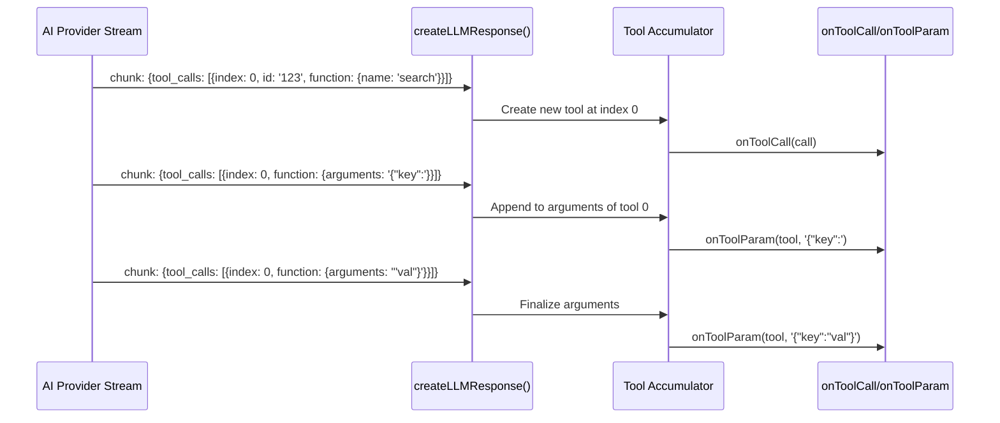
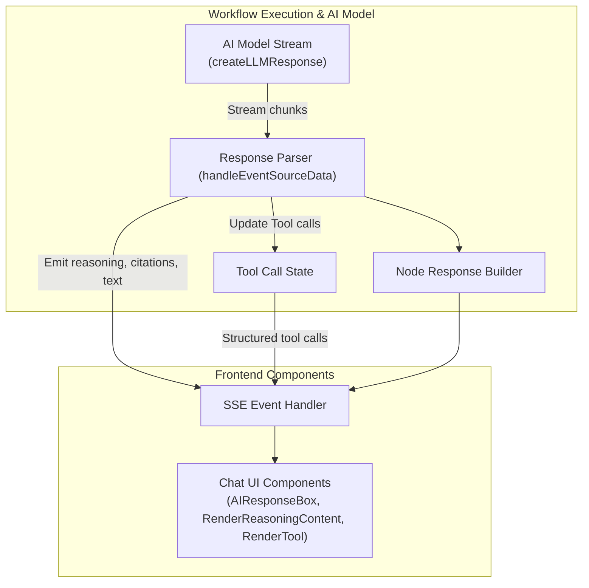
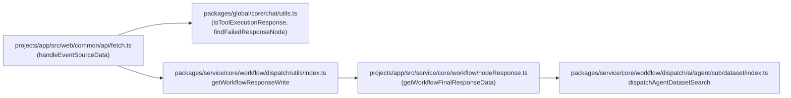

<!-- source: DeepWiki mcp.deepwiki.com · repo labring/FastGPT · page 4.8 AI Response Parsing and Streaming · fetched 2026-10-29 -->

# AI Response Parsing and Streaming

<details>
<summary>Relevant source files</summary>

The following files were used as context for generating this wiki page:

- [packages/global/core/app/utils.ts](packages/global/core/app/utils.ts)
- [packages/global/core/chat/utils.ts](packages/global/core/chat/utils.ts)
- [packages/global/test/core/chat/chatUtils.test.ts](packages/global/test/core/chat/chatUtils.test.ts)
- [packages/service/core/chat/nodeResponseStorage.ts](packages/service/core/chat/nodeResponseStorage.ts)
- [packages/service/core/workflow/dispatch/ai/agent/sub/dataset/index.ts](packages/service/core/workflow/dispatch/ai/agent/sub/dataset/index.ts)
- [packages/service/core/workflow/dispatch/dataset/nodeResponse.ts](packages/service/core/workflow/dispatch/dataset/nodeResponse.ts)
- [packages/service/core/workflow/dispatch/dataset/utils.ts](packages/service/core/workflow/dispatch/dataset/utils.ts)
- [packages/service/core/workflow/dispatch/utils/index.ts](packages/service/core/workflow/dispatch/utils/index.ts)
- [packages/service/core/workflow/dispatch/utils/summary.ts](packages/service/core/workflow/dispatch/utils/summary.ts)
- [packages/service/core/workflow/utils/fileContext.ts](packages/service/core/workflow/utils/fileContext.ts)
- [packages/service/test/core/chat/nodeResponseStorage.test.ts](packages/service/test/core/chat/nodeResponseStorage.test.ts)
- [packages/service/test/core/workflow/dispatch/ai/agent/sub/dataset.test.ts](packages/service/test/core/workflow/dispatch/ai/agent/sub/dataset.test.ts)
- [packages/service/test/core/workflow/dispatch/dataset/utils.test.ts](packages/service/test/core/workflow/dispatch/dataset/utils.test.ts)
- [packages/service/test/core/workflow/dispatch/index.persistence.test.ts](packages/service/test/core/workflow/dispatch/index.persistence.test.ts)
- [packages/service/test/core/workflow/dispatch/utils.test.ts](packages/service/test/core/workflow/dispatch/utils.test.ts)
- [projects/app/src/components/core/chat/ChatContainer/ChatBox/components/AIChatBubble/Content.tsx](projects/app/src/components/core/chat/ChatContainer/ChatBox/components/AIChatBubble/Content.tsx)
- [projects/app/src/components/core/chat/ChatContainer/ChatBox/components/HumanChatBubble/Actions.tsx](projects/app/src/components/core/chat/ChatContainer/ChatBox/components/HumanChatBubble/Actions.tsx)
- [projects/app/src/components/core/chat/ChatContainer/ChatBox/components/HumanChatBubble/index.tsx](projects/app/src/components/core/chat/ChatContainer/ChatBox/components/HumanChatBubble/index.tsx)
- [projects/app/src/components/core/chat/components/AIResponseBox/RenderProcessingPreview.tsx](projects/app/src/components/core/chat/components/AIResponseBox/RenderProcessingPreview.tsx)
- [projects/app/src/components/core/chat/components/AIResponseBox/index.tsx](projects/app/src/components/core/chat/components/AIResponseBox/index.tsx)
- [projects/app/src/global/core/chat/utils.ts](projects/app/src/global/core/chat/utils.ts)
- [projects/app/src/service/core/workflow/nodeResponse.ts](projects/app/src/service/core/workflow/nodeResponse.ts)
- [projects/app/test/global/core/chat/utils.test.ts](projects/app/test/global/core/chat/utils.test.ts)
- [projects/app/test/service/core/workflow/nodeResponse.test.ts](projects/app/test/service/core/workflow/nodeResponse.test.ts)

</details>


## Purpose and Scope

This section details how FastGPT parses and processes AI model responses that arrive either in streaming or batch mode. It covers the handling of:

- Reasoning content embedded in special XML-like tags for model thought traces,
- Tool call invocations and incremental function calling constructs,
- Dataset citations and quote references inserted by Retrieval-Augmented Generation (RAG),
- Parsing and filtering node responses within workflow executions,
- Streaming result handling and SSE event writing to frontend clients.

By parsing these elements correctly, FastGPT ensures that users receive detailed model reasoning, tool execution results, interactive elements, and proper citation metadata during live or completed chat sessions.

---

## Response Parsing Overview

### Reasoning Content Extraction

FastGPT detects reasoning content which is wrapped inside special delimiters like:

```
<deepseek>...</deepseek>
```

Such content represents the model's internal thought process or reasoning trace separate from the final direct answer. The parser identifies these tags during token streaming and extracts reasoning for a dedicated UI component, **RenderReasoningContent**.

The parser carefully buffers partial tags (e.g., incomplete `</th` fragments) so as not to prematurely render the reasoning content or corrupt the user-visible text flow.

The reasoning extraction is done during both streaming, via incremental parsing in `handleEventSourceData` and `parseLLMStreamResponse`, and in non-streaming mode using regex extraction on the complete response text.

### Streaming Token Handling and Buffering

During streaming, raw text tokens are appended gradually. Since reasoning tags and citation markers might be split across chunks, a small buffer remembers recent trailing characters to recognize tag boundaries or citation markers on the fly.

### Non-Streaming Parsing

For batch responses (non-streaming), reasoning content blocks are extracted using regular expressions that identify the reasoning tags and isolate the reasoning trace from the final completion text.

---

## Dataset Citation Handling

When RAG is enabled, AI completions embed citations with markdown-like references aligned to dataset chunks:

- Inline citations: `[Source Name](CITE)`, `[id](QUOTE)`
- Citation IDs are 24-character hexadecimal strings

These citations are filtered out from the stream text shown to users but preserved as metadata for citation popups.

### Citation Buffer Logic

To prevent broken citation markers on streaming boundaries, FastGPT maintains a citation buffer that collects trailing chunk text and matches against known citation IDs. Confirmed matches are removed from the display text stream but preserved internally.

---

## Tool Call Parsing and Incremental Building

FastGPT supports **function calling style tool invocation** from AI models. Tool calls might be split over multiple streaming chunks, requiring assembly and state tracking.

### Tool Call State Management

Incoming streamed chunks contain `tool_calls` arrays with incremental information:

- `index`: a numeric identifier for the tool call within the generation.
- `id` and `function.name`: tool identifier metadata.
- `function.arguments`: string fragments of the JSON-encoded argument object, arriving incrementally.

The streaming parser maintains a map of active tools keyed by `index`. For each new `index`, it creates a new tool object. For subsequent chunks without `index`, it appends the arguments string to the current tool call object. When complete, it triggers callbacks to update UI components with partial and final tool call state.

### Tool Call Parsing Flow



The implementation merges multiple calls by offset `index` to reconstruct full JSON arguments, enabling downstream tool runners to execute with correct inputs.

---

## Frontend Rendering and Node Responses

FastGPT frontend components receive parsed SSE events incrementally and render responses, consistent with parsed reasoning, tool calls, citations, and interactive workflow nodes.

### Relevant UI Components and Their Roles

| Component               | Role                                                                                      |
|------------------------|-------------------------------------------------------------------------------------------|
| `AIResponseBox`         | Container for an individual AI message segment including text, reasoning, and tool outputs. |
| `RenderReasoningContent`| Displays extracted reasoning/tracing text inside collapsible sections.                    |
| `RenderText`            | Renders Markdown answer content with clickable citation links.                           |
| `RenderTool`            | Shows detailed tool call info, parameters, outputs, and their execution status.          |
| `RenderSkill`           | Renders skill references related to tool outputs.                                        |
| `RenderUserSelectInteractive`<br>`RenderUserFormInteractive`<br>`RenderAgentAskInteractive` | Render interactive user input components inside AI responses for workflow nodes.        |

### Node Response Filtering and Shape

Workflow execution produces node-specific responses with multiple nested children and response fields. These are filtered and transformed before persistence or frontend usage.

- `filterNodeResponseData` filters node response fields by visibility rules,
- `getWorkflowFinalResponseData` aggregates flat dispatch node responses into structured trees,
- Errors and tool execution responses are identified with helper functions like `findFailedResponseNode` and `isToolExecutionResponse`.

---

## Streaming SSE Response Writing

Streaming workflows employ SSE (Server-Sent Events) via the helper `getWorkflowResponseWrite` to send events such as:

- `answerDelta`: partial text answer tokens,
- `toolCall`, `toolParams`, `toolResponse`: tool invocation states,
- `flowNodeStatus`: status updates of workflow nodes during execution.

The response writer respects flags like `detail` and `showNodeStatus` to filter event granularity and payload exposure.

---

## Data Flow Diagram: From Natural Language Stream to Structured Node Responses



---

## Symbol Map: System Names and Key Code Entities



---

## Key Functions and Classes

| Name                          | Location                                                 | Description                                                                                  |
|-------------------------------|----------------------------------------------------------|----------------------------------------------------------------------------------------------|
| `handleEventSourceData`        | `projects/app/src/web/common/api/fetch.ts` (157-213)     | Parses streaming SSE chunks: delimiters reasoning, tool_calls, flow node status, text etc.  |
| `isToolExecutionResponse`      | `packages/global/core/chat/utils.ts` (45-55)            | Checks whether a node response is a tool execution to handle errors and UI filtration.       |
| `findFailedResponseNode`       | `packages/global/core/chat/utils.ts` (67-82)            | Locates error nodes in chat history excluding captured errors and tool execution errors.    |
| `filterNodeResponseData`       | `packages/global/core/chat/utils.ts` (181-204)           | Filters node response fields for public or detailed API outputs.                             |
| `addStatisticalDataToHistoryItem` | `projects/app/src/global/core/chat/utils.ts` (121-200) | Adds metadata like sandbox tool usage and citation deduplication to chat history items.      |
| `getWorkflowFinalResponseData` | `projects/app/src/service/core/workflow/nodeResponse.ts` (67-98) | Constructs nested node response trees from flat dispatch responses for UI and exports.       |
| `getWorkflowResponseWrite`     | `packages/service/core/workflow/dispatch/utils/index.ts` (56-123) | Creates a streaming SSE writer with filtering and buffering controls.                        |
| `dispatchAgentDatasetSearch`   | `packages/service/core/workflow/dispatch/ai/agent/sub/dataset/index.ts` (182-210) | Formats and executes dataset search tool responses during LLM agent execution.               |

---

## Summary

- FastGPT uses a composite parser approach for streaming AI responses, carefully managing buffers for reasoning tags and citation markers.
- Tool call invocations are incrementally assembled from the streaming chunks by tracking `index` and accumulating `arguments` strings.
- Dataset citations embedded inline as markdown are parsed, filtered from output text, and stored for citation modals.
- Node responses from workflow executions are recursively filtered and structured before being persisted or sent to clients.
- SSE streams carry diverse event types including final answers, reasoning content, tool call states, and status updates, filtered according to client visibility flags.
- Frontend React components render parsed reasoning, tools, citations, and interactive elements according to these parsed streams.

By understanding these mechanisms, developers can extend the parsing logic, handle new response types, and customize UI rendering for richer AI assistant experiences.

---

Sources:

- `projects/app/src/web/common/api/fetch.ts:157-213`  
- `packages/global/core/chat/utils.ts:1-205`  
- `projects/app/src/global/core/chat/utils.ts:1-200`  
- `projects/app/src/service/core/workflow/nodeResponse.ts:67-98`  
- `packages/service/core/workflow/dispatch/utils/index.ts:56-123`  
- `packages/service/core/workflow/dispatch/ai/agent/sub/dataset/index.ts:182-210`  
- `projects/app/src/components/core/chat/components/AIResponseBox/index.tsx:1-138`

---

