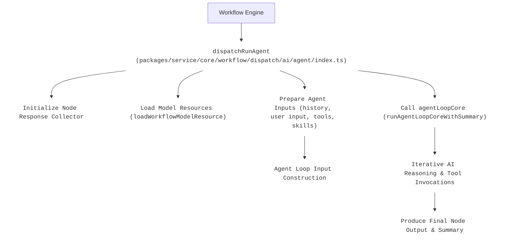
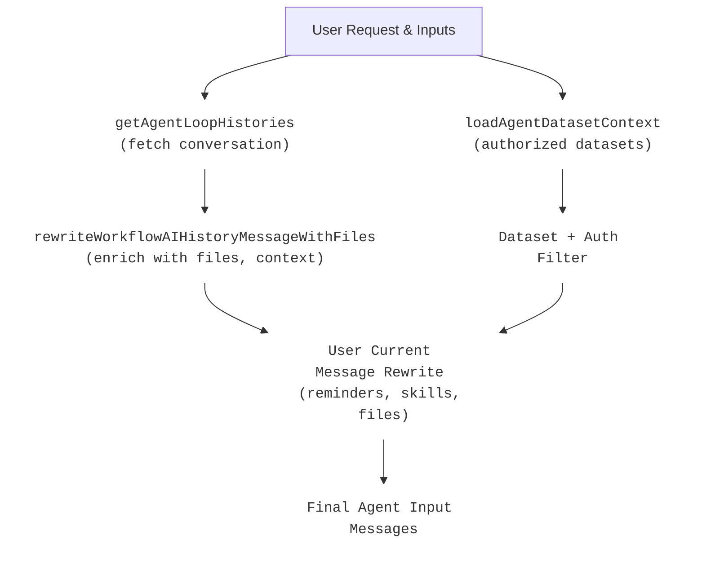
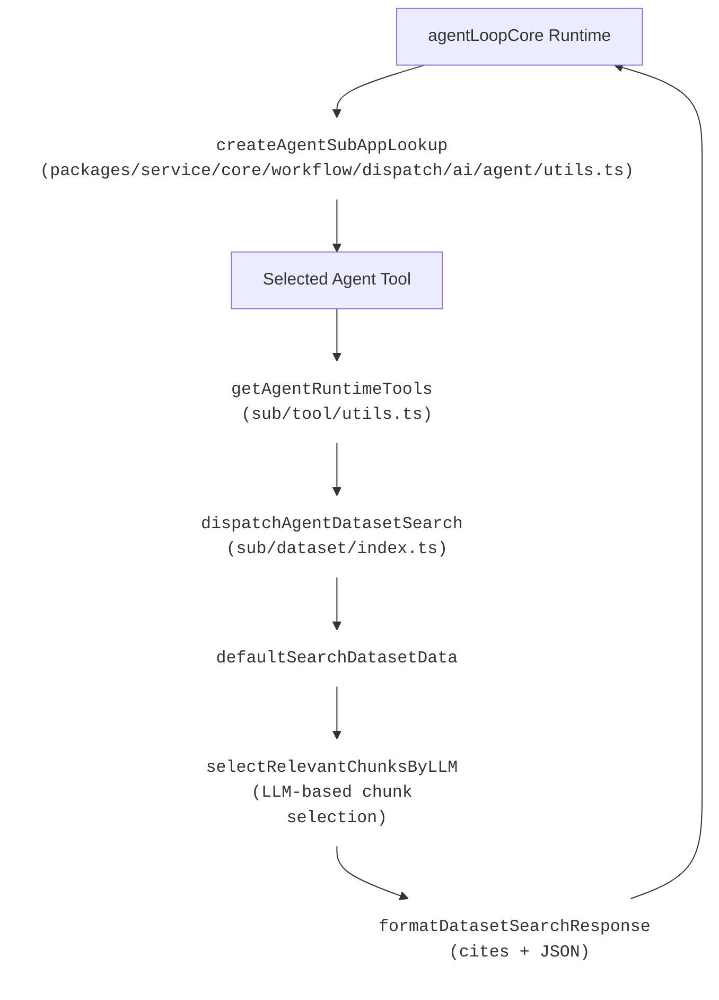
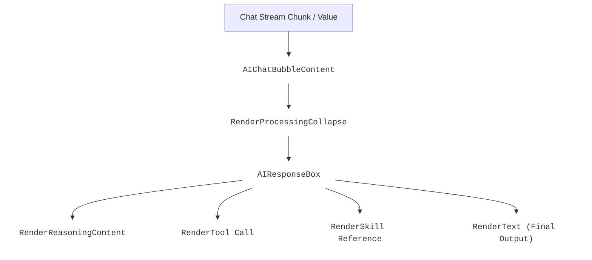
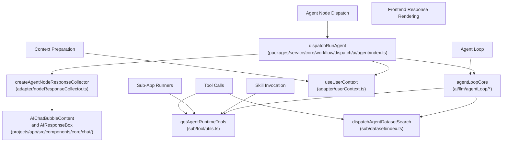

<!-- source: DeepWiki mcp.deepwiki.com · repo labring/FastGPT · page 4.9 Agent Loop and Tool Calling · fetched 2026-10-29 -->

# Agent Loop and Tool Calling

Relevant source files

The following files were used as context for generating this wiki page:

- [.agents/design/app/tool-input-runtime.md](.agents/design/app/tool-input-runtime.md)
- [packages/global/core/ai/sandbox/tools/common.ts](packages/global/core/ai/sandbox/tools/common.ts)
- [packages/global/core/ai/sandbox/tools/index.ts](packages/global/core/ai/sandbox/tools/index.ts)
- [packages/global/core/app/formEdit/utils.ts](packages/global/core/app/formEdit/utils.ts)
- [packages/global/core/app/jsonschema.ts](packages/global/core/app/jsonschema.ts)
- [packages/global/core/app/tool/runtime.ts](packages/global/core/app/tool/runtime.ts)
- [packages/global/core/workflow/migration/legacy/input.ts](packages/global/core/workflow/migration/legacy/input.ts)
- [packages/global/core/workflow/node/agent/constants.ts](packages/global/core/workflow/node/agent/constants.ts)
- [packages/global/test/core/app/formEdit/utils.test.ts](packages/global/test/core/app/formEdit/utils.test.ts)
- [packages/global/test/core/app/jsonschema.test.ts](packages/global/test/core/app/jsonschema.test.ts)
- [packages/global/test/core/app/tool/runtime.test.ts](packages/global/test/core/app/tool/runtime.test.ts)
- [packages/global/test/core/app/tool/type.test.ts](packages/global/test/core/app/tool/type.test.ts)
- [packages/global/test/core/workflow/template/datasetSearch.test.ts](packages/global/test/core/workflow/template/datasetSearch.test.ts)
- [packages/service/core/app/tool/utils/client.ts](packages/service/core/app/tool/utils/client.ts)
- [packages/service/core/app/utils.ts](packages/service/core/app/utils.ts)
- [packages/service/core/workflow/dispatch/ai/agent/adapter/userContext.ts](packages/service/core/workflow/dispatch/ai/agent/adapter/userContext.ts)
- [packages/service/core/workflow/dispatch/ai/agent/index.ts](packages/service/core/workflow/dispatch/ai/agent/index.ts)
- [packages/service/core/workflow/dispatch/ai/agent/sub/tool/utils.ts](packages/service/core/workflow/dispatch/ai/agent/sub/tool/utils.ts)
- [packages/service/core/workflow/dispatch/ai/agent/utils.ts](packages/service/core/workflow/dispatch/ai/agent/utils.ts)
- [packages/service/test/core/app/tool/utils/clientSystemTool.test.ts](packages/service/test/core/app/tool/utils/clientSystemTool.test.ts)
- [packages/service/test/core/workflow/dispatch/ai/agent/adapter/userContext.test.ts](packages/service/test/core/workflow/dispatch/ai/agent/adapter/userContext.test.ts)
- [packages/service/test/core/workflow/dispatch/ai/agent/index.test.ts](packages/service/test/core/workflow/dispatch/ai/agent/index.test.ts)
- [packages/service/test/core/workflow/dispatch/ai/agent/sub/tool/utils.test.ts](packages/service/test/core/workflow/dispatch/ai/agent/sub/tool/utils.test.ts)
- [packages/service/test/core/workflow/dispatch/ai/agent/utils.test.ts](packages/service/test/core/workflow/dispatch/ai/agent/utils.test.ts)
- [packages/web/components/common/Textarea/PromptEditor/plugins/SkillLabelPlugin/index.tsx](packages/web/components/common/Textarea/PromptEditor/plugins/SkillLabelPlugin/index.tsx)
- [projects/app/src/pageComponents/app/detail/Edit/HTTPTools/ChatTest.tsx](projects/app/src/pageComponents/app/detail/Edit/HTTPTools/ChatTest.tsx)
- [projects/app/src/pageComponents/app/detail/Edit/component/ConfigToolModal.tsx](projects/app/src/pageComponents/app/detail/Edit/component/ConfigToolModal.tsx)
- [projects/app/src/pageComponents/app/detail/WorkflowComponents/Flow/nodes/render/RenderInput/Label.tsx](projects/app/src/pageComponents/app/detail/WorkflowComponents/Flow/nodes/render/RenderInput/Label.tsx)
- [projects/app/src/pageComponents/app/detail/WorkflowComponents/Flow/nodes/render/RenderOutput/Label.tsx](projects/app/src/pageComponents/app/detail/WorkflowComponents/Flow/nodes/render/RenderOutput/Label.tsx)
- [projects/app/test/service/core/app/rewriteAppWorkflowToDetail.test.ts](projects/app/test/service/core/app/rewriteAppWorkflowToDetail.test.ts)

This section documents FastGPT's advanced AI Agent architecture, focusing on the agent node dispatch entry point (`dispatchRunAgent`), the underlying execution loop core (`agentLoopCore`), tool calling providers, sub-app/dataset runners, and skill invocation inside agents. It also covers the integration between natural language inputs, AI model execution, and the code entities managing tools and skills.

---

## 1. Agent Node Dispatch Entry Point (`dispatchRunAgent`)

The agent node execution pipeline starts at the function `dispatchRunAgent` located in `packages/service/core/workflow/dispatch/ai/agent/index.ts` (lines 97-164). This function orchestrates preparation and runtime dispatch of an AI agent inside the workflow engine.

### Function Role and Flow
- **Response Collectors**: Initializes `createAgentNodeResponseCollector` to capture node responses from child executions and merges runtime summaries into the current node summary [lines 103-109]().

- **Parameter Extraction and Context Setup**:
  - Extracts chat history, user input, system prompt, selected tools, and skills from node inputs.
  - Loads the effective LLM model resources with `loadWorkflowModelResource`, normalizing modalities such as vision, audio, and video based on model capabilities [lines 144-161]().

- **Agent Loop Execution**: Prepares input for `agentLoopCore` and calls `runAgentLoopCoreWithSummary`, coordinating AI interactions, tool calling, and iterative reasoning until completion or pause.

- **Dynamic Capabilities**:
  - Detects if Agent sandbox runtimes are needed when using skills or editSkillId.
  - Supports agent sandbox preparation actions to adjust runtime behaviors [lines 100-164]().

*Sources: `packages/service/core/workflow/dispatch/ai/agent/index.ts:97-164`*

---

## 2. User Context Preparation (`useUserContext`)

Before agent execution, the user conversational and file context is assembled in `useUserContext` (`packages/service/core/workflow/dispatch/ai/agent/adapter/userContext.ts`). This prepares full conversational history enriched with referenced documents, conversation memory, and user files for the agent model input.

### Context Building Steps
- **History Inclusion and Rewriting**: Loads and rewrites prior conversation turns to include any linked files, references, or enriched context using:
  - `getAgentLoopHistories` to fetch prior messages.
  - `rewriteWorkflowAIHistoryMessageWithFiles` to inject relevant file data or knowledge base info [lines 135-144]().

- **Dataset Authorization and Injection**: Loads authorized knowledge bases:
  - Calls `loadAgentDatasetContext` that queries datasets the user has access to and confirms permissions based on team membership [lines 31-84]().

- **Current Turn Preparation**:
  - Updates the latest user message with system reminders, available agent skills, and chat files using `rewriteWorkflowAIUserMessageWithFiles` [lines 178-189]().

This setup ensures the agent has comprehensive inputs structured for model reasoning and tool usage.

*Sources: `packages/service/core/workflow/dispatch/ai/agent/adapter/userContext.ts:31-189`*

---

## 3. Tool Calling Providers and Sub-App Dispatchers

FastGPT agents utilize a modular tool calling system to invoke both built-in and user-defined capabilities. This includes system tools, HTTP API tools, Skill tools, and custom sub-app tools.

### Provider and Lookup Utilities

- **`getWorkflowAgentLoopProvider`**  in `packages/service/core/workflow/dispatch/ai/agent/utils.ts` detects runtime agent engine provider based on environment—either `'fastAgent'` or `'piAgent'` [lines 11-12]().

- **`createAgentSubAppLookup`** builds a unified lookup over sub-app/runtime tools:
  - Resolves tool metadata such as name, avatar, and description.
  - Searches in user-defined sub-app map or fallback to built-in system tool info retrieved from `agentLoopCore` interfaces [lines 18-53]().

### Agent Runtime Tools Construction

- `getAgentRuntimeTools` in `sub/tool/utils.ts` converts selected agent tools into runtime-compatible descriptions compatible with LLM function calls:
  - Handles system/commercial tools directly via `SystemToolRepo`.
  - Loads app versions, MCP tools, and HTTP tools, performing authorization checks.
  - Normalizes tool input/output JSON schemas preserving agent-generated inputs [lines 97-177]().

### Built-in Knowledge Base Search Tool Example (`dispatchAgentDatasetSearch`)

- **Parameter Parsing and Validation**: Uses `DatasetSearchToolSchema` to validate tool call parameters.

- **Hybrid Retrieval**: Executes vector and full-text search using `defaultSearchDatasetData`.

- **Chunk Selection**: Invokes LLM post-processor `selectRelevantChunksByLLM` to trim retrieval results to context window if necessary.

- **Formatting**: Produces an agent-friendly result struct with reasoning logs, citations with URLs, and related docs [sub/dataset/index.ts].

*Sources:*
- `packages/service/core/workflow/dispatch/ai/agent/utils.ts:11-53`
- `packages/service/core/workflow/dispatch/ai/agent/sub/tool/utils.ts:97-177`
- `packages/service/core/workflow/dispatch/ai/agent/sub/dataset/index.ts`
- `packages/global/core/workflow/node/agent/constants.ts`

---

## 4. Skill Invocation Within Agents

Skills are modular AI capabilities (e.g., translation, code review) that agents invoke much like tools. Skills are selected as part of agent inputs under `NodeInputKeyEnum.skills` and processed inside agent loops.

Skill metadata and authorization are loaded during preparation phases alongside tool info, ensuring runtime correctness.

---

## 5. Agent Loop Core

The core iterative engine, `agentLoopCore`, (imported and extensively used inside `dispatchRunAgent`) handles the stepwise execution of AI reasoning, tool calls, and skill invocations until an intent is fulfilled or the workflow pauses.

Details include maintaining in-memory state, managing streaming of responses, merging responses from nested tool calls, and supporting interactive sub-flows.

---

## 6. Frontend Rendering and Stream UI Processing

Agent execution steps, including reasoning tokens, tool calls, skill invocations, and final outputs, are streamed to the UI and rendered as chat bubbles and expandable blocks.

### Components Breakdown

- **`AIChatBubbleContent`** groups consecutive processing messages with collapsible sections (`RenderProcessingCollapse`) for reasoning/tool calls.

- **`AIResponseBox`** dynamically renders items based on type:
  - **Reasoning Content** shows model thinking steps.
  - **Tool Call** renders executed tool parameters and results.
  - **Skill Reference** displays invoked skills.
  - **Final Text** streams the concluding AI answer, including markdown and citations [projects/app/src/components/core/chat/]().

- **`RenderProcessingPreview`** generates auto-scrollable truncated previews for inputs and logs to maintain UI responsiveness.

*Sources:*
- `projects/app/src/components/core/chat/ChatContainer/ChatBox/components/AIChatBubble/Content.tsx:100-162`
- `projects/app/src/components/core/chat/components/AIResponseBox/index.tsx`
- `projects/app/src/components/core/chat/components/AIResponseBox/RenderProcessingPreview.tsx`

---

# Summary

FastGPT's agent loop architecture provides a robust system to dispatch agent nodes that:
- Prepare rich user and context history including datasets and skills,
- Detect and prepare selected tools, including system and custom MCP/HTTP tools,
- Execute an iterative agent loop core combining reasoning, tool calls, and skill invocation,
- Stream and collect fine-grained node responses with error handling and summaries,
- Present agent execution visually in the frontend with detailed reasoning and call traces.

This layered approach mediates between natural language input, AI model function call protocols, and internal representations of tools, skills, datasets, and agent abilities.

---

# Appendix: Key Code Entities Map Bridging Natural Language and Code

*Sources: Complete section contents as above.*

---

