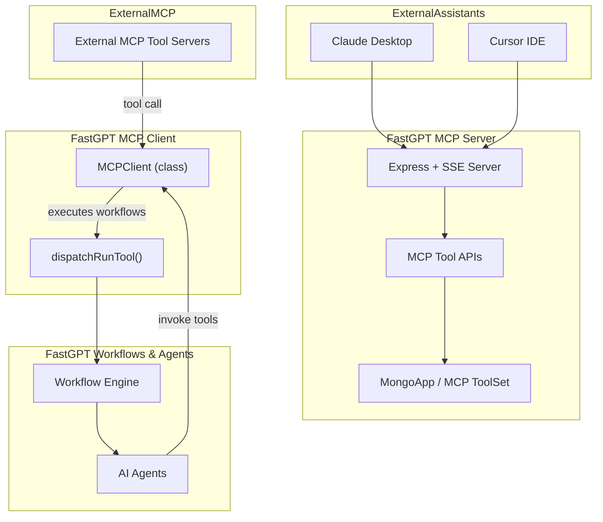
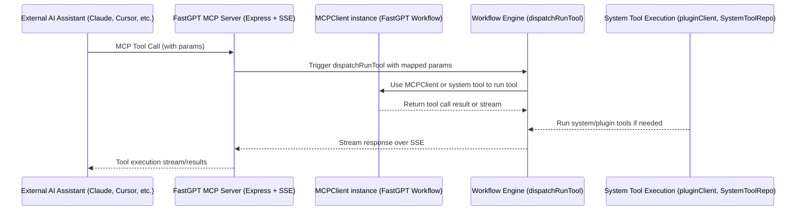

<!-- source: DeepWiki mcp.deepwiki.com · repo labring/FastGPT · page 5 Model Context Protocol (MCP) Integration · fetched 2026-10-29 -->

# Model Context Protocol (MCP) Integration

<details>
<summary>Relevant source files</summary>

The following files were used as context for generating this wiki page:

- [.agents/design/core/ai/model-permission-auth.md](.agents/design/core/ai/model-permission-auth.md)
- [packages/global/common/error/utils.ts](packages/global/common/error/utils.ts)
- [packages/service/common/file/image/controller.ts](packages/service/common/file/image/controller.ts)
- [packages/service/common/response/index.ts](packages/service/common/response/index.ts)
- [packages/service/core/app/mcp.ts](packages/service/core/app/mcp.ts)
- [packages/service/core/dataset/image/controller.ts](packages/service/core/dataset/image/controller.ts)
- [packages/service/core/workflow/dispatch/ai/agent/sub/tool/index.ts](packages/service/core/workflow/dispatch/ai/agent/sub/tool/index.ts)
- [packages/service/core/workflow/dispatch/ai/toolcall/toolCall.ts](packages/service/core/workflow/dispatch/ai/toolcall/toolCall.ts)
- [packages/service/core/workflow/dispatch/child/runTool.ts](packages/service/core/workflow/dispatch/child/runTool.ts)
- [packages/service/test/core/app/http.test.ts](packages/service/test/core/app/http.test.ts)
- [packages/service/test/core/app/mcp.test.ts](packages/service/test/core/app/mcp.test.ts)
- [packages/service/test/core/workflow/dispatch/ai/agent/sub/tool/index.test.ts](packages/service/test/core/workflow/dispatch/ai/agent/sub/tool/index.test.ts)
- [packages/service/test/core/workflow/dispatch/ai/toolcall/toolProvider/createToolCallToolProvider.test.ts](packages/service/test/core/workflow/dispatch/ai/toolcall/toolProvider/createToolCallToolProvider.test.ts)
- [packages/service/test/core/workflow/dispatch/tools/runTool.test.ts](packages/service/test/core/workflow/dispatch/tools/runTool.test.ts)
- [projects/app/src/pageComponents/app/detail/Edit/HTTPTools/Edit.tsx](projects/app/src/pageComponents/app/detail/Edit/HTTPTools/Edit.tsx)
- [projects/app/test/api/core/app/tool/debugCompatibility.test.ts](projects/app/test/api/core/app/tool/debugCompatibility.test.ts)

</details>


## Purpose and Scope

The Model Context Protocol (MCP) integration enables FastGPT to expose its applications as callable tools for external AI assistants such as Claude Desktop, Cursor IDE, and other MCP-compatible clients. This allows AI assistants to leverage FastGPT's workflow orchestration, RAG capabilities, and knowledge base features as part of their tool ecosystem.

FastGPT implements both sides of the protocol: it acts as an **MCP Client** to consume third-party tools within its workflows via the `MCPClient` class, and it provides an **MCP Server** to export its own apps as MCP tools. These core implementations are found in `packages/service/core/app/mcp.ts` and related API pages in the app project.

- For internal architecture details, see [MCP Server Architecture](#5.1)  
- For tool definition logic and schema management, see [Tool Discovery and Listing](#5.2)  
- For execution flow, including parameter mapping and security assertions, see [Tool Execution Flow](#5.3)  
- For containerized deployment and CI/CD pipelines, see [MCP Server Deployment](#5.4)  

Sources:  
[packages/service/core/app/mcp.ts:1-216](), [projects/app/src/pages/api/core/app/mcpTools/create.ts:23-69]()

---

## System Architecture Overview

The MCP integration in FastGPT establishes a two-way protocol interaction:

- As an **MCP Client**, FastGPT connects to external MCP tool servers to call tools directly from workflows or agents, enabling integration with external assistant ecosystems.
- As an **MCP Server**, FastGPT exposes its internal applications—especially `mcpToolSet` apps—as MCP tools accessible by MCP-compatible AI assistants.

The MCP Server is built atop an Express.js backend enhanced with Server-Sent Events (SSE) streaming and uses the official `@modelcontextprotocol/sdk` for handling protocol communication, including SSE and HTTP transports.

### Diagram: MCP Client-Server Interaction and Tool Usage Within FastGPT

Sources: [packages/service/core/app/mcp.ts:1-216](), [packages/service/core/workflow/dispatch/child/runTool.ts:60-180]()

---

## MCP Server Architecture

FastGPT's MCP server is an Express.js application that serves MCP requests via two key endpoints with SSE transport support. It leverages the `@modelcontextprotocol/sdk`, creating an SSE server for streaming tool responses efficiently. The server implements careful security measures such as SSRF prevention by hostname/IP validation (`assertMCPUrlNotInternal`), DNS resolution locking, and careful redirect header management to ensure only safe outgoing connections are allowed.

Key features of the MCP Server include:

- Dual-endpoint pattern: separate endpoints for tool discovery/listing and tool execution calls
- Streaming responses over SSE for interactive tool runs
- Secure, pinned DNS lookup and proxy-aware HTTP client (`undici` agent with pinned lookup)
- JSON schema dereferencing to safely handle tool input schemas
- Header secret management and retry logic for robustness

For detailed workings of the MCP server's Express setup, HTTP transports, and SSE event handling, see [MCP Server Architecture](#5.1).

Sources: [packages/service/core/app/mcp.ts:1-50](), [packages/service/core/app/mcp.ts:130-215]()

---

## Tool Discovery and Listing

FastGPT applications of type `mcpToolSet` are transformed into MCP tool definitions that describe the tool name, description, and input schema following MCP specifications. This involves:

- Retrieving the latest published workflow version of the app.
- Extracting MCP child tools from saved tool nodes in the app's workflow.
- Parsing and dereferencing JSON schemas with `$RefParser` to produce fully self-contained input schemas.
- Providing tool metadata including authentication secrets and URL information as needed.

This discovery process allows external assistants to enumerate and understand the capabilities of FastGPT apps exposed as MCP tools.

For implementation details on schema parsing, transformed output formats, and filtering tools, see [Tool Discovery and Listing](#5.2).

Sources:  
[packages/service/core/app/mcp.ts:30-110](),  
[projects/app/src/pages/api/core/app/mcpTools/create.ts:51-72](),  
[projects/app/src/pages/api/core/app/mcpTools/update.ts:38-45]()

---

## Tool Execution Flow

When an MCP tool call is received, the MCP server triggers the corresponding FastGPT workflow node for the tool, orchestrating the execution flow with:

- Validation of the call source and parameters.
- Mapping input arguments to the workflow node's inputs.
- Security assertions such as preventing calls to internal/private IP addresses (`assertMCPUrlNotInternal`).
- Executing the tool via the `dispatchRunTool` function, which may call system tools or plugin tools.
- Streaming the tool's output back to the caller over SSE.
- Error handling with consistent and safe response formatting.

This flow ensures external AI assistants calling FastGPT MCP tools receive real-time responses with secure and predictable behavior.

For detailed step-by-step execution with parameter mapping and streaming interactions, see [Tool Execution Flow](#5.3).

Sources:  
[packages/service/core/app/mcp.ts:130-160](),  
[packages/service/core/workflow/dispatch/child/runTool.ts:64-180](),  
[packages/service/core/workflow/dispatch/ai/agent/sub/tool/index.ts:65-185]()

---

## MCP Server Deployment

The MCP server is containerized and distributed as a multi-architecture Docker image. It is built with environment configurations to enable secure run-time options, including supporting secret header injection for authentication and proxy configurations.

The official GitHub Actions workflow automates multi-arch Docker image building and publishing, ensuring up-to-date and reliable delivery of the MCP server to various platforms.

For configuration details, build instructions, and CI/CD pipeline scripts, see [MCP Server Deployment](#5.4).

Sources: [projects/app/src/pages/api/core/app/mcpTools/create.ts:33-50]()

---

# Diagrams Bridging System Names and Code Entities

### Diagram: Mapping MCP Concepts to Code Entities in FastGPT
```mermaid
graph TD
    "MCP Client" -->|"Class instantiation"| MCPClient["class MCPClient\n(packages/service/core/app/mcp.ts)"]
    "MCP Server" -->|"Express endpoints"| MCPExpress["Express + SSE server\n(packages/service/core/app/mcp.ts)"]
    "Tool Discovery" -->|"JSON Schema parsing"| SchemaParser["$RefParser\n(packages/service/core/app/mcp.ts)"]
    "Tool Discovery" -->|"Tool config extraction"| McpToolSetNodes["decodeMcpToolSetNodesFromStorage\n(packages/service/core/app/mcp.ts)"]
    "Tool Execution" -->|"Dispatch tool calls"| dispatchRunTool["dispatchRunTool function\n(packages/service/core/workflow/dispatch/child/runTool.ts)"]
    "Tool Execution" -->|"Security check"| assertMCPUrlNotInternal["assertMCPUrlNotInternal\n(packages/service/core/app/mcp.ts)"]
    "Deployment" -->|"Docker build + GitHub Actions"| MCPDockerBuild["MCP Docker/CI\n(projects/app/src/pages/api/core/app/mcpTools/create.ts)"]
```

### Diagram: Runtime Flow from AI Assistant Call to FastGPT Workflow Execution


---

This page provides a structured high-level overview of how FastGPT integrates MCP to export and consume AI assistant tools, linking protocol concepts with key implementation files. For development or operations, consult the specific child pages for detailed architecture, code flow, and deployment instructions.

---

