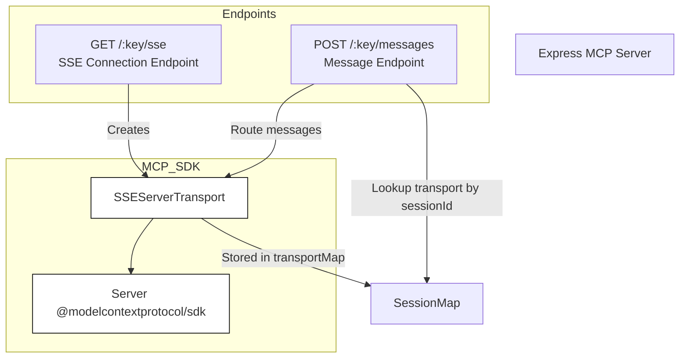
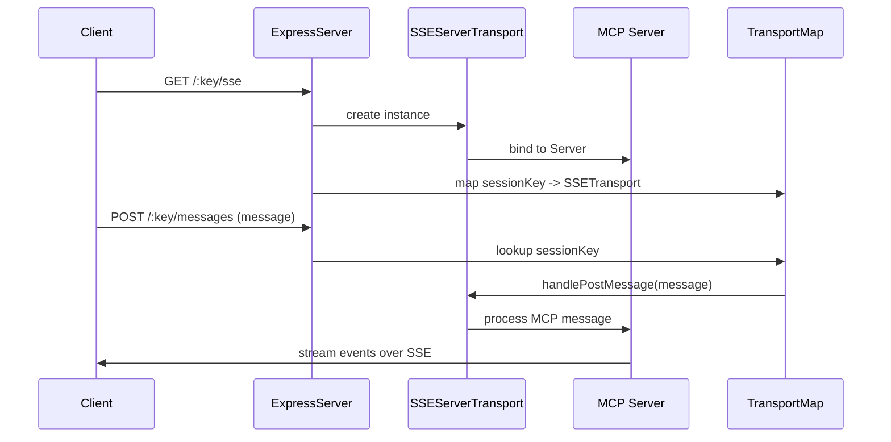
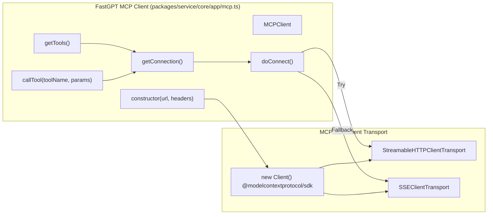
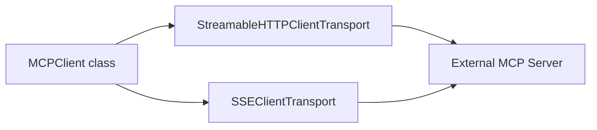

<!-- source: DeepWiki mcp.deepwiki.com · repo labring/FastGPT · page 5.1 MCP Server Architecture · fetched 2026-10-29 -->

# MCP Server Architecture

<details>
<summary>Relevant source files</summary>

The following files were used as context for generating this wiki page:

- [.agents/design/core/ai/model-permission-auth.md](.agents/design/core/ai/model-permission-auth.md)
- [document/package.json](document/package.json)
- [package.json](package.json)
- [packages/global/common/error/utils.ts](packages/global/common/error/utils.ts)
- [packages/global/package.json](packages/global/package.json)
- [packages/service/common/file/image/controller.ts](packages/service/common/file/image/controller.ts)
- [packages/service/common/response/index.ts](packages/service/common/response/index.ts)
- [packages/service/core/app/mcp.ts](packages/service/core/app/mcp.ts)
- [packages/service/core/dataset/image/controller.ts](packages/service/core/dataset/image/controller.ts)
- [packages/service/core/workflow/dispatch/ai/agent/sub/tool/index.ts](packages/service/core/workflow/dispatch/ai/agent/sub/tool/index.ts)
- [packages/service/core/workflow/dispatch/ai/toolcall/toolCall.ts](packages/service/core/workflow/dispatch/ai/toolcall/toolCall.ts)
- [packages/service/core/workflow/dispatch/child/runTool.ts](packages/service/core/workflow/dispatch/child/runTool.ts)
- [packages/service/package.json](packages/service/package.json)
- [packages/service/test/core/app/http.test.ts](packages/service/test/core/app/http.test.ts)
- [packages/service/test/core/app/mcp.test.ts](packages/service/test/core/app/mcp.test.ts)
- [packages/service/test/core/workflow/dispatch/ai/agent/sub/tool/index.test.ts](packages/service/test/core/workflow/dispatch/ai/agent/sub/tool/index.test.ts)
- [packages/service/test/core/workflow/dispatch/ai/toolcall/toolProvider/createToolCallToolProvider.test.ts](packages/service/test/core/workflow/dispatch/ai/toolcall/toolProvider/createToolCallToolProvider.test.ts)
- [packages/service/test/core/workflow/dispatch/tools/runTool.test.ts](packages/service/test/core/workflow/dispatch/tools/runTool.test.ts)
- [packages/web/package.json](packages/web/package.json)
- [pnpm-lock.yaml](pnpm-lock.yaml)
- [pnpm-workspace.yaml](pnpm-workspace.yaml)
- [projects/app/package.json](projects/app/package.json)
- [projects/app/src/pageComponents/app/detail/Edit/HTTPTools/Edit.tsx](projects/app/src/pageComponents/app/detail/Edit/HTTPTools/Edit.tsx)
- [projects/app/test/api/core/app/tool/debugCompatibility.test.ts](projects/app/test/api/core/app/tool/debugCompatibility.test.ts)
- [projects/marketplace/Dockerfile](projects/marketplace/Dockerfile)
- [projects/marketplace/package.json](projects/marketplace/package.json)
- [projects/mcp_server/Dockerfile](projects/mcp_server/Dockerfile)
- [projects/mcp_server/package.json](projects/mcp_server/package.json)
- [scripts/icon/package.json](scripts/icon/package.json)

</details>


The Model Context Protocol (MCP) Server is a dedicated Express-based server that exposes FastGPT applications as callable tools following the MCP specification. This server enables external AI assistants (e.g., Claude Desktop, Cursor IDE) to interact with FastGPT toolsets seamlessly via MCP, facilitating tool discovery and invocation with streaming capabilities. It integrates closely with the `@modelcontextprotocol/sdk` for MCP-compliant communication and leverages FastGPT internal workflow execution through a dual-endpoint pattern combining Express routes with Server-Sent Events (SSE).

---

## Overview and Purpose

The MCP Server acts as a bridge translating MCP protocol tool calls into FastGPT workflows and returning streamed responses. Its main purposes are:

- **Expose FastGPT apps as MCP tools** with input schemas for external AI clients.
- **Support real-time communication** over SSE for streaming interaction.
- **Securely proxy tool invocation requests** from external MCP clients to internal FastGPT workflows.
- **Maintain connection state** using session-based transport mappings.

---

## Server Implementation and Data Flow

The MCP Server is implemented in an Express app offering two primary HTTP endpoints:

- `GET /:key/sse` — Establishes a persistent SSE connection per client session.
- `POST /:key/messages` — Accepts inbound messages that correspond to active SSE sessions.

The `:key` uniquely authenticates/identifies the client connection and is used as a session token.

The server internally uses `@modelcontextprotocol/sdk` classes to instantiate an MCP `Server` object for each new SSE connection and creates an `SSEServerTransport` object to manage bidirectional messages over the SSE stream. Incoming POST messages are routed to the corresponding transport using a session ID map.

### Data Flow



- **GET `/sse`**: Client initiates an SSE connection, server instantiates an MCP Server and associated SSE transport, and maps the session transport.
- **POST `/messages`**: Client sends messages corresponding to prior sessions, the server routes the messages to the appropriate transport instance to process using MCP protocol handlers.

**Sources:**  
[projects/mcp_server/package.json:10-28]()  
[projects/mcp_server/Dockerfile:1-70]()

---

## Express + SSE Server Architecture

The server’s dual-endpoint pattern provides bi-directional asynchronous communication:

| Endpoint         | Method | Functionality                          |
|------------------|--------|-------------------------------------|
| `/:key/sse`      | GET    | Upgrade HTTP connection to SSE; initializes MCP server instance and transport for streaming messages. |
| `/:key/messages` | POST   | Receives messages from clients, proxies them to the relevant SSE transport by session key. |

### Transport and Session Management

An in-memory map stores session keys to `SSEServerTransport` instances. This design enables the stateless HTTP POST messages to be associated with persistent SSE connections.

- When a new connection is established, a transport is created and linked to the session key.
- Incoming POST messages are routed to their transport using the session key for processing.
- The transport handles MCP requests such as tool listing and tool execution.

---

## MCP SDK Integration

The `@modelcontextprotocol/sdk` is the core MCP protocol handler integrated into the MCP Server.

### Key Classes and Functions

- **`Server`** from SDK: Implements MCP service-side logic, handles request parsing, response formatting, and event routing.
- **`SSEServerTransport`**: Provides SSE as the underlying asynchronous transport, managing sending and receiving MCP protocol messages over SSE.
- **Handler registration**: The server registers handlers for MCP requests such as `ListToolsRequestSchema` and `CallToolRequestSchema`.

In the MCP Server startup:

- For each `GET /:key/sse` connection, the server:
  - Creates a new `SSEServerTransport`.
  - Instantiates a MCP `Server` passing the transport.
  - Registers request handlers (for tool discovery and execution).
  - Stores the transport in `transportMap` keyed by session.

- For each `POST /:key/messages` request:
  - The server finds matching `SSEServerTransport` by session key.
  - Forwards the HTTP POST message to the transport handler method `handlePostMessage(req, res)`.

### MCP Server Lifecycle Flow



**Sources:**  
[projects/mcp_server/package.json:10-28]()  
[packages/service/core/app/mcp.ts:1-216]()

---

## MCP Client in FastGPT Core Service

FastGPT includes an `MCPClient` class to consume MCP servers as external tool providers within FastGPT workflows. This class handles:

- Connection management with fallback (Streamable HTTP → SSE)
- Tool discovery and schema dereferencing
- Tool invocation with parameter passing and response streaming
- SSRF protection and safe HTTP redirects

### `MCPClient` Design



- Tries creating a `StreamableHTTPClientTransport`.
- If that fails (e.g., due to network limitations), falls back to `SSEClientTransport`.
- Uses JSON Schema dereferencing (`@apidevtools/json-schema-ref-parser`) disabled from external fetches to secure input schemas.

---

## Secure Request and SSRF Guards

The MCP Client enforces network security by:

- Pre-resolving and validating hostnames/IP to avoid internal/private address access.
- Creating pinned DNS lookups to prevent DNS rebinding attacks.
- Sanitizing HTTP headers and redirect handling in safe fetch requests.
- Restricting redirect protocols and removing sensitive headers on cross-host redirects.

These protections are implemented in utility functions like `resolveMcpConnectAddress`, `createPinnedLookup`, and custom safe fetch wrappers within `MCPClient` [packages/service/core/app/mcp.ts:63-215]().

**Sources:**  
[packages/service/core/app/mcp.ts:1-220]()  
[packages/service/test/core/app/mcp.test.ts:1-197]()

---

## Tool Discovery and Transformation

FastGPT apps internally define composite modules and MCP tool configurations which are transformed to MCP-compatible tool definitions exposed by the MCP Server.

### Data Flow: MCP Tool Generation

```mermaid
graph LR
    App[App (AppSchemaType)]
    Modules[app.modules]
    ToolConfig[toolConfig.mcpToolSet]
    Children[getMCPChildren()]
    Schema[pluginNodes2InputSchema()]
    MCPTools[McpToolConfigType List]

    App --> Modules
    Modules --> ToolConfig
    ToolConfig --> Children
    Children --> MCPTools
```

- `getMCPChildren()` extracts MCP child tool configurations from app modules.
- Input JSON schemas are generated by `pluginNodes2InputSchema`.
- These are exposed via MCP Server tool listing handlers.

**Sources:**  
[packages/service/core/app/mcp.ts:7-43]()

---

## Deployment and Build Details

### Build Configuration

The MCP Server uses `bun` for ultra-fast native builds, with the following scripts defined in `projects/mcp_server/package.json`:

```json
"scripts": {
  "build": "bun build src/index.ts --outdir=dist --target=node && chmod +x dist/index.js",
  "dev": "bun --watch src/index.ts",
  "start": "bun src/index.ts",
  "mcp_test": "npx @modelcontextprotocol/inspector"
}
```

This produces a single output file for server runtime in `dist/index.js`.

### Dependency and Package Structure

- Depends on core FastGPT packages (`@fastgpt/global`, `@fastgpt-sdk/otel`) via monorepo workspace protocol.
- Integrates the external `@modelcontextprotocol/sdk` package for the MCP protocol implementation.
- Runs on Node.js 22+ environment compatible with SSE and modern HTTP clients.

---

## Summary Diagrams

### MCP Server Logical Architecture

```mermaid
graph TD
    ExpressApp[Express App - MCP Server]
    SSETransport[SSEServerTransport<br/>(MCP SDK)]
    MCPServer[MCP Server Instance]
    TransportMap["transportMap<br/>sessionKey → SSETransport"]
    GET_SSE["GET /:key/sse<br/>SSE connection"]
    POST_MSG["POST /:key/messages<br/>Incoming messages"]

    GET_SSE -->|New SSE Transport| SSETransport
    SSETransport --> MCPServer
    SSETransport -->|Stored in| TransportMap

    POST_MSG -->|Find transport| TransportMap
    TransportMap -->|Forward message| SSETransport
    SSETransport --> MCPServer
```

### MCP Client Interaction Flow (FastGPT Core)



---

# References

| Source File | Lines | Description |
|-------------|--------|-------------|
| projects/mcp_server/package.json | 10-28 | MCP server Express endpoints and npm scripts |
| projects/mcp_server/Dockerfile | 1-70 | MCP server build and environment setup |
| packages/service/core/app/mcp.ts | 1-220 | MCP client implementation, SSRF guards, schema parsing |
| packages/service/test/core/app/mcp.test.ts | 1-197 | Tests for MCP client and SSRF protections |

---

**Sources:**  
[projects/mcp_server/package.json:10-28](),  
[projects/mcp_server/Dockerfile:1-70](),  
[packages/service/core/app/mcp.ts:1-220](),  
[packages/service/test/core/app/mcp.test.ts:1-197]()

---

