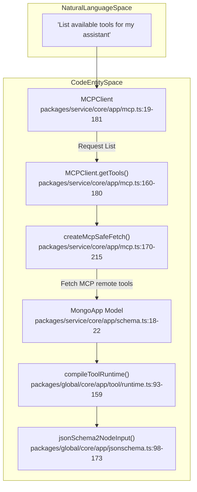
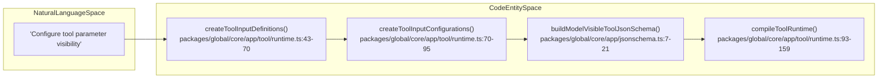
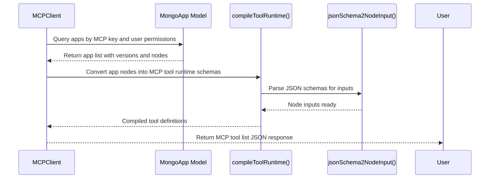

<!-- source: DeepWiki mcp.deepwiki.com · repo labring/FastGPT · page 5.2 Tool Discovery and Listing · fetched 2026-10-29 -->

# Tool Discovery and Listing

<details>
<summary>Relevant source files</summary>

The following files were used as context for generating this wiki page:

- [.agents/design/app/tool-input-runtime.md](.agents/design/app/tool-input-runtime.md)
- [.agents/design/core/ai/model-permission-auth.md](.agents/design/core/ai/model-permission-auth.md)
- [packages/global/common/error/utils.ts](packages/global/common/error/utils.ts)
- [packages/global/core/app/formEdit/utils.ts](packages/global/core/app/formEdit/utils.ts)
- [packages/global/core/app/jsonschema.ts](packages/global/core/app/jsonschema.ts)
- [packages/global/core/app/tool/runtime.ts](packages/global/core/app/tool/runtime.ts)
- [packages/global/core/workflow/migration/legacy/input.ts](packages/global/core/workflow/migration/legacy/input.ts)
- [packages/global/test/core/app/formEdit/utils.test.ts](packages/global/test/core/app/formEdit/utils.test.ts)
- [packages/global/test/core/app/jsonschema.test.ts](packages/global/test/core/app/jsonschema.test.ts)
- [packages/global/test/core/app/tool/runtime.test.ts](packages/global/test/core/app/tool/runtime.test.ts)
- [packages/global/test/core/app/tool/type.test.ts](packages/global/test/core/app/tool/type.test.ts)
- [packages/global/test/core/workflow/template/datasetSearch.test.ts](packages/global/test/core/workflow/template/datasetSearch.test.ts)
- [packages/service/common/file/image/controller.ts](packages/service/common/file/image/controller.ts)
- [packages/service/common/response/index.ts](packages/service/common/response/index.ts)
- [packages/service/core/app/mcp.ts](packages/service/core/app/mcp.ts)
- [packages/service/core/app/tool/utils/client.ts](packages/service/core/app/tool/utils/client.ts)
- [packages/service/core/app/utils.ts](packages/service/core/app/utils.ts)
- [packages/service/core/dataset/image/controller.ts](packages/service/core/dataset/image/controller.ts)
- [packages/service/core/workflow/dispatch/ai/agent/sub/tool/index.ts](packages/service/core/workflow/dispatch/ai/agent/sub/tool/index.ts)
- [packages/service/core/workflow/dispatch/ai/agent/sub/tool/utils.ts](packages/service/core/workflow/dispatch/ai/agent/sub/tool/utils.ts)
- [packages/service/core/workflow/dispatch/ai/toolcall/toolCall.ts](packages/service/core/workflow/dispatch/ai/toolcall/toolCall.ts)
- [packages/service/core/workflow/dispatch/child/runTool.ts](packages/service/core/workflow/dispatch/child/runTool.ts)
- [packages/service/test/core/app/http.test.ts](packages/service/test/core/app/http.test.ts)
- [packages/service/test/core/app/mcp.test.ts](packages/service/test/core/app/mcp.test.ts)
- [packages/service/test/core/app/tool/utils/clientSystemTool.test.ts](packages/service/test/core/app/tool/utils/clientSystemTool.test.ts)
- [packages/service/test/core/workflow/dispatch/ai/agent/sub/tool/index.test.ts](packages/service/test/core/workflow/dispatch/ai/agent/sub/tool/index.test.ts)
- [packages/service/test/core/workflow/dispatch/ai/agent/sub/tool/utils.test.ts](packages/service/test/core/workflow/dispatch/ai/agent/sub/tool/utils.test.ts)
- [packages/service/test/core/workflow/dispatch/ai/toolcall/toolProvider/createToolCallToolProvider.test.ts](packages/service/test/core/workflow/dispatch/ai/toolcall/toolProvider/createToolCallToolProvider.test.ts)
- [packages/service/test/core/workflow/dispatch/tools/runTool.test.ts](packages/service/test/core/workflow/dispatch/tools/runTool.test.ts)
- [projects/app/src/pageComponents/app/detail/Edit/HTTPTools/ChatTest.tsx](projects/app/src/pageComponents/app/detail/Edit/HTTPTools/ChatTest.tsx)
- [projects/app/src/pageComponents/app/detail/Edit/HTTPTools/Edit.tsx](projects/app/src/pageComponents/app/detail/Edit/HTTPTools/Edit.tsx)
- [projects/app/src/pageComponents/app/detail/Edit/component/ConfigToolModal.tsx](projects/app/src/pageComponents/app/detail/Edit/component/ConfigToolModal.tsx)
- [projects/app/src/pageComponents/app/detail/WorkflowComponents/Flow/nodes/render/RenderInput/Label.tsx](projects/app/src/pageComponents/app/detail/WorkflowComponents/Flow/nodes/render/RenderInput/Label.tsx)
- [projects/app/src/pageComponents/app/detail/WorkflowComponents/Flow/nodes/render/RenderOutput/Label.tsx](projects/app/src/pageComponents/app/detail/WorkflowComponents/Flow/nodes/render/RenderOutput/Label.tsx)
- [projects/app/test/api/core/app/tool/debugCompatibility.test.ts](projects/app/test/api/core/app/tool/debugCompatibility.test.ts)
- [projects/app/test/service/core/app/rewriteAppWorkflowToDetail.test.ts](projects/app/test/service/core/app/rewriteAppWorkflowToDetail.test.ts)

</details>


This document explains how FastGPT applications are discovered and transformed into MCP (Model Context Protocol) tool definitions and input schemas that external AI assistants can invoke. This covers the tool listing mechanism, schema generation, security validation, and the mapping between FastGPT applications and MCP tools.

For information about executing discovered tools, see [Tool Execution Flow](#5.3). For MCP server architecture and transport setup, see [MCP Server Architecture](#5.1).

## Purpose and Scope

The tool discovery system enables external AI assistants (such as Claude Desktop or custom agents) to enumerate available FastGPT applications and remote MCP services as callable tools. This page documents:

- How MCP keys map to collections of FastGPT applications and remote toolsets.
- The transformation of FastGPT apps into MCP `Tool` definitions using `compileToolRuntime` and JSON schema parsers.
- Schema generation and input parameter separation (agent-generated vs manual/fixed bindings) using `packages/global/core/app/tool/runtime.ts`.
- SSRF and safety boundaries implemented via `createMcpSafeFetch` in `packages/service/core/app/mcp.ts`.

## Tool Discovery Architecture

Tool discovery starts when an MCP client requests available tools. The backend queries MongoDB for associated FastGPT applications authorized by the MCP key, loads their latest published versions, and compiles these into standardized MCP tool definitions with input/output schemas.

### Natural Language to Code Entity Space: Discovery Flow



**Sources:**  
[packages/service/core/app/mcp.ts:19-181](), [packages/service/core/app/mcp.ts:160-180](), [packages/service/core/app/mcp.ts:170-215](), [packages/service/core/app/schema.ts:18-22](), [packages/global/core/app/tool/runtime.ts:93-159](), [packages/global/core/app/jsonschema.ts:98-173]()

## MCP Key to Application Mapping

An MCP key acts as the authentication and authorization token to expose a set of FastGPT applications as MCP tools. Given an MCP key, the server:

1. Resolves team/user scope and permission via `MongoApp` (MongoDB application documents).
2. Retrieves published application versions and workflow nodes.
3. Filters applications within scope and user permission.
4. Converts each app's toolset to MCP tool definitions.

The applications are managed in the database via the Mongoose model `MongoApp` [packages/service/core/app/schema.ts:18-22](). MCP authorization and app fetching handles edge cases like soft deletes, permission denials, and snapshot states.

**Sources:**  
[packages/service/core/app/mcp.ts:1-29](), [packages/service/core/app/schema.ts:18-22]()

## Tool Schema Generation and Compilation

FastGPT converts application workflow inputs and tool parameters into standard JSON Schema formats consumable as MCP tool input schemas. This transformation is essential for external AI assistants to present correct invocation parameters.

The central compilation routine `compileToolRuntime` (in `packages/global/core/app/tool/runtime.ts`) performs:

- Extraction of tool input definitions — distinguishing between agent-generated inputs and manually configured bindings.
- Building of JSON Schema that represents tool inputs for MCP.
- Validation that input keys are not conflicting between generated and fixed categories.

### Schema Compilation Flow



**Sources:**  
[packages/global/core/app/tool/runtime.ts:43-159](), [packages/global/core/app/jsonschema.ts:1-202]()

### Parameter Separation (`compileToolRuntime`)

The function `compileToolRuntime` splits inputs into two distinct categories:

- **`agentGeneratedKeys`**: Parameters dynamically generated by the AI during tool invocation. These are part of the function tool call schema allowing the model to fill them freely.
- **`fixedInputBindings`**: Parameters bound to fixed values or external references configured by users or integrations. These cannot be overridden by the agent at runtime.

If an input parameter is assigned to both categories simultaneously, `compileToolRuntime` throws an error to prevent ambiguity in execution [packages/global/core/app/tool/runtime.ts:126-144]().

**Source:**  
[packages/global/core/app/tool/runtime.ts:93-159]()

## Security and SSRF Protections

For security, all external requests involved in discovery and tool schema dereferencing must prevent SSRF attacks or access to internal private networks.

### Safe Fetch Implementation (`createMcpSafeFetch`)

Function `createMcpSafeFetch` creates a secure fetch wrapper that:

- Forces `redirect: 'manual'` to handle HTTP redirects explicitly.
- Checks every URL for internal/private IPs via `assertMCPUrlNotInternal`.
- On redirects, filters sensitive headers such as `authorization`, `cookie` if the host or protocol changes.
- Throws errors on disallowed IPs or unsafe redirects.

This mechanism ensures MCP interactions and JSON schema dereferencing do not leak credentials or tunnel into internal networks, maintaining production safety boundaries [packages/service/core/app/mcp.ts:130-215]().

```typescript
// Simplified pattern from createMcpSafeFetch() usage
const safeFetch = createMcpSafeFetch({
  maxRedirects: 5,
  fetchImpl: fetch
});

// Usage to list MCP tools with built-in unsafe URL prevention
const tools = await mcpClient.getTools();
```

**Sources:**  
[packages/service/core/app/mcp.ts:130-215]()

## App-to-MCP Tool Transformations

The transformation from FastGPT applications to MCP tool definitions involves combining:

- Application metadata: name, description, avatar, and published workflow version.
- Workflow nodes representing the tool inputs/outputs, converted into MCP-compatible JSON schemas.
- Generated and fixed input splits to create the MCP tool input contract.
- Secret input handling and metadata embedding.

This is commonly handled via `getClientToolPreviewNode` and `compileToolRuntime` integration, providing the MCP server with detailed, versioned tool descriptions for external invocation.

## Example: Tool Listing Endpoint Flow



**Sources:**  
[packages/service/core/app/mcp.ts:160-180](), [packages/global/core/app/tool/runtime.ts:93-159](), [packages/global/core/app/jsonschema.ts:1-202]()

## Integration and UI Considerations

- Tools discovered and listed via MCP are surfaced in the FastGPT UI in tool selection/modification dialogs.
- The schema-driven inputs influence forms and validation behavior for invoking tools interactively or in automation workflows.
- Permissions and access control propagate from MCP keys down to tool visibility and execution.

Typical UI entry points include configuration modals and workflow node editors (`ConfigToolModal.tsx` in the frontend projects).

**Sources:**  
[projects/app/src/pageComponents/app/detail/Edit/component/ConfigToolModal.tsx](), [packages/service/core/app/mcp.ts]()

---

This detailed description covers FastGPT's tool discovery and listing mechanism as they relate to MCP tool exposure, safe external schema dereferencing, and internal transforms that enable AI assistants to use FastGPT tools effectively and securely.

# Summary Table of Key Entities and Their Roles

| Entity                    | Role                                                  | Source File / Lines                  |
|---------------------------|-------------------------------------------------------|------------------------------------|
| `MCPClient`               | MCP client wrapper for connecting to MCP endpoints    | `packages/service/core/app/mcp.ts` (19-181) |
| `getTools()`              | Method to fetch and transform available MCP tools     | `packages/service/core/app/mcp.ts` (160-180) |
| `createMcpSafeFetch`      | Secure fetch wrapper for SSRF safe MCP communications | `packages/service/core/app/mcp.ts` (170-215) |
| `MongoApp`                | Mongoose model for application documents               | `packages/service/core/app/schema.ts` (18-22) |
| `compileToolRuntime`      | Converts FastGPT app inputs into MCP tool JSON schema  | `packages/global/core/app/tool/runtime.ts` (93-159) |
| `jsonSchema2NodeInput`    | JSON schema → workflow node input converter            | `packages/global/core/app/jsonschema.ts` (98-173) |

---

# References

- [packages/service/core/app/mcp.ts](https://github.com/labring/FastGPT/blob/main/packages/service/core/app/mcp.ts)  
- [packages/global/core/app/tool/runtime.ts](https://github.com/labring/FastGPT/blob/main/packages/global/core/app/tool/runtime.ts)  
- [packages/global/core/app/jsonschema.ts](https://github.com/labring/FastGPT/blob/main/packages/global/core/app/jsonschema.ts)  
- [packages/service/core/app/schema.ts](https://github.com/labring/FastGPT/blob/main/packages/service/core/app/schema.ts)  
- [packages/service/test/core/app/mcp.test.ts](https://github.com/labring/FastGPT/blob/main/packages/service/test/core/app/mcp.test.ts)  

---

**Sources:**  
[packages/service/core/app/mcp.ts:1-222]()  
[packages/global/core/app/tool/runtime.ts:40-159]()  
[packages/global/core/app/jsonschema.ts:1-202]()  
[packages/service/core/app/schema.ts:18-22]()  
[projects/app/src/pageComponents/app/detail/Edit/component/ConfigToolModal.tsx]()

---

