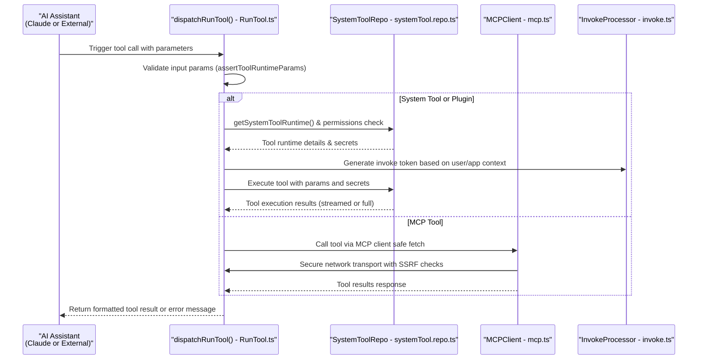
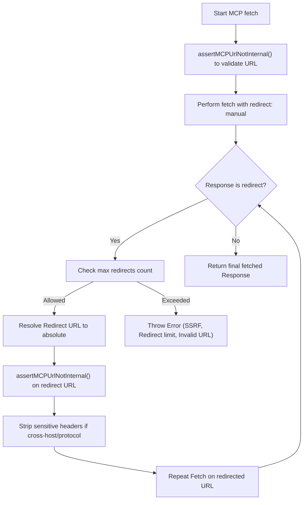
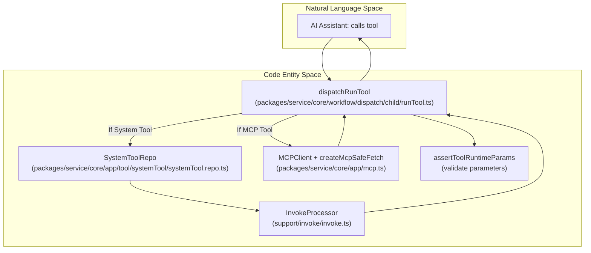

<!-- source: DeepWiki mcp.deepwiki.com · repo labring/FastGPT · page 5.3 Tool Execution Flow · fetched 2026-10-29 -->

# Tool Execution Flow

Relevant source files

The following files were used as context for generating this wiki page:

- [.agents/design/core/ai/model-permission-auth.md](.agents/design/core/ai/model-permission-auth.md)
- [packages/global/common/error/utils.ts](packages/global/common/error/utils.ts)
- [packages/service/common/file/image/controller.ts](packages/service/common/file/image/controller.ts)
- [packages/service/common/response/index.ts](packages/service/common/response/index.ts)
- [packages/service/core/app/mcp.ts](packages/service/core/app/mcp.ts)
- [packages/service/core/dataset/image/controller.ts](packages/service/core/dataset/image/controller.ts)
- [packages/service/core/workflow/dispatch/ai/agent/sub/tool/index.ts](packages/service/core/workflow/dispatch/ai/agent/sub/tool/index.ts)
- [packages/service/core/workflow/dispatch/ai/toolcall/toolCall.ts](packages/service/core/workflow/dispatch/ai/toolcall/toolCall.ts)
- [packages/service/core/workflow/dispatch/child/runTool.ts](packages/service/core/workflow/dispatch/child/runTool.ts)
- [packages/service/test/core/app/http.test.ts](packages/service/test/core/app/http.test.ts)
- [packages/service/test/core/app/mcp.test.ts](packages/service/test/core/app/mcp.test.ts)
- [packages/service/test/core/workflow/dispatch/ai/agent/sub/tool/index.test.ts](packages/service/test/core/workflow/dispatch/ai/agent/sub/tool/index.test.ts)
- [packages/service/test/core/workflow/dispatch/ai/toolcall/toolProvider/createToolCallToolProvider.test.ts](packages/service/test/core/workflow/dispatch/ai/toolcall/toolProvider/createToolCallToolProvider.test.ts)
- [packages/service/test/core/workflow/dispatch/tools/runTool.test.ts](packages/service/test/core/workflow/dispatch/tools/runTool.test.ts)
- [projects/app/src/pageComponents/app/detail/Edit/HTTPTools/Edit.tsx](projects/app/src/pageComponents/app/detail/Edit/HTTPTools/Edit.tsx)
- [projects/app/test/api/core/app/tool/debugCompatibility.test.ts](projects/app/test/api/core/app/tool/debugCompatibility.test.ts)

## Purpose and Scope

This document provides a comprehensive technical description of how Model Context Protocol (MCP) tool calls trigger workflow execution in FastGPT. It explains how parameters are mapped, how secure transport is handled to prevent SSRF risks, how workflow dispatch happens via key functions like `dispatchRunTool`, and how responses are formatted and errors isolated for robust AI agent interaction.

The scope covers:
- Invocation flow from MCP calls or internal tool calls
- Parameter extraction and validation using JSON schema contracts
- Secure HTTP request management and redirects inside MCP client (`createMcpSafeFetch`)
- Integration of system tool permissions and runtime secrets injection
- Response wrapping for tool call results
- Differentiation of tool execution responses from workflow errors to prevent upstream failures

This page complements [Tool Discovery and Listing](#5.2) and [MCP Server Architecture](#5.1).

---

## 1. Overview of Tool Dispatch Architecture

When an AI assistant (external or internal) invokes a tool, the request is handled by runtime dispatch code specialized for tools. The core entry is the `dispatchRunTool` function located in `packages/service/core/workflow/dispatch/child/runTool.ts`. It serves to:

- Resolve the tool type (system/tool HTTP/MCP tool)
- Fetch or resolve runtime tool details, including version and secret configuration
- Validate tool input parameters against prescribed JSON schemas using `assertToolRuntimeParams`
- Execute the tool via either:
  - The system tool repository client for built-in or plugin tools (`SystemToolRepo`)
  - The MCP protocol client for external MCP tools
  - HTTP tool runtime handlers for HTTP endpoints
- Handle authorization scoped by the caller's permission context
- Collect streaming output and structure tool responses for injection back into the workflow

FastGPT supports multiple tool sources: system/internal tools, HTTP tools, and MCP-based tools. The tool configurations (including schema, endpoint details) reside within app definitions and version snapshots.

Key implementations:
- `dispatchRunTool` orchestrates runtime tool calls and parameter mapping [packages/service/core/workflow/dispatch/child/runTool.ts:64-181]()
- `SystemToolRepo` manages system tools and plugin invocations with secret injection [packages/service/core/workflow/dispatch/child/runTool.ts:121-176]()
- MCP tools are invoked through the MCP client backed by `createMcpSafeFetch` for network communication [packages/service/core/app/mcp.ts:170-215]().

---

## 2. End-to-End Execution Flow

The following diagram illustrates the interaction flow bridging from an external AI assistant invoking a tool call through the FastGPT dispatch machinery:

### Natural Language to Code Entity Space Mapping for Tool Execution

This sequence captures how calls from natural language via AI assistants translate to precise method calls interacting with the system tool repo or MCP client, including runtime validation and permission enforcement.

**Sources:**
- [packages/service/core/workflow/dispatch/child/runTool.ts:64-181]()
- [packages/service/core/app/mcp.ts:170-215]()

---

## 3. Secure Fetching and SSRF Protection (`createMcpSafeFetch`)

FastGPT emphasizes security in external tool calls, especially over MCP which connects to arbitrary URLs. The MCP client wraps HTTP requests in a `createMcpSafeFetch` function that:

- Uses undici's HTTP client with pinned DNS lookup to avoid DNS rebinding attacks.
- Does manual redirect handling (fetch redirect mode `'manual'`) for up to 5 hops.
- On each redirect:
  - Validates the redirect URL is HTTP/HTTPS.
  - Checks that no internal/private IP addresses are targeted, blocking SSRF.
  - Strips sensitive headers (`authorization`, `cookie`, `proxy-authorization`) when crossing host or protocol boundaries.
- Throws errors on excessive redirects, invalid redirect schemes, or internal IP targets.

### Secure Fetch & Redirect Handling Flow

This ensures that MCP tool calls do not unintentionally hit internal services or leak authorization tokens to unknown domains. It protects the platform from SSRF-related security risks when invoking external MCP tools.

**Sources:**
- [packages/service/core/app/mcp.ts:44-215]()

---

## 4. Parameter Mapping and Validation

Before executing any tool, `dispatchRunTool` extracts the input parameters from the node context, handling system-level inputs such as secret injection.

- It selectively removes internal system input configs from the user parameters before validation.
- Uses `assertToolRuntimeParams` to validate parameters against the tool's JSON schema input definition, ensuring strict compliance.
- For system tools, secret values configured at deployment or manually injected are retrieved and merged into execution context.
- For MCP tools, the input mapping aligns with the MCP tool input schema defined in discovery.

If validation fails, the tool execution is aborted early with user-friendly error reporting.

**Sources:**
- [packages/service/core/workflow/dispatch/child/runTool.ts:150-160]()
- [packages/service/core/workflow/dispatch/child/runTool.ts:158-170]()

---

## 5. Tool Runtime Dispatch

`dispatchRunTool` handles multiple tool source types dynamically:

- **System Tools**: Calls are delegated to the singleton `SystemToolRepo` instance. The runtime details (permissions, version, secrets) are asynchronously loaded before actual invocation.
- **MCP Tools**: Tool calls are made through an instantiated `MCPClient` that manages secure connections and fetch requests. The MCP client internally uses `createMcpSafeFetch`.
- **HTTP Tools**: For HTTP-based integrations, handlers in the HTTP tool module are invoked.

During execution, ongoing usage is tracked for telemetry and billing, and the tool runtime streams responses back to the workflow system efficiently.

**Sources:**
- [packages/service/core/workflow/dispatch/child/runTool.ts:64-181]()
- [packages/service/core/app/mcp.ts:54-150]()

---

## 6. Response Formatting and Error Handling

Tool invocation results are encapsulated into a standard node response structure that includes metadata:

- The `moduleType` is set to `"tool"` to mark the response as a tool execution.
- Response includes toolResult data, and input parameters echoed for traceability.
- Errors during a tool invocation are caught and converted into error messages rather than terminating the whole workflow, facilitating error resilience.
- The utility `isToolExecutionResponse` helps detect if a response pertains to a tool call and suppresses error bubbling for these cases, enabling the LLM to handle it flexibly [packages/global/core/chat/utils.ts:33-85]().

This design ensures that tool semantics integrate smoothly with the workflow runtime logic and avoid interrupting end-user chat sessions due to tool errors.

---

## 7. Illustration: Tool Execution Flow within Workflow Dispatch

This diagrams how the user-initiated call from an AI assistant navigates through validation, source-specific execution and finally formats the results for returning to the assistant.

---

## 8. Summary of Key Functions and Classes

| Symbol                  | Location                                          | Role                                                                                          |
|-------------------------|--------------------------------------------------|-----------------------------------------------------------------------------------------------|
| `dispatchRunTool`       | `packages/service/core/workflow/dispatch/child/runTool.ts` | Main dispatcher that receives tool invocation with parameters, handles validation, and calls appropriate runtime tool executors including MCP client or system tools. |
| `SystemToolRepo`        | `packages/service/core/app/tool/systemTool/systemTool.repo.ts` | Singleton repository managing system tools and plugins, providing tool runtime info and execution.                     |
| `MCPClient`             | `packages/service/core/app/mcp.ts`                  | MCP protocol client responsible for performing secure RPCs to MCP tool endpoints with SSRF and redirect protections.   |
| `createMcpSafeFetch`    | `packages/service/core/app/mcp.ts`                  | Custom fetch wrapper creating a secure HTTP client with manual redirect handling and internal address blocking.        |
| `assertToolRuntimeParams`| `packages/service/core/workflow/dispatch/child/runTool.ts` | Validator that checks tool input parameters against the tool's JSON schema definitions.           |
| `InvokeProcessor`       | `support/invoke/invoke.ts`                           | Generates authorization tokens for tool invocation reflecting user and app permission scopes.                            |
| `isToolExecutionResponse`| `packages/global/core/chat/utils.ts`                | Utility to detect if a workflow response comes from a tool execution, enabling error isolation inside the chat flow.    |

---

## References and Sources

- Tool dispatch core: [packages/service/core/workflow/dispatch/child/runTool.ts:64-181]()
- MCP client and safe fetch: [packages/service/core/app/mcp.ts:44-215]()
- System tool asynchronous runtime & secret handling: [packages/service/core/workflow/dispatch/child/runTool.ts:120-176]()
- Tool response error isolation: [packages/global/core/chat/utils.ts:33-85]()
- Parameter validation: [packages/service/core/workflow/dispatch/child/runTool.ts:150-160]()
- MCP client HTTP redirect and SSRF prevention: [packages/service/core/app/mcp.ts:170-215]()

---

This technical documentation entry details the full flow from MCP tool call through workflow dispatch with security, parameter validation, and response handling in FastGPT. It bridges the conceptual AI assistant tool call with the concrete code entities responsible for execution and protection.

---

