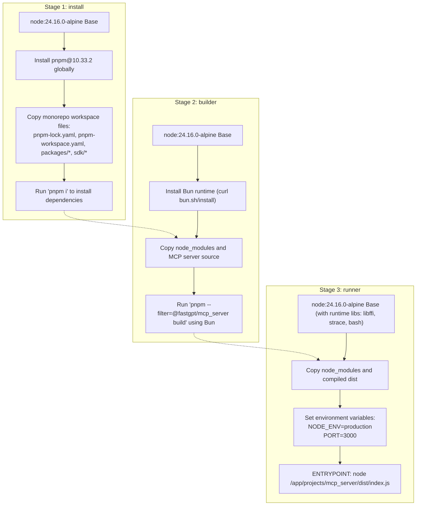
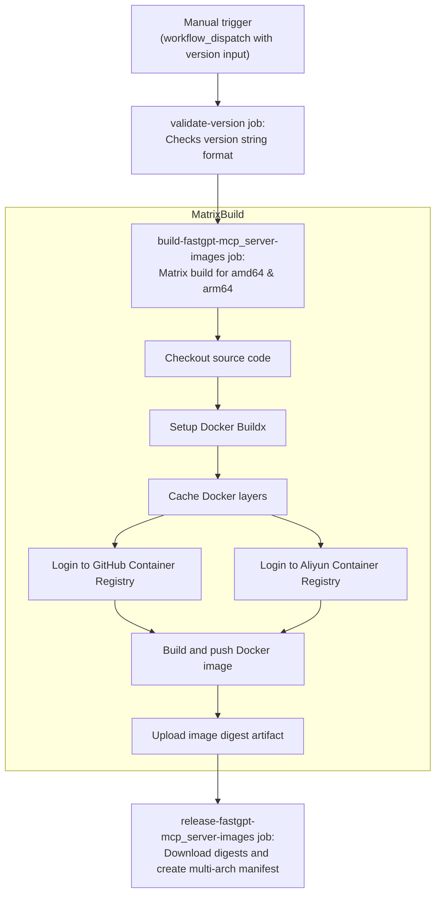
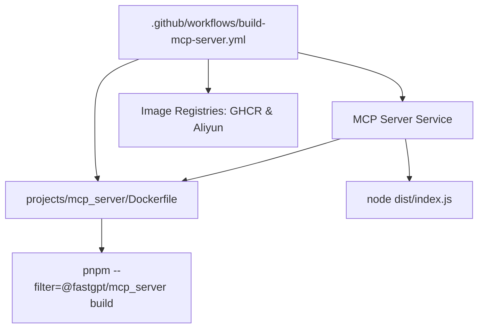
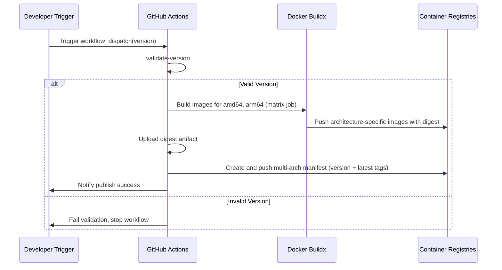

<!-- source: DeepWiki mcp.deepwiki.com · repo labring/FastGPT · page 5.4 MCP Server Deployment · fetched 2026-10-29 -->

# MCP Server Deployment

<details>
<summary>Relevant source files</summary>

The following files were used as context for generating this wiki page:

- [.github/workflows/build-admin.yml](.github/workflows/build-admin.yml)
- [.github/workflows/build-agent-sandbox.yml](.github/workflows/build-agent-sandbox.yml)
- [.github/workflows/build-code-sandbox.yml](.github/workflows/build-code-sandbox.yml)
- [.github/workflows/build-docs.yml](.github/workflows/build-docs.yml)
- [.github/workflows/build-fastgpt.yml](.github/workflows/build-fastgpt.yml)
- [.github/workflows/build-marketplace.yml](.github/workflows/build-marketplace.yml)
- [.github/workflows/build-mcp-server.yml](.github/workflows/build-mcp-server.yml)
- [.github/workflows/build-sso-service-image.yml](.github/workflows/build-sso-service-image.yml)
- [.github/workflows/preview-admin-build.yml](.github/workflows/preview-admin-build.yml)
- [.github/workflows/preview-admin-push.yml](.github/workflows/preview-admin-push.yml)
- [.github/workflows/preview-docs-build.yml](.github/workflows/preview-docs-build.yml)
- [.github/workflows/preview-docs-push.yml](.github/workflows/preview-docs-push.yml)
- [.github/workflows/preview-fastgpt-build.yml](.github/workflows/preview-fastgpt-build.yml)
- [.github/workflows/preview-fastgpt-push.yml](.github/workflows/preview-fastgpt-push.yml)
- [.github/workflows/test-fastgpt-pro.yaml](.github/workflows/test-fastgpt-pro.yaml)
- [.github/workflows/test-fastgpt.yaml](.github/workflows/test-fastgpt.yaml)
- [document/package.json](document/package.json)
- [package.json](package.json)
- [packages/global/package.json](packages/global/package.json)
- [packages/service/package.json](packages/service/package.json)
- [packages/web/package.json](packages/web/package.json)
- [pnpm-lock.yaml](pnpm-lock.yaml)
- [pnpm-workspace.yaml](pnpm-workspace.yaml)
- [projects/app/package.json](projects/app/package.json)
- [projects/app/src/components/core/chat/ChatContainer/ChatBox/Provider.tsx](projects/app/src/components/core/chat/ChatContainer/ChatBox/Provider.tsx)
- [projects/app/src/pages/api/core/chat/file/presignChatFilePostUrl.ts](projects/app/src/pages/api/core/chat/file/presignChatFilePostUrl.ts)
- [projects/app/test/pages/api/core/chat/file/presignChatFilePostUrl.test.ts](projects/app/test/pages/api/core/chat/file/presignChatFilePostUrl.test.ts)
- [projects/marketplace/Dockerfile](projects/marketplace/Dockerfile)
- [projects/marketplace/package.json](projects/marketplace/package.json)
- [projects/mcp_server/Dockerfile](projects/mcp_server/Dockerfile)
- [projects/mcp_server/package.json](projects/mcp_server/package.json)
- [scripts/icon/package.json](scripts/icon/package.json)
- [turbo.json](turbo.json)

</details>


This document details the deployment infrastructure of the FastGPT Model Context Protocol (MCP) server located at `projects/mcp_server`. It focuses on the Docker multi-stage build configuration, GitHub Actions CI/CD workflows for multi-architecture Docker image building and publishing, and container registry distribution workflows targeting GitHub Container Registry and Aliyun Container Registry.

The MCP server acts as an isolated containerized service that exposes FastGPT applications as MCP tools for AI assistants.

For deeper system design, see [MCP Server Architecture](#5.1) and for tool discovery and execution flows, see sections [Tool Discovery and Listing](#5.2) and [Tool Execution Flow](#5.3).

---

## Docker Build Configuration

The MCP server Docker image is built using a multi-stage Dockerfile at `projects/mcp_server/Dockerfile`. It utilizes the lightweight `node:24.16.0-alpine` base image and the `pnpm@10.33.2` package manager to optimize image size and build speed.

### Multi-Stage Build Process Overview

The build consists of three primary stages:



**Figure 1: MCP Server Docker Multi-Stage Build Pipeline**

### Detailed Stage Explanation

- **Stage 1: install**  
  Starts with the `node:24.16.0-alpine` image, installs `pnpm@10.33.2` globally, copies monorepo-wide workspace files (`pnpm-lock.yaml`, `pnpm-workspace.yaml`, internal packages, and the SDK), and installs all dependencies using `pnpm i`. This creates a dependency cache shared in subsequent stages.  
  This stage corresponds to lines 2–30 in the Dockerfile.

- **Stage 2: builder**  
  Begins again with the Alpine Node base, imports the installed node_modules from the install stage, installs the Bun JavaScript runtime, then builds the MCP server package (`@fastgpt/mcp_server`) leveraging Bun.  
  This compilation outputs optimized JavaScript artifacts to `dist/`.  
  This stage covers lines 33–55 of the Dockerfile.

- **Stage 3: runner**  
  The minimal runtime image, extends Alpine Node base with runtime dependencies (`libffi`, `bash`, `strace`). Copies the compiled `dist` folder and `node_modules` from builder stage to the container. The image sets `NODE_ENV=production` and listens on port `3000`. The container entrypoint runs `node dist/index.js` to start the MCP server.  
  This is defined at lines 56–70.

---

## GitHub Actions Multi-Architecture Image Publishing Workflow

To enable wide compatibility, FastGPT publishes MCP server images for both `amd64` and `arm64` architectures. This uses GitHub's Docker Buildx and matrix builds with caching for efficiency.

### Workflow Overview

The workflow file is `.github/workflows/build-mcp-server.yml`, triggered manually (`workflow_dispatch`) with a version input.



**Figure 2: MCP Server Multi-Arch CI/CD Publishing Pipeline**

### Workflow Job Details

1. **`validate-version`**  
   Validates that the input version starts with `v` (e.g., `v1.0.0`), preventing malformed tags.  
   (Lines ~10–25)

2. **`build-fastgpt-mcp_server-images`**  
   Runs on two platforms:  
   - `ubuntu-24.04` targeting `linux/amd64`  
   - `ubuntu-24.04-arm` targeting `linux/arm64`  
    
   The job sets up Buildx, uses caching for Docker layers, logs into GHCR and Aliyun registries, builds the Docker image at `projects/mcp_server/Dockerfile`, tags it with the provided version and architecture suffix, and pushes to both registries.  
   The image tag form is:  
   ```
   ghcr.io/owner/fastgpt-mcp-server:<version>-<arch>
   registry.cn-hangzhou.aliyuncs.com/owner/fastgpt-mcp-server:<version>-<arch>
   ```  
   The digest of each image is saved as an artifact for the next job.  
   (Lines ~26–128)

3. **`release-fastgpt-mcp_server-images`**  
   Downloads the architecture-specific digest files, then uses `docker buildx imagetools create` to compose a multi-architecture manifest, providing a universal image tag for the version without architecture suffix, as well as a `latest` tag.  
   This makes the image consumable transparently on multiple CPU platforms.  
   (Lines ~129–183)

---

## Deployment Configuration Summary

| Parameter                       | Value / Location                                         |
|--------------------------------|----------------------------------------------------------|
| **Base Node.js Image**          | `node:24.16.0-alpine` (Dockerfile Stage 1 & 2 base)     |
| **pnpm Version**                | `10.33.2` (installed globally in install stage)          |
| **Node.js Runtime Dependencies**| `libffi`, `strace`, `bash` (installed in runner stage)   |
| **Docker Build Architecture**  | `linux/amd64`, `linux/arm64` (GitHub Actions build matrix) |
| **Dockerfile Path**             | `projects/mcp_server/Dockerfile`                         |
| **Docker Build Context**        | Repository root (context `.`)                             |
| **Default Server Port**         | `3000` (set in final container environment variable)    |
| **Image Registries**            | GitHub Container Registry (ghcr.io), Aliyun Registry     |
| **CI/CD Workflow File**         | `.github/workflows/build-mcp-server.yml`                 |
| **Build Trigger**               | Manual trigger (`workflow_dispatch` with version input)  |

---

## Relating Natural Language Services to Code Entities



**Figure 3: MCP Server Deployment Components and Key Code Entities**

---

## Detailed Data Flow of GitHub Actions Build



**Figure 4: MCP Server CI/CD Image Build and Publish Data Flow**

---

# Summary

- The MCP server Docker image is built using a multi-stage, optimized pipeline that installs dependencies, compiles source using Bun, and creates a minimal runtime container image with Node.js 24 Alpine.  
- GitHub Actions CI/CD workflows implement a matrix build over AMD64 and ARM64 architectures with caching and push to both GitHub and Aliyun registries.  
- A multi-architecture manifest combining these builds facilitates seamless multi-platform support for MCP server container deployments.  
- The server listens on port 3000 and expects minimal runtime dependencies for low image size and resource usage.  

This enables flexible and efficient deployment of the MCP server as a standalone tool service in containerized infrastructures.

---

### Sources

- `projects/mcp_server/Dockerfile:1-70`  
- `.github/workflows/build-mcp-server.yml:1-183`  
- `projects/mcp_server/package.json:1-34`

---

