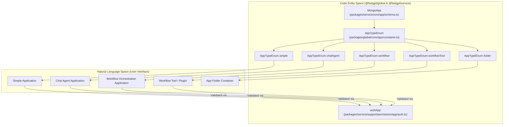
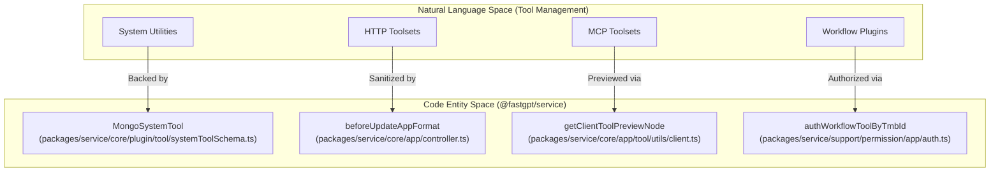

<!-- source: DeepWiki mcp.deepwiki.com · repo labring/FastGPT · page 6 Application Types and Tool Ecosystem · fetched 2026-10-29 -->

# Application Types and Tool Ecosystem

Relevant source files

The following files were used as context for generating this wiki page:

- [packages/global/core/app/constants.ts](packages/global/core/app/constants.ts)
- [packages/global/core/app/tool/toolSet/type.ts](packages/global/core/app/tool/toolSet/type.ts)
- [packages/global/core/app/type.ts](packages/global/core/app/type.ts)
- [packages/global/core/workflow/migration/index.ts](packages/global/core/workflow/migration/index.ts)
- [packages/global/core/workflow/migration/legacy/structure.ts](packages/global/core/workflow/migration/legacy/structure.ts)
- [packages/global/core/workflow/migration/legacy/systemConfig.ts](packages/global/core/workflow/migration/legacy/systemConfig.ts)
- [packages/global/core/workflow/migration/legacy/workflow.ts](packages/global/core/workflow/migration/legacy/workflow.ts)
- [packages/global/core/workflow/migration/migrate.ts](packages/global/core/workflow/migration/migrate.ts)
- [packages/global/core/workflow/type/io.ts](packages/global/core/workflow/type/io.ts)
- [packages/global/test/core/app/type.test.ts](packages/global/test/core/app/type.test.ts)
- [packages/global/test/core/workflow/migration/schema.test.ts](packages/global/test/core/workflow/migration/schema.test.ts)
- [packages/service/core/workflow/dispatch/utils/variables.ts](packages/service/core/workflow/dispatch/utils/variables.ts)
- [packages/service/test/core/app/schema.test.ts](packages/service/test/core/app/schema.test.ts)
- [packages/service/test/core/workflow/dispatch/variables.test.ts](packages/service/test/core/workflow/dispatch/variables.test.ts)
- [packages/service/test/support/permission/app/resource.test.ts](packages/service/test/support/permission/app/resource.test.ts)
- [projects/app/src/pageComponents/app/detail/WorkflowComponents/Flow/nodes/components/ToolParamsEditModal/constants.ts](projects/app/src/pageComponents/app/detail/WorkflowComponents/Flow/nodes/components/ToolParamsEditModal/constants.ts)
- [projects/app/test/pageComponents/app/detail/WorkflowComponents/Flow/nodes/components/ToolParamsEditModal/constants.test.ts](projects/app/test/pageComponents/app/detail/WorkflowComponents/Flow/nodes/components/ToolParamsEditModal/constants.test.ts)

## Purpose and Scope

This document provides a high-level overview of FastGPT's application paradigms, tool integration ecosystem, publishing channels, and the marketplace service. FastGPT supports multiple application types ranging from simplified form-based setups to complex visual node-based workflows, integrating externally via system tools, HTTP toolsets, Model Context Protocol (MCP) servers, and a marketplace service.

As a PARENT page, this document summarizes the core architecture and cross-cutting relationships. For deep technical implementation details, refer to the respective child pages:

- **[Simple Apps, Workflow Apps, and Plugins](#6.1)** — Differences between app types, form-based vs. React Flow editors, and versioning APIs (`/core/app/create`, `/core/app/update`) [packages/service/core/app/schema.ts:1-179](), [packages/global/openapi/core/app/common/index.ts:77-147]().

- **[Tool Integration System](#6.2)** — System tool registries, tool templates, HTTP/MCP toolsets, and fastgpt-plugin marketplace clients [packages/service/core/app/controller.ts:114-162]().

- **[Publishing Channels and External Integration](#6.3)** — Share links, iframe embedding, OpenAPI access, and third-party chat platform integrations (Feishu, WeChat, DingTalk, WeCom) [packages/global/openapi/core/app/common/index.ts:28-267]().

- **[Marketplace Service](#6.4)** — Next.js marketplace service under `projects/marketplace`, API proxying via `/api/marketplace/[...path]`, and tool package distribution [projects/app/src/pages/api/core/app/list.ts:1-197]().

---

## 6.1. Application Types and Core Architecture

FastGPT categorizes applications primarily by the `AppTypeEnum` enumeration defined in the global core constants. The main app types relevant to users include:

- **Simple apps (`AppTypeEnum.simple`)**: Basic, form-driven applications typically with straightforward question-response logic.

- **Chat agents (`AppTypeEnum.chatAgent`)**: Applications focused on chat interactions that may include variable input, entry points, and voice-related configurations.

- **Workflow apps (`AppTypeEnum.workflow`)**: Advanced applications using visual node-based workflow orchestration for multi-step logic and integration.

- **Workflow tools (`AppTypeEnum.workflowTool`)**: Plugins or tools designed primarily to be used within workflows or by agents.

- **Folders (`AppTypeEnum.folder`)**: Organizational containers to group apps.

Permission enforcement for app resource access is implemented through `authApp` middleware/services ensuring security boundaries in multi-tenant environments.

**Diagram: Application Type Entity Mapping**

For details on editors for simple apps and chat agents, workflow graph structures, plugin concepts, and versioning APIs, see [Simple Apps, Workflow Apps, and Plugins](#6.1).

**Sources:**  
[packages/global/core/app/constants.ts:10-37](),  
[packages/global/core/app/type.ts:1-203](),  
[packages/service/support/permission/app/auth.ts:135-166](),  
[packages/service/core/app/schema.ts:1-179](),  
[projects/app/src/pages/api/core/app/list.ts:10-10](),  
[projects/app/src/pages/api/core/app/listV2.ts:10-10]()  

---

## 6.2. Tool Integration System

FastGPT applications and workflow nodes access external capabilities through a variety of tools integrated in the platform. The system supports:

- **System tools**: Internal utility tools managed via the system tool repository schema.

- **HTTP toolsets**: Tools exposing HTTP-based APIs, configurable and invokable from workflows or agents.

- **MCP toolsets**: Tools compliant with the Model Context Protocol (MCP), allowing seamless invocation by AI assistants.

- **Workflow plugins**: Specialized workflow tools (`workflowTool`) designed as plugins to extend workflow functionality.

Integration includes structured tool data sanitization and formatting handled in controller layers before persistence or execution (`beforeUpdateAppFormat`). Preview and execution authorization logic are enforced by the permission system.

**Diagram: Tool Ecosystem Entity Mapping**

For comprehensive details on system tool registry, tool templates, HTTP/MCP toolset handling, and marketplace client tooling, see [Tool Integration System](#6.2).

**Sources:**  
[packages/service/core/app/controller.ts:50-163](),  
[packages/service/core/app/controller.ts:114-162](),  
[packages/service/support/permission/app/auth.ts:25-40](),  
[packages/service/core/plugin/tool/systemToolSchema.ts:1-50]()  

---

## 6.3. Publishing Channels and External Integration

FastGPT applications can be exposed and shared via multiple external channels:

- **Share links**: Generate public or team-private access URLs for apps.

- **Iframe embedding**: Embed app UIs securely in external web pages.

- **OpenAPI endpoints**: Apps and workflows can be accessed programmatically via REST API interfaces.

- **Third-party integrations**: Bots and webhooks for platforms like Feishu, WeChat, DingTalk, and WeCom enable app invocation within popular chat environments.

These external channels allow app creators to extend their reach and automate workflows across platforms.

For details on share link generation, iframe security, API usage, and third-party platform adapters, see [Publishing Channels and External Integration](#6.3).

**Sources:**  
[packages/global/openapi/core/app/common/index.ts:28-267]()  

---

## 6.4. Marketplace Service

The FastGPT marketplace service, implemented as a Next.js project located under `projects/marketplace`, is the central hub for discovering, sharing, and installing applications, tool packages, and workflow templates.

Key features include:

- User authentication and authorization for marketplace operations.

- Aggregation of public and private app catalogs.

- API proxying endpoints under `/api/marketplace/[...path]` within the primary app server to enable seamless integration.

- Tool package distribution mechanisms supporting installation and updates.

- Marketplace client components to facilitate browsing and selection of marketplace offerings.

This ecosystem encourages community-driven contribution and fast adoption of prebuilt AI agents and tools.

For architecture and API design specifics, see [Marketplace Service](#6.4).

**Sources:**  
[projects/app/src/pages/api/core/app/list.ts:1-197]()  

---

# Summary

FastGPT supports a flexible range of **application types**—from simple forms to complex workflows—each backed by robust permission checks and versioning. The system integrates a powerful **tool ecosystem** (system tools, HTTP and MCP toolsets, plugins) allowing dynamic execution and extension. Applications can be published widely using several **channels and integrations**, facilitating sharing and embedding. Finally, the **marketplace** service connects users with an evolving catalog of applications and tools to enhance productivity.

Explore the linked child pages to dive into implementation details, technical APIs, and user interface descriptions within the FastGPT platform.

---

