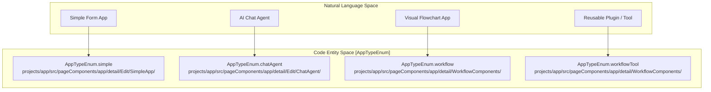
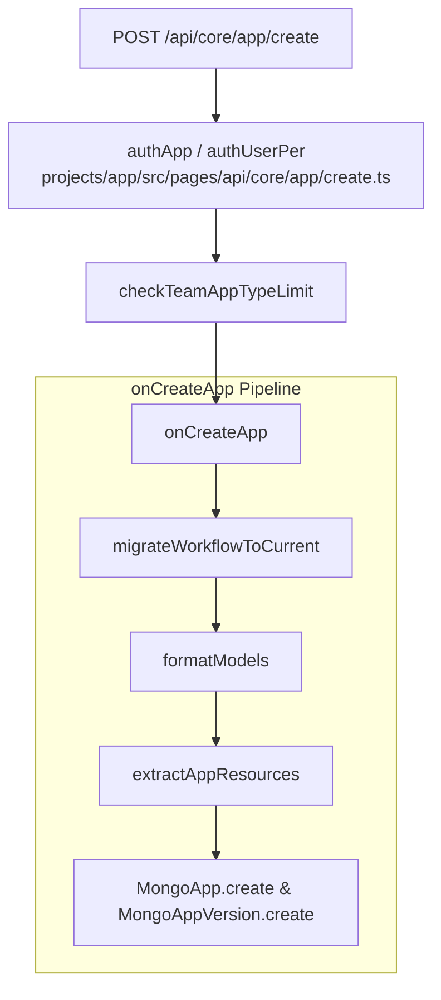
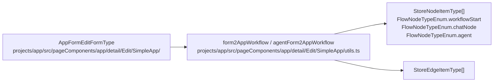
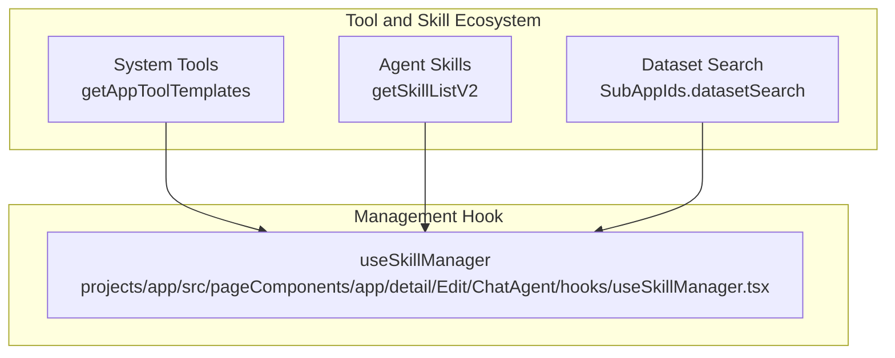
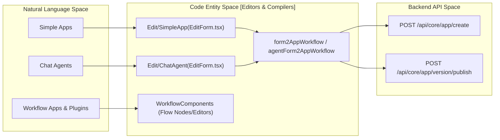
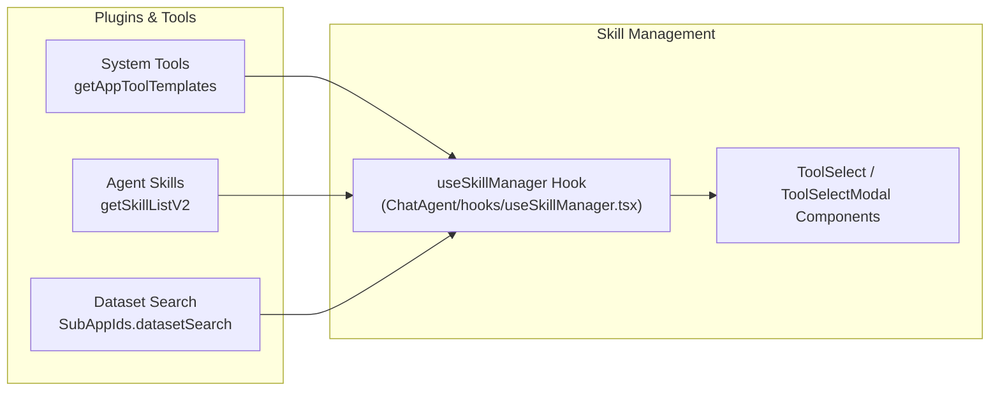

<!-- source: DeepWiki mcp.deepwiki.com · repo labring/FastGPT · page 6.1 Simple Apps, Workflow Apps, and Plugins · fetched 2026-10-29 -->

# Simple Apps, Workflow Apps, and Plugins

Relevant source files

The following files were used as context for generating this wiki page:

- [packages/service/common/secret/utils.ts](packages/service/common/secret/utils.ts)
- [projects/app/public/imgs/app/agentPreview.svg](projects/app/public/imgs/app/agentPreview.svg)
- [projects/app/public/imgs/app/workflowPreview.svg](projects/app/public/imgs/app/workflowPreview.svg)
- [projects/app/src/components/common/secret/HeaderAuthForm.tsx](projects/app/src/components/common/secret/HeaderAuthForm.tsx)
- [projects/app/src/components/core/chat/components/Interactive/InteractiveComponents.tsx](projects/app/src/components/core/chat/components/Interactive/InteractiveComponents.tsx)
- [projects/app/src/pageComponents/app/constants.ts](projects/app/src/pageComponents/app/constants.ts)
- [projects/app/src/pageComponents/app/detail/Edit/ChatAgent/EditForm.tsx](projects/app/src/pageComponents/app/detail/Edit/ChatAgent/EditForm.tsx)
- [projects/app/src/pageComponents/app/detail/Edit/ChatAgent/hooks/useSkillManager.tsx](projects/app/src/pageComponents/app/detail/Edit/ChatAgent/hooks/useSkillManager.tsx)
- [projects/app/src/pageComponents/app/detail/Edit/ChatAgent/utils.ts](projects/app/src/pageComponents/app/detail/Edit/ChatAgent/utils.ts)
- [projects/app/src/pageComponents/app/detail/Edit/FormComponent/ToolSelector/ToolSelect.tsx](projects/app/src/pageComponents/app/detail/Edit/FormComponent/ToolSelector/ToolSelect.tsx)
- [projects/app/src/pageComponents/app/detail/Edit/FormComponent/ToolSelector/ToolSelectModal.tsx](projects/app/src/pageComponents/app/detail/Edit/FormComponent/ToolSelector/ToolSelectModal.tsx)
- [projects/app/src/pageComponents/app/detail/Edit/SimpleApp/EditForm.tsx](projects/app/src/pageComponents/app/detail/Edit/SimpleApp/EditForm.tsx)
- [projects/app/src/pageComponents/app/detail/Edit/SimpleApp/utils.ts](projects/app/src/pageComponents/app/detail/Edit/SimpleApp/utils.ts)
- [projects/app/src/pageComponents/app/detail/WorkflowComponents/Flow/nodes/NodeAgent/index.tsx](projects/app/src/pageComponents/app/detail/WorkflowComponents/Flow/nodes/NodeAgent/index.tsx)
- [projects/app/src/pageComponents/app/detail/WorkflowComponents/Flow/nodes/NodeAgent/useAgentSkillManager.ts](projects/app/src/pageComponents/app/detail/WorkflowComponents/Flow/nodes/NodeAgent/useAgentSkillManager.ts)
- [projects/app/src/pageComponents/app/detail/WorkflowComponents/Flow/nodes/NodePluginIO/InputTypeConfig.tsx](projects/app/src/pageComponents/app/detail/WorkflowComponents/Flow/nodes/NodePluginIO/InputTypeConfig.tsx)
- [projects/app/src/pageComponents/app/detail/WorkflowComponents/Flow/nodes/render/RenderInput/index.tsx](projects/app/src/pageComponents/app/detail/WorkflowComponents/Flow/nodes/render/RenderInput/index.tsx)
- [projects/app/src/pageComponents/app/detail/WorkflowComponents/Flow/nodes/render/RenderInput/templates/SelectDataset.tsx](projects/app/src/pageComponents/app/detail/WorkflowComponents/Flow/nodes/render/RenderInput/templates/SelectDataset.tsx)
- [projects/app/src/pageComponents/app/detail/context.tsx](projects/app/src/pageComponents/app/detail/context.tsx)
- [projects/app/src/pageComponents/chat/ChatSetting/ToolSelectModal.tsx](projects/app/src/pageComponents/chat/ChatSetting/ToolSelectModal.tsx)
- [projects/app/src/pages/dashboard/create/index.tsx](projects/app/src/pages/dashboard/create/index.tsx)
- [projects/app/test/web/core/app/templates.test.ts](projects/app/test/web/core/app/templates.test.ts)
- [projects/app/test/web/core/app/utils.test.ts](projects/app/test/web/core/app/utils.test.ts)

## Purpose and Scope

This document details the primary application paradigms in FastGPT: **Simple Apps**, **Workflow Apps**, **Chat Agents**, and **Plugins/Tools**. It explains their structural differences, configuration approaches, component editors, form-to-workflow compilers, and the backend APIs responsible for app creation and versioning. FastGPT balances no-code simplicity with low-level visual workflow orchestration through these distinct abstractions.

---

## 1. Application Type Hierarchy and Editors

FastGPT defines several app types via the enum `AppTypeEnum`. Each app type corresponds to specific UI editors and underlying models:

| Natural Language Concept    | Code Enum & Editor Location                                          |
|----------------------------|---------------------------------------------------------------------|
| Simple Form App            | `AppTypeEnum.simple` `projects/app/src/pageComponents/app/detail/Edit/SimpleApp/` |
| AI Chat Agent              | `AppTypeEnum.chatAgent` `projects/app/src/pageComponents/app/detail/Edit/ChatAgent/` |
| Visual Flowchart Workflow  | `AppTypeEnum.workflow` `projects/app/src/pageComponents/app/detail/WorkflowComponents/` |
| Reusable Plugin / Tool     | `AppTypeEnum.workflowTool` (Same editor as Workflow Apps)       |

These mappings define the editing experience users see — from simple forms for straightforward conversational tasks to complex visual flowchart editors for advanced orchestrations.

**Key notes:**

- Simple Apps and Chat Agents are form-driven, offering limited but user-friendly configurations.
- Workflow Apps and Plugins expose the visual node-based editor, allowing complex workflows and reusable tool integrations.
- Chat Agents expose additional skill/agent UI to manage agent sub-skills and tools.

Sources:  
[packages/global/core/app/constants.ts:9-23](),  
[projects/app/src/pageComponents/app/detail/Edit/ChatAgent/EditForm.tsx:73-141](),  
[projects/app/src/pageComponents/app/detail/Edit/SimpleApp/EditForm.tsx:84-95]()

---

## 2. App Creation and Versioning APIs

New apps and versions are created via specific backend APIs. The main POST endpoint is `/api/core/app/create` which:

- Authenticates user and team permissions.
- Checks team limits on app type counts (`checkTeamAppTypeLimit`).
- Normalizes and migrates workflows to the current format.
- Extracts internal resource dependencies (datasets, models, subapps).
- Inserts new documents into MongoDB collections for apps and app versions.

The creation flow inside `projects/app/src/pages/api/core/app/create.ts` looks like:

For app version publishing, `/api/core/app/version/publish` handles:

- Auto-saving drafts or publishing based on `isPublish` flag.
- Validating model availability and tool configuration errors.
- Resolving and verifying resource permissions.
- Updating app's published version reference (`publishedVersionId`).

The publishing logic performs checks and permission validations to ensure consistent app states.

Sources:  
[projects/app/src/pages/api/core/app/create.ts:50-161](),  
[projects/app/src/pages/api/core/app/version/publish.ts:29-178]()

---

## 3. Form-to-Workflow Compilation

Both **Simple Apps** and **Chat Agents** expose simplified forms but rely on a standardized DAG workflow representation internally. On save, compilers convert their form state to detailed workflow nodes and edges.

For example:

- In Simple Apps, `form2AppWorkflow` compiles the form inputs into a workflow with `workflowStart`, `chatNode`, and potential `toolCall` nodes.
- In Chat Agents, `agentForm2AppWorkflow` compiles the AI model config, agent-specific parameters, selected tools, and workflows into a DAG that can execute agent skills and tool calls.

This separation allows FastGPT to unify execution models regardless of the app type.

Sources:  
[projects/app/src/pageComponents/app/detail/Edit/ChatAgent/utils.ts:150-185](),  
[projects/app/src/pageComponents/app/detail/Edit/SimpleApp/utils.ts:48-190](),  
[projects/app/test/web/core/app/utils.test.ts:20-62]()

---

## 4. Plugins, Tool Sets, and Skill Integration

**Chat Agents** and **Workflow Apps** use plugins (also called tools or skills) to extend capabilities. These may be:

- System-level tools (`getAppToolTemplates`), including dataset search, file reading, and common utilities.
- Agent skills from user/team libraries (`getSkillListV2`).
- Dataset search integration as a special system sub-app (id: `datasetSearch`).
- HTTP or MCP tool sets acting as external APIs.

The management of these plugins within editors is handled by the `useSkillManager` hook, which:

- Loads system and team tool templates.
- Converts raw tool data to UI-friendly items.
- Tracks selected skills and tools.
- Performs validation on tool config and status.

These plugins populate UI components such as tool selectors (`ToolSelect` and `ToolSelectModal`) to provide users with interface controls for tool addition and configuration.

Sources:  
[projects/app/src/pageComponents/app/detail/Edit/ChatAgent/hooks/useSkillManager.tsx:122-189](),  
[projects/app/src/pageComponents/app/detail/Edit/FormComponent/ToolSelector/ToolSelectModal.tsx:1-167](),  
[projects/app/src/pageComponents/app/detail/Edit/FormComponent/ToolSelector/ToolSelect.tsx:29-176]()

---

## 5. Permission and Resource Management

FastGPT enforces resource permissions to secure app editing and publishing:

- The `authApp` function verifies team membership and permission levels (`WritePermissionVal`) before any modification.
- `extractAppResources` inspects workflow nodes and chat configurations to enumerate dependencies on datasets, language models, sub-apps, and skills.
- Publishing verifies read access to all referenced resources before marking a version as live.

This strict model ensures collaborative integrity and prevents unauthorized app changes or accidental publishing of incomplete configurations.

Sources:  
[projects/app/src/pages/api/core/app/create.ts:58-72](),  
[projects/app/src/pages/api/core/app/version/publish.ts:39-63]()

---

# Summary Diagram: Connecting Natural Language App Types to Core Code Entities and APIs

# Summary Diagram: Plugins, Tools, Skills Ecosystem

---

# Additional Notes on ChatAgent and SimpleApp Editors

- **ChatAgent Editor** (`EditForm.tsx`) exposes configuration options for model choice, system prompt, variables, datasets, agent skills, and tool selection. It integrates sandbox options for skill execution. It uses hooks like `useAgentSkillSelect` and `useSkillManager` to manage skill and tool selection UI and logic.

- **SimpleApp Editor** (`EditForm.tsx` in SimpleApp directory) includes dataset selection, variable editing, welcome text/inputs, model selection, and tool integration. It supports legacy and new dataset tag filters and compiles form data into workflows with `form2AppWorkflow`.

Both editors use shared components such as `ToolSelect` and dynamic components to potentially render dataset modals, TTS config, or welcome question forms.

Sources:  
[projects/app/src/pageComponents/app/detail/Edit/ChatAgent/EditForm.tsx:73-141](),  
[projects/app/src/pageComponents/app/detail/Edit/SimpleApp/EditForm.tsx:84-170]()

---

# Conclusion

This page clarifies the distinctions between FastGPT's application types, detailing their:

- UI editor mappings
- Internal workflow compilation mechanisms
- Plugin and skill integration
- App creation and versioning server APIs
- Permission and resource management

The design promotes separation of concerns: user-friendly form editors for common cases vs. powerful visual workflows for advanced orchestration, all unified under a robust backend execution and permission system.

---

Sources Summary:  
- `projects/app/src/pageComponents/app/detail/Edit/ChatAgent/EditForm.tsx` (1-141)  
- `projects/app/src/pageComponents/app/detail/Edit/SimpleApp/EditForm.tsx` (1-170)  
- `projects/app/src/pageComponents/app/detail/Edit/SimpleApp/utils.ts` (1-190)  
- `projects/app/src/pageComponents/app/detail/Edit/ChatAgent/utils.ts` (1-185)  
- `projects/app/src/pageComponents/app/detail/WorkflowComponents/` (overview, inferred)  
- `projects/app/src/pages/api/core/app/create.ts` (50-161)  
- `projects/app/src/pages/api/core/app/version/publish.ts` (29-178)  
- `projects/app/src/pageComponents/app/detail/Edit/ChatAgent/hooks/useSkillManager.tsx` (122-189)  
- `projects/app/src/pageComponents/app/detail/Edit/FormComponent/ToolSelector/ToolSelectModal.tsx` (1-167)  
- `projects/app/src/pageComponents/app/detail/Edit/FormComponent/ToolSelector/ToolSelect.tsx` (29-176)

---

