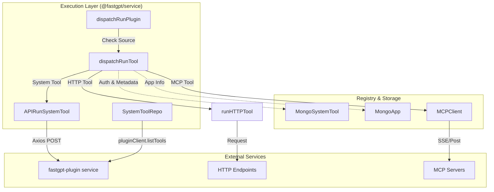
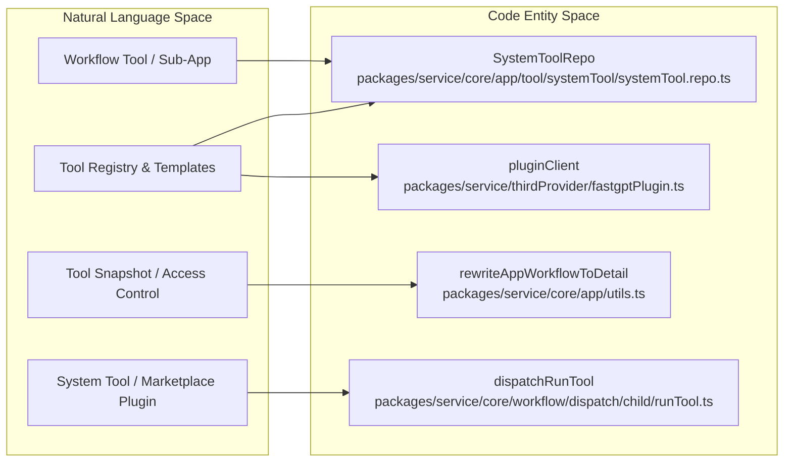

<!-- source: DeepWiki mcp.deepwiki.com · repo labring/FastGPT · page 6.2 Tool Integration System · fetched 2026-10-29 -->

# Tool Integration System

Relevant source files

The following files were used as context for generating this wiki page:

- [.agents/design/app/tool-input-runtime.md](.agents/design/app/tool-input-runtime.md)
- [packages/global/core/app/formEdit/utils.ts](packages/global/core/app/formEdit/utils.ts)
- [packages/global/core/app/jsonschema.ts](packages/global/core/app/jsonschema.ts)
- [packages/global/core/app/tool/runtime.ts](packages/global/core/app/tool/runtime.ts)
- [packages/global/core/app/tool/systemTool/type/admin.ts](packages/global/core/app/tool/systemTool/type/admin.ts)
- [packages/global/core/app/tool/systemTool/type/base.ts](packages/global/core/app/tool/systemTool/type/base.ts)
- [packages/global/core/workflow/migration/legacy/input.ts](packages/global/core/workflow/migration/legacy/input.ts)
- [packages/global/core/workflow/type/node.ts](packages/global/core/workflow/type/node.ts)
- [packages/global/test/core/app/formEdit/utils.test.ts](packages/global/test/core/app/formEdit/utils.test.ts)
- [packages/global/test/core/app/jsonschema.test.ts](packages/global/test/core/app/jsonschema.test.ts)
- [packages/global/test/core/app/tool/runtime.test.ts](packages/global/test/core/app/tool/runtime.test.ts)
- [packages/global/test/core/app/tool/systemTool/type.test.ts](packages/global/test/core/app/tool/systemTool/type.test.ts)
- [packages/global/test/core/app/tool/type.test.ts](packages/global/test/core/app/tool/type.test.ts)
- [packages/global/test/core/workflow/template/datasetSearch.test.ts](packages/global/test/core/workflow/template/datasetSearch.test.ts)
- [packages/service/core/app/tool/systemTool/systemTool.repo.ts](packages/service/core/app/tool/systemTool/systemTool.repo.ts)
- [packages/service/core/app/tool/utils/client.ts](packages/service/core/app/tool/utils/client.ts)
- [packages/service/core/app/utils.ts](packages/service/core/app/utils.ts)
- [packages/service/core/plugin/tool/systemToolSchema.ts](packages/service/core/plugin/tool/systemToolSchema.ts)
- [packages/service/core/workflow/dispatch/ai/agent/sub/tool/utils.ts](packages/service/core/workflow/dispatch/ai/agent/sub/tool/utils.ts)
- [packages/service/test/core/app/tool/systemTool/systemTool.repo.test.ts](packages/service/test/core/app/tool/systemTool/systemTool.repo.test.ts)
- [packages/service/test/core/app/tool/utils/clientSystemTool.test.ts](packages/service/test/core/app/tool/utils/clientSystemTool.test.ts)
- [packages/service/test/core/workflow/dispatch/ai/agent/sub/tool/utils.test.ts](packages/service/test/core/workflow/dispatch/ai/agent/sub/tool/utils.test.ts)
- [projects/app/src/pageComponents/app/detail/Edit/HTTPTools/ChatTest.tsx](projects/app/src/pageComponents/app/detail/Edit/HTTPTools/ChatTest.tsx)
- [projects/app/src/pageComponents/app/detail/Edit/component/ConfigToolModal.tsx](projects/app/src/pageComponents/app/detail/Edit/component/ConfigToolModal.tsx)
- [projects/app/src/pageComponents/app/detail/WorkflowComponents/Flow/nodes/render/RenderInput/Label.tsx](projects/app/src/pageComponents/app/detail/WorkflowComponents/Flow/nodes/render/RenderInput/Label.tsx)
- [projects/app/src/pageComponents/app/detail/WorkflowComponents/Flow/nodes/render/RenderOutput/Label.tsx](projects/app/src/pageComponents/app/detail/WorkflowComponents/Flow/nodes/render/RenderOutput/Label.tsx)
- [projects/app/src/pages/api/core/app/tool/getSystemToolTemplates.ts](projects/app/src/pages/api/core/app/tool/getSystemToolTemplates.ts)
- [projects/app/test/api/core/app/tool/getSystemToolTemplates.test.ts](projects/app/test/api/core/app/tool/getSystemToolTemplates.test.ts)
- [projects/app/test/service/core/app/rewriteAppWorkflowToDetail.test.ts](projects/app/test/service/core/app/rewriteAppWorkflowToDetail.test.ts)

## Purpose and Scope

The Tool Integration System is a core infrastructure within FastGPT for managing and invoking diverse categories of tools in workflows. It integrates external system tools, internal workflow-defined tools, and Model Context Protocol (MCP) tools, facilitating seamless operations in AI agent workflows. This system involves managing tooling metadata, runtime nodes, permission verification, secure secret injection, version handling, and interfacing with the fastgpt-plugin marketplace.

This page documents the technical design and implementation details of:

- The `SystemToolRepo` central registry for system and commercial tools.
- Tool templates and validation logic.
- HTTP and MCP tool execution frameworks.
- Workflow snapshot resolution and authorization via `rewriteAppWorkflowToDetail`.
- The fastgpt-plugin marketplace client integration and usage.

---

## Tool Integration Architecture

At a high level, the tool integration system manages tools from multiple sources (system tools, workflow tools, HTTP/MCP tools), registers them, and dispatches calls to the appropriate execution subsystem or external service.

**Description:**

- `SystemToolRepo` queries and caches system/commercial tool metadata both from local database (`MongoSystemTool`) and remote fastgpt-plugin marketplace.
- The `dispatchRunTool` function routes tool invocations based on tool source/type.
- System tools invoke APIs of `fastgpt-plugin` service (`APIRunSystemTool`).
- HTTP tools send configured HTTP requests.
- MCP tools use the MCP SSE client to communicate with MCP-compliant servers.
- Persistent tool info and permissions are stored in `MongoSystemTool` and `MongoApp`.
- This architecture supports dynamic tool discovery, user permission enforcement, and multiple tool invocation protocols.

Sources: [packages/service/core/workflow/dispatch/plugin/run.ts:48-76](), [packages/service/core/workflow/dispatch/child/runTool.ts:46-67](), [packages/service/core/app/tool/systemTool/systemTool.repo.ts:20-25]()

---

## Natural Language to Code Entity Mapping

Bridging the user-facing tool concepts with their precise codebase counterparts aids developers in understanding interactions and debugging.

- **SystemToolRepo** manages tool metadata and lookup.
- **pluginClient** interacts with the external marketplace.
- **rewriteAppWorkflowToDetail** resolves tool snapshots with permission and existence checks.
- **dispatchRunTool** manages the runtime dispatching of tool calls.

Sources: [packages/service/core/app/tool/systemTool/systemTool.repo.ts:1-65](), [packages/service/core/app/utils.ts:57-140]()

---

## System Tool Registry (`SystemToolRepo`)

`SystemToolRepo` is a singleton registry class serving as the authoritative cache and API wrapper for system and commercial tools. Located at `packages/service/core/app/tool/systemTool/systemTool.repo.ts`, it unifies tool metadata from:

- **Local DB** via `MongoSystemTool`
- **Remote Marketplace** via `pluginClient.listTools`

Key features include:

- **Tag-based Filtering and Ranking**  
  When fetching tool lists, it ranks by matched tags count first, then by `pluginOrder` for consistent ordering [packages/service/test/core/app/tool/systemTool/systemTool.repo.test.ts:121-159]().
  
- **Secret Status Computation**  
  Tools report if they require system secrets and user configuration status via `systemSecretStatus`: `none`, `unconfigured`, or `configured` [packages/service/test/core/app/tool/systemTool/systemTool.repo.test.ts:182-212]().

- **Version Management**  
  Handles version listing and detail retrieval for system tools and commercial plugins.

Typical usage scenario:

- When workflows reference system tools, their metadata and configuration status are loaded from `SystemToolRepo`.
- This repository empowers both UI components and runtime dispatchers with up-to-date tool information.

Sources: [packages/service/core/app/tool/systemTool/systemTool.repo.ts:1-55](), [packages/service/test/core/app/tool/systemTool/systemTool.repo.test.ts:120-180]()

---

## Tool Source and Dispatch Logic

FastGPT distinguishes tool types primarily by their source and delegates execution accordingly within the dispatch framework:

### System Tools

- Identified by the `AppToolSourceEnum.systemTool` or `commercial`.
- Stored and introspected from the system plugin marketplace.
- Execution is via the `APIRunSystemTool` function, which sends POST requests to the plugin API endpoints.
- The dispatch function `dispatchRunTool` recognizes system tools via `toolConfig.systemTool.toolId` and routes to appropriate runtime [packages/service/core/workflow/dispatch/child/runTool.ts:67-100]().

- System variables (e.g., User ID, App ID, runtime time) are injected as secrets or special inputs for tool runtime [packages/service/core/workflow/dispatch/child/runTool.ts:102-122]().

### HTTP Tools

- These allow workflows to call arbitrary HTTP RESTful APIs.
- Configured via `HttpToolConfigType` dictating request payload schema and output schema.
- Execution performed by the `runHTTPTool` method with the specific HTTP request formed at runtime [packages/global/core/app/tool/httpTool/utils.ts:51-91](), [packages/service/core/workflow/dispatch/child/runTool.ts:233-240]().

### MCP Tools

- Tools implementing the Model Context Protocol are integrated via `MCPClient`.
- MCP clients establish SSE connections based on configured endpoints.
- MCP tool metadata is translated into FastGPT workflow runtime nodes using helper utilities like `getMCPToolRuntimeNode` [packages/service/core/app/mcp/index.ts:10-15](), [packages/global/core/app/tool/mcpTool/utils.ts:44-83]().

Sources: [packages/service/core/workflow/dispatch/child/runTool.ts:206-220](), [packages/global/core/app/tool/constants.ts:1-10]()

---

## Tool Selection and Marketplace Client

FastGPT provides a frontend tool selection modal to enable workflow authors to browse and add system or team-defined tools.

- The modal calls API routes like `getAppToolTemplates` and `getTeamAppTemplatesV2` to fetch templates from system and team plugins.
- On the server side, these API handlers internally query the `SystemToolRepo` and the FastGPT marketplace via `pluginClient.listTools` [projects/app/src/pageComponents/app/detail/Edit/FormComponent/ToolSelector/ToolSelectModal.tsx:53-125](), [packages/service/core/app/tool/systemTool/systemTool.repo.ts:20-35]().

This arrangement supports:

- Dynamic discovery of the latest marketplace tools.
- Filtering by capabilities, tags, and user permission.
- Inclusion of team-created custom workflow tools.

Sources: [projects/app/src/pageComponents/app/detail/Edit/FormComponent/ToolSelector/ToolSelectModal.tsx:100-132](), [packages/service/core/app/tool/systemTool/systemTool.repo.ts:20-35]()

---

## Tool Validation and Snapshot Resolution

When FastGPT loads or exports apps with workflows referencing external tools, the `rewriteAppWorkflowToDetail` function (in `packages/service/core/app/utils.ts`) enriches nodes with detailed metadata and verifies access. This process enables proper UI display of snapshot data, even if external tools are deleted or access is denied.

Key steps:

1. **Snapshot Baseline Detection**  
   The function checks if an external tool/agent is part of the current resource snapshot baseline to avoid redundant permissions checks [packages/service/core/app/utils.ts:73-78]().

2. **Viewer Permission Validation**  
   Calls `authAppByTmbId` to verify if the current viewer has rights to access the tool application [packages/service/core/app/utils.ts:118-128]().

3. **Tool Metadata Loading**  
   When permitted, obtains the tool preview node using `getClientToolPreviewNode` to load up-to-date input/output schema and configuration [packages/service/core/app/utils.ts:135-166]().

4. **Error and Denial Handling**  
   If a tool is deleted, the workflow marks the tool input with `tool_missing`. If access is denied, it marks as `resource_no_permission`, while preserving name, avatar, and snapshot metadata so UI degrade gracefully [projects/app/test/service/core/app/rewriteAppWorkflowToDetail.test.ts:51-190]().

This mechanism supports robust, permission-aware loading of multi-source workflows and solid snapshot versioning.

Sources: [packages/service/core/app/utils.ts:57-140](), [projects/app/test/service/core/app/rewriteAppWorkflowToDetail.test.ts:51-190]()

---

## Secret and Input Management

Tools commonly require sensitive inputs (API keys, secrets). FastGPT manages secrets securely across different tool types.

- **Manual Secrets**: Tools allow secrets to be manually configured on workflow nodes using `SystemInputConfigType` inputs [packages/service/core/workflow/dispatch/child/runTool.ts:74-78]().

- **System-Level Secrets**: For system tools, secret keys are saved encrypted in `MongoSystemTool`. Secrets are decrypted at runtime and injected into tool calls securely [packages/service/core/workflow/dispatch/child/runTool.ts:79-85](), [packages/service/core/workflow/dispatch/plugin/run.ts:156-160]().

- **Validation and Masking**: Helper utilities mask secret values on UI and decrypt for runtime, protecting user credentials.

This design ensures that secrets needed for external API access are only available at runtime without accidental exposure.

Sources: [packages/service/core/workflow/dispatch/child/runTool.ts:27-30](), [packages/service/core/workflow/dispatch/utils.ts:77-81]()

---

## Tool Versioning

Tools support explicit versioning for workflow stability and repeatability.

- **Workflow Tools**: Versions are stored in `MongoAppVersion`. When executing, workflows load the precise version referenced by nodes [packages/service/core/workflow/dispatch/plugin/run.ts:99-104]().
  
- **System Tools**: Version metadata is fetched from metadata entries in `SystemToolRepo` and marketplace.

- The version list API returns available versions for system tools and commercial plugins, allowing users or systems to pin workflow versions [projects/app/src/pages/api/core/app/tool/getVersionList.ts:44-55](), [packages/service/core/app/tool/controller.ts:49-58]().

Versioning ensures reliable tool executions with backward compatibility.

Sources: [projects/app/src/pages/api/core/app/tool/getVersionList.ts:18-25](), [packages/service/core/app/tool/controller.ts:49-58]()

---

# Summary

The Tool Integration System in FastGPT provides:

- Unified registry and discovery for system, workflow, HTTP, and MCP tools.
- Runtime dispatch that selects the appropriate invocation strategy.
- Secure management and injection of API secrets.
- Runtime schema compilation and configuration validation.
- Snapshot resolution with permission control to maintain workflow integrity.
- Integration with the fastgpt-plugin marketplace client for plugin discovery.

This system forms the foundation for extensible and secure AI agent tool usage in FastGPT workflows.

---

**Included Diagrams:**

- Tool Integration Architecture (execution, registry, external)
- Natural Language to Code Entity Mapping (system tools, registry, dispatch, snapshot)

Sources:  
- packages/service/core/app/tool/systemTool/systemTool.repo.ts  
- packages/service/test/core/app/tool/systemTool/systemTool.repo.test.ts  
- packages/service/core/workflow/dispatch/child/runTool.ts  
- packages/service/core/workflow/dispatch/plugin/run.ts  
- packages/service/core/app/utils.ts  
- packages/service/test/core/app/rewriteAppWorkflowToDetail.test.ts  
- projects/app/src/pageComponents/app/detail/Edit/FormComponent/ToolSelector/ToolSelectModal.tsx  
- packages/service/thirdProvider/fastgptPlugin.ts

---

