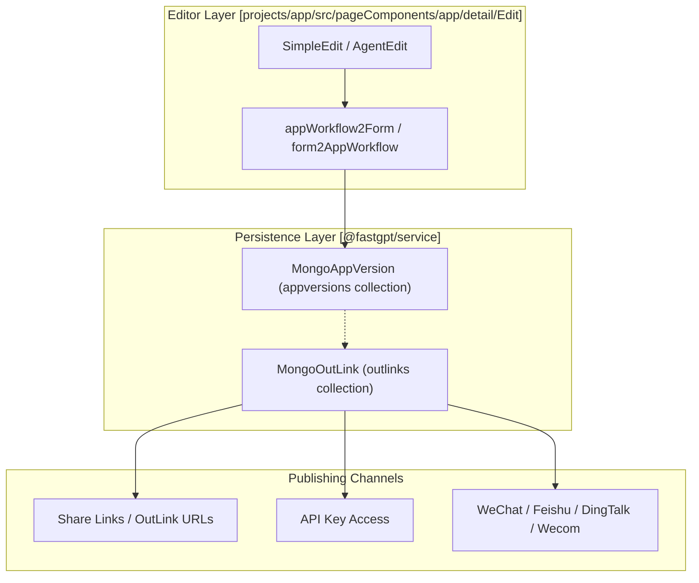
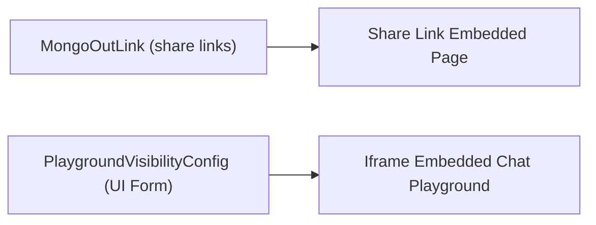
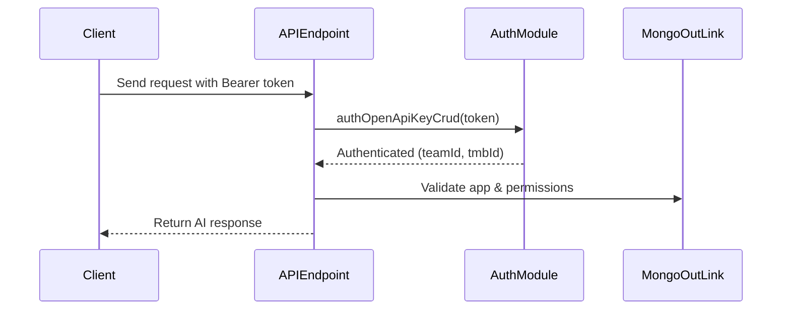
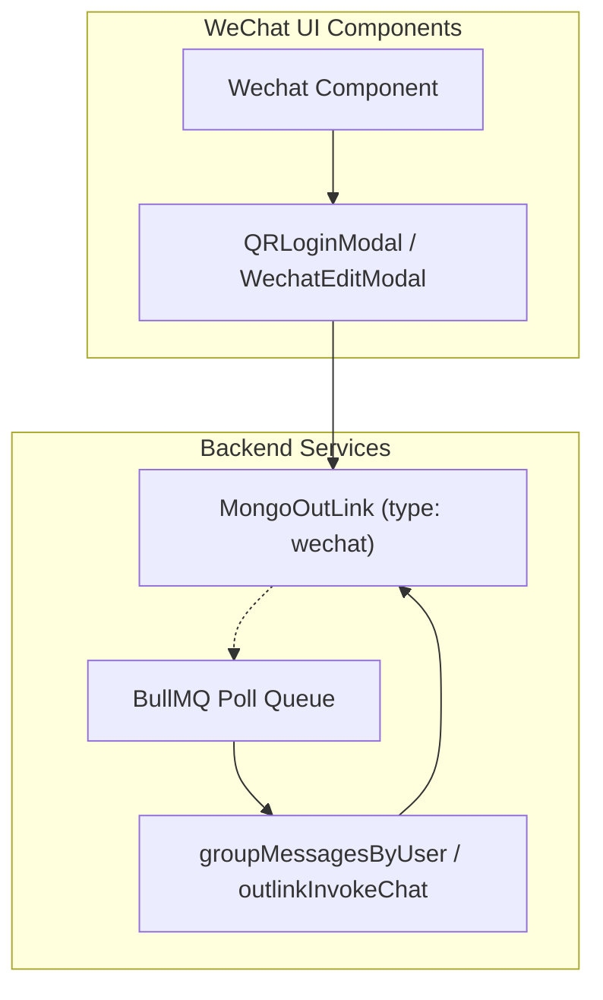
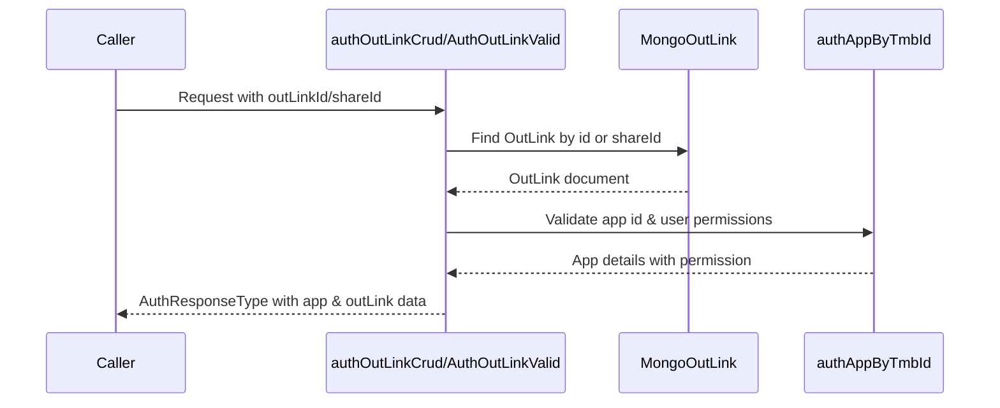
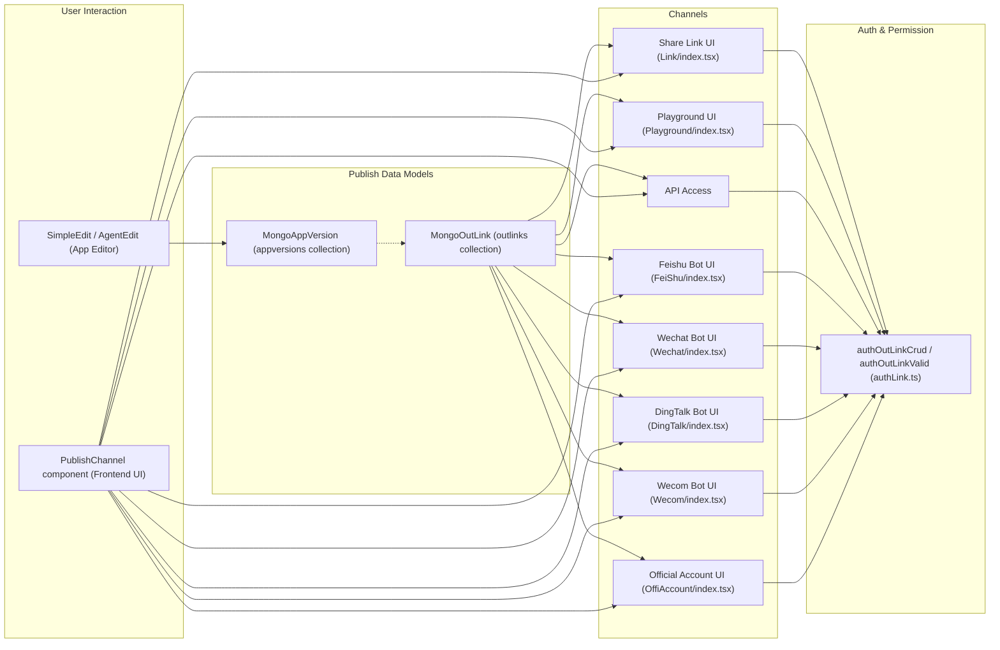
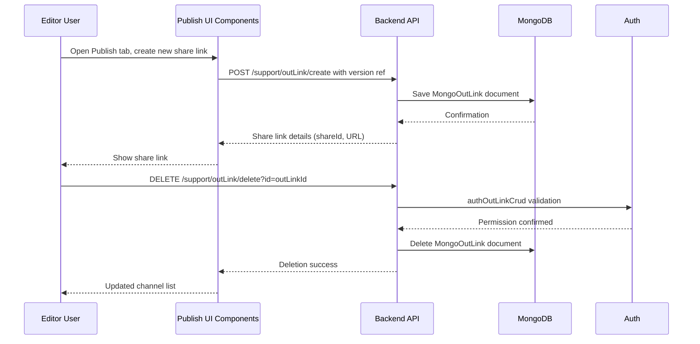

<!-- source: DeepWiki mcp.deepwiki.com · repo labring/FastGPT · page 6.3 Publishing Channels and External Integration · fetched 2026-10-29 -->

# Publishing Channels and External Integration

<details>
<summary>Relevant source files</summary>

The following files were used as context for generating this wiki page:

- [document/content/guide/build/publish/feishu.mdx](document/content/guide/build/publish/feishu.mdx)
- [document/public/imgs/feishu-bot-13.jpg](document/public/imgs/feishu-bot-13.jpg)
- [packages/service/support/permission/publish/authLink.ts](packages/service/support/permission/publish/authLink.ts)
- [projects/app/src/components/core/chat/ChatContainer/ChatBox/components/ResponseTags.tsx](projects/app/src/components/core/chat/ChatContainer/ChatBox/components/ResponseTags.tsx)
- [projects/app/src/pageComponents/app/detail/Edit/ChatAgent/index.tsx](projects/app/src/pageComponents/app/detail/Edit/ChatAgent/index.tsx)
- [projects/app/src/pageComponents/app/detail/Edit/SimpleApp/index.tsx](projects/app/src/pageComponents/app/detail/Edit/SimpleApp/index.tsx)
- [projects/app/src/pageComponents/app/detail/Plugin/index.tsx](projects/app/src/pageComponents/app/detail/Plugin/index.tsx)
- [projects/app/src/pageComponents/app/detail/Publish/DingTalk/index.tsx](projects/app/src/pageComponents/app/detail/Publish/DingTalk/index.tsx)
- [projects/app/src/pageComponents/app/detail/Publish/FeiShu/index.tsx](projects/app/src/pageComponents/app/detail/Publish/FeiShu/index.tsx)
- [projects/app/src/pageComponents/app/detail/Publish/Link/index.tsx](projects/app/src/pageComponents/app/detail/Publish/Link/index.tsx)
- [projects/app/src/pageComponents/app/detail/Publish/OffiAccount/index.tsx](projects/app/src/pageComponents/app/detail/Publish/OffiAccount/index.tsx)
- [projects/app/src/pageComponents/app/detail/Publish/Playground/index.tsx](projects/app/src/pageComponents/app/detail/Publish/Playground/index.tsx)
- [projects/app/src/pageComponents/app/detail/Publish/Wechat/index.tsx](projects/app/src/pageComponents/app/detail/Publish/Wechat/index.tsx)
- [projects/app/src/pageComponents/app/detail/Publish/Wecom/index.tsx](projects/app/src/pageComponents/app/detail/Publish/Wecom/index.tsx)
- [projects/app/src/pageComponents/app/detail/Publish/index.tsx](projects/app/src/pageComponents/app/detail/Publish/index.tsx)
- [projects/app/src/pageComponents/app/detail/Workflow/index.tsx](projects/app/src/pageComponents/app/detail/Workflow/index.tsx)
- [projects/app/src/pages/api/support/outLink/delete.ts](projects/app/src/pages/api/support/outLink/delete.ts)
- [projects/app/test/pages/api/support/outLink/delete.test.ts](projects/app/test/pages/api/support/outLink/delete.test.ts)

</details>


## 1. Introduction and Scope

This section documents in full technical detail the various publishing channels and external integrations supported by FastGPT. It covers:

- Shareable public links and iframe embedding mechanisms.
- API access via OpenAPI-compatible keys.
- Deep integrations with enterprise messaging platforms: Feishu, WeChat, DingTalk, and Wecom.
- How these channels are managed in the dashboard UI and backed by persistent outlink entities.
- Authentication, authorization, and usage policies for secure and scalable publishing.

These capabilities enable FastGPT applications to be consumed broadly, via direct links, embedded web views, external APIs, or enterprise chatbots.

Sources: [projects/app/src/pageComponents/app/detail/Publish/index.tsx:1-40](), [packages/service/support/permission/publish/authLink.ts:1-136]()

---

## 2. Publishing Architecture and Version Management

### Snapshot-based Publishing Model

FastGPT relies on immutable snapshot versions for external publishing to ensure stability and consistency across channels. Each published application references a specific version stored in the database (`MongoAppVersion` schema), capturing the workflow and node states at publish time.

The publishing channels object (`MongoOutLink`) references these snapshots, linking them to:

- Share links (`shareId`) for direct user access.
- API keys enabling authenticated programmatic calls.
- Messaging channel configurations for chatbots.

This architecture decouples editing changes from published app states, allowing freezes and audits on the published content.



Sources: [projects/app/src/pageComponents/app/detail/Edit/SimpleApp/index.tsx:23-50](), [packages/service/support/outLink/schema.ts:10-40]()

---

## 3. Share Links and Playground Embedding

### Share Link Channel

Share links enable users to generate public URLs that expose an individual FastGPT application version to end-users without requiring authentication tokens. A share link is identified by a unique `shareId` stored in the `MongoOutLink` database.

Key features:

- Limited usage points with optional expiry (`limit.maxUsagePoints`, `limit.expiredTime`).
- Queries per minute (QPM) throttling to prevent abuse.
- Optional webhook notifications (`limit.hookUrl`) on usage limits.
- Visibility toggles controlling rendering options such as citations, full text, and download rights.

### Example Share Link URL:

```
https://<fastgpt-host>/chat/share?shareId=abc123xyz
```

### Playground Embedding

The playground channel offers an iframe-embeddable web chat UI exposing the FastGPT app with configurable visibility settings:

- `showRunningStatus`: Shows node execution progress.
- `showCite`: Enables display of citations.
- `showFullText`: Shows full source content.
- `canDownloadSource`: Allows users to download source files.
- `showWholeResponse`: Toggles expanded AI response display.

These configurations, stored per app, are editable in the UI form (`PlaygroundVisibilityConfig` component).



Sources: [packages/service/support/outLink/schema.ts:20-88](), [projects/app/src/pageComponents/app/detail/Publish/Playground/index.tsx:1-80](), [projects/app/src/pageComponents/app/detail/Publish/Link/index.tsx:1-144]()

---

## 4. API Access Channel

### API Key Channel (`PublishChannelEnum.apikey`)

FastGPT exposes applications as RESTful APIs compatible with OpenAPI specifications:

- API keys authenticate requests via Bearer tokens.
- Permission checks verify tokens are associated with the team (`teamId`) and user (`tmbId`).
- Rate-limiting and usage points are enforced.
- Request payloads conform to defined Zod schemas for validation (`parseApiInput` utility).

Example authentication flow:



All API surface and validation schemas reside in the `@fastgpt/global/openapi` package, ensuring consistency across client and server.

Sources: [packages/service/support/permission/auth/openapi.ts:15-40](), [projects/app/src/pages/api/v1/audio/transcriptions.ts:19-70]()

---

## 5. Enterprise Messaging Integrations

FastGPT supports key enterprise messaging platforms as native publish channels, allowing applications to function as chatbots or interactive agents.

### Supported Channels

- **Feishu Bot (`PublishChannelEnum.feishu`)**
- **WeChat Official Account (`PublishChannelEnum.wechat`)**
- **DingTalk Bot (`PublishChannelEnum.dingtalk`)**
- **Wecom Bot (`PublishChannelEnum.wecom`)**
- **Official Account (`PublishChannelEnum.officialAccount`)**

### Common Architectural Traits

- Each platform's integration is configured as an `OutLink` document with channel-specific app settings.
- Secure webhook endpoints authenticate inbound messages/events.
- Background workers implement polling or webhook handlers to process chat messages.
- Bot sessions and credentials are managed via configuration UIs (`FeiShu`, `Wechat`, `DingTalk`, `Wecom`, `OffiAccount` components).

### WeChat Polling Example

The WeChat integration uses a MongoDB partial index to track bots in the `"online"` status and their `shareId`s for polling workers. Poll workers consume messages using BullMQ queues and group messages by user before invoking the app's chat workflow.



### Channel Management UIs

Each channel's management UI shares patterns:

- Lists all "outlinks" of that type for the app.
- Supports adding/editing credentials and bot config via modals (`FeiShuEditModal`, `WechatEditModal`, etc.).
- Shows usage points, last usage time, and enables generating request URLs.
- Controls deletion and cleanup with audit logging in the backend.

Channels enforce feature gating for pro users (`isPlus`) controlling access.

Sources:  
- [projects/app/src/pageComponents/app/detail/Publish/Wechat/index.tsx:1-190](),  
- [projects/app/src/pageComponents/app/detail/Publish/FeiShu/index.tsx:1-130](),  
- [projects/app/src/pageComponents/app/detail/Publish/DingTalk/index.tsx:1-130](),  
- [projects/app/src/pageComponents/app/detail/Publish/Wecom/index.tsx:1-180](),  
- [projects/app/src/pageComponents/app/detail/Publish/OffiAccount/index.tsx:1-140](),  
- [packages/service/support/outLink/schema.ts:110-126](),  
- [document/content/guide/build/publish/feishu.mdx:1-40]()

---

## 6. Implementation Details: OutLink Authorization and Management

FastGPT encapsulates publish channel authorization and validation inside the `authOutLinkCrud` and `authOutLinkValid` functions in `packages/service/support/permission/publish/authLink.ts`.

Key functionalities:

- `authOutLinkCrud`: Validates request headers and permissions, ensuring the acting user/team has rights to CRUD or invoke the outlink.
- `authOutLinkValid`: Checks existence and validity of an outlink by `shareId`, validating associated app and usage rules.
- `loadOutlinkProviderConfig`: Loads provider config by channel and parses the stored app payload securely using Zod schemas.
- Logging and audit trails are created during outlink delete operations.
- Outlink deletion triggers special cleanup such as stopping websocket polling (WeChat).



Sources: [packages/service/support/permission/publish/authLink.ts:17-130](), [projects/app/src/pages/api/support/outLink/delete.ts:1-50]()

---

## 7. Dashboard UI: Publishing Channels Component Structure

The `PublishChannel` component (`projects/app/src/pageComponents/app/detail/Publish/index.tsx`) serves as the main entry managing different publishing channels. It renders tabs or menu items for:

- Share Links
- API Key Access
- Playground Embed/Chat
- Third-party integrations: Feishu, DingTalk, Wecom, WeChat, Official Account

Individual channel UI components are dynamically imported to improve startup performance:

- `Link` (Share links)
- `API` (API keys)
- `Playground` (Chat playground embedding)
- `FeiShu`, `DingTalk`, `Wecom`, `Wechat`, `OffiAccount` (Enterprise bots)

The component fetches usage counts for each channel from the backend (`getOutLinkCounts`), controls pro feature gating, and offers toggleable views separating native and third-party channels.

### Example Publish List Item Structure:

| Icon               | Title                    | Value                | Pro Feature | Group       | Count Key               |
|--------------------|--------------------------|----------------------|-------------|-------------|-------------------------|
| support/outlink/share | Share Link               | share                | No          | native      | share                   |
| support/outlink/apikey| API Request              | apikey               | No          | native      | -                       |
| core/chat/sidebar/home| Chat Playground          | playground           | Yes         | native      | -                       |
| core/app/publish/lark| Feishu Bot               | feishu               | Yes         | thirdParty  | feishu                  |
| common/dingtalkFill  | DingTalk Bot             | dingtalk             | Yes         | thirdParty  | dingtalk                |
| core/app/publish/wecom| Wecom Bot                | wecom                | Yes         | thirdParty  | wecom                   |
| core/app/publish/wechat| WeChat Bot              | wechat               | No          | thirdParty  | wechat                  |
| core/app/publish/offiaccount| Official Account         | officialAccount      | Yes         | thirdParty  | officialAccount         |

Sources: [projects/app/src/pageComponents/app/detail/Publish/index.tsx:30-165]()

---

## 8. Summary Diagram: Natural Language to Code Entities Mapping



Sources:  
- [projects/app/src/pageComponents/app/detail/Publish/index.tsx:1-190](),  
- [projects/app/src/pageComponents/app/detail/Publish/Link/index.tsx:1-150](),  
- [projects/app/src/pageComponents/app/detail/Publish/Playground/index.tsx:1-150](),  
- [projects/app/src/pageComponents/app/detail/Publish/FeiShu/index.tsx:1-140](),  
- [projects/app/src/pageComponents/app/detail/Publish/Wechat/index.tsx:1-190](),  
- [projects/app/src/pageComponents/app/detail/Publish/DingTalk/index.tsx:1-140](),  
- [projects/app/src/pageComponents/app/detail/Publish/Wecom/index.tsx:1-180](),  
- [projects/app/src/pageComponents/app/detail/Publish/OffiAccount/index.tsx:1-140](),  
- [packages/service/support/permission/publish/authLink.ts:1-136]()

---

## 9. Usage Flow: Creating and Managing a Share Link

1. User opens the Publish tab in the app editor (`SimpleEdit` -> `PublishChannel` UI).
2. Selects the Share Link channel (`Link` component).
3. Creates a new share link entry; backend stores an `OutLink` document referencing a snapshot (`MongoAppVersion`).
4. The share link with `shareId` is generated and can be copied or embedded.
5. Shared URL grants controlled access with usage throttling and expiration.
6. Deletion requests are routed via API to `/api/support/outLink/delete`, invoking `authOutLinkCrud` for permission before removing data and auditing.



Sources: [projects/app/src/pageComponents/app/detail/Publish/Link/index.tsx:20-140](), [projects/app/src/pages/api/support/outLink/delete.ts:1-60]()

---

## 10. Summary

FastGPT's publishing and external integrations are designed for extensibility and security, enabling AI applications to be shared widely and integrated into enterprise workflows. Through versioned snapshots, outlink entities, and channel-specific UI controls, FastGPT maintains a robust ecosystem facilitating sharing links, embedding playgrounds, API consumption, and integrating with major chat platforms like WeChat, Feishu, DingTalk, and Wecom.

This structured approach provides consistent UX, safety controls on usage, and comprehensive audit trails across all publishing methods.

---

# References

- `projects/app/src/pageComponents/app/detail/Publish/index.tsx` (lines 1-190)
- `projects/app/src/pageComponents/app/detail/Edit/SimpleApp/index.tsx` (lines 20-50)
- `projects/app/src/pageComponents/app/detail/Publish/Link/index.tsx` (lines 1-150)
- `projects/app/src/pageComponents/app/detail/Publish/Playground/index.tsx` (lines 1-150)
- `projects/app/src/pageComponents/app/detail/Publish/Wechat/index.tsx` (lines 1-190)
- `projects/app/src/pageComponents/app/detail/Publish/FeiShu/index.tsx` (lines 1-130)
- `projects/app/src/pageComponents/app/detail/Publish/DingTalk/index.tsx` (lines 1-140)
- `projects/app/src/pageComponents/app/detail/Publish/Wecom/index.tsx` (lines 1-180)
- `projects/app/src/pageComponents/app/detail/Publish/OffiAccount/index.tsx` (lines 1-140)
- `packages/service/support/permission/publish/authLink.ts` (lines 1-140)
- `packages/service/support/outLink/schema.ts` (lines 10-130)
- `projects/app/src/pages/api/support/outLink/delete.ts` (lines 1-60)
- `document/content/guide/build/publish/feishu.mdx` (lines 1-40)

---

