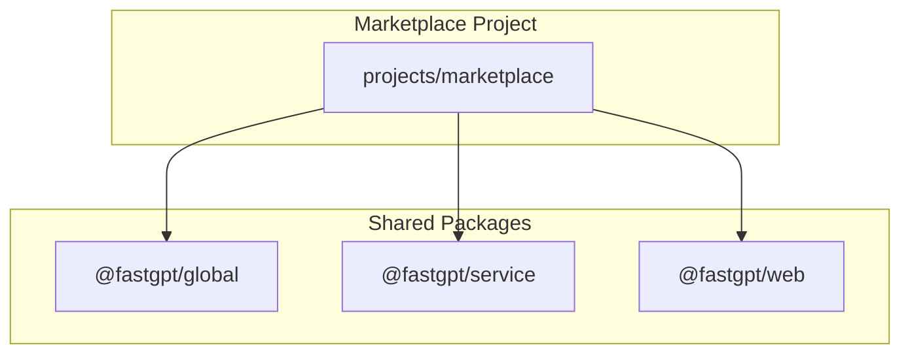
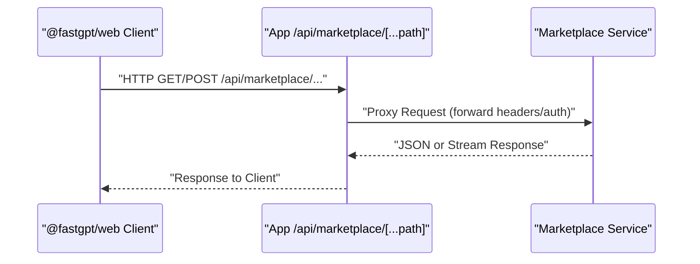
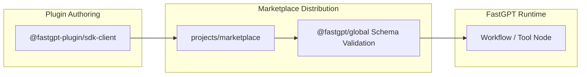
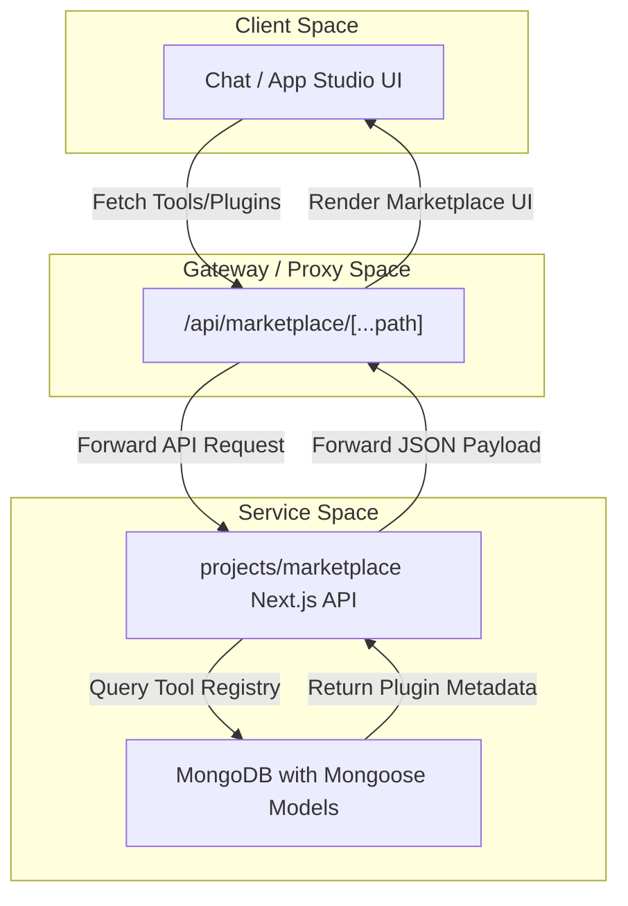

<!-- source: DeepWiki mcp.deepwiki.com · repo labring/FastGPT · page 6.4 Marketplace Service · fetched 2026-10-29 -->

# Marketplace Service

Relevant source files

The following files were used as context for generating this wiki page:

- [document/content/self-host/config/env.en.mdx](document/content/self-host/config/env.en.mdx)
- [document/content/self-host/config/env.mdx](document/content/self-host/config/env.mdx)
- [document/package.json](document/package.json)
- [package.json](package.json)
- [packages/global/common/system/types/index.ts](packages/global/common/system/types/index.ts)
- [packages/global/openapi/common/system/api.ts](packages/global/openapi/common/system/api.ts)
- [packages/global/package.json](packages/global/package.json)
- [packages/service/env.ts](packages/service/env.ts)
- [packages/service/package.json](packages/service/package.json)
- [packages/service/support/permission/memberGroup/teamDefaultGroup.ts](packages/service/support/permission/memberGroup/teamDefaultGroup.ts)
- [packages/service/test/env.test.ts](packages/service/test/env.test.ts)
- [packages/service/test/support/permission/memberGroup/teamDefaultGroup.test.ts](packages/service/test/support/permission/memberGroup/teamDefaultGroup.test.ts)
- [packages/service/test/support/user/team/controller.test.ts](packages/service/test/support/user/team/controller.test.ts)
- [packages/web/package.json](packages/web/package.json)
- [pnpm-lock.yaml](pnpm-lock.yaml)
- [pnpm-workspace.yaml](pnpm-workspace.yaml)
- [projects/app/.env.template](projects/app/.env.template)
- [projects/app/package.json](projects/app/package.json)
- [projects/app/src/env.ts](projects/app/src/env.ts)
- [projects/app/src/pageComponents/admin/config/ImportPluginModal.tsx](projects/app/src/pageComponents/admin/config/ImportPluginModal.tsx)
- [projects/app/src/pageComponents/admin/config/ToolProvider.tsx](projects/app/src/pageComponents/admin/config/ToolProvider.tsx)
- [projects/app/src/pages/config/tool/marketplace.tsx](projects/app/src/pages/config/tool/marketplace.tsx)
- [projects/app/src/pages/dashboard/systemTool/index.tsx](projects/app/src/pages/dashboard/systemTool/index.tsx)
- [projects/app/src/service/common/system/index.ts](projects/app/src/service/common/system/index.ts)
- [projects/marketplace/Dockerfile](projects/marketplace/Dockerfile)
- [projects/marketplace/package.json](projects/marketplace/package.json)
- [projects/mcp_server/Dockerfile](projects/mcp_server/Dockerfile)
- [projects/mcp_server/package.json](projects/mcp_server/package.json)
- [scripts/icon/package.json](scripts/icon/package.json)

The Marketplace Service (`projects/marketplace`) is a dedicated Next.js application within the FastGPT monorepo that provides the official plugin marketplace for FastGPT. It enables users and developers to discover, browse, and distribute tool packages and plugins. This service manages the lifecycle of marketplace tools including validation, schema compliance, version handling, and distribution. The marketplace integrates tightly with the main FastGPT frontend application primarily via API proxying to maintain secure and unified access.

This page covers the architecture, API proxying mechanism, tool package distribution, and detailed request/data flow within the Marketplace Service.

---

## 1. Marketplace Service Architecture

The Marketplace Service is implemented as a standalone Next.js app in `projects/marketplace`. It heavily depends on shared monorepo packages:

- `@fastgpt/global` for common types, OpenAPI and Zod schemas used for validation across the ecosystem.
- `@fastgpt/service` for backend domain logic, persistence layers, data models, and core APIs.
- `@fastgpt/web` for UI components and design system elements.

This architecture enables the marketplace to leverage well-tested shared logic and typing, consistent with other parts of FastGPT.

Sources: `projects/marketplace/package.json:1-53`(), `pnpm-workspace.yaml:6-6`()

---

## 2. API Proxying Mechanism

The main FastGPT application in `projects/app` implements an API proxying layer under the route `/api/marketplace/[...path]`. This Next.js API route forwards all marketplace-related HTTP requests to the Marketplace Service backend.

### Purpose

- **Security Boundary**: Keeps the marketplace backend isolated, only accessible through a controlled API endpoint.
- **Cross-Origin Handling**: Prevents CORS issues when frontend code under the main app domain calls marketplace APIs.
- **Unified Authentication**: Enables request header and authentication token forwarding in a centralized manner.

### Request Flow

1. A client component in the FastGPT frontend calls the proxy API endpoint `/api/marketplace/...`.
2. The Next.js API route handler in `projects/app/src/pages/api/marketplace/[...path].ts` receives the request.
3. It forwards the incoming request (method, headers, body) to the proper Marketplace Service backend URL.
4. The marketplace backend processes the request (e.g., query marketplace tool data).
5. The response is returned back through the proxy route.
6. The frontend receives the JSON or streamed response transparently.

Sources: `projects/app/src/pages/api/marketplace/[...path].ts`(), `projects/app/package.json:1-149`()

---

## 3. Tool Package Distribution and Plugin Integration

The Marketplace Service is the central hub for distributing third-party tools and plugins within FastGPT's ecosystem. It manages:

- **Plugin Packages**: Bundles that include tool metadata, manifests, OpenAPI/JSON schemas describing API inputs and outputs, versioning, and runtime configuration.
- **Validation with SDK**: Uses `@fastgpt-plugin/sdk-client` to validate plugin manifests, ensure OpenAPI schema correctness, and compatibility with FastGPT workflow nodes.
- **Runtime Configuration**: Specifies execution environment parameters such as code sandbox settings, HTTP proxies, or custom skill handlers.

These packaged tools can be uploaded, listed, updated, or downloaded from the marketplace.

### Distribution Pipeline Diagram

Sources: `projects/marketplace/package.json:1-53`(), `packages/global/package.json:16-16`()

---

## 4. Request Lifecycle and Data Flow

This section details the end-to-end data flow when an end-user interacts with the marketplace via the FastGPT frontend app.

- The frontend UI component triggers a marketplace data fetch (e.g., query available plugins/tools).
- The request hits the app’s API proxy endpoint `/api/marketplace/[...path]`.
- The proxy forwards this request to the marketplace Next.js backend service.
- The marketplace service uses Mongoose models and MongoDB to query the tool registry database.
- The resulting data (tool manifests, metadata, versions) is returned through the proxy route.
- The UI then renders the marketplace tool listings, plugin details, installation buttons, or version info.

This layered flow ensures loose coupling between the main FastGPT app and the marketplace backend while centralizing access control and schema validation.

Sources: `projects/app/src/pages/api/marketplace/[...path].ts`(), `projects/marketplace/package.json:1-53`()

---

# Summary

The Marketplace Service is a modular Next.js project within FastGPT responsible for managing plugin and tool packages. It leverages shared global and service packages for consistency and provides a secure, proxied API interface used transparently by the main app UI layers. As the ecosystem’s official distribution point for tools and plugins, the marketplace service ensures strict validation, schema conformance, and version management, enabling seamless extension and customization of the FastGPT platform.

# Marketplace Service Components Overview

| Component                     | Description                                                                                                  | Location/Entry Point                                      |
|-------------------------------|--------------------------------------------------------------------------------------------------------------|----------------------------------------------------------|
| Marketplace Next.js Service    | Next.js app managing plugin browsing, listing, and tool metadata APIs                                        | `projects/marketplace/`                                   |
| API Proxy Route               | Forwards client requests to the marketplace service, maintaining auth and headers                            | `projects/app/src/pages/api/marketplace/[...path].ts`    |
| Tool Package & Plugin Support | Uses `@fastgpt-plugin/sdk-client` + `@fastgpt/global` for tool schema validation and distribution support    | `projects/marketplace/package.json`, shared SDK imports  |
| MongoDB/Mongoose Tool Registry | Persists marketplace tool metadata, versions, manifests                                                      | Backend service database integration                       |

This architecture decomposes the marketplace capability cleanly from the main app, simplifying development, deployment, and scaling of the FastGPT tool ecosystem.

---

# References
- `projects/marketplace/package.json:1-53`()
- `pnpm-workspace.yaml:6-6`()
- `projects/app/src/pages/api/marketplace/[...path].ts`()
- `projects/app/package.json:1-149`()
- `packages/global/package.json:16-16`()

---

