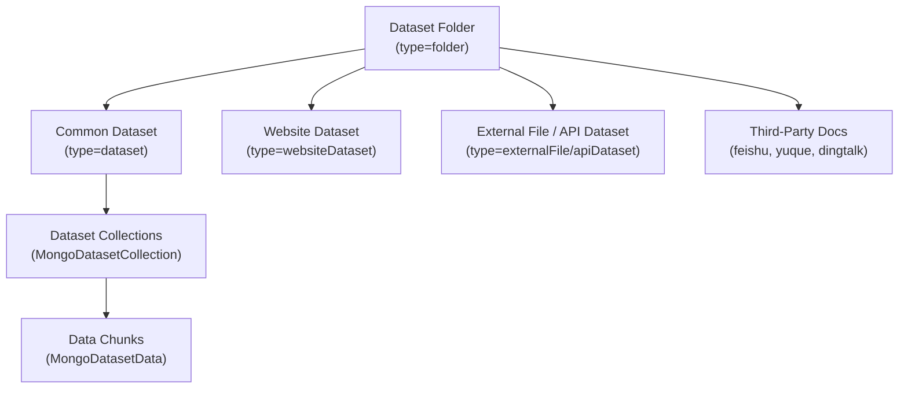
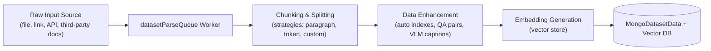
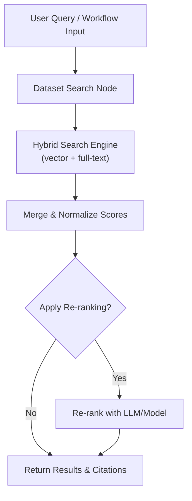
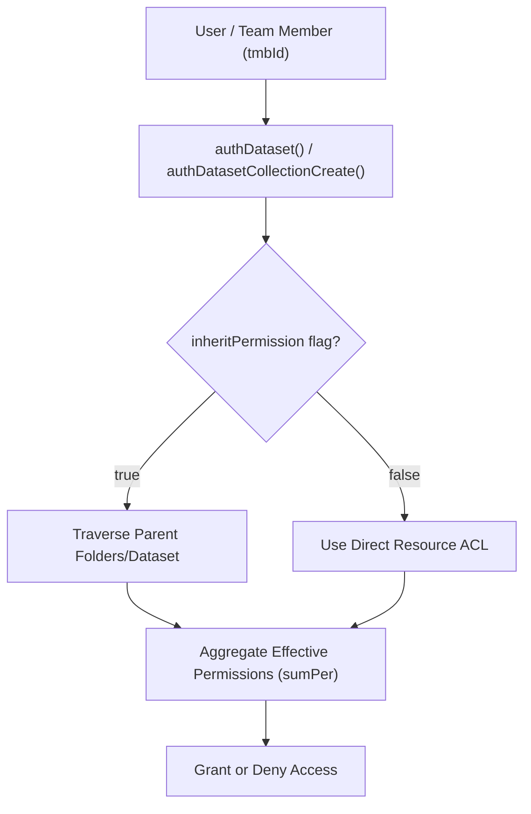
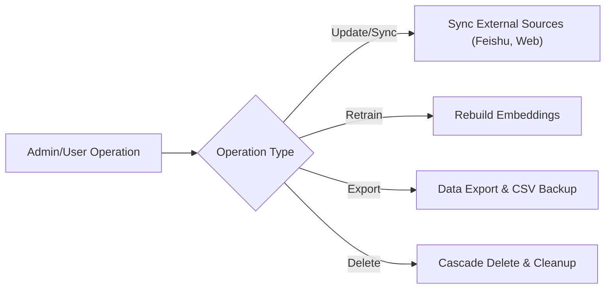
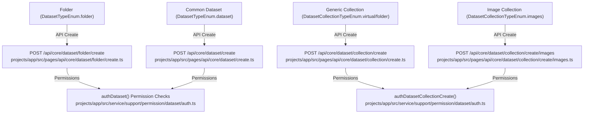
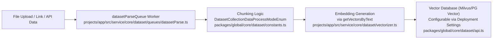

<!-- source: DeepWiki mcp.deepwiki.com · repo labring/FastGPT · page 7 Dataset and Knowledge Base System · fetched 2026-10-29 -->

# Dataset and Knowledge Base System

Relevant source files

The following files were used as context for generating this wiki page:

- [packages/global/core/dataset/type.ts](packages/global/core/dataset/type.ts)
- [packages/global/openapi/core/dataset/api.ts](packages/global/openapi/core/dataset/api.ts)
- [packages/global/openapi/core/dataset/collection/createApi.ts](packages/global/openapi/core/dataset/collection/createApi.ts)
- [projects/app/src/pages/api/core/dataset/collection/create.ts](projects/app/src/pages/api/core/dataset/collection/create.ts)
- [projects/app/src/pages/api/core/dataset/collection/create/images.ts](projects/app/src/pages/api/core/dataset/collection/create/images.ts)
- [projects/app/src/pages/api/core/dataset/create.ts](projects/app/src/pages/api/core/dataset/create.ts)
- [projects/app/src/pages/api/core/dataset/folder/create.ts](projects/app/src/pages/api/core/dataset/folder/create.ts)
- [projects/app/test/api/core/dataset/collection/create/inheritPermission.test.ts](projects/app/test/api/core/dataset/collection/create/inheritPermission.test.ts)
- [projects/app/test/api/core/dataset/create.test.ts](projects/app/test/api/core/dataset/create.test.ts)
- [projects/app/test/api/core/dataset/folder/create.test.ts](projects/app/test/api/core/dataset/folder/create.test.ts)

## Purpose and Scope

The Dataset and Knowledge Base System is FastGPT's foundational data management layer that enables efficient knowledge ingestion, structuring, searching, and controlled access to power Retrieval-Augmented Generation (RAG) workflows.

It provides:
- Hierarchical organization of knowledge resources (folders, datasets, collections)
- Automated ingestion pipelines for various data sources and formats
- Custom chunking, embedding generation, and storage in vector DBs
- Hybrid search integrating vector similarity with keyword retrieval and re-ranking
- Granular permission model supporting team-based dataset access and inheritance
- Full lifecycle management including creation, updating, export, sync, retraining, and deletion

This page introduces the major components and how they interact at a system level. For detailed technical specifications and API shapes, see the linked child pages below:

- [Dataset Structure and Hierarchy](#7.1) — Dataset types, folders, collections, and Mongo schema models
- [Data Processing and Embedding](#7.2) — Ingestion pipeline, chunking, training, embedding and vector storage
- [Search and Retrieval System](#7.3) — Hybrid vector + keyword search, re-ranking, dataset search API and RAG workflows
- [Permission System and Access Control](#7.4) — Resource permissions, inheritance, team/group/org access control
- [Dataset Lifecycle Management](#7.5) — Dataset updates, export, deletion, retraining, cron cleanup tasks

Sources:  
[packages/global/core/dataset/type.ts:1-176](),  
[packages/global/openapi/core/dataset/api.ts:1-204](),  
[projects/app/src/pages/api/core/dataset/create.ts:1-154](),  
[projects/app/src/pages/api/core/dataset/folder/create.ts:1-89]()

---

## Dataset Structure and Hierarchy

FastGPT organizes knowledge using a hierarchical model composed of datasets and collections within nested folders. This supports multiple dataset types suited for various data sources:

- **Dataset Types (`DatasetTypeEnum`)** include standard datasets, web crawler datasets, folder containers, and integration targets like Feishu or Yuque document stores.
- **Collections** organize data items inside datasets, such as files, links, images, or manually curated virtual collections.
- MongoDB schemas underpinning this structure are `MongoDataset` (dataset level), `MongoDatasetCollection` (collections), and `MongoDatasetData` (chunks).
- Each entity supports metadata such as permissions, vector model associations, and collection/discipline-specific settings.

Datasets and collections are created and managed via authenticated API endpoints with permission checks (e.g., `POST /api/core/dataset/create` or `/api/core/dataset/collection/create`).

For example, creating a folder and setting inherit permission flags occurs in API handlers that leverage `MongoDataset.create` and resource permission controllers, enforcing ACL logic and audit logging.

For details, see [Dataset Structure and Hierarchy](#7.1).

Sources:  
[packages/global/core/dataset/constants.ts:3-13](),  
[packages/global/core/dataset/type.ts:160-176](),  
[projects/app/src/pages/api/core/dataset/folder/create.ts:1-89](),  
[projects/app/src/pages/api/core/dataset/create.ts:1-154](),  
[projects/app/src/pages/api/core/dataset/collection/create.ts:1-52]()

---

## Data Processing and Embedding

Data ingestion pipelines transform raw input files, links, or API data into vectorized knowledge representations, enabling efficient retrieval.

Key aspects:  
- Queued workers (`datasetParseQueue`) perform parsing and chunk creation asynchronously with team AI point locking and leasing.
- Multiple chunking modes and AI-backed paragraph splitting improve context granularity.
- Vision Language Models (VLM) extend embeddings to image data, automatically extracting captions or multimodal multimodal feature vectors.
- Embeddings are stored in vector databases with fast similarity search capabilities.

File uploads and ingestion APIs enforce upload limits, file validation, and use multipart/form-data handling for local files.

For details, see [Data Processing and Embedding](#7.2).

Sources:  
[projects/app/src/pages/api/core/dataset/collection/create/images.ts:1-137](),  
[packages/global/core/dataset/constants.ts:190-211]()

---

## Search and Retrieval System

FastGPT implements a hybrid vector and full-text search mechanism to retrieve relevant knowledge chunks during RAG workflows.

- Search APIs validate and test retrieval quality (`/api/core/dataset/searchTest`).
- Dataset search nodes in workflows inject retrieved context chunks into LLM prompts.
- Scores from vector similarity and keyword matches are merged and optionally re-ranked using AI models.

For details, see [Search and Retrieval System](#7.3).

Sources:  
[projects/app/src/web/core/dataset/api.ts:85-87]()  
[packages/web/i18n/en/dataset.json:8-14]()

---

## Permission System and Access Control

FastGPT enforces fine-grained permissions on datasets and collections with support for inheritance and team-based access control.

- `inheritPermission` controls whether a folder or collection inherits ACL from its parent or maintains an independent snapshot.
- Permissions cover read, write, and manage roles at dataset and collection levels.
- API endpoints for creating folders, datasets, and collections enforce permission checks and propagate ACL snapshots accordingly.
- Permission inheritance is fully tested with automated tests verifying ACL snapshot merging and overrides.

For details, see [Permission System and Access Control](#7.4).

Sources:  
[projects/app/src/pages/api/core/dataset/folder/create.ts:1-89](),  
[projects/app/src/pages/api/core/dataset/create.ts:1-154](),  
[projects/app/src/pages/api/core/dataset/collection/create.ts:1-52](),  
[projects/app/test/api/core/dataset/folder/create.test.ts:1-112](),  
[projects/app/test/api/core/dataset/collection/create/inheritPermission.test.ts:1-185]()

---

## Dataset Lifecycle Management

Dataset lifecycle operations maintain data quality, synchronization, and compliance throughout the knowledge base's existence.

- Users can update datasets and collections with new data or retrain vector embeddings if the underlying model changes.
- Periodic jobs enable automatic synchronization with third-party sources like Feishu or web scrapers.
- Export facilities provide CSV template backups and chunk-level exports.
- Deletion operations cascade through collections and chunks with cleanup of orphaned data.
- Audit logs record all lifecycle events for traceability.

For details, see [Dataset Lifecycle Management](#7.5).

Sources:  
[packages/web/i18n/en/dataset.json:10-14](),  
[packages/web/i18n/en/dataset.json:36-37](),  
[packages/web/i18n/en/dataset.json:51]()

---

# Bridging Natural Language Concepts to Code Entities

### Diagram 1: Dataset Conceptual Types to Code Entities

### Diagram 2: Data Ingestion and Embedding Pipeline to Code Entities

---

# Summary

FastGPT’s Dataset and Knowledge Base System bridges raw data ingestion, rich hierarchical organization, and AI-enhanced search with a robust permissions model to form a scalable knowledge infrastructure. These components work cohesively to support RAG use cases where large volumes of structured or semi-structured data must be efficiently stored, updated, accessed, and retrieved with fine-grained team controls.

For all structural schemas, detailed API routes, and permission rules, refer to the child pages linked in this section.

---

Sources:  
[packages/global/core/dataset/type.ts:1-176](),  
[packages/global/openapi/core/dataset/api.ts:1-204](),  
[projects/app/src/pages/api/core/dataset/create.ts:1-154](),  
[projects/app/src/pages/api/core/dataset/folder/create.ts:1-89](),  
[projects/app/src/pages/api/core/dataset/collection/create.ts:1-52](),  
[projects/app/src/pages/api/core/dataset/collection/create/images.ts:1-137](),  
[projects/app/test/api/core/dataset/folder/create.test.ts:1-112](),  
[projects/app/test/api/core/dataset/collection/create/inheritPermission.test.ts:1-185]()

---

