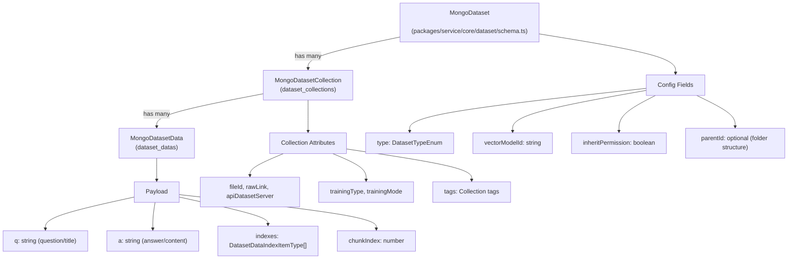
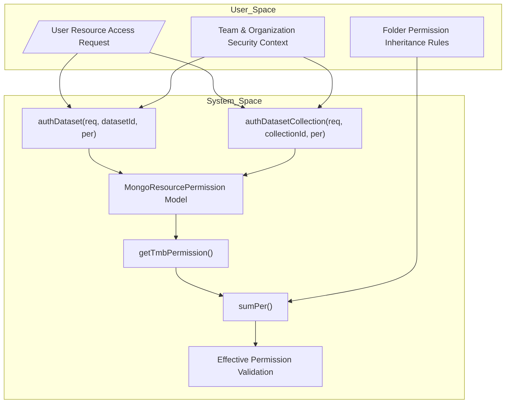
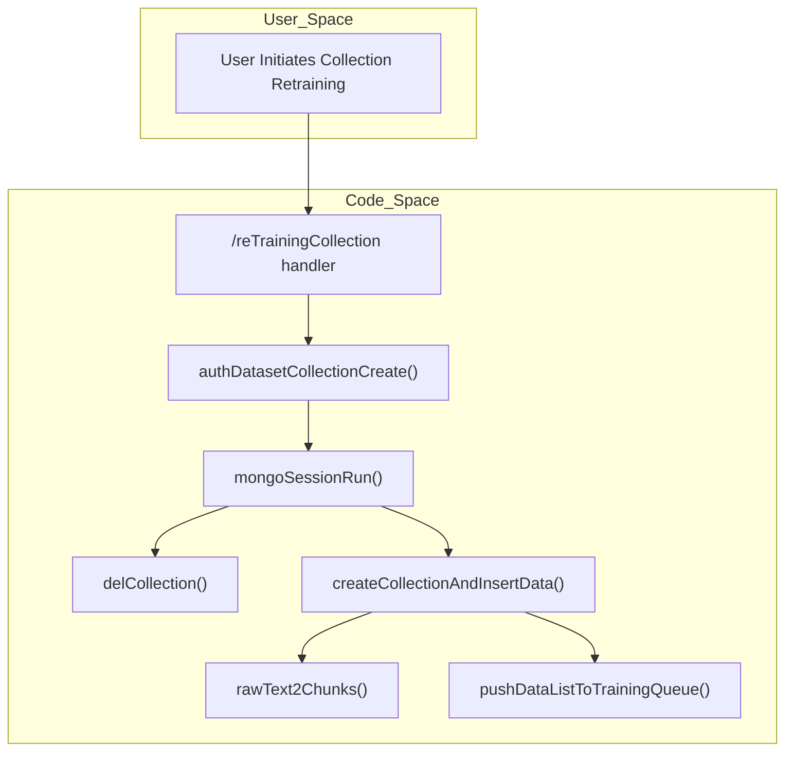
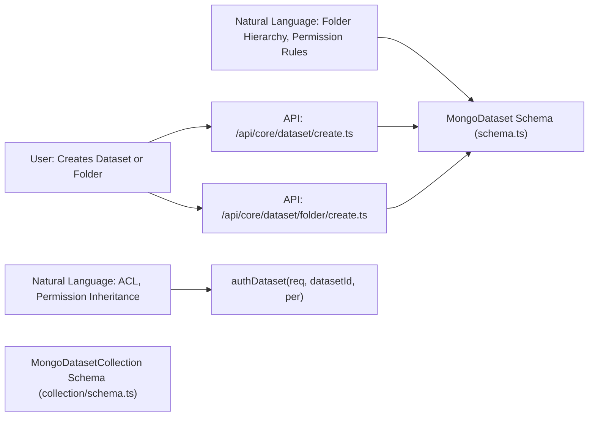
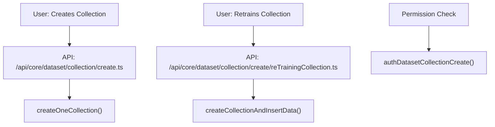

<!-- source: DeepWiki mcp.deepwiki.com · repo labring/FastGPT · page 7.1 Dataset Structure and Hierarchy · fetched 2026-10-29 -->

# Dataset Structure and Hierarchy

Relevant source files

The following files were used as context for generating this wiki page:

- [packages/global/core/chat/setting/type.ts](packages/global/core/chat/setting/type.ts)
- [packages/global/core/dataset/type.ts](packages/global/core/dataset/type.ts)
- [packages/global/openapi/core/dataset/api.ts](packages/global/openapi/core/dataset/api.ts)
- [packages/global/openapi/core/dataset/collection/createApi.ts](packages/global/openapi/core/dataset/collection/createApi.ts)
- [packages/global/test/core/chat/setting/type.test.ts](packages/global/test/core/chat/setting/type.test.ts)
- [packages/service/support/user/utils.ts](packages/service/support/user/utils.ts)
- [packages/service/test/support/user/utils.test.ts](packages/service/test/support/user/utils.test.ts)
- [projects/app/src/pageComponents/dataset/list/List.tsx](projects/app/src/pageComponents/dataset/list/List.tsx)
- [projects/app/src/pages/api/core/app/logs/exportLogs.ts](projects/app/src/pages/api/core/app/logs/exportLogs.ts)
- [projects/app/src/pages/api/core/app/logs/getUsers.ts](projects/app/src/pages/api/core/app/logs/getUsers.ts)
- [projects/app/src/pages/api/core/dataset/collection/create.ts](projects/app/src/pages/api/core/dataset/collection/create.ts)
- [projects/app/src/pages/api/core/dataset/collection/create/images.ts](projects/app/src/pages/api/core/dataset/collection/create/images.ts)
- [projects/app/src/pages/api/core/dataset/create.ts](projects/app/src/pages/api/core/dataset/create.ts)
- [projects/app/src/pages/api/core/dataset/folder/create.ts](projects/app/src/pages/api/core/dataset/folder/create.ts)
- [projects/app/test/api/core/app/logs/getUsers.test.ts](projects/app/test/api/core/app/logs/getUsers.test.ts)
- [projects/app/test/api/core/dataset/collection/create/inheritPermission.test.ts](projects/app/test/api/core/dataset/collection/create/inheritPermission.test.ts)
- [projects/app/test/api/core/dataset/create.test.ts](projects/app/test/api/core/dataset/create.test.ts)
- [projects/app/test/api/core/dataset/folder/create.test.ts](projects/app/test/api/core/dataset/folder/create.test.ts)

This wiki page documents the detailed dataset structure and hierarchical organization in FastGPT's knowledge base system. This includes dataset types (common, website, API, Feishu, Yuque), their folder and collection organization, and the underlying MongoDB schema implementations that enable effective access control, ingestion, and retrieval.

---

## Overview and Three-Tier Hierarchy

FastGPT organizes knowledge assets into a consistent three-tier containment model:

1. **Dataset (`MongoDataset`):** The top-level entity representing a knowledge base with team ownership, permission controls, embedding and LLM model configurations, and optional folder-like parents for nested structures.

2. **Collection (`MongoDatasetCollection`):** Logical subdivisions under a dataset that represent specific data sources or groupings, such as uploaded files, web crawl results, API datasets, or folders.

3. **Data Chunks (`MongoDatasetData`):** Atomic searchable units containing text or image content, along with indexes linking to vector databases for semantic search.

### Diagram: Dataset Three-Tier Hierarchy and MongoDB Schema Mapping

**Summary:**
- **`MongoDataset`** stores datasets and folders, defining team ownership, inherit permissions, and model settings.
- **`MongoDatasetCollection`** groups chunks logically by source or function, enabling granular access and chunk processing mode.
- **`MongoDatasetData`** stores the smallest units of knowledge for embedding and retrieval.

Sources:  
[packages/service/core/dataset/schema.ts:59-167](),  
[packages/service/core/dataset/collection/controller.ts:43-61](),  
[packages/service/core/dataset/collection/controller.ts:133-141]()  

---

## Dataset Types and External Integrations

FastGPT supports diverse dataset types (`DatasetTypeEnum`) tailored for different ingestion and synchronization mechanisms:

| Dataset Type       | Description                                                                                         | Key Schema Fields / Features                               |
|--------------------|-------------------------------------------------------------------------------------------------|------------------------------------------------------------|
| **`dataset` (common)** | Standard knowledge base primarily for user-uploaded files (PDF, Markdown, Word, CSV), manual text-data pairs. | Basic dataset with general chunking and vector embedding.  |
| **`folder`**        | Virtual container used to organize datasets hierarchically by `parentId`.                        | Shares `MongoDataset` schema, used for permission inheritance and UI folder listing.   |
| **`websiteDataset`**| Dataset backed by web crawling jobs, configured via `websiteConfig` specifying seed URLs and HTML selectors. | Has web-specific ingestion via crawler jobs and sync limits. |
| **`apiDataset`**    | Integrates with external/custom API endpoints providing files or documents; supports server config `apiDatasetServer` with sync APIs. | Synchronizes with remote servers; supports collection-level API access.                 |
| **`feishu` / `yuque` / `dingtalk`** | Enterprise document syncing types connected to Feishu, Yuque, or DingTalk platforms; use specialized server configs. | Syncs external enterprise docs; keeps hierarchical doc structures and tags.           |

This categorization enables specialized ingestion, synchronization, and permission control per dataset type.

Sources:  
[packages/service/core/dataset/schema.ts:119-167](),  
[packages/service/core/dataset/apiDataset/custom/api.ts:33-152]()  

---

## Folder Organization and Permission Inheritance

Both **datasets** and **folders** use a shared MongoDB schema (`MongoDataset`) with a `parentId` field enabling nested folder structures. Folder nodes serve as organizational units within the dataset list UI and support permission inheritance, ensuring access control propagates correctly through the hierarchy.

### Permission Inheritance Flow from Natural Language User Request to Code Entitites

- When users request access, the `authDataset` or `authDatasetCollection` middleware validates permissions.
- Permissions are resolved by aggregating user/team permissions from `MongoResourcePermission`.
- Folder permission inheritance (configurable via `inheritPermission`) governs whether child nodes merge or override parent permissions.

Sources:  
[projects/app/src/pages/api/core/dataset/collection/create.ts:16-51](),  
[packages/service/support/permission/dataset/auth.ts:1-100]()  

---

## Collection Level Structure and Management

Collections are the intermediate organizational level within datasets. They represent grouped data, such as:

- Folder-like collections for hierarchical grouping
- File-based collections from uploaded documents
- Text or link-based virtual collections
- Image collections for datasets with visual content
- Collections sourced from APIs or external enterprise platforms

Collections manage data processing settings and chunking parameters, specializing ingest workflows for different data sources.

### Key Schema and Structure

- `datasetId`: Links back to parent dataset.
- `parentId`: Optional nested folder parent within collections.
- `type`: Collection type such as folder, virtual, fileId-based, etc.
- `name`: Human-readable collection name.
- `tags`: Metadata tags for classification.
- `inheritPermission`: Folder collections optionally inherit parent snapshot permissions.
- `trainingType` and related fields: Configure data processing modes, e.g., chunking, image parsing.

### Collection Creation and Retraining Flow

When collections are created or retrained, the ingestion controller performs:

1. Authorization check via `authDatasetCollectionCreate`
2. Background cleanup/retraining of existing data chunks via `delCollection`
3. Chunking raw text into paragraphs with `rawText2Chunks`
4. Inserting new data chunks and pushing them onto embedding/training queues for asynchronous indexing.

### Diagram: Collection Retraining and Ingestion Pipeline

Sources:  
[projects/app/src/pages/api/core/dataset/collection/create/reTrainingCollection.ts:19-73](),  
[packages/service/core/dataset/collection/controller.ts:43-166]()  

---

## Data Chunk Level (`MongoDatasetData`)

The granular data units are stored as documents in `MongoDatasetData`. Each chunk contains:

- `q`: The question, title, or segment header for context and embedding.
- `a`: The detailed content or answer text.
- `indexes`: An array of `DatasetDataIndexItemType` linking chunk to vector database nodes for search.
- `chunkIndex`: Sequential order index within the collection.

This schema structure enables precise semantic search and retrieval with granular embedding vector references.

Sources:  
[packages/service/core/dataset/collection/controller.ts:133-141](),  
[packages/service/core/dataset/data/schema.ts:1-93]()  

---

## Summary Table: Dataset Types and Characteristics

| Dataset Type        | Description                                  | Key Parameters/Schemas                                    | Usage Notes                              |
|---------------------|----------------------------------------------|------------------------------------------------------------|-----------------------------------------|
| `dataset`           | Common knowledge base from file/text upload | `MongoDataset` + standard chunking                         | Default dataset type                     |
| `folder`            | Organizational unit, folder node             | Uses `MongoDataset`, `parentId` for nesting                | Folder nodes for UI and inheritance     |
| `websiteDataset`    | Web crawling knowledge base                   | `websiteConfig` settings, sync limits                      | Specialized for site crawling            |
| `apiDataset`        | External API linked dataset                   | `apiDatasetServer` config for remote API synchronization   | Ideal for third-party API integrations  |
| `feishu`, `yuque`, `dingtalk` | Enterprise doc syncing                    | Specialized server configs                                  | For enterprise document sync             |

---

This completes the detailed technical exposition of the FastGPT dataset structure, hierarchy, and schema implementations.

# Appendices

### References to Key Code Entities

| System Component        | Relevant Code Entity/Function                           | Location                                        |
|-------------------------|--------------------------------------------------------|------------------------------------------------|
| Dataset Schema          | `MongoDataset` schema entity                           | `packages/service/core/dataset/schema.ts`       |
| Dataset API Create      | Dataset creation handler with model & permission checks | `projects/app/src/pages/api/core/dataset/create.ts` |
| Dataset Folder Create   | Folder creation API that validates folder depth & permissions | `projects/app/src/pages/api/core/dataset/folder/create.ts` |
| Collection Controller   | Collection creation, deletion, retraining orchestrator | `packages/service/core/dataset/collection/controller.ts` |
| Collection API Create   | Collection create API and permission check             | `projects/app/src/pages/api/core/dataset/collection/create.ts` |
| Collection Retraining   | Retraining endpoint that clears old chunks & recreates  | `projects/app/src/pages/api/core/dataset/collection/create/reTrainingCollection.ts` |
| Permission Check        | Dataset and collection permission authorization logic  | `packages/service/support/permission/dataset/auth.ts` |
| Permission Utility      | Permission data merging and team member info patterns  | `packages/service/support/user/utils.ts`         |

---

### Mermaid Diagram: Mapping Natural Language Concepts to Code Entities for Dataset and Collection

### Mermaid Diagram: Natural Language to Code for Collection Creation and Retraining

Sources:  
[projects/app/src/pages/api/core/dataset/create.ts:1-154](),  
[projects/app/src/pages/api/core/dataset/folder/create.ts:1-89](),  
[projects/app/src/pages/api/core/dataset/collection/create.ts:1-52](),  
[projects/app/src/pages/api/core/dataset/collection/create/reTrainingCollection.ts:1-73](),  
[packages/global/core/dataset/type.ts:160-176](),  
[packages/global/openapi/core/dataset/api.ts:30-153]()  

---

# References

- Dataset and folder Mongo schema: `MongoDataset` [packages/service/core/dataset/schema.ts:59-177]()
- Dataset creation API: `projects/app/src/pages/api/core/dataset/create.ts:1-155`
- Folder creation API: `projects/app/src/pages/api/core/dataset/folder/create.ts:1-90`
- Collection controller and schema: `packages/service/core/dataset/collection/controller.ts:1-166`
- Collection creation API: `projects/app/src/pages/api/core/dataset/collection/create.ts:1-53`
- Retraining collection API: `projects/app/src/pages/api/core/dataset/collection/create/reTrainingCollection.ts:1-73`
- Dataset type enums and constants: `packages/global/core/dataset/type.ts:1-176`
- Dataset openapi schemas: `packages/global/openapi/core/dataset/api.ts:1-153`
- Permission auth utilities: `packages/service/support/permission/dataset/auth.ts`
- User utilities for team members and permission: `packages/service/support/user/utils.ts`

This concludes the technical documentation for FastGPT's dataset structure and hierarchy.

---

