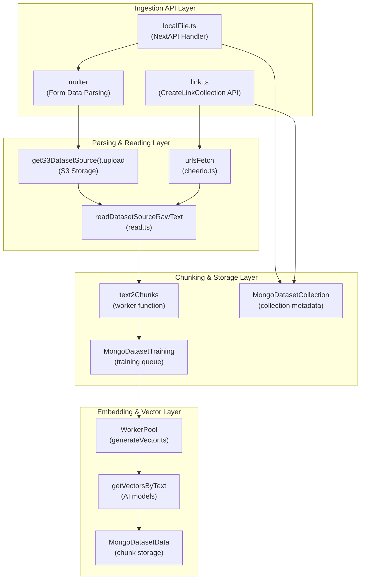
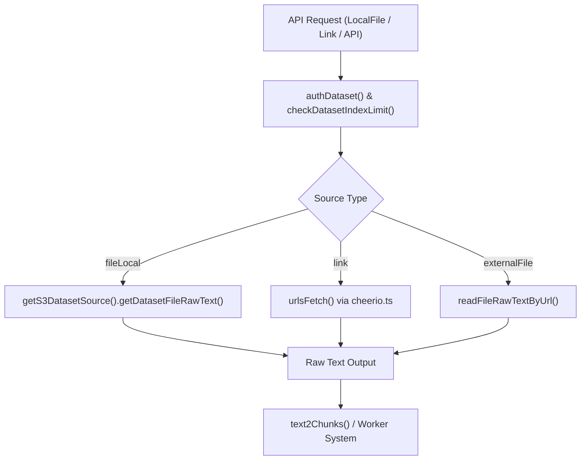
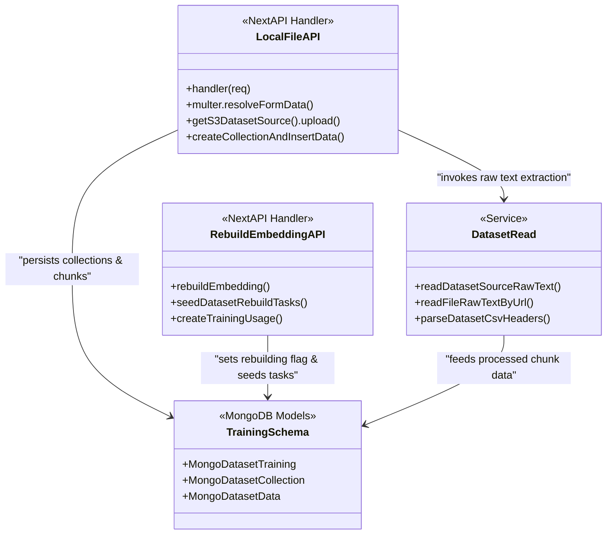

<!-- source: DeepWiki mcp.deepwiki.com · repo labring/FastGPT · page 7.2 Data Processing and Embedding · fetched 2026-10-29 -->

# Data Processing and Embedding

Relevant source files

The following files were used as context for generating this wiki page:

- [packages/global/common/string/markdown.ts](packages/global/common/string/markdown.ts)
- [packages/global/test/common/string/markdown.test.ts](packages/global/test/common/string/markdown.test.ts)
- [packages/service/common/file/image/schema.ts](packages/service/common/file/image/schema.ts)
- [packages/service/common/file/multer.ts](packages/service/common/file/multer.ts)
- [packages/service/common/file/read/utils.ts](packages/service/common/file/read/utils.ts)
- [packages/service/common/s3/utils/preview.ts](packages/service/common/s3/utils/preview.ts)
- [packages/service/core/chat/fileContext.ts](packages/service/core/chat/fileContext.ts)
- [packages/service/core/dataset/apiDataset/custom/api.ts](packages/service/core/dataset/apiDataset/custom/api.ts)
- [packages/service/core/dataset/collection/controller.ts](packages/service/core/dataset/collection/controller.ts)
- [packages/service/core/dataset/collection/schema.ts](packages/service/core/dataset/collection/schema.ts)
- [packages/service/core/dataset/collection/utils.ts](packages/service/core/dataset/collection/utils.ts)
- [packages/service/core/dataset/data/controller.ts](packages/service/core/dataset/data/controller.ts)
- [packages/service/core/dataset/data/schema.ts](packages/service/core/dataset/data/schema.ts)
- [packages/service/core/dataset/data/utils.ts](packages/service/core/dataset/data/utils.ts)
- [packages/service/core/dataset/importFile.ts](packages/service/core/dataset/importFile.ts)
- [packages/service/core/dataset/training/controller.ts](packages/service/core/dataset/training/controller.ts)
- [packages/service/core/dataset/training/schema.ts](packages/service/core/dataset/training/schema.ts)
- [packages/service/core/dataset/utils.ts](packages/service/core/dataset/utils.ts)
- [packages/service/test/common/file/read/utils.test.ts](packages/service/test/common/file/read/utils.test.ts)
- [packages/service/test/common/s3/utils/preview.test.ts](packages/service/test/common/s3/utils/preview.test.ts)
- [packages/service/test/core/dataset/data/controller.test.ts](packages/service/test/core/dataset/data/controller.test.ts)
- [packages/service/test/core/dataset/data/utils.test.ts](packages/service/test/core/dataset/data/utils.test.ts)
- [packages/service/test/core/dataset/importFile.test.ts](packages/service/test/core/dataset/importFile.test.ts)
- [packages/service/test/core/dataset/textSplitter.test.ts](packages/service/test/core/dataset/textSplitter.test.ts)
- [packages/service/test/core/dataset/utils.test.ts](packages/service/test/core/dataset/utils.test.ts)
- [packages/service/test/thirdProvider/sangfor.test.ts](packages/service/test/thirdProvider/sangfor.test.ts)
- [packages/service/test/worker/readFile/extension/csv.test.ts](packages/service/test/worker/readFile/extension/csv.test.ts)
- [packages/service/test/worker/readFile/extension/xlsx.test.ts](packages/service/test/worker/readFile/extension/xlsx.test.ts)
- [packages/service/thirdProvider/sangfor/index.ts](packages/service/thirdProvider/sangfor/index.ts)
- [packages/service/thirdProvider/sangfor/parseConfig.ts](packages/service/thirdProvider/sangfor/parseConfig.ts)
- [packages/service/worker/readFile/extension/csv.ts](packages/service/worker/readFile/extension/csv.ts)
- [packages/service/worker/readFile/extension/docx.ts](packages/service/worker/readFile/extension/docx.ts)
- [packages/service/worker/readFile/extension/html.ts](packages/service/worker/readFile/extension/html.ts)
- [packages/service/worker/readFile/extension/rawText.ts](packages/service/worker/readFile/extension/rawText.ts)
- [packages/service/worker/readFile/extension/xlsx.ts](packages/service/worker/readFile/extension/xlsx.ts)
- [packages/service/worker/readFile/index.ts](packages/service/worker/readFile/index.ts)
- [projects/app/src/pageComponents/dataset/detail/DataCard.tsx](projects/app/src/pageComponents/dataset/detail/DataCard.tsx)
- [projects/app/src/pages/api/core/dataset/collection/create/apiCollection.ts](projects/app/src/pages/api/core/dataset/collection/create/apiCollection.ts)
- [projects/app/src/pages/api/core/dataset/collection/create/apiCollectionV2.ts](projects/app/src/pages/api/core/dataset/collection/create/apiCollectionV2.ts)
- [projects/app/src/pages/api/core/dataset/collection/create/localFile.ts](projects/app/src/pages/api/core/dataset/collection/create/localFile.ts)
- [projects/app/src/pages/api/core/dataset/collection/create/reTrainingCollection.ts](projects/app/src/pages/api/core/dataset/collection/create/reTrainingCollection.ts)
- [projects/app/src/pages/api/core/dataset/collection/delete.ts](projects/app/src/pages/api/core/dataset/collection/delete.ts)
- [projects/app/src/pages/api/core/dataset/collection/detail.ts](projects/app/src/pages/api/core/dataset/collection/detail.ts)
- [projects/app/src/pages/api/core/dataset/collection/export.ts](projects/app/src/pages/api/core/dataset/collection/export.ts)
- [projects/app/src/pages/api/core/dataset/collection/update.ts](projects/app/src/pages/api/core/dataset/collection/update.ts)
- [projects/app/src/pages/api/core/dataset/data/update.ts](projects/app/src/pages/api/core/dataset/data/update.ts)
- [projects/app/src/pages/api/core/dataset/data/v2/list.ts](projects/app/src/pages/api/core/dataset/data/v2/list.ts)
- [projects/app/src/pages/api/core/dataset/training/rebuildEmbedding.ts](projects/app/src/pages/api/core/dataset/training/rebuildEmbedding.ts)
- [projects/app/src/service/common/system/cronTask.ts](projects/app/src/service/common/system/cronTask.ts)
- [projects/app/test/api/core/dataset/collection/detail.test.ts](projects/app/test/api/core/dataset/collection/detail.test.ts)
- [projects/app/test/api/core/dataset/data/update.test.ts](projects/app/test/api/core/dataset/data/update.test.ts)

## Purpose and Scope

This document thoroughly explains the data processing and embedding subsystem in FastGPT. Its core function is to ingest data from various sources (local files, linked URLs, API-based files, etc.), parse raw content, chunk it intelligently, manage asynchronous training queues, generate embeddings using AI models, and ultimately store these dense vectors into the vector database backend.

This pipeline includes multipart form data ingestion with `multer`, universal source reading (`readDatasetSourceRawText`), rich chunking logic, MongoDB-backed training queues (`MongoDatasetTraining`), embedding generation, vector storage, and support for extensible PDF parsing providers.

Refer to section 7.1 for dataset and collection hierarchical structures and section 7.3 for search and retrieval mechanisms.

---

## Processing Pipeline Overview

FastGPT's ingestion pipeline is organized in layers spanning APIs, file reading workers, chunking processors, training queues, embedding models, and vector data persistence. Below is a code-entity architectural diagram showing key modules and their relationships.

### Pipeline Code-Entity Architecture

**Sources:**  
[projects/app/src/pages/api/core/dataset/collection/create/localFile.ts:21-91](),  
[projects/app/src/pages/api/core/dataset/collection/create/link.ts:14-46](),  
[packages/service/common/file/multer.ts:82-142](),  
[packages/service/core/dataset/read.ts:121-221]()

---

## File Ingestion and Multipart Parsing

FastGPT supports multipart file uploads and various external dataset sources. This section details multipart handling, unified text extraction, and file parsing delegation.

### Multipart Form Handling via `multer`

- The `multer` module encapsulates multipart form-data parsing and validation for files, including extension whitelisting and maximum file size enforcement.  
- It stores uploaded files to disk temporarily and offers synchronous buffer access and async read streams for downstream processing.  
- Key methods:  
  - `resolveFormData` for single file multipart form resolution and JSON payload extraction.  
  - `resolveMultipleFormData` for batch file uploads.  
- File filters check extensions via `normalizeAllowedExtensions`.  
- Uploaded file names are randomized with nanoid + original extension preservation [packages/service/common/file/multer.ts:20-143]().

### Local File Upload API Handler (`localFile.ts`)

- Handler processes upload requests by parsing multipart form data, authenticating dataset write permission, and checking index size limits per team [`checkDatasetIndexLimit`]().  
- The uploaded file is directly streamed and saved to S3 storage via `getS3DatasetSource().upload`.  
- After upload, a new collection record is created and data insertion is triggered [`createCollectionAndInsertData`]() [projects/app/src/pages/api/core/dataset/collection/create/localFile.ts:21-91]().

### Unified Source Reading with `readDatasetSourceRawText`

- Supports multiple dataset source read types:
  - `fileLocal`: reads from the internal S3 vector storage, verifying keys and fetching raw text for collections.
  - `link`: scrapes webpage HTML content, converts to markdown using `urlsFetch` plus cheerio-based HTML/Markdown conversion.
  - `externalFile` and `apiFile`: fetch files by URL with strict SSRF protection and safety checks before parsing raw text buffers.
- This unified interface abstracts different data origins for downstream chunking and embedding [packages/service/core/dataset/read.ts:121-221]().

### Web Content Fetching and HTML Parsing

- For link sources, FastGPT scrapes content with cheerio utility methods that extract meaningful text and strip HTML tags, converting tables to Markdown where applicable (e.g. `htmlTable2Md`).
- Markdown content is normalized by removing excess formatting and parsing embedded images [packages/service/common/string/cheerio.ts:74-126](), [packages/global/common/string/markdown.ts:1-123]().

**Sources:**  
[projects/app/src/pages/api/core/dataset/collection/create/localFile.ts:21-91](),  
[packages/service/core/dataset/read.ts:121-221](),  
[packages/service/common/file/multer.ts:82-142](),  
[packages/service/common/string/cheerio.ts:74-126]()

---

## Training Queues and Database Schemas

After ingestion, raw text is chunked and placed into MongoDB-backed queues awaiting embedding generation.

### Persistent Training Queue Schema: `MongoDatasetTraining`

- Represents asynchronous chunk processing units in `dataset_trainings` collection.
- Main fields include:  
  - Identifiers: `teamId`, `datasetId`, `collectionId`  
  - `mode`: specifies training category (embedding, rerank, image etc.).  
  - Data: `q`, `a` (chunk question/answer or chunk content).  
  - Status: `retryCount`, `lockTime` for concurrency control.  
  - `expireAt` TTL index auto-purges stale tasks (7 days).  
- Indices optimize worker pull and collection-status views for efficient scaling [packages/service/core/dataset/training/schema.ts:17-103,125-141]().

### Dataset Data and Collection Metadata Schemas

- `MongoDatasetCollection` stores metadata of collections including chunking settings, file references, indexing flags, and timestamps [packages/service/core/dataset/collection/schema.ts:13-87]().
- `MongoDatasetData` stores chunk-level data associated with collections, including content (`q`/`a` fields), metadata, and chunk index for sequence tracking [packages/service/core/dataset/data/schema.ts:15-94]().

These schemas provide durable tracking of dataset state and chunk lifecycle.

**Sources:**  
[packages/service/core/dataset/training/schema.ts:17-103,125-141](),  
[packages/service/core/dataset/collection/schema.ts:13-87](),  
[packages/service/core/dataset/data/schema.ts:15-94]()

---

## Embedding Generation and Index Rebuilding

To reflect updated AI vector models or re-index data, FastGPT manages coordinated background rebuilding tasks.

### Embedding Rebuild API (`rebuildEmbedding.ts`)

- API route that handles vector model migration for specified datasets.  
- Steps include:  
  1. Checks owner permission with `OwnerPermissionVal`.  
  2. Validates target vector embedding model via `getModelHandle`.  
  3. Prevents concurrent rebuild or ongoing training by querying `MongoDatasetData` flag `rebuilding`.  
  4. Records training usage billing with `createTrainingUsage`.  
  5. Starts a MongoDB transaction with `mongoSessionRun` to update all dataset chunks with `rebuilding=true` and sets dataset's `vectorModelId`.  
  6. Enqueues rebuilding tasks via `seedDatasetRebuildTasks` to the training queue [projects/app/src/pages/api/core/dataset/training/rebuildEmbedding.ts:23-131]().
  
This design enables transparent and safe model migration with billing and queue coordination.

**Sources:**  
[projects/app/src/pages/api/core/dataset/training/rebuildEmbedding.ts:23-131]()

---

## Multi-threaded Worker System and Code Entity Mapping

Parsing, chunking, and embedding generation run in dedicated workers to avoid blocking the main thread.

- Worker functions such as `text2Chunks` and `readRawContentFromBuffer` are dispatched asynchronously by worker pools [packages/service/worker/function.ts]().
- These produce training records in `MongoDatasetTraining` asynchronously consumed by embedding workers.

### System Natural Language Space to Code Entity Mapping

**Sources:**  
[projects/app/src/pages/api/core/dataset/collection/create/localFile.ts:21-91](),  
[packages/service/core/dataset/read.ts:121-221](),  
[packages/service/core/dataset/training/schema.ts:142-144](),  
[projects/app/src/pages/api/core/dataset/training/rebuildEmbedding.ts:23-131]()

---

## Summary of Key Components

| Component | File Path | Responsibility |
|:--------- |:--------- |:-------------- |
| `localFile.ts` | `projects/app/src/pages/api/core/dataset/collection/create/localFile.ts` | Handles local file upload ingestion, multipart parsing, S3 staging upload, and collection creation. |
| `readDatasetSourceRawText` | `packages/service/core/dataset/read.ts` | Central entry point to read raw text from local files, links, or API sources with parsing and SSRF checks. |
| `multer` | `packages/service/common/file/multer.ts` | Multipart form parser and validator with extension filtering and file streaming. |
| `MongoDatasetTraining` | `packages/service/core/dataset/training/schema.ts` | MongoDB persistent queue schema for asynchronous chunk training and embedding processing. |
| `rebuildEmbedding.ts` | `projects/app/src/pages/api/core/dataset/training/rebuildEmbedding.ts` | API route managing dataset embedding rebuilding, vector model migration, and training task seeding. |
| `urlsFetch` | `packages/service/common/string/cheerio.ts` | Scrapes web URLs for HTML content, converts to Markdown and extracts text/images. |

---

# End of 7.2 — Data Processing and Embedding

**Sources:**  
[projects/app/src/pages/api/core/dataset/collection/create/localFile.ts:21-91](),  
[packages/service/common/file/multer.ts:20-143](),  
[packages/service/core/dataset/read.ts:121-221](),  
[packages/service/common/string/cheerio.ts:74-126](),  
[packages/service/core/dataset/training/schema.ts:17-103,125-141](),  
[projects/app/src/pages/api/core/dataset/training/rebuildEmbedding.ts:23-131]()

---

