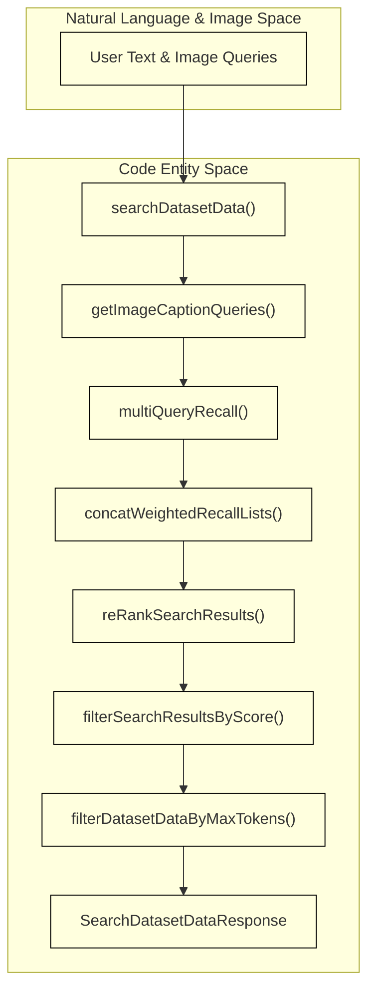
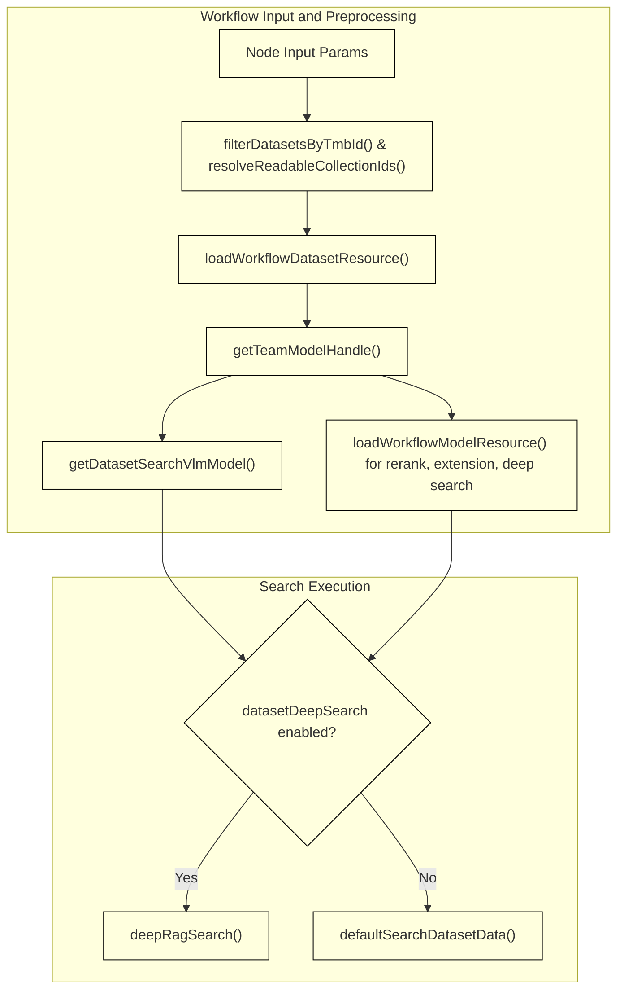
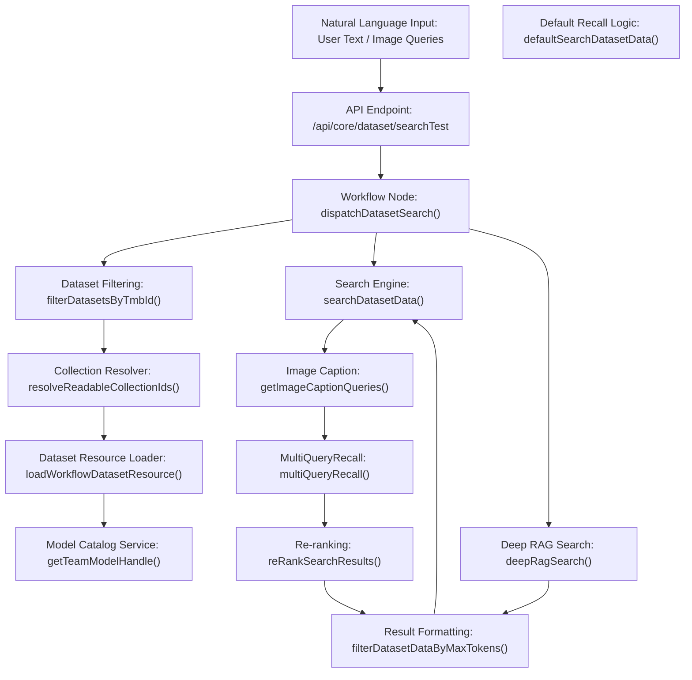

<!-- source: DeepWiki mcp.deepwiki.com · repo labring/FastGPT · page 7.3 Search and Retrieval System · fetched 2026-10-29 -->

# Search and Retrieval System

Relevant source files

The following files were used as context for generating this wiki page:

- [document/content/self-host/upgrading/4-16/4162.en.mdx](document/content/self-host/upgrading/4-16/4162.en.mdx)
- [document/content/self-host/upgrading/4-16/4162.mdx](document/content/self-host/upgrading/4-16/4162.mdx)
- [packages/global/common/error/errorCode.ts](packages/global/common/error/errorCode.ts)
- [packages/global/core/workflow/runtime/type.ts](packages/global/core/workflow/runtime/type.ts)
- [packages/service/core/dataset/search/defaultRecall/imageCaption.ts](packages/service/core/dataset/search/defaultRecall/imageCaption.ts)
- [packages/service/core/dataset/search/defaultRecall/index.ts](packages/service/core/dataset/search/defaultRecall/index.ts)
- [packages/service/core/dataset/search/type.ts](packages/service/core/dataset/search/type.ts)
- [packages/service/core/dataset/search/utils.ts](packages/service/core/dataset/search/utils.ts)
- [packages/service/core/workflow/dispatch/dataset/search.ts](packages/service/core/workflow/dispatch/dataset/search.ts)
- [packages/service/test/core/dataset/search/defaultRecall.test.ts](packages/service/test/core/dataset/search/defaultRecall.test.ts)
- [packages/service/test/core/dataset/search/utils.test.ts](packages/service/test/core/dataset/search/utils.test.ts)
- [packages/service/test/core/workflow/dispatch/dataset/search.test.ts](packages/service/test/core/workflow/dispatch/dataset/search.test.ts)
- [projects/app/src/pages/api/core/dataset/data/insertData.ts](projects/app/src/pages/api/core/dataset/data/insertData.ts)
- [projects/app/src/pages/api/core/dataset/data/pushData.ts](projects/app/src/pages/api/core/dataset/data/pushData.ts)
- [projects/app/src/pages/api/core/dataset/searchTest.ts](projects/app/src/pages/api/core/dataset/searchTest.ts)
- [projects/app/src/service/core/dataset/data/data.ts](projects/app/src/service/core/dataset/data/data.ts)
- [projects/app/src/service/core/dataset/data/dataIndex.ts](projects/app/src/service/core/dataset/data/dataIndex.ts)
- [projects/app/test/service/core/dataset/data/data.test.ts](projects/app/test/service/core/dataset/data/data.test.ts)
- [projects/app/test/service/core/dataset/data/dataIndex.test.ts](projects/app/test/service/core/dataset/data/dataIndex.test.ts)

## Purpose and Scope

This page provides an in-depth technical overview of FastGPT's Search and Retrieval System within the knowledge base framework. It details the hybrid search methodology combining embedding similarity, full-text search, query expansions, image captioning with vision-language models (VLM), re-ranking of search results, dataset search node execution in workflows, the `searchTest` API endpoint, and integration of Retrieval-Augmented Generation (RAG) in workflows.

---

## System Architecture and Retrieval Pipeline

FastGPT's retrieval system is designed as a multi-stage pipeline integrating vector databases, knowledge base collections, and advanced language models to provide highly relevant search results with rich context.

At the core is the `searchDatasetData` function, which orchestrates query expansion, multi-path recall, and result fusion before final token-limited output formatting [packages/service/core/dataset/search/defaultRecall/index.ts:34-191]().

### Retrieval Data Flow

This pipeline:

1. Accepts multi-modal queries (text and images).
2. Generates captions from images using VLM models to enable text-based retrieval for images.
3. Retrieves candidate chunks from both vector similarity and full-text engines in parallel (`multiQueryRecall`).
4. Combines and weights embedding and full-text recall results (`concatWeightedRecallLists`).
5. Re-ranks textual candidates using cross-encoder models (`reRankSearchResults`).
6. Filters and clips results by similarity thresholds and output token budgets.
7. Formats final search results with dataset-specific image link shortening and metadata.

**Sources:**  
- [packages/service/core/dataset/search/defaultRecall/index.ts:34-191]()  
- [packages/service/core/dataset/search/defaultRecall/imageCaption.ts:34-126]()  
- [packages/service/core/dataset/search/type.ts:15-55]()

---

## Search Execution Modes and Hybrid Retrieval

FastGPT supports several search modes configured by `DatasetSearchModeEnum`:

| Mode        | Implementation                              | Description                                   |
|-------------|---------------------------------------------|-----------------------------------------------|
| `embedding` | Vector store recall                         | Pure semantic similarity matching using embeddings (vector DB) |
| `fullText`  | Text token aggregations (MongoDB full-text) | Keyword matching and token-based textual recall |
| `hybrid`    | Combination of embedding and full-text via weighted fusion | Hybrid recall mixing semantic and lexical matching |

`searchDatasetData` uses `DatasetSearchModeMap` to validate and fallback search modes [packages/service/core/dataset/search/defaultRecall/index.ts:57-59]().

### Hybrid Fusion Logic

Embedding and full-text recall results are combined separately on text and image channels by weighted summation and then fused by Reciprocal Rank Fusion (RRF) like algorithms [packages/service/core/dataset/search/defaultRecall/index.ts:113-120](). This preserves:

- Text embedding and full-text results fusion
- Image caption embedding and image vector embeddings fusion
- Final fusion balancing text and image relevance with tunable weights (`embeddingWeight`)

Reranking applies only on textual recall to avoid harming visually guided recall results.

**Sources:**  
- [packages/service/core/dataset/search/defaultRecall/index.ts:57-120]()  
- [packages/service/core/dataset/search/defaultRecall/result.ts]() (referenced)

---

## Dataset Search Workflow Node

The dataset search node in FastGPT's workflow system is implemented through `dispatchDatasetSearch`, which manages dataset access, model inference, and search dispatching. It handles permissions, dataset filtering, auxiliary model loading, and routing between default and deep RAG search [packages/service/core/workflow/dispatch/dataset/search.ts:62-189]().

### Workflow Node Execution Flow

### Key Node Parameters

| Parameter                         | Description                             | Reference                                      |
|----------------------------------|-----------------------------------------|------------------------------------------------|
| `datasetMaxTokens`               | Maximum allowed tokens of search result; controls final output size | [dispatchDatasetSearch:31-56]()               |
| `datasetSimilarity`              | Minimum vector similarity threshold to filter results                     | [dispatchDatasetSearch:31-56]()               |
| `datasetDeepSearch`              | Enables multi-step deep RAG search for iterative reasoning                  | [dispatchDatasetSearch:91-95]()                |
| `collectionFilterMatch`          | Filter for collection metadata to limit recall candidates                  | [dispatchDatasetSearch:43-53]()                |
| `usingReRank`                   | Enables final cross-encoder reranking                                    | [dispatchDatasetSearch:38-41]()                 |

This node ensures proper permission filtering by team membership (`authTmbId`) and collection-level ACLs `resolveReadableCollectionIds()` before dispatching the actual search.

**Sources:**  
- [packages/service/core/workflow/dispatch/dataset/search.ts:62-189]()  
- [packages/global/core/workflow/runtime/type.ts:44-129]()

---

## SearchTest API Endpoint

FastGPT exposes a dedicated API endpoint `/api/core/dataset/searchTest` for programmatically testing and debugging dataset search configurations with live data [projects/app/src/pages/api/core/dataset/searchTest.ts:32-197]().

### API Execution Flow

1. **Authentication and Authorization**  
   Authenticates users or API keys with `authDataset()` validating read permission on the requested dataset [searchTest.ts:64-71]().

2. **Frequency and AI Points Quota Enforcement**  
   Uses `teamFrequencyLimit` to enforce request rate limits and `checkTeamAIPoints` for sufficient AI quota checks [searchTest.ts:72-74]().

3. **Image Query Validation**  
   Filters image queries through `isAuthorizedTempFileS3Key()` to ensure team ownership of temporary S3 keys and generates short-lived external URLs [searchTest.ts:75-101]().

4. **Model Handles Acquisition**  
   Resolves embedding, Vision-Language (`vlm`), re-ranking, extension, and deep search model data instances with model authorization [searchTest.ts:104-131]().

5. **Search Dispatching**  
   Based on flags, calls either the deep iterative RAG search (`deepRagSearch`) or standard `defaultSearchDatasetData` for recall and ranking [searchTest.ts:177-189]().

6. **Token Usage Billing**  
   Pushes usage events with `pushDatasetTestUsage` and optionally updates API key usage accounting [searchTest.ts:191-197]().

**Sources:**  
- [projects/app/src/pages/api/core/dataset/searchTest.ts:32-197]()

---

## Reranking and Auxiliary Models

The reranking step improves retrieval precision by reordering results via powerful cross-encoder models. It strictly reranks text recall outputs to preserve image-related retrieval integrity [packages/service/core/dataset/search/defaultRecall/index.ts:130-142]().

### Auxiliary Models Resolution

`dispatchDatasetSearch` conditionally loads auxiliary models:

- **Rerank Model**: For result scoring fine-tuning.
- **Query Extension Model**: For expanding user queries to capture more relevant results.
- **Deep Search Model**: Used when `datasetDeepSearch` is enabled for multi-hop reasoning.

Fallback mechanisms ensure that if user-configured models are unavailable or produce errors, default system models are used instead [packages/service/core/workflow/dispatch/dataset/search.ts:170-189]().

**Sources:**  
- [packages/service/core/dataset/search/defaultRecall/index.ts:130-142]()  
- [packages/service/core/workflow/dispatch/dataset/search.ts:170-189]()

---

## Token Management, Billing & Data Maintenance

Effective quota management is achieved by detailed tracking of token consumption on embedding, reranking, query extension, and image caption sub-processes:

- Embedding tokens counted on vector generation [search/defaultRecall/index.ts:96]()  
- Rerank input tokens tracked if reranking enabled [search/defaultRecall/index.ts:134]()  
- Image caption tokens and usage tracked at VLM query stages [search/defaultRecall/imageCaption.ts:119-122]()  
- Final output results clipped to `datasetMaxTokens` via `filterDatasetDataByMaxTokens` [search/defaultRecall/index.ts:180]()

These metrics feed into usage accounting and billing, visible in workflow node response metadata.

**Sources:**  
- [packages/service/core/dataset/search/defaultRecall/index.ts:96-180]()  
- [packages/service/core/dataset/search/defaultRecall/imageCaption.ts:119-122]()  
- [projects/app/src/pages/api/core/dataset/searchTest.ts:156-191]()

---

## Summary Mermaid Diagram: From Natural Language Input to Workflow Search Node

---

## Detailed Mermaid Diagram: Components Bridging Search Concepts to Implementation

```mermaid
flowchart LR
  subgraph "Natural Language Space"
    UserInput["User Query: text/image"]
  end

  subgraph "Code Entity Space"
    APIHandler["Handler /api/core/dataset/searchTest"]
    AuthDataset["authDataset()"]
    FrequencyLimit["teamFrequencyLimit()"]
    AIPointsCheck["checkTeamAIPoints()"]
    ImageKeyCheck["isAuthorizedTempFileS3Key()"]
    ModelCatalog["getTeamModelHandle()"]
    DatasetSearchNode["dispatchDatasetSearch()"]
    DefaultSearch["defaultSearchDatasetData()"]
    DeepSearch["deepRagSearch()"]
    ImgCaption["getImageCaptionQueries()"]
    MultiRecall["multiQueryRecall()"]
    RerankProc["reRankSearchResults()"]
    BillingPush["pushDatasetTestUsage()"]
  end

  UserInput --> APIHandler
  APIHandler --> AuthDataset
  AuthDataset --> FrequencyLimit
  FrequencyLimit --> AIPointsCheck
  AIPointsCheck --> ImageKeyCheck
  ImageKeyCheck --> ModelCatalog
  ModelCatalog --> DatasetSearchNode
  DatasetSearchNode -->|deepSearch? yes| DeepSearch
  DatasetSearchNode -->|deepSearch? no| DefaultSearch
  DefaultSearch --> ImgCaption
  ImgCaption --> MultiRecall
  MultiRecall --> RerankProc
  RerankProc --> BillingPush

```

---

# References and Sources

- packages/service/core/dataset/search/defaultRecall/index.ts [34-191]()  
- packages/service/core/dataset/search/defaultRecall/imageCaption.ts [34-126]()  
- packages/service/core/workflow/dispatch/dataset/search.ts [62-189]()  
- projects/app/src/pages/api/core/dataset/searchTest.ts [32-197]()  
- packages/global/core/workflow/runtime/type.ts [44-129]()  
- packages/service/core/dataset/search/defaultRecall/result.ts (referenced)

---

