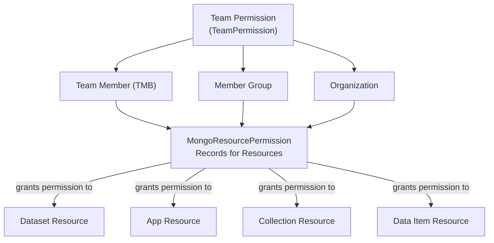
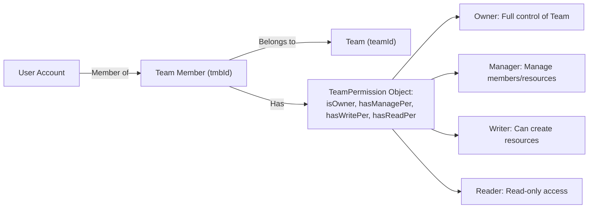
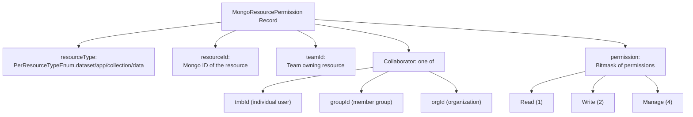
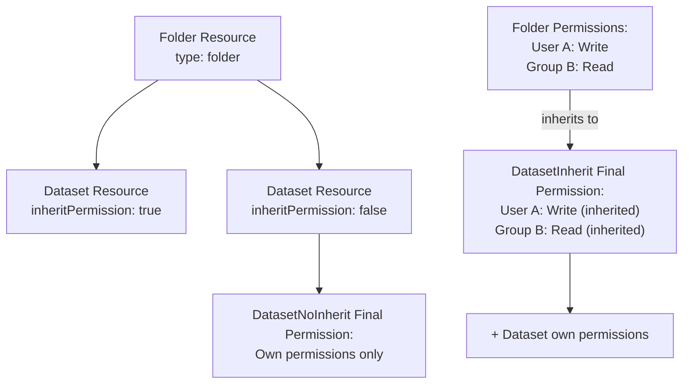
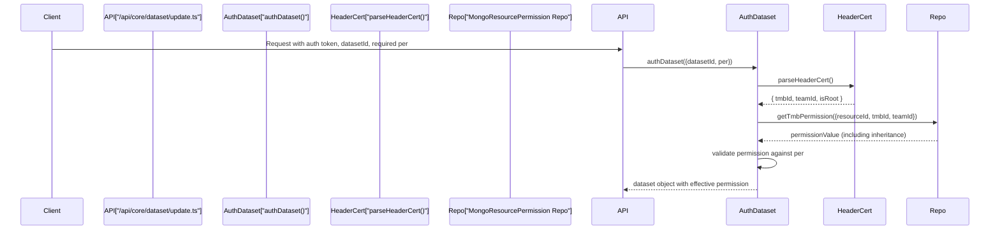
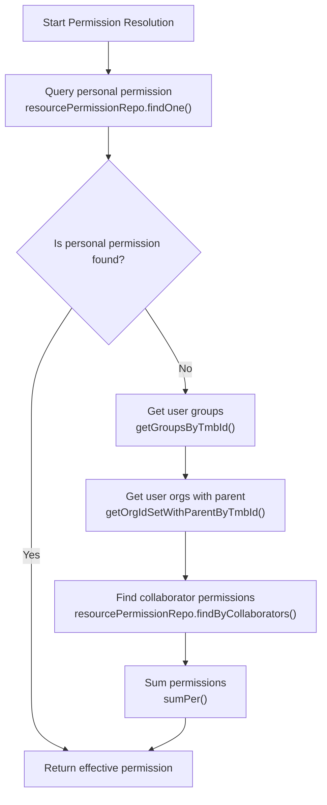
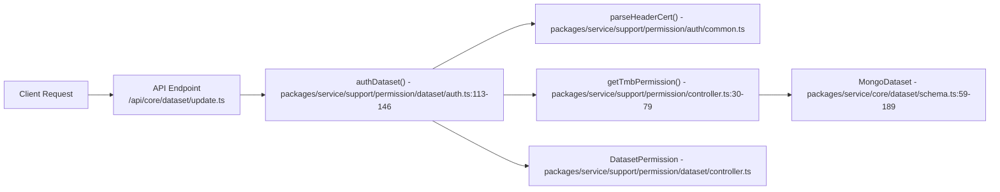
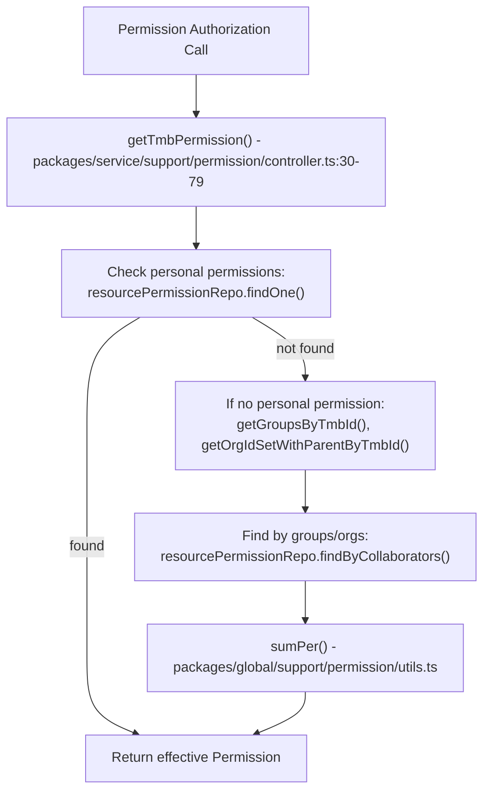

<!-- source: DeepWiki mcp.deepwiki.com · repo labring/FastGPT · page 7.4 Permission System and Access Control · fetched 2026-10-29 -->

# Permission System and Access Control

<details>
<summary>Relevant source files</summary>

The following files were used as context for generating this wiki page:

- [packages/service/core/dataset/schema.ts](packages/service/core/dataset/schema.ts)
- [packages/service/env.util.ts](packages/service/env.util.ts)
- [packages/service/global.d.ts](packages/service/global.d.ts)
- [packages/service/support/permission/app/auth.ts](packages/service/support/permission/app/auth.ts)
- [packages/service/support/permission/controller.ts](packages/service/support/permission/controller.ts)
- [packages/service/support/permission/dataset/auth.ts](packages/service/support/permission/dataset/auth.ts)
- [packages/service/support/permission/repository/resourcePermissionRepo.ts](packages/service/support/permission/repository/resourcePermissionRepo.ts)
- [packages/service/support/permission/resourcePermissionService.ts](packages/service/support/permission/resourcePermissionService.ts)
- [packages/service/support/user/systemUser.ts](packages/service/support/user/systemUser.ts)
- [packages/service/support/user/team/controller.ts](packages/service/support/user/team/controller.ts)
- [packages/service/test/support/permission/app/auth.test.ts](packages/service/test/support/permission/app/auth.test.ts)
- [packages/service/test/support/permission/controller.test.ts](packages/service/test/support/permission/controller.test.ts)
- [packages/service/test/support/permission/resourcePermissionRepo.test.ts](packages/service/test/support/permission/resourcePermissionRepo.test.ts)
- [packages/service/test/support/user/systemUser.test.ts](packages/service/test/support/user/systemUser.test.ts)
- [projects/app/src/instrumentation-node.ts](projects/app/src/instrumentation-node.ts)
- [projects/app/src/pageComponents/dataset/detail/Import/commonProgress/Upload.tsx](projects/app/src/pageComponents/dataset/detail/Import/commonProgress/Upload.tsx)
- [projects/app/test/api/core/dataset/collection/create/reTrainingCollection.test.ts](projects/app/test/api/core/dataset/collection/create/reTrainingCollection.test.ts)

</details>


## Purpose and Scope

This document presents a detailed technical overview of FastGPT's permission and access control system. It covers dataset resource permissions, folder inheritance, team/group/organization-based access control, and the dataset-specific authorization (`authDataset`). The system ensures secure, flexible, and fine-grained access control over datasets, applications, collections, and data items within FastGPT.

---

## Permission Model Overview

FastGPT implements a layered permission system that ties user permissions to team memberships and resource-level access control. Permissions are granted and checked via a combination of:

- Team-level permissions defining broad capabilities for team members (owners, managers, writers, readers).
- Resource-level permissions specifying access rights on datasets, apps, and collections.
- Collaborator permissions assigned individually or via groups and organizations.
- Optional inheritance of permissions from parent folders for hierarchical resources.

### Permission Hierarchy Diagram



---

## Team-Based Permission Architecture

Every user is part of a team represented by a Team Member (TMB) record. The team permission system governs top-level privileges such as the ability to create datasets, manage members, and audit usage.

### Team Permission Structure



### Key Team Permission Flags

| Flag        | Meaning                          | Relevant Checks                  |
|-------------|---------------------------------|---------------------------------|
| `isOwner`   | Complete team control            | `teamPer.isOwner`                |
| `hasManagePer` | Manage team membership and billing | `tmbPer.hasManagePer`           |
| `hasWritePer` | Permission to create resources  | `tmbPer.hasWritePer`             |
| `hasReadPer`  | Permission to view content      | `tmbPer.hasReadPer`              |

Team owners automatically bypass resource-level permission restrictions, but agent-created applications require explicit ACL checks even for owners.

---

## Resource Permission System

Datasets, apps, collections, and data items each have distinct resource permissions stored in MongoDB (`MongoResourcePermission` collection). These permissions link specific collaborators to resources with assigned permission bits.

### Resource Permission Schema Diagram



### Permission Values

| Constant           | Value | Description                               |
|--------------------|-------|-------------------------------------------|
| `ReadPermissionVal`  | 1     | Read access to resource content           |
| `WritePermissionVal` | 2     | Write access to modify or add data        |
| `ManagePermissionVal`| 4     | Full control, manage collaborators        |
| `OwnerRoleVal`       | Highest | Full ownership rights                    |

---

## Permission Inheritance Model

FastGPT supports hierarchical permission inheritance to simplify managing folder-structured datasets and apps. 

### Inheritance Rules

- Folders (`DatasetTypeEnum.folder`) **do NOT** inherit permissions from parents.
- Other resource types **can inherit** if `inheritPermission` is enabled and a valid `parentId` exists.
- Effective permission is the bitwise sum of inherited permissions and explicit resource permissions.
- The `shouldInheritResourcePermission()` utility determines if inheritance should apply.
- Permission inheritance propagates via calls to `getTmbPermission()` with the parent's resource ID when needed.

### Inheritance Flow Diagram



---

## Authentication and Authorization Flow

All API requests involving resource access perform multi-step authentication:

- Identity and team membership is resolved via token or API key using `parseHeaderCert()`.
- The team member's effective permission for the resource is computed with `getTmbPermission()`.
- Folder inheritance triggers recursive permission fetch on parent resources if activated.
- Specific authorization functions like `authDataset()`, `authApp()`, and `authDatasetCollection()` validate the requested permissions and return enriched resource objects with effective `Permission` wrappers.
- Unauthorized access triggers explicit errors such as `DatasetErrEnum.unAuthDataset` or `AppErrEnum.unAuthApp`.

### Dataset Authorization Flow



---

## Dataset Permission Implementation Details

The key function handling dataset permission authorization for team members is `authDatasetByTmbId()`. It performs:

- Loading the dataset document (ensuring it is not deleted).
- Checking root access: if true, full ownership is granted.
- Verifying team membership against dataset team.
- Checking if inheritance is enabled on dataset: if yes, fetch parent's permission recursively.
- Fetching team member's explicit permission on the dataset resource.
- Summing inherited and explicit permissions with `sumPer()`.
- Using `assertDatasetPermission()` to ensure required permission bits are satisfied or throw an error.
- Returning dataset with attached `DatasetPermission` object representing effective permissions.

```typescript
export const authDatasetByTmbId = async ({
  tmbId,
  datasetId,
  per,
  isRoot = false,
  tmbInfo
}) => {
  // Fetch teamId, tmb permission and dataset in parallel
  const [{teamId, permission: tmbPer}, dataset] = await Promise.all([
    tmbInfo ?? getTmbInfoByTmbId({ tmbId }),
    MongoDataset.findOne({ _id: datasetId, deleteTime: null }).lean()
  ]);

  if (!dataset) { throw DatasetErrEnum.unExist; }

  if (isRoot) {
    return {
      ...dataset,
      permission: new DatasetPermission({ isOwner: true })
    };
  }

  if (String(dataset.teamId) !== teamId) {
    throw DatasetErrEnum.unAuthDataset;
  }

  const isInherit = shouldInheritResourcePermission(dataset.inheritPermission) &&
    dataset.type !== DatasetTypeEnum.folder &&
    !!dataset.parentId;

  const [folderPer = 0, myPer = 0] = await Promise.all([
    isInherit ? getTmbPermission({
      teamId,
      tmbId,
      resourceId: dataset.parentId!,
      resourceType: PerResourceTypeEnum.dataset
    }) : 0,
    getTmbPermission({
      teamId,
      tmbId,
      resourceId: datasetId,
      resourceType: PerResourceTypeEnum.dataset
    })
  ]);

  return assertDatasetPermission({
    dataset,
    teamId,
    tmbId,
    isTeamOwner: tmbPer.isOwner,
    isRoot,
    role: sumPer(folderPer, myPer) ?? 0,
    per
  });
};
```

This function is used by higher-level authorization functions like `authDataset()` which parse the user token and return the authenticated dataset and permissions.

---

## Permission Resolution with Groups and Organizations

When resolving a user's permission on a resource, FastGPT considers direct user permissions plus inherited permissions via:

- Member groups the user belongs to.
- Organizations the user is part of, including parent organizations.

The aggregation is performed in `getTmbPermission()`:

### Permission Resolution Diagram



This prioritizes direct user permissions first, then sums group and organization permissions if no direct permission found.

---

## Collaborator Management and Details

Collaborators can be team members, groups, or organizations. The system provides APIs to list and update collaborators on resources.

**Collaborator List Resolution**

The function `getClbsInfo()` aggregates collaborator metadata including:

- Team member names, avatars, userIds.
- Organization and group names and avatars.
- Resolves usernames lazily by batching user ID lookups to avoid N+1 queries.

This detailed info supports UI display components for collaborator lists.

---

## Agent Users and Root User Considerations

FastGPT treats "agent users" (internal AI agent accounts) specially:

- Agent users are configured via environment variables.
- Agent user team member IDs (`tmbId`s) are cached globally after system initialization.
- The function `checkIsAgentUser(tmbId)` checks if an ID belongs to an agent user.
- For applications created by agent users, team owners and root do not get implicit ownership and must undergo normal ACL checks, preventing permission bypass.

System user initialization (`initSystemUser()`) sets up root user and agent user accounts in the database with distributed locking to ensure serialized init in clustered deployments.

---

# Summary

FastGPT's permission system combines fine-grained resource control with flexible team/group/org inheritance patterns, supporting complex access scenarios while ensuring security and auditability.

---

# Diagrams Bridging Natural Language and Code

### 1. Dataset Authorization Flow - Natural Language to Code Entities



### 2. Permission Resolution Logic - Personal, Group, Organization



---

# Key Functions and Classes

| Function / Class           | Role                                                  | Location                                                      |
|---------------------------|-------------------------------------------------------|---------------------------------------------------------------|
| `authDatasetByTmbId()`     | Authorize team member access to dataset resources     | `packages/service/support/permission/dataset/auth.ts:38-111`  |
| `authAppByTmbId()`         | Authorize team member access to app resources         | `packages/service/support/permission/app/auth.ts:27-146`      |
| `authDataset()`            | Middleware api to parse token and authorize dataset   | `packages/service/support/permission/dataset/auth.ts:113-146` |
| `getTmbPermission()`       | Calculate effective permission for team member        | `packages/service/support/permission/controller.ts:30-79`     |
| `getClbsInfo()`            | Resolve detailed collaborator info for UI             | `packages/service/support/permission/controller.ts:174-211`   |
| `checkIsAgentUser()`       | Check if user is an internal agent user                | `packages/service/support/user/systemUser.ts:50-54`           |
| `MongoDataset`             | MongoDB schema/model for datasets                       | `packages/service/core/dataset/schema.ts:59-189`              |
| `MongoResourcePermission`  | MongoDB resource permission document                    | `packages/service/support/permission/schema.ts` (not shown)   |
| `DatasetPermission`        | Dataset permission abstraction class                    | `packages/service/support/permission/dataset/controller.ts`   |
| `AppPermission`            | App permission abstraction class                        | `packages/service/support/permission/app/controller.ts`       |

---

# Sources

- `packages/service/support/permission/app/auth.ts:1-180`  
- `packages/service/support/permission/controller.ts:1-121,123-211`  
- `packages/service/support/permission/dataset/auth.ts:1-230`  
- `packages/service/support/user/systemUser.ts:1-207`  
- `packages/service/core/dataset/schema.ts:59-189`  
- `projects/app/src/pageComponents/dataset/list/List.tsx:2-25`  
- `packages/service/support/permission/controller.ts:132-197`  
- `projects/app/src/pages/api/core/dataset/update.ts:95-105`  
- `projects/app/src/pages/api/core/app/update.ts:59-72`

---

