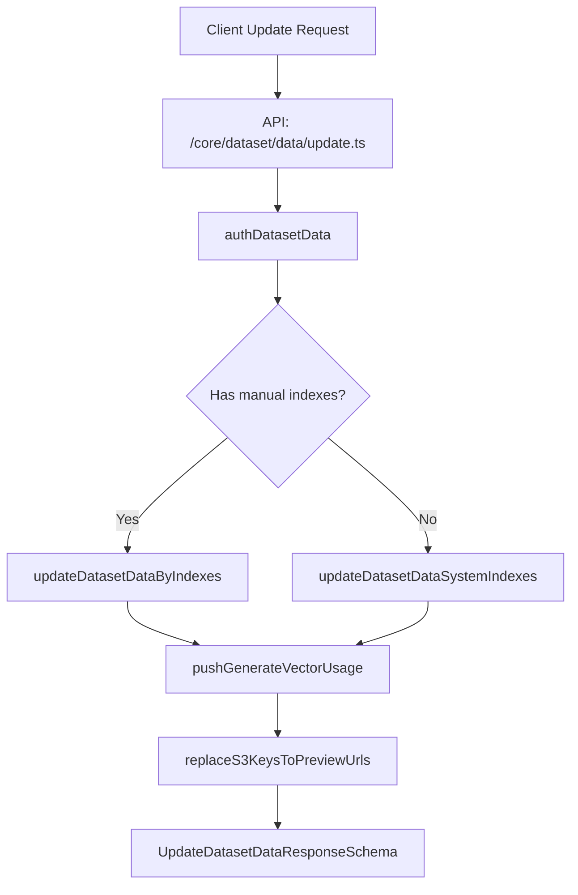
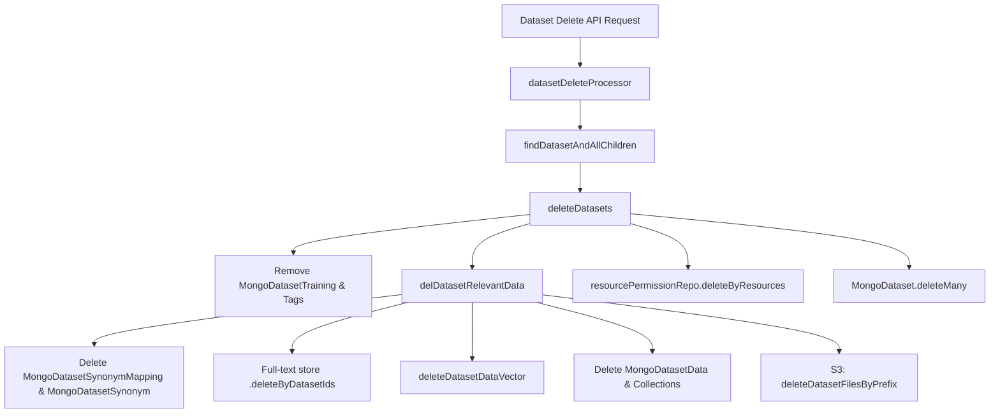
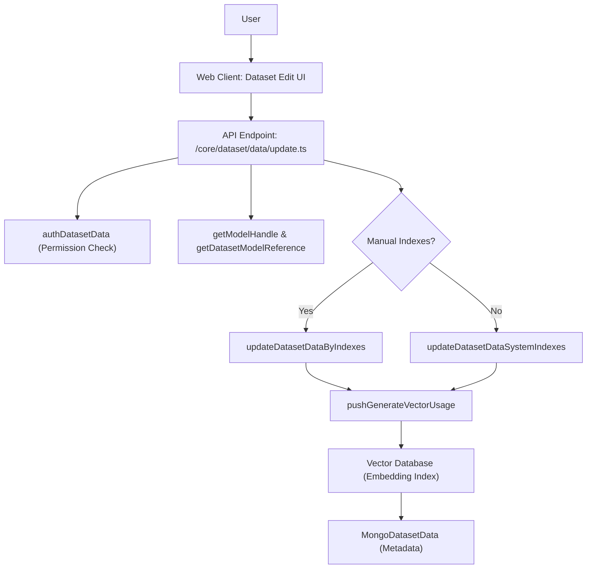
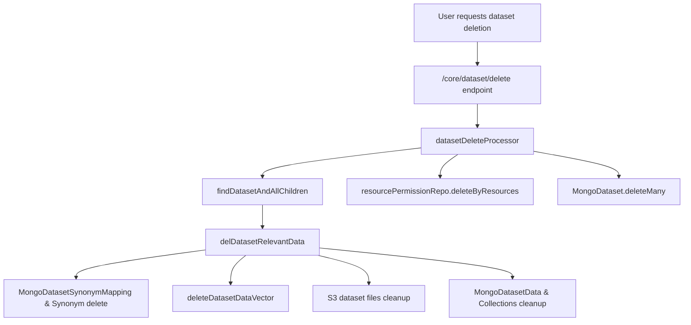

<!-- source: DeepWiki mcp.deepwiki.com · repo labring/FastGPT · page 7.5 Dataset Lifecycle Management · fetched 2026-10-29 -->

# Dataset Lifecycle Management

Relevant source files

The following files were used as context for generating this wiki page:

- [packages/global/core/dataset/constants.ts](packages/global/core/dataset/constants.ts)
- [packages/global/core/dataset/data/utils.ts](packages/global/core/dataset/data/utils.ts)
- [packages/global/openapi/core/dataset/collection/createPath.ts](packages/global/openapi/core/dataset/collection/createPath.ts)
- [packages/global/test/core/dataset/data/utils.test.ts](packages/global/test/core/dataset/data/utils.test.ts)
- [packages/web/i18n/en/dataset.json](packages/web/i18n/en/dataset.json)
- [packages/web/i18n/zh-CN/dataset.json](packages/web/i18n/zh-CN/dataset.json)
- [packages/web/i18n/zh-Hant/dataset.json](packages/web/i18n/zh-Hant/dataset.json)
- [projects/app/src/pageComponents/dataset/detail/CollectionCard/TagManageModal.tsx](projects/app/src/pageComponents/dataset/detail/CollectionCard/TagManageModal.tsx)
- [projects/app/src/pageComponents/dataset/detail/CollectionCard/TagsPopOver.tsx](projects/app/src/pageComponents/dataset/detail/CollectionCard/TagsPopOver.tsx)
- [projects/app/src/pageComponents/dataset/detail/CollectionCard/index.tsx](projects/app/src/pageComponents/dataset/detail/CollectionCard/index.tsx)
- [projects/app/src/pageComponents/dataset/detail/Form/CollectionChunkForm.tsx](projects/app/src/pageComponents/dataset/detail/Form/CollectionChunkForm.tsx)
- [projects/app/src/pages/api/core/dataset/collection/create/backup.ts](projects/app/src/pages/api/core/dataset/collection/create/backup.ts)
- [projects/app/src/pages/api/core/dataset/collection/create/template.ts](projects/app/src/pages/api/core/dataset/collection/create/template.ts)
- [projects/app/src/pages/api/core/dataset/exportAll.ts](projects/app/src/pages/api/core/dataset/exportAll.ts)
- [projects/app/src/pages/dataset/detail/index.tsx](projects/app/src/pages/dataset/detail/index.tsx)
- [projects/app/src/service/core/dataset/queues/datasetParse.ts](projects/app/src/service/core/dataset/queues/datasetParse.ts)
- [projects/app/src/web/core/dataset/api.ts](projects/app/src/web/core/dataset/api.ts)
- [projects/app/test/service/core/dataset/queues/datasetParse.test.ts](projects/app/test/service/core/dataset/queues/datasetParse.test.ts)

## Purpose and Scope

This page presents a comprehensive technical overview of the dataset lifecycle management subsystem in FastGPT. It covers mechanisms for dataset and collection updates, data export processors, deletion workflows, dataset retraining procedures, chunk preview generation, image training mode determination, and scheduled cleanup tasks. The documentation highlights relevant API endpoints, key functions and classes, data flow, and system interactions.

---

## 1. Dataset and Data Chunk Updates

Dataset data updates handle metadata and content modifications along with index recalculations and embedding vector regeneration. The key API entry point is:

- `projects/app/src/pages/api/core/dataset/data/update.ts` — This API endpoint validates user permissions through `authDatasetData`. It then retrieves the embedding model configuration using `getModelHandle()` and `getDatasetModelReference()`. Updates are routed depending on manual index presence:
  - Updates with explicit indexes call `updateDatasetDataByIndexes`.
  - Otherwise, updates rely on `updateDatasetDataSystemIndexes` for system-generated indexes.

Both update flows incorporate token usage tracking related to embedding generation via `pushGenerateVectorUsage`. After vector recalculation, S3 object keys within the data are replaced with preview URLs for frontend consumption [projects/app/src/pages/api/core/dataset/data/update.ts:1-113]().

*Diagram 1: Dataset Data Update and Embedding Vector Regeneration Flow.*

Sources: `projects/app/src/pages/api/core/dataset/data/update.ts`

---

## 2. Data Export Mechanism

FastGPT supports streaming CSV exports for datasets, optimized to handle large-scale data efficiently without loading entire datasets into memory.

- The primary export endpoint is `projects/app/src/pages/api/core/dataset/collection/export.ts`.
- It verifies read permissions either on individual collections or via associated chat contexts with `authDatasetCollectionRead` and `authChat` respectively.
- Export requests are throttled with `assertMemberRateLimit` using configured export policies.
- Data is fetched from secondary MongoDB replicas using the `readFromSecondary` option for load balancing.
- A cursor stream iterates the dataset, and rows are asynchronously serialized and sent through response streams using `responseWriteController`.
- CSV fields are sanitized by `sanitizeCsvField` for proper CSV formatting.
- S3 keys in data contents are converted to temporary signed URLs for secure preview with `replaceS3KeysToPreviewUrls`.
- Export settings:
  - `Content-Type` header set to `text/csv; charset=utf-8`
  - `Content-Disposition` header enforces attachment with a downloadable CSV filename.
  - Mongo cursor limits batches to 1000 and total exports to at most 50000 records per request.

| Config | Value | Description |
|---|---|---|
| `Content-Type` | `text/csv; charset=utf-8` | CSV content with UTF-8 encoding |
| `Content-Disposition` | `attachment; filename={dataset_name}-backup.csv` | Forces browser download |
| Cursor Batch Size | 1000 | MongoDB output batch size for streaming |
| Max Export Records | 50000 | Safeguard upper limit per export |

Sources: `projects/app/src/pages/api/core/dataset/collection/export.ts`

---

## 3. Dataset and Collection Deletion Processors

Dataset deletion involves complex asynchronous processing due to dependent cleanups such as vector database pruning, file storage purges, and permission revocations.

- The core processor resides in `packages/service/core/dataset/delete/processor.ts`.
- It begins by resolving the target dataset's entire hierarchy using `findDatasetAndAllChildren` to account for child datasets.
- Deletion commands trigger `delDatasetRelevantData`, responsible for cascading cleanup:
  - Remove all related training task documents.
  - Delete synonym mappings (`MongoDatasetSynonymMapping`) and synonym documents (`MongoDatasetSynonym`).
  - Purge full-text store entries via `getFullTextStore().deleteByDatasetIds`.
  - Remove vector embeddings with `deleteDatasetDataVector`.
  - Remove dataset data documents and collections from MongoDB.
  - Delete dataset files from S3 matching dataset prefixes via `getS3DatasetSource().deleteDatasetFilesByPrefix`.
- Resource permissions linked to the dataset are deleted using `resourcePermissionRepo.deleteByResources`.
- The final step deletes the dataset documents themselves via `MongoDataset.deleteMany`.

*Diagram 2: Dataset Deletion Workflow and System Components.*

Sources: `packages/service/core/dataset/delete/processor.ts`, `packages/service/core/dataset/controller.ts`

---

## 4. Retraining Collections and Chunk Preview

### Retraining Collections

The lifecycle allows for retraining existing dataset collections when chunking methods or embedding parameters change.

- The API `/core/dataset/collection/create/reTrainingCollection` reinitializes a collection by deleting the original and recreating with updated parameters.
- Calls to `createCollectionAndInsertData` perform the insertion and trigger downstream training ingestion.
- Retraining includes re-chunking documents and regenerating embeddings according to the new configuration [packages/global/openapi/core/dataset/collection/createPath.ts:47-65]().

### Chunk Preview Generation

Before committing chunks to persistent storage, users can preview how the raw data will be split.

- The endpoint `projects/app/src/pages/api/core/dataset/file/getPreviewChunks.ts` receives raw text or file references and uses `computedCollectionChunkSettings` for chunk parameters.
- Chunks are generated with `rawText2Chunks`, which supports a range of chunking strategies.
- Chunk preview data includes partial content and meta details for frontend inspection.
- The endpoint supports handling local files or object keys in S3 [projects/app/src/pages/api/core/dataset/file/getPreviewChunks.ts:29-112]().

---

## 5. Image Training Mode and Index Capability

FastGPT dynamically determines how image data within datasets should be handled based on the dataset's configured embedding models.

- `getDatasetImageIndexCapability` examines:
  - Whether the selected embedding model supports vision-based embeddings (`isImageEmbeddingModel`).
  - Whether a Vision Language Model (VLM) backend is configured and enabled.
- `getDatasetImageTrainingMode` chooses one of three modes:
  - `TrainingModeEnum.imageParse` when VLM is active.
  - `TrainingModeEnum.image` when only the image embedding model is supported.
  - `TrainingModeEnum.chunk` in fallback cases or when images are embedded in markdown chunks [packages/service/core/dataset/utils.ts:40-74]().

This logic controls the downstream ingestion and training pipeline, ensuring appropriate vectorization and indexing of multimedia inputs.

---

## 6. Formatting Dataset Data for Consumption

The dataset data controller provides utilities to format and prepare dataset contents for UI or API consumption.

- `formatDatasetDataValues` prepares data by transforming embedded S3 file keys into accessible preview URLs asynchronously.
- `getFormatDatasetCiteList` generates citation metadata lists for dataset items.
- Batching in these helper functions minimizes redundant IO and network calls for resolving temporary URLs in large datasets [packages/service/core/dataset/data/controller.ts:77-139]().

---

## 7. Periodic Cleanup and Cron Jobs

FastGPT runs scheduled cleanup routines for dataset resources such as expired signed URLs, orphaned files, and stale training data. These tasks maintain system hygiene and resource usage efficiency but do not have detailed implementation code excerpts in this context.

---

# Bridging Natural Language Concepts to Code Entities

## Diagram 3: Dataset Update Flow from User Action to Database Layer

*Diagram 3: Client-Initiated Dataset Update Flow through API Authentication, Model Configuration, Processing, and Database Updates.*

## Diagram 4: Dataset Deletion Process Mapping from API Layer to Backend Cleanup Routines

*Diagram 4: Dataset Deletion Request Traversing through Hierarchy Resolution to Permission Removal and Storage Cleanup.*

---

# Summary

This page has detailed the end-to-end lifecycle management for datasets and data collections within FastGPT. Key points:

- Secure and flexible update APIs enforce ownership and adjust embeddings as data changes.
- Export mechanisms efficiently stream CSV backups with permission and rate-limiting safeguards.
- Deletion processors handle multi-layer resource cleanup asynchronously and reliably.
- Retraining flows support collection re-initialization with updated chunking or models.
- Chunk preview and image indexing capabilities provide advanced processing customization.
- Formatting helpers optimize data presentation with minimized IO overhead.

Together, these components maintain the integrity and operational efficiency of FastGPT’s knowledge base system.

---

# References

- `projects/app/src/pages/api/core/dataset/data/update.ts`
- `projects/app/src/pages/api/core/dataset/collection/export.ts`
- `packages/service/core/dataset/delete/processor.ts`
- `packages/service/core/dataset/controller.ts`
- `projects/app/src/pages/api/core/dataset/file/getPreviewChunks.ts`
- `packages/service/core/dataset/utils.ts`
- `packages/service/core/dataset/data/controller.ts`
- `packages/global/openapi/core/dataset/collection/createPath.ts`

Sources:  
`projects/app/src/pages/api/core/dataset/data/update.ts`,  
`projects/app/src/pages/api/core/dataset/collection/export.ts`,  
`packages/service/core/dataset/delete/processor.ts`,  
`packages/service/core/dataset/controller.ts`,  
`projects/app/src/pages/api/core/dataset/file/getPreviewChunks.ts`,  
`packages/service/core/dataset/utils.ts`,  
`packages/service/core/dataset/data/controller.ts`,  
`packages/global/openapi/core/dataset/collection/createPath.ts`

---

