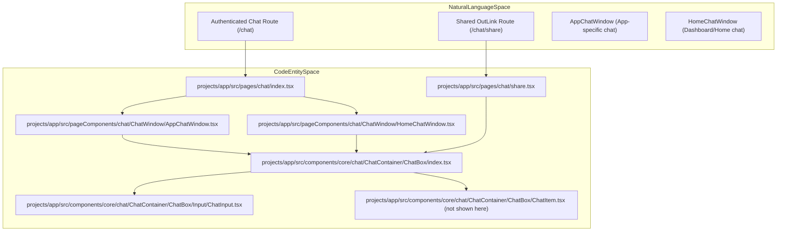
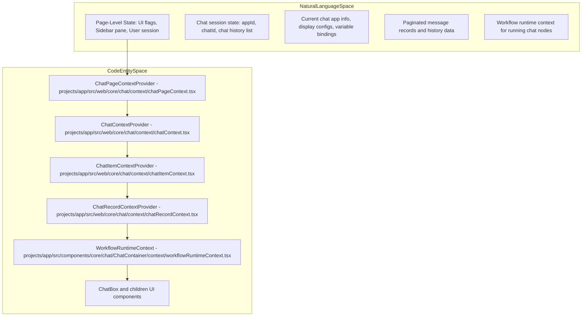

<!-- source: DeepWiki mcp.deepwiki.com · repo labring/FastGPT · page 8 Chat Interface and User Interaction · fetched 2026-10-29 -->

# Chat Interface and User Interaction

Relevant source files

The following files were used as context for generating this wiki page:

- [.agents/design/core/chat/input-draft-cache.md](.agents/design/core/chat/input-draft-cache.md)
- [packages/web/hooks/useScrollPagination.tsx](packages/web/hooks/useScrollPagination.tsx)
- [packages/web/i18n/en/chat.json](packages/web/i18n/en/chat.json)
- [packages/web/i18n/ko-KR/chat.json](packages/web/i18n/ko-KR/chat.json)
- [packages/web/i18n/zh-CN/chat.json](packages/web/i18n/zh-CN/chat.json)
- [packages/web/i18n/zh-Hant/chat.json](packages/web/i18n/zh-Hant/chat.json)
- [projects/app/src/components/core/chat/ChatContainer/ChatBox/Input/ChatInput.tsx](projects/app/src/components/core/chat/ChatContainer/ChatBox/Input/ChatInput.tsx)
- [projects/app/src/components/core/chat/ChatContainer/ChatBox/hooks/useChatGenerate.ts](projects/app/src/components/core/chat/ChatContainer/ChatBox/hooks/useChatGenerate.ts)
- [projects/app/src/components/core/chat/ChatContainer/ChatBox/hooks/useChatInputForm.ts](projects/app/src/components/core/chat/ChatContainer/ChatBox/hooks/useChatInputForm.ts)
- [projects/app/src/components/core/chat/ChatContainer/ChatBox/index.tsx](projects/app/src/components/core/chat/ChatContainer/ChatBox/index.tsx)
- [projects/app/src/pageComponents/chat/ChatHeader.tsx](projects/app/src/pageComponents/chat/ChatHeader.tsx)
- [projects/app/src/pageComponents/chat/ChatTeamApp/List.tsx](projects/app/src/pageComponents/chat/ChatTeamApp/List.tsx)
- [projects/app/src/pageComponents/chat/ChatWindow/AppChatWindow.tsx](projects/app/src/pageComponents/chat/ChatWindow/AppChatWindow.tsx)
- [projects/app/src/pageComponents/chat/ChatWindow/HomeChatWindow.tsx](projects/app/src/pageComponents/chat/ChatWindow/HomeChatWindow.tsx)
- [projects/app/src/pageComponents/chat/slider/ChatSliderList.tsx](projects/app/src/pageComponents/chat/slider/ChatSliderList.tsx)
- [projects/app/src/pages/chat/index.tsx](projects/app/src/pages/chat/index.tsx)
- [projects/app/src/pages/chat/share.tsx](projects/app/src/pages/chat/share.tsx)
- [projects/app/src/web/core/chat/context/chatContext.tsx](projects/app/src/web/core/chat/context/chatContext.tsx)
- [projects/app/src/web/core/chat/context/chatPageContext.tsx](projects/app/src/web/core/chat/context/chatPageContext.tsx)

This page provides an architectural overview of FastGPT's chat system, covering the core UI container `ChatBox`, multi-layered context providers, state management, streaming mechanics, initialization flows, and persistence layers.

As a parent page, this document outlines high-level concepts and relationships. For deep technical details, refer to the child pages:
- [Chat Components Architecture](#8.1) — ChatBox, ChatInput, message bubbles, Markdown rendering and response boxes
- [Chat Context and State Management](#8.2) — ChatContextProvider, ChatItemContext, ChatRecordContext, useChatStore and history handling
- [Streaming Responses and Real-time Updates](#8.3) — SSE streaming, streamFetch, stream resume, typing queue and incremental rendering
- [Variable Input and Chat Initialization](#8.4) — Chat variables, form rendering, file selectors, chat init APIs and outLink init
- [Feedback, Citations and Admin Features](#8.5) — Like/dislike feedback, dataset marking, quote lists/citation readers and whole-response inspection
- [Shared vs Authenticated Chat Architecture](#8.6) — Differences between `/chat`, `/chat/share` and team chat spaces, plus chat settings and sliders
- [Chat Persistence and Logs](#8.7) — `saveChat`, chat/chatItem schemas, node response storage and app log tables

---

## Chat Interface Architecture

The chat interface is centered on the `ChatBox` component, which serves as the main container coordinating message presentation, user input, and interaction dynamics. This component is utilized in different page-level contexts such as authenticated chat (`/chat`) and shared chats (`/chat/share`), and is embedded by window manager components like `AppChatWindow` and `HomeChatWindow` which handle layout and integration with sidebars and headers.

Below is a conceptual mapping between user-facing chat interface concepts and their core code entities in the repository:

This structure demonstrates that:

- The `/chat` route loads either the `AppChatWindow` or `HomeChatWindow` components depending on chat context. 
- Both windows embed the `ChatBox` container to manage the main chat panel.
- `ChatBox` internally includes components like `ChatInput` for message input and chat bubbles for rendering messages.

For a detailed breakdown of chat UI components, message rendering, input handling, and markdown-based rich content, see [Chat Components Architecture](#8.1).

Sources:  
- [projects/app/src/pages/chat/index.tsx:35-125]()  
- [projects/app/src/pages/chat/share.tsx:75-155]()  
- [projects/app/src/components/core/chat/ChatContainer/ChatBox/index.tsx:141-164]()

---

## Chat Context and State Management

FastGPT applies a layered context and state management system using React Context and hooks to decouple various parts of the chat state such as session info, chat metadata, message records, and workflow runtime variables. This avoids prop drilling and allows independent components to access or update shared state safely.

The key context providers form a stack wherein each provider adds a specific layer of chat state and logic:

- **`ChatPageContextProvider`**: Manages overall page-level state such as sidebar pane selection and user initialization flags.
- **`ChatContextProvider`**: Handles chat session lifecycle, chatId/appId updates, chat history loading, and slider sidebar state.
- **`ChatItemContextProvider`**: Stores current app metadata, runtime chat variables, citation data, and UI display toggles.
- **`ChatRecordContextProvider`**: Manages the list and pagination of chat message records for the active chat.
- **`WorkflowRuntimeContext`**: Provides runtime workflow execution context for agent workflows and interactive chat nodes.

This separation of concerns facilitates modular updates and improves maintainability.

For implementation details, see [Chat Context and State Management](#8.2).

Sources:  
- [projects/app/src/pages/chat/index.tsx:152-182]()  
- [projects/app/src/web/core/chat/context/chatItemContext.tsx:1-54]()  
- [projects/app/src/web/core/chat/context/chatContext.tsx:86-197]()  
- [projects/app/src/components/core/chat/ChatContainer/ChatBox/Provider.tsx:30-45]()  

---

## Streaming Responses and Real-time Updates

FastGPT streamlines chat responses using Server-Sent Events (SSE) streamed by the `streamFetch` utility. This mechanism enables incremental token-by-token updates, giving a real-time AI chat experience. Streaming also supports:

- Auto resuming interrupted streams to avoid double-fetching.
- A typing queue that processes incoming tokens asynchronously.
- Incremental user interface rendering to show partial responses as soon as they arrive.

Streaming handlers are implemented in chat hooks and chat container components to synchronize generation status and update UI progressively.

For detailed streaming API and rendering mechanics, see [Streaming Responses and Real-time Updates](#8.3).

Sources: Streaming refers to [projects/app/src/components/core/chat/ChatContainer/ChatBox/hooks/useChatGenerate.ts]() and related streaming calls in `AppChatWindow` and `ChatBox`[projects/app/src/pageComponents/chat/ChatWindow/AppChatWindow.tsx:120-160](), [projects/app/src/components/core/chat/ChatContainer/ChatBox/index.tsx:130-150]().

---

## Variable Input and Chat Initialization

Before users start chatting, FastGPT chat apps may require initialization with input variables such as forms, file selectors, or custom parameters. These inputs are rendered dynamically based on the app’s variable configuration:

- The `ChatBox` component coordinates variable input forms (e.g., `ChatHomeVariablesForm`).
- Initialization APIs fetch chat metadata and bind custom variables.
- Out-link authentication ensures secure access for shared chats with variable-binding support.
- File upload selectors and form input handlers manage rich inputs prior to chat message sending.

These initialization flows enable dynamic chat prompt customization based on user input and app requirements.

For details on variable inputs, API interactions, and out-link initialization, refer to [Variable Input and Chat Initialization](#8.4).

Sources:  
- [projects/app/src/components/core/chat/ChatContainer/ChatBox/index.tsx:70-100]()  
- [projects/app/src/pages/chat/share.tsx:75-160]()  

---

## Feedback, Citations and Admin Features

FastGPT’s chat interface supports post-response interaction features including:

- Feedback buttons (like/dislike) to capture user sentiment on responses.
- Citation links showing source datasets used for retrieval-augmented generation (RAG).
- Quote list popovers to inspect detailed source documents.
- Administrative debug views for whole-response inspection and error tracing.

Citation rendering is integrated with Markdown link rendering components. Feedback handlers connect with backend APIs for logging and analyzing user feedback.

For usage details on feedback UI, citation components, and admin features, see [Feedback, Citations and Admin Features](#8.5).

Sources:  
- [projects/app/src/components/Markdown/A.tsx]()  
- [projects/app/src/pageComponents/app/detail/Logs/DetailLogsModal.tsx]()  

---

## Shared vs Authenticated Chat Architecture

FastGPT distinguishes between internal authenticated chat sessions and shared public chats:

- `/chat`: Authenticated user chats with full access to user stores, app and chat management, and sidebar components.
- `/chat/share`: Shared outlink chat sessions use token-based authentication (`outLinkAuthData`) and operate with restricted context and UI.
- Shared chats disable sidebars and manage isolated sessions, supporting limited read-write capabilities and variable initialization specific to the share context.
- Authenticated chats fully utilize user and team permissions, chat sliders, and advanced chat settings.

This separation ensures security and context-appropriate UX in different chat deployment scenarios.

For architectural contrast and details, see [Shared vs Authenticated Chat Architecture](#8.6).

Sources:  
- [projects/app/src/pages/chat/index.tsx:35-72]()  
- [projects/app/src/pages/chat/share.tsx:75-115]()  

---

## Chat Persistence and Logs

All chat conversations are persisted in backend stores with schemas representing chats and individual chat items:

- Persistence methods like `saveChat` ensure durable storage of both user and AI messages.
- Data models define chat records, node responses, user feedback, and versioning.
- Logs capture audit trails, usage metrics, and debug information.
- Chat history APIs synchronize chat data and provide paginated retrieval.

The persistence layer allows robust chat history restoration and analytic capabilities for the FastGPT platform.

Detailed schema descriptions, persistence logic, and API docs are available in [Chat Persistence and Logs](#8.7).

---

This page has provided a high-level overview of the key architectural elements in FastGPT’s chat system and how user interactions are managed across UI components, contexts, streaming, input initialization, feedback facilities, multi-auth architecture, and data persistence.

For comprehensive, in-depth implementation discussions and code-level details, please follow the child page links provided above.

---

*End of Section 8: Chat Interface and User Interaction*

---

