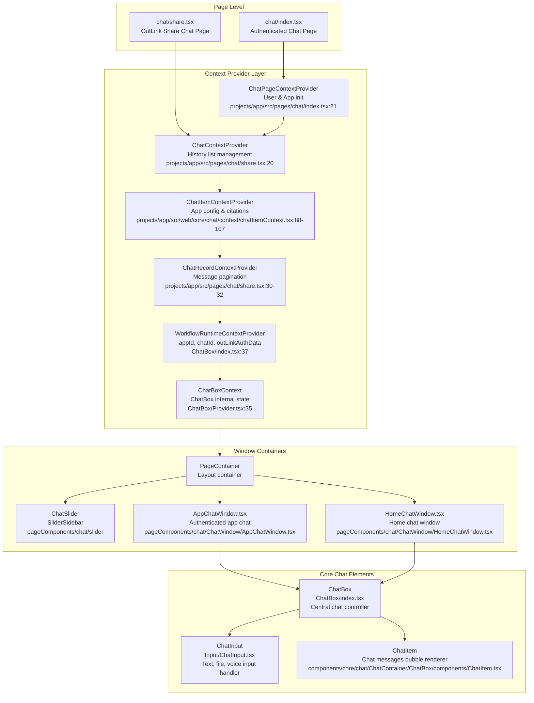
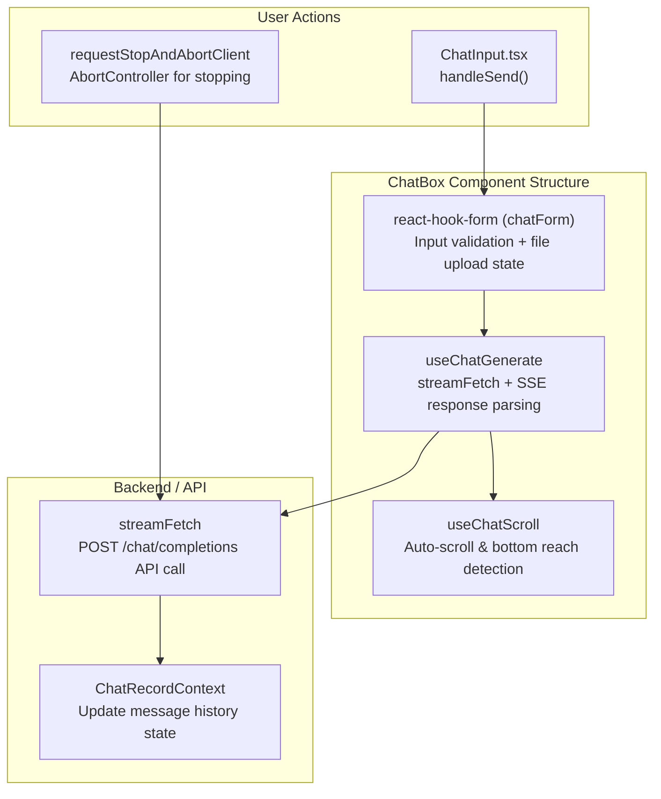

<!-- source: DeepWiki mcp.deepwiki.com · repo labring/FastGPT · page 8.1 Chat Components Architecture · fetched 2026-10-29 -->

# Chat Components Architecture

Relevant source files

The following files were used as context for generating this wiki page:

- [.agents/design/core/chat/input-draft-cache.md](.agents/design/core/chat/input-draft-cache.md)
- [packages/global/common/string/url.ts](packages/global/common/string/url.ts)
- [packages/global/test/common/string/url.test.ts](packages/global/test/common/string/url.test.ts)
- [packages/web/components/common/Markdown/index.tsx](packages/web/components/common/Markdown/index.tsx)
- [packages/web/hooks/useScrollPagination.tsx](packages/web/hooks/useScrollPagination.tsx)
- [packages/web/i18n/en/chat.json](packages/web/i18n/en/chat.json)
- [packages/web/i18n/ko-KR/chat.json](packages/web/i18n/ko-KR/chat.json)
- [packages/web/i18n/zh-CN/chat.json](packages/web/i18n/zh-CN/chat.json)
- [packages/web/i18n/zh-Hant/chat.json](packages/web/i18n/zh-Hant/chat.json)
- [projects/app/src/components/Markdown/index.module.scss](projects/app/src/components/Markdown/index.module.scss)
- [projects/app/src/components/Markdown/index.tsx](projects/app/src/components/Markdown/index.tsx)
- [projects/app/src/components/core/chat/ChatContainer/ChatBox/Input/ChatInput.tsx](projects/app/src/components/core/chat/ChatContainer/ChatBox/Input/ChatInput.tsx)
- [projects/app/src/components/core/chat/ChatContainer/ChatBox/hooks/useChatGenerate.ts](projects/app/src/components/core/chat/ChatContainer/ChatBox/hooks/useChatGenerate.ts)
- [projects/app/src/components/core/chat/ChatContainer/ChatBox/hooks/useChatInputForm.ts](projects/app/src/components/core/chat/ChatContainer/ChatBox/hooks/useChatInputForm.ts)
- [projects/app/src/components/core/chat/ChatContainer/ChatBox/index.tsx](projects/app/src/components/core/chat/ChatContainer/ChatBox/index.tsx)
- [projects/app/src/components/core/chat/ChatContainer/ChatBox/type.ts](projects/app/src/components/core/chat/ChatContainer/ChatBox/type.ts)
- [projects/app/src/pageComponents/chat/ChatHeader.tsx](projects/app/src/pageComponents/chat/ChatHeader.tsx)
- [projects/app/src/pageComponents/chat/ChatTeamApp/List.tsx](projects/app/src/pageComponents/chat/ChatTeamApp/List.tsx)
- [projects/app/src/pageComponents/chat/ChatWindow/AppChatWindow.tsx](projects/app/src/pageComponents/chat/ChatWindow/AppChatWindow.tsx)
- [projects/app/src/pageComponents/chat/ChatWindow/HomeChatWindow.tsx](projects/app/src/pageComponents/chat/ChatWindow/HomeChatWindow.tsx)
- [projects/app/src/pageComponents/chat/slider/ChatSliderList.tsx](projects/app/src/pageComponents/chat/slider/ChatSliderList.tsx)
- [projects/app/src/pages/chat/index.tsx](projects/app/src/pages/chat/index.tsx)
- [projects/app/src/pages/chat/share.tsx](projects/app/src/pages/chat/share.tsx)
- [projects/app/src/web/core/chat/context/chatContext.tsx](projects/app/src/web/core/chat/context/chatContext.tsx)
- [projects/app/src/web/core/chat/context/chatPageContext.tsx](projects/app/src/web/core/chat/context/chatPageContext.tsx)
- [projects/app/test/components/Markdown/A.test.ts](projects/app/test/components/Markdown/A.test.ts)
- [projects/app/test/components/Markdown/rehypeImageCitations.test.ts](projects/app/test/components/Markdown/rehypeImageCitations.test.ts)
- [projects/app/test/components/Markdown/rehypeStreamAnimated.test.ts](projects/app/test/components/Markdown/rehypeStreamAnimated.test.ts)

This document describes the component architecture of FastGPT's chat interface, including the component hierarchy, context provider system, message rendering pipeline, and input/output handling.

---

## Purpose and Scope

The chat interface is built using React and Chakra UI and features a multi-layered context provider architecture. It supports various chat modes including authenticated, shared (OutLink), team, and home chats. Input mechanisms include:

- Text input with rich variable support.
- File attachments with upload management.
- Voice input with whisper integration.
- Interactive workflow-driven prompts.

The message rendering pipeline supports incremental Markdown streaming, citation links, and interactive workflow responses.

Key areas covered:

- Component hierarchy from the page container down to individual chat bubbles.
- Context provider architecture and state management (`ChatContextProvider`, `ChatItemContext`, `ChatRecordContext`, etc.).
- The `ChatBox` controller component and its orchestration of message dispatch and streaming.
- Chat input handling and file upload coordination via `ChatInput`.
- Message bubbles rendering with Markdown and citation support.

Sources:  
`[projects/app/src/components/core/chat/ChatContainer/ChatBox/index.tsx:1-172]`  
`[projects/app/src/components/core/chat/ChatContainer/ChatBox/Input/ChatInput.tsx:1-179]`  
`[projects/app/src/components/Markdown/index.tsx:1-206]`

---

## Component Hierarchy Overview

The chat system is hierarchically structured with nested context providers to supply session state, authorization, app configuration, and chat records through to UI containers and message bubbles.

### Diagram: Chat Component Hierarchy and Code Entity Mapping

Sources:  
`[projects/app/src/pages/chat/index.tsx:1-182]`  
`[projects/app/src/pages/chat/share.tsx:1-158]`  
`[projects/app/src/components/core/chat/ChatContainer/ChatBox/index.tsx:1-172]`  
`[projects/app/src/web/core/chat/context/chatItemContext.tsx:88-107]`

---

## Context Provider Architecture

FastGPT uses multiple specialized contexts to separate concerns and optimize re-rendering with `use-context-selector`.

| Context Provider        | Purpose                                | Key State/Handlers                                    | Location                                                    |
|------------------------|--------------------------------------|------------------------------------------------------|-------------------------------------------------------------|
| **ChatPageContext**     | Page-level pane switching, user info | `pane`, `userInfo`, `handlePaneChange`               | `projects/app/src/pages/chat/index.tsx:21`                  |
| **ChatContext**         | Manages chat history lists, nav       | `histories`, `onChangeChatId`, `forbidLoadChat`      | `projects/app/src/pages/chat/share.tsx:20`                  |
| **ChatItemContext**     | App config, citations, variables      | `chatBoxData`, `variablesForm`, `datasetCiteData`    | `projects/app/src/web/core/chat/context/chatItemContext.tsx:88-107` |
| **ChatRecordContext**   | Message history records & pagination  | `chatRecords`, `isChatRecordsLoaded`                  | `projects/app/src/pages/chat/share.tsx:30-32`                |
| **WorkflowRuntimeContext** | Runtime identifiers and auth          | `appId`, `chatId`, `outLinkAuthData`, `sourceTarget` | `projects/app/src/components/core/chat/ChatContainer/ChatBox/index.tsx:37`  |
| **ChatBoxContext**      | Runtime features inside ChatBox       | `isChatting`, `chatType`, `fileSelectConfig`          | `projects/app/src/components/core/chat/ChatContainer/ChatBox/Provider.tsx:35`  |

Each context delivers scoped state relevant for the chat UI layer it governs and enables granular state updates impacting only affected consumers.

Sources:  
`[projects/app/src/pages/chat/index.tsx:21-21]`  
`[projects/app/src/pages/chat/share.tsx:20-32]`  
`[projects/app/src/web/core/chat/context/chatItemContext.tsx:88-107]`  
`[projects/app/src/components/core/chat/ChatContainer/ChatBox/index.tsx:36-36]`

---

## ChatBox Component Architecture

`ChatBox` (`projects/app/src/components/core/chat/ChatContainer/ChatBox/index.tsx`) is the core orchestrator managing message dispatch, SSE streaming message reception, stopping and aborting generation, and interactive workflow-based prompt handling.

It integrates hooks and subcomponents for composing and controlling chat input, rendering messages, and syncing scroll positions.

### Key Responsibilities

- Manages `react-hook-form` for chat input validation and management.
- Controls SSE streaming lifecycle for chat response using `useChatGenerate`.
- Coordinates scrolling behavior and view sync with `useChatScroll`.
- Provides UI features toggled by props via `ChatBoxFeatures`.
- Emits events upward for reading state, generation status, and refresh triggering.

### Diagram: ChatBox Controller and Stream Processing Flow

Sources:  
`[projects/app/src/components/core/chat/ChatContainer/ChatBox/index.tsx:1-172]`  
`[projects/app/src/components/core/chat/ChatContainer/ChatBox/Input/ChatInput.tsx:1-179]`

---

## ChatInput Component

The `ChatInput` component (`projects/app/src/components/core/chat/ChatContainer/ChatBox/Input/ChatInput.tsx`) manages user input including:

- Textarea input with `react-hook-form` for controlled form state.
- File upload integration and validation using `useFileUpload`.
- Voice input using the `VoiceInput` component (hooking into Whipser config).
- Input guidance and variable expansion support.
- Send button enabled/disabled states based on input or ongoing upload.
- Stop generation operation proxy.

It observes runtime attributes such as:

- Whether input guide can be shown (`enableInputGuide`).
- Whether voice input is enabled (`enableVoiceInput`).
- Upload configuration from the app's file selection config.
- Last interactive workflow input to support context-aware responses.

Sources:  
`[projects/app/src/components/core/chat/ChatContainer/ChatBox/Input/ChatInput.tsx:1-179]`

---

## Message Bubbles and Markdown Rendering

Chat messages are rendered as individual bubbles by `ChatItem` components. There are separate bubbles for human inputs and AI responses. AI responses may contain multiple segments such as:

- Reasoning or thought process.
- Plain text with rich Markdown formatting.
- Tool call results.
- Interactive workflow forms or prompts.

### Markdown Rendering Pipeline

Messages utilize the centralized `Markdown` component (`projects/app/src/components/Markdown/index.tsx`) to parse and render the response content with the following features:

- Safe rendering of very long content by fallback to plain text.
- Incremental streaming rendering with block-level isolation for smooth typing animation.
- Context-based runtime parameters for citations, popover controls, sandbox referencing.
- Support for math (KaTeX), code blocks, images, and custom extensions.
- Citation elements link to knowledge base snippets/sources with popovers.

The Markdown system keeps streaming animation smooth and isolates completed blocks to optimize React rendering.

Sources:  
`[projects/app/src/components/core/chat/ChatContainer/ChatBox/components/ChatItem.tsx:56-65]`  
`[projects/app/src/components/Markdown/index.tsx:1-206]`

---

## Variable Input and Chat Initialization

Before starting chat or when apps expose dynamic variables, `ChatBox` renders initialization inputs:

- Variables are managed via `variablesForm` in `ChatItemContext`, allowing forms tied to workflow variables.
- File uploads are handled within `ChatInput` with validation conforming to `fileSelectConfig`.
- Uploads are chunked or direct, coordinated with state hooks in `useFileUpload` to ensure readiness before sending messages.

This integration ensures complex workflows can be properly initiated with correct inputs, and uploaded files can be referenced in later message generation.

Sources:  
`[projects/app/src/web/core/chat/context/chatItemContext.tsx:168-201]`  
`[projects/app/src/components/core/chat/ChatContainer/ChatBox/Input/ChatInput.tsx:128-134]`

---

# Summary

FastGPT's chat components are carefully architected with a layered React context model and modular UI components:

- `ChatBox` acts as the central runtime bridge handling input, streaming generation, and message state synchronization.
- `ChatInput` manages rich input modes with files and voice.
- Messages render with a Markdown pipeline optimized for streamed incremental updates and rich citations.
- Context providers scope state finely to enable efficient updates and flexible UI composition.
  
This architecture supports multiple chat modes and delivers a responsive, extensible user chat experience in FastGPT.

Sources:  
`[projects/app/src/components/core/chat/ChatContainer/ChatBox/index.tsx:1-172]`  
`[projects/app/src/components/core/chat/ChatContainer/ChatBox/Input/ChatInput.tsx:1-179]`  
`[projects/app/src/components/Markdown/index.tsx:1-206]`  
`[projects/app/src/pages/chat/index.tsx:1-182]`  
`[projects/app/src/pages/chat/share.tsx:1-158]`  
`[projects/app/src/web/core/chat/context/chatItemContext.tsx:88-107,168-201]`

---

